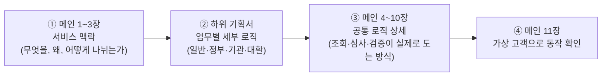
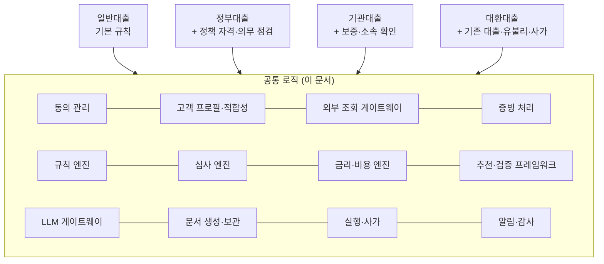
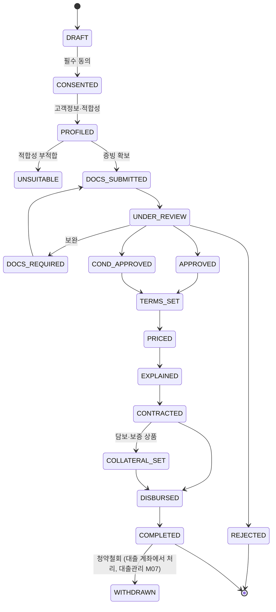
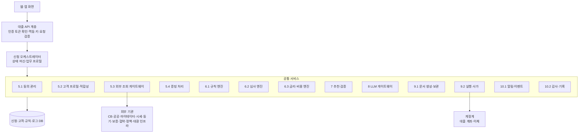
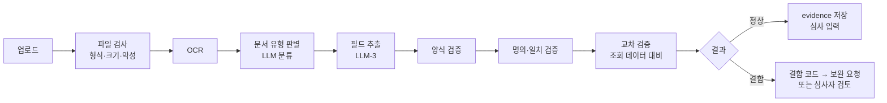
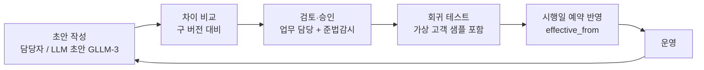
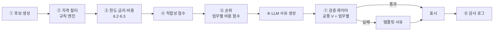
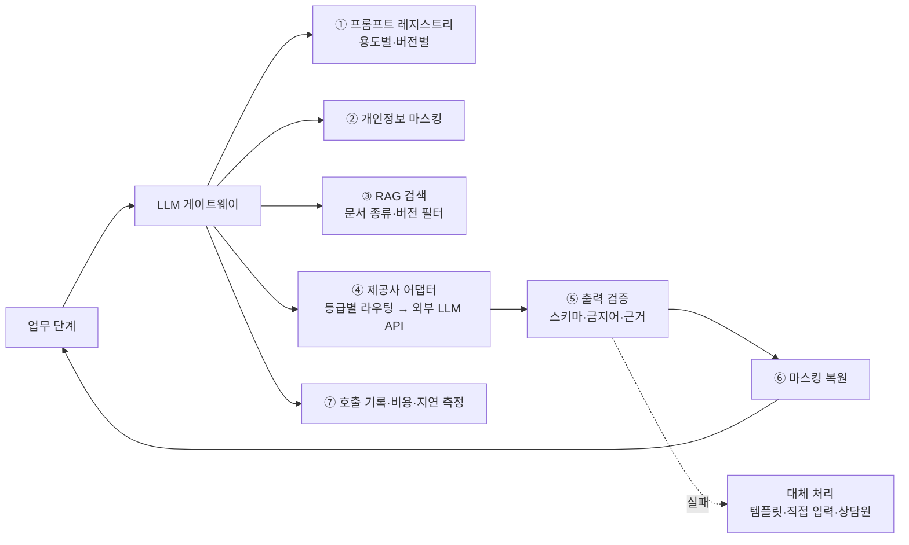

# 대출 업무 종합 기획서 (메인)

| 항목 | 내용 |
|---|---|
| 문서 | 은행 웹서비스 대출 업무 종합 기획서: 서비스 맥락과 공통 로직 |
| 버전 | v0.3 (공유 검토본) |
| 표기 원칙 | 은행명은 'OO은행'(본문에서는 '당행')으로 씁니다. 본문에 나오는 실제 기관·제도·회사 이름(신용평가회사, 보증기관, 시세 제공처, 정책자금 상품명 등)은 업무를 설명하기 위한 공개 정보 기준 예시이며 제휴·승인 관계를 뜻하지 않습니다. 금리·한도·기준값은 모두 예시이고, 법령·약관 내용은 요약이므로 실제 적용 전 법무·준법감시 확인이 필요합니다. |
| 작성일 | 2026-11-04 |
| 하위 문서 | [일반대출](Loan_Service/일반대출_기획서.md) · [정부대출](Loan_Service/정부대출_기획서.md) · [기관대출](Loan_Service/기관대출_기획서.md) · [대환대출](Refinancing_Service/대환대출_기획서.md) · [대출관리(사후)](대출관리_기획서.md) |
| 테스트 자료 | [Customer_Submission_Documents](Customer_Submission_Documents/README.md) (가상 고객 4명, PDF 100개, 판정 정답표) |
| 체험 프로토타입 | [대출서비스_프로토타입.html](Prototype/대출서비스_프로토타입.html) — 모바일 웹 화면으로 네 업무와 대출관리의 흐름을 직접 눌러 보는 데모 (브라우저에서 파일을 열면 됨. 기본은 한 화면 전환, PC에서는 분할 보기로 바꿀 수 있음, 3.6). 화면·값·문구 명세: [프로토타입_구현명세.md](Prototype/프로토타입_구현명세.md) |
| 서류 양식 | `Loan_Service/Contract Document/` (LN-01~28), `Refinancing_Service/Contract Document/` (RF-01~19) |

---

## 이 문서를 읽는 방법



1. **맥락 (1~3장)**: 대출 서비스가 어떤 업무로 나뉘고, 업무끼리 무엇을 함께 쓰는지 봅니다.
2. **세부 기획 (하위 문서)**: 업무마다 다른 화면, 입력 항목, 자격 기준, 고유 검증을 봅니다.
3. **공통 로직 (4~10장)**: 하위 문서에서 "일반대출과 동일", "main 문서 참고"라고 적은 부분, 즉 업무가 진행되다가 조회·심사·검증이 필요할 때 부르는 공통 모듈이 어떻게 구성되고 동작하는지 봅니다.
4. **동작 확인 (11장)**: 가상 고객 4명의 서류가 공통 로직을 거치며 어떤 판정을 받는지 따라가 봅니다.

> **범위**: 대출 업무만 다룹니다. 로그인, 본인인증, 실명확인, 계좌개설은 웹서비스 공통 플랫폼 기능이라 이 문서에서는 **호출 인터페이스만** 적습니다(4.3).

---

## 1. 서비스 맥락

### 1.1 목적
고객이 웹·앱에서 대출을 신청해 실행까지 마치는 과정을, 상품 종류가 달라도 **하나의 공통 처리 체계** 위에서 운영합니다. 업무마다 다른 부분은 각 업무의 규칙과 확장 단계로만 분리합니다.

### 1.2 네 가지 업무
| 업무 | 한 줄 정의 | 다른 업무와 가장 크게 다른 점 | 하위 문서 구간 코드 |
|---|---|---|---|
| 일반대출 | 은행 자체 상품 (신용, 전월세, 부동산담보, 자동차, 예금담보) | 기준 업무. 공통 로직을 가장 기본 형태로 씀 | S01~S14 |
| 정부대출 | 정책자금 대출 (주택 구입, 전세, 서민금융 등) | 공고 기준 **정책 자격 검증**, 세대·배우자 확인, 실행 후 **의무 점검** | G01~G15 |
| 기관대출 | 보증기관 보증부(A) · 협약기관 소속 직원(B) 대출 | **보증 신청·발급**, 소속·재직 확인, 보증료를 포함한 **실질 비용** | I01~I16 |
| 대환대출 | 기존 대출을 새 대출로 갈아타기 (일반·정부·기관 대환 포함) | 마이데이터 **기존 대출 조회**, **유불리 판단**, 새 대출 실행과 기존 대출 상환을 묶은 **사가 처리** | R01~R18 |

실행이 끝난 대출은 네 업무 모두 **[대출관리(사후) 기획서](대출관리_기획서.md)**(M01~M12: 조회, 납입, 연체, 금리 변경, 중도상환, 금리인하요구, 청약철회, 기간연장, 자동이체 변경, 증명서, 완제, 업무별 사후 관리)로 넘어갑니다.

### 1.3 공통과 고유의 경계



| 구분 | 공통 로직이 맡는 것 | 업무별 문서가 맡는 것 |
|---|---|---|
| 흐름 | 신청 수명주기, 상태 전이, 유효기간, 이어하기 | 업무 고유 단계 (정책 자격 검증, 보증 신청, 기존 대출 조회 등) |
| 데이터 | 외부 조회 방식, 데이터 신선도, 출처 기록, 마스킹 | 업무별로 필요한 조회 항목 |
| 판단 | 규칙 실행 방식, 사유 코드, 버전 관리 | 규칙의 **내용** (정책 기준값, 보증 기준, 대환 자격) |
| 계산 | DSR·한도·금리·상환 스케줄의 공통 계산식 | 계산식의 업무별 변형 (대환 DSR, 정책 금리표, 보증료) |
| 추천 | 8단계 추천 흐름, 공통 검증 V1~V9, 대체 처리 | 업무별 비용 함수와 추가 검증 (GV, IV, RV) |
| LLM | 호출 방식, 안전장치, 기록, 평가 | 업무별 LLM 용도 (공고 질의응답, 대출 정규화 등) |

### 1.4 설계 원칙 (네 업무 공통)
1. **결정은 규칙 엔진, 설명은 LLM**: 승인, 한도, 금리, 순위는 결정적 계산만 씁니다. LLM 출력은 항상 검증을 거칩니다.
2. **동의 없이 조회하지 않음**: 모든 외부 조회는 동의 확인을 통과해야 호출됩니다(5.1 동의 게이트).
3. **고객 이익 우선 추천**: 순위는 고객 비용 기준이며, 은행 수익성은 넣지 않습니다.
4. **규칙은 코드가 아니라 데이터**: 규제값, 정책 기준, 보증 기준은 버전 관리되는 테이블에 두고, 승인 후 시행일에 반영합니다.
5. **재현 가능**: 같은 입력과 같은 규칙 버전이면 같은 결과가 나와야 하며, 모든 판단의 근거를 기록합니다.
6. **실패해도 안전하게**: 외부 연동이나 LLM이 실패하면 진행을 멈추거나 정해진 대체 경로로 갑니다. 추측으로 채우지 않습니다.

---

## 2. 공통 처리 흐름

### 2.1 공통 단계와 업무별 구간 대응
네 업무는 같은 14개 공통 단계(C01~C14)를 지나고, 업무마다 확장 단계를 끼워 넣습니다.

| 공통 단계 | 이름 | 일반 | 정부 | 기관 | 대환 |
|---|---|---|---|---|---|
| C01 | 상품 선택·신청서 생성 | S01 | G01 (+자격 사전 확인) | I01 (+협약기관 선택) | R01 |
| C02 | 동의 | S02 | G02 (+행정정보·배우자) | I02 (+보증·협약기관) | R02 (+마이데이터) |
| C02x | 업무 고유 사전 조회 | - | - | - | **R03 기존 대출 조회, R04 대상 선택** |
| C03 | 고객정보·적합성 | S03 | G03 (+세대 정보) | I03 | R05 |
| C04 | 증빙·자격 확인 | S04 | **G04 정책 자격**, G05 | **I04-A 보증 대상 / I04-B 소속**, I05 | R06 |
| C05 | 심사 | S05 | G06 (+정책기관) | I06, **I07 보증 심사** | R07 |
| C06 | 결과 처리·추천·검증 | S06 | G07 | I08 | R08, **R09 유불리** |
| C07 | 조건 설정 | S07 | G08 | I09 | R10 |
| C08 | 금액·금리 확정 | S08 | G09 | I10 (+보증료) | R11 |
| C09 | 설명의무 이행 | S09 | G10 (+의무사항) | I11 (+보증 약관) | R12 |
| C10 | 약정 | S10 | G11 | I12 | R13 |
| C11 | 담보·보증 설정 | S11 | G12 | **I13 보증서 발급** | R14 (말소·이전) |
| C12 | 실행·지급 | S12 | G13 (+정책기관 보고) | I14 | R15 **사가 실행** |
| C12x | 업무 고유 실행 후 처리 | - | - | - | **R16 완제 확인** |
| C13 | 결과 통보·서류 교부 | S13 | G14 | I15 | R17 |
| C14 | 종료·사후 관리 연결 → [대출관리](대출관리_기획서.md) M01~M12 | S14 | **G15 의무 점검** | **I16 보증·협약 관리** | R18 |

### 2.2 오케스트레이터 동작
각 신청서는 **오케스트레이터**가 관리합니다. 오케스트레이터는 업무 프로필(2.3)을 읽어 다음 단계를 정하고, 단계마다 필요한 공통 모듈을 부릅니다.

```
on 단계 요청(application_id, step):
    app = 신청서 로드
    profile = 업무 프로필[app.business_type]        # GENERAL / POLICY / INSTITUTIONAL / REFI
    assert step ∈ profile.allowed_next(app.status)   # 상태 전이 검증 (3장)
    assert 필요 동의 ∈ app.consents                    # 동의 게이트 (5.1)
    for hook in profile.hooks[step]:                  # 업무 고유 처리 (하위 문서)
        hook.run(app)
    result = 공통 모듈 호출(step)                       # 4~10장
    app.status = profile.next_status(step, result)
    감사 로그 기록(app, step, result)                    # 10.2
    이벤트 발행(app.status)                             # 알림·비동기 (10.1)
```

### 2.3 업무 프로필 (Business Profile)
업무 프로필은 "이 업무는 공통 흐름에 무엇을 더하고 무엇을 바꾸는가"를 데이터로 적은 설정입니다. **새 상품이나 새 업무를 추가할 때 공통 코드를 고치지 않고 프로필만 추가**하는 것이 목표입니다.

| 프로필 항목 | 일반 | 정부 | 기관 | 대환 |
|---|---|---|---|---|
| 추가 동의 코드 | - | `ADMIN_INFO`, `SPOUSE_INQUIRY`, `AGENCY_PROVIDE`, `POST_CHECK` | `GUARANTOR_PROVIDE`, `ORG_EMPLOYMENT` | `MYDATA_TRANSFER`, `PAYOFF_PROVIDE` |
| 고유 단계 훅 | - | `policy_check`(C04), `agency_review`(C05), `agency_report`(C12), `obligation_register`(C14) | `guarantee_precheck` / `affiliation_check`(C04), `guarantee_request`(C05), `guarantee_issue`(C11) | `fetch_existing_loans`·`select_targets`(C02x), `refi_benefit`(C06), `refi_saga`(C12), `payoff_confirm`(C12x) |
| 규칙 세트 | `product_catalog`, `reg_param` | + `policy_rule` | + `guarantee_rule`, `agreement_org` | + `REFI-ELIG`, `reg_param.refi_dsr_rule` |
| DSR 변형 | 기본 | 정책 예외 상품 적용 | 기본 (보증 예정 금액 반영) | 대환 대상 상환분 제외 |
| 금리 방식 | 은행 금리 체계 | 정책 금리표 | 보증 반영 금리 / 협약 금리표 | 상품별 (대환 대상 유형 따름) |
| 비용 함수 (추천 순위) | 총 이자 | 총 이자 + 제약 감점 | 실질 비용 (이자 + 보증료 + 부대비용) | 순 절감액 |
| 추가 검증 | V1~V9 | + GV1~GV5 | + IV1~IV6 | + RV1~RV6 |
| 추가 상태 코드 | - | `POLICY_*`, `AGENCY_REVIEW`, `OBLIGATION_*` | `AFFILIATION_*`, `GUARANTEE_*` | `LOANS_FETCHED` ~ `REFI_FAILED` |
| 서류 양식 | LN-01~18 | LN + LN-19~21 (정책 전용) | LN + LN-14, LN-22~24 (협약 전용) | RF-01~19 |

---

## 3. 공통 신청 수명주기 (상태 머신)

### 3.1 공통 상태

- 모든 상태에서 `CANCELLED`(고객 취소), 유효기간이 있는 상태에서 `EXPIRED`로 갈 수 있습니다.
- 업무별 추가 상태(2.3 표)는 공통 상태 사이에 **끼워 넣는 방식**입니다. 예: 정부대출은 `PROFILED → POLICY_CHECKING → DOCS_SUBMITTED`, 대환은 `CONSENTED → LOANS_FETCHED → TARGET_SELECTED → PROFILED`.

### 3.2 공통 유효기간 규칙
| 대상 | 기본값 (설정) | 경과 시 |
|---|---|---|
| 작성 중 신청서 (`DRAFT`~`DOCS_SUBMITTED`) | 7일 | `EXPIRED` |
| 서류 보완 요청 | 14일 | `EXPIRED` |
| 심사 결과 (한도·금리) | 30일 | 재심사 |
| 금리 확정 | 당일 영업 마감 (기준금리 변경 시 재산출) | `TERMS_SET`로 복귀 |
| 배우자 동의 요청 (정부) | 7일 | `EXPIRED` |
| 기존 대출 조회 데이터 (대환) | 24시간 | 재조회 |

### 3.3 이어하기와 중복 방지
- 같은 고객, 같은 업무·상품 유형으로 진행 중인 신청서가 있으면 "이어하기 / 새로 시작"을 고르게 합니다.
- 새로 시작하면 기존 신청서는 `CANCELLED`로 닫고, 이미 받은 동의는 문서 버전이 같을 때만 재사용합니다.

### 3.4 대출·대환 불가 화면의 하단 버튼 규칙 (공통 화면 규칙)
더 진행할 수 없는 판정이 나온 화면에서는 하단 버튼을 **비활성화하지 않습니다.** 고객이 막힌 화면에 머무르지 않도록, 「다음」 버튼을 **「처음으로」** 버튼으로 바꿔 메인 화면(상품 목록)으로 돌아가게 합니다.

| 업무 | 구간 | 불가 판정 | 하단 버튼 | 함께 보여 주는 것 |
|---|---|---|---|---|
| 공통 | C06 심사 결과 | `REJECTED` (거절) | 처음으로 | 거절 사유 코드, 근거 신용정보 제공 기관, 제휴사 안내 |
| 공통 | C06 심사 결과 | `DOCS_REQUIRED` (보완) | 서류 다시 제출 (불가가 아니므로 예외) | 보완할 서류와 결함 코드 |
| 정부 | G01 자격 사전 확인 | 정책 자격 미충족 | 처음으로 | 미충족 사유, 「일반대출로 전환」 버튼 |
| 정부 | G04 정책 자격 검증 | `POLICY_INELIGIBLE` | 처음으로 | 미충족 사유, 「일반대출로 전환」 버튼 |
| 기관(A) | I04-A·I07 보증 | 모든 보증기관 보증 불가 | 처음으로 | 보증 불가 사유 |
| 기관(B) | I04-B 소속 확인 | `AFFILIATION_FAILED` | 처음으로 | 사유, 「일반 신용대출로 전환」 버튼 |
| 대환 | R04 대환 대상 | 대환 가능한 대출 0건 | 처음으로 | 대출별 `REFI-*` 사유, 금리인하요구권 안내 |
| 대환 | R09 유불리 비교 | `TRADE_OFF`·`NOT_BENEFICIAL`이고 불리 고지 미확인 | 처음으로 → 고지 확인 체크 시 「대환 진행」 | 비교표, 순 절감액, 불리 고지 체크박스 |

- 아직 입력이 끝나지 않아서 진행할 수 없는 경우(필수 동의 미체크, 이해 확인 문제 미완료 등)는 "불가"가 아니므로 지금처럼 「다음」을 비활성화합니다.
- 「처음으로」로 돌아가도 신청서는 종료 상태(`REJECTED`, `POLICY_INELIGIBLE` 등)로 기록되며, 같은 상품을 다시 신청하면 새 신청서로 시작합니다.

### 3.5 상품 카드와 희망 금액 입력 화면 규칙 (공통 화면 규칙)
| 화면 | 규칙 |
|---|---|
| 상품 카드·상품 상세 (C01) | "최대 N원" 바로 옆에 **대출 기간 최소 ~ 최대**를 표시 (예: 최대 1억원 \| 기간 1년 ~ 5년, 허용 기간이 하나면 "기간 2년") |
| 상품 진입 (C01) | 카드 클릭, 카드의 「대출신청」·「갈아타기 신청」 버튼, 배너 클릭 모두 **상품 상세(상품 정보)를 먼저** 보여 주고, 상세의 신청 버튼을 눌러야 동의(C02)로 들어감. 대출·대환 동일 |
| 희망 금액 입력 (C03) | 라벨에 "(최대 N원)" 표시. 상품 최대 한도를 넘으면 **"한도금액을 초과하였습니다."** 알림 + 입력란 아래 빨간 안내 + 「다음」 비활성화. 한도 이내로 고치면 해제 |
| 적용 범위 | 일반·정부·기관대출. 대환대출은 금액이 자동 설정되어 한도 초과 검사를 하지 않고, 카드의 기간 표시만 적용 |

- 상품 최대 한도는 입력 검증용입니다. 고객별 승인 한도는 심사(C05)에서 정하고, 승인 한도 < 희망 금액이면 조건부 승인(감액)입니다.

### 3.6 화면 보기 방식: 한 화면 전환과 분할 보기 (공통 화면 규칙)
메인 화면(배너·탭·상품 목록·대출관리)과 하위 화면(상품 상세·신청 단계)을 보여 주는 방식은 두 가지입니다. **휴대폰에서 쓰는 것이 기본**이라 기본값은 한 화면 전환입니다.

| 방식 | 화면 | 동작 |
|---|---|---|
| **한 화면 전환 (모바일 보기, 기본)** | 한 칸(폭 최대 440px)만 보임 | 메인에서 상품을 누르면 같은 자리가 상품 상세로 **전환**되고, 신청 단계도 같은 자리에서 이어집니다. 뒤로 아이콘·「이전」·「처음으로」·집 아이콘으로 메인에 돌아오면 메인이 다시 보이고 화면 맨 위로 이동합니다 |
| 분할 보기 (PC에서 선택) | 왼쪽 메인 + 오른쪽 하위 화면 | 메인은 왼쪽에 그대로 있고 하위 화면만 오른쪽에 열립니다(왼쪽 목록에 선택한 상품 표시) |

| 규칙 | 내용 |
|---|---|
| 전환 버튼 | 화면 폭 900px 이상일 때 오른쪽 위에 「📱 모바일 보기」/「🖥 분할 보기」 전환 버튼을 띄웁니다. 고른 방식은 그 브라우저에 기억합니다(다시 열어도 유지) |
| 폭 900px 미만 (휴대폰·좁은 창) | 고른 방식과 관계없이 **항상 한 화면 전환**으로 보여 주고, 전환 버튼은 숨깁니다 |
| 메뉴(≡) 창 | 상단바의 ≡를 누르면 "대출 서비스" 메뉴 창(대출 / 대환 / 대출관리)이 **메인 화면과 같은 자리·같은 폭**으로 겹쳐 열립니다(화면 오른쪽 끝에 따로 뜨지 않음). 지금 보고 있는 탭에는 "현재 화면" 표시. 항목을 누르면 메뉴가 닫히고 **같은 자리**에 그 탭의 메인 화면(대출·대환 상품 목록 또는 대출관리)이 열리며 맨 위로 이동합니다. 상세·신청 중에 메뉴를 열어도 그 자리에 열리고, 항목을 고르면 신청 화면을 나가 해당 메인 화면으로 갑니다. 닫기(X)를 누르면 보던 화면 그대로 돌아옵니다 |
| 화면 상태 유지 | 어느 방식이든 신청 중인 단계·입력값은 그대로 유지됩니다. 보기 방식을 바꿔도 처음부터 다시 하지 않습니다 |
| 적용 범위 | 대출·대환 신청 흐름, 상품 상세, 대출관리 탭, 메뉴(≡) 창 전체 (네 업무 공통) |
| 분할 보기에서 메뉴 | 메뉴는 ≡를 누른 칸(왼쪽 메인 칸 또는 오른쪽 하위 칸) 위에 열리고, 항목을 고르면 메인 화면은 왼쪽 칸에 보입니다 |

---

## 4. 공통 로직 구성 (모듈 지도)

### 4.1 계층 구조


### 4.2 모듈 호출 매트릭스 (어느 업무의 어느 단계가 무엇을 부르는가)
| 공통 모듈 | 일반 | 정부 | 기관 | 대환 |
|---|---|---|---|---|
| 5.1 동의 관리 | S02 | G02 | I02 | R02 |
| 5.2 고객 프로필·적합성 | S03 | G03 | I03 | R05 |
| 5.3 외부 조회 게이트웨이 | S04, S05, S12 | G04, G06, G13, G15 | I04-A/B, I06, I07, I13, I14 | R03, R07, R15, R16 |
| 5.4 증빙 처리 | S04 | G05 | I05 | R06 |
| 6.1 규칙 엔진 | S03, S05, S08 | G01, G04 | I04-A, I04-B | R04, R09 |
| 6.2 심사 엔진 | S05 | G06 | I06 | R07 |
| 6.3 금리·비용 엔진 | S06, S07, S08 | G07, G09 | I08, I10 | R09, R10, R11 |
| 7 추천·검증 | S06 | G07 | I08 | R09 |
| 8 LLM 게이트웨이 | LLM-1~8 | GLLM-1~4 | ILLM-1~4 | RLLM-1~3 |
| 9.1 문서 생성·보관 | S02, S08~S10, S13 | 같음 + 의무사항 확인서 | 같음 + 보증 특약 | R02, R09, R11~R13, R17 |
| 9.2 실행·사가 | S11~S12 | G12~G13 | I13~I14 | R14~R16 |
| 10.1 알림·이벤트 | 전 구간 | 전 구간 + 의무 점검 알림 | 전 구간 + 보증 결과 | 전 구간 + 사가 진행 |
| 10.2 감사·기록 | 전 구간 | 전 구간 | 전 구간 | 전 구간 |

### 4.3 공통 플랫폼 의존 (이 문서 범위 밖, 인터페이스만)
| 기능 | 대출 업무에서 쓰는 곳 | 인터페이스 |
|---|---|---|
| 로그인·세션 | 모든 API | 요청마다 고객 ID와 인증 수준이 담긴 토큰 |
| 본인인증 (재인증) | 동의(C02), 약정(C10), 실행(C12) | `verify(customer_id, purpose) → auth_ref` (결과 참조값만 저장) |
| 전자서명 | 약정(C10), 배우자 동의(G02) | `sign(document_hash, auth_ref) → signature_ref` |
| 계좌 실명 확인 | 자동이체 계좌(C07), 지급 계좌(C12) | `verify_account(bank, account, name) → match` |

---

## 5. 공통 로직 상세 ① — 고객·데이터 확보

### 5.1 동의 관리 (Consent Service)

**역할**: 모든 업무의 동의를 한곳에서 기록하고, 조회 직전에 "이 조회에 필요한 동의가 있는가"를 확인합니다.

**동의 코드 카탈로그**
| 동의 코드 | 내용 | 필수 업무 | 서류 |
|---|---|---|---|
| `TERMS_BASIC` | 여신거래기본약관 | 전체 | LN-01, RF-01 |
| `COLLECT_USE`, `UNIQUE_ID` | 개인(신용)정보 수집·이용, 고유식별정보 | 전체 | LN-02, RF-02 |
| `CREDIT_INQUIRY` | 신용정보 조회 | 전체 | LN-02, RF-02 |
| `PROVIDE_3RD` | 신용정보원·보증기관·법무사 제공 | 전체 | LN-02, RF-02 |
| `PUBLIC_SCRAPING` | 공공기관 소득·재직 자동 연동 | 선택 (서류 대체 가능) | C02 화면에서 동의 (안내 양식 LN-04·RF-06, 증빙 단계에서 다시 요청 가능) |
| `ADMIN_INFO` | 행정정보 공동이용 (주민등록, 주택 소유 등) | 정부 | LN-19 |
| `SPOUSE_INQUIRY` | 배우자·세대원 정보 조회 (**배우자 본인 동의**) | 정부 | LN-20 |
| `AGENCY_PROVIDE` | 정책기관 정보 제공 (정책 심사·중복 확인·실행 보고) | 정부 | LN-19 (G02) |
| `POST_CHECK` | 실행 후 의무 점검 정보 확인 | 정부 | LN-19 (G02) · LN-21 의무사항 확인서(G10)에서 재확인 |
| `GUARANTOR_PROVIDE` | 보증기관 정보 제공 | 기관(A) | LN-14 |
| `ORG_EMPLOYMENT` | 협약기관 재직 조회·퇴직 통보 수신 | 기관(B) | LN-22 |
| `PAYROLL_DEDUCTION` | 급여공제 상환 | 기관(B) 선택 | LN-23 |
| `MYDATA_TRANSFER` | 마이데이터 전송요구 | 대환 | RF-03 |
| `PAYOFF_PROVIDE` | 기존 금융사 상환 처리 정보 제공 | 대환 | R02 화면에서 동의 · 양식은 RF-17(상환자금 지급 위임장, R15) |
| `AUTO_DEBIT` | 자동이체 출금 | 전체 (C07) | LN-08, RF-11 |
| `PARTNER_3RD` | 제휴사 안내용 제3자 제공 | 선택 (부적합 시) | LN-07, RF-09 |
| `MARKETING` | 마케팅 활용 | 선택 | LN-02, RF-02 |

**동의 게이트 (Consent Gate)**
```
외부 조회 게이트웨이(5.3)가 호출될 때마다:
    required = 조회 출처별 필요 동의 (5.3 표의 '필요 동의')
    for code in required:
        rec = consent_record[app, code] 의 최신 기록
        if rec is None or rec.agreed == N or rec.withdrawn: 차단 → CONSENT-MISSING
        if rec.doc_version ≠ 현재 시행 문서 버전 and 변경이 중요 변경: 재동의 요청
    통과 시 consent_token(조회 1건용, 목적·범위 포함) 발급 → 게이트웨이가 요청에 첨부
```

**기록 항목**: 동의 코드, 동의 여부, 문서 버전 해시, 시각, 채널, 인증 참조값(`auth_ref`), 화면 스크롤 완료 여부, 철회 시각

**효과**
- 동의 없는 조회가 **구조적으로 불가능**해져, 신용정보법·개인정보 보호법 위반 위험을 줄입니다.
- 네 업무의 동의를 같은 형식으로 남겨, 감사·분쟁 때 "언제, 어떤 문서 버전에 동의했는가"를 바로 답할 수 있습니다.
- 업무가 늘어도 동의 코드와 문서만 추가하면 됩니다.

---

### 5.2 고객 프로필·적합성 (Profile & Suitability)

**역할**: 고객정보확인서(LN-03, RF-05) 내용을 공통 형식으로 저장하고, 금소법 적합성 1차 판정을 합니다.

**공통 프로필 구조**
```
applicant_profile
├─ basic      : 성명, 생년월일, 연락처, 주소, 주거 형태
├─ job        : 직업 구분, 직장(상호), 직위, 재직(사업) 기간
├─ income     : 연 소득(고객 진술), 확정 소득(심사 후), 소득 출처
├─ assets     : 자산, 부동산 보유
├─ debts      : 기존 대출 합계, 월 상환액, 연체 이력, 보증 채무
├─ plan       : 목적, 희망 금액·기간, 상환 방법, 상환 재원, 금리 선호
└─ extensions : 업무별 확장 (정부: 세대·배우자·특수 대상 / 기관: 협약기관·사번 / 대환: 대상 대출 목록)
```

**적합성 판정 (공통 규칙 `SUIT-RULE`)**
```
monthly_income = income.annual / 12
expected_payment = 상환액 추정(희망 금액, 기간, 상환 방법, 상품 고시 최고 금리)
   └ 대환이면: 대환 대상 대출의 월 상환액을 빼고 새 대출 상환액을 더함
burden_ratio = (debts.monthly + expected_payment) / monthly_income
결과 = SUITABLE / WARNING(reason) / UNSUITABLE(reason)
```
- 판정 사유는 사유 코드(6.1.3)로 남기고, 고객 안내 문장은 고정 템플릿을 씁니다.
- 고객 진술 값은 심사 단계에서 조회 값으로 **교차 검증**되며(5.4, 6.2), 차이가 크면 `MISMATCH`가 됩니다.

**효과**: 네 업무가 같은 적합성 기준과 기록 형식을 써서, "어떤 업무에서는 적합성 확인을 빠뜨리는" 일이 생기지 않습니다.

#### 5.2.1 적합성 판정 창 공통 화면 규칙
네 업무(일반·정부·기관·대환)의 고객정보 확인 단계(C03)에 똑같이 적용합니다.

| 항목 | 내용 |
|---|---|
| 주의 문구 | 판정 창 맨 아래에 항상 표시: "※ 본 결과는 입력한 정보에 따른 결과이므로 심사 결과는 달라질 수 있습니다." |
| 법 설명 팝업 | 화면의 **「금소법 적합성 원칙」** 글자를 누르면 작은 창으로 설명 표시 (제17조 적합성 원칙: 정보 파악 → 부적합 권유 금지 → 확인·보관 / 제18조 적정성 원칙: 적정성 원칙 대상 상품을 고객이 권유 없이 신청할 때 부적정 사실 고지·확인. 대상이 아닌 대출에도 같은 고지·확인 절차를 적용하는 것은 이 서비스의 기획안이며 적용 범위는 준법감시 확인) |
| 부적합(`UNSUITABLE`) 시 체크박스 | 판정 창 안에 "대출 업무 진행이 불가할 수 있는 점을 인지하고 있으며, 신용 조회 등 관련 심사 절차 진행에 동의합니다." 체크박스 표시. 체크 전에는 「다음」 비활성화(입력 미완료 상태) |
| 조정 안내 창 | 체크하면 작은 창이 열려 적합 기준 안으로 들어오는 방법을 계산해 보여 줌 (아래 계산식) |
| 창의 선택지 | ① 기간 유지 → 금액을 X원 이하로 조정 ② 금액 유지 → 기간을 N개월로 조정 ③ 조정 없이 현재 조건으로 심사 진행 (불가능한 선택지는 이유와 함께 비활성 표시) |
| 창의 버튼 | **「이전」**: 창을 닫고 고객정보 화면에 머무름 (직접 수정 가능) / **「다음」**: 고른 선택지를 적용하고 다음 단계로 이동 |
| 기록 | ①·② 선택 시 조정된 금액·기간으로 다시 적합 판정. ③ 선택 시 `suitability_override` 기록(고지 문구 버전, 시각)을 남기고, 심사 화면 첫 단계에 "적합성 확인 — 고객 동의로 진행" 표시 |

**조정 안내 계산식 (규칙 엔진, 예시 기준)**
```
월 상환 가능액 B = 월 소득 × 0.7 − 유지되는 기존 대출 월 상환액      (대환이면 대환 대상 상환분 제외)
금리 r = 상품 고시 최고 금리 ÷ 12
① 기간 n 유지 → 최대 금액
     원리금균등: A = B × (1 − (1 + r)^−n) ÷ r
     원금균등:   A = B ÷ (1/n + r)
     만기일시:   A = B ÷ r
     → 100만원 단위 내림, 상품 최소 금액 미만이면 "금액 조정 불가"
② 금액 유지 → 최소 기간
     월 상환액(금액, 금리, t) ≤ B 를 만족하는 가장 짧은 t (계산상 최소 개월)
     → 상품이 허용하는 기간 중 그 이상인 가장 짧은 기간을 제안, 없으면 "기간 조정 불가"
     → 만기일시상환은 기간을 바꿔도 월 이자가 같으므로 "기간 조정 불가"
B ≤ 0 (기존 대출만으로 기준 초과) → ①·② 모두 불가, ③만 선택 가능
대환은 금액이 상환 필요 금액으로 고정 → ①은 불가, ②·③만 선택 가능
```

**대환의 기간 선택 (R05)**: 대환은 금액을 자동으로 정하는 대신 **기간을 고객이 직접 고릅니다.** 기본값은 기존 대출 남은 기간과 가장 가까운 허용 기간이고, 기간을 바꿀 때마다 예상 월 상환액·총 이자·월 부담 변화와 적합성 판정을 다시 계산해 보여 줍니다. 고른 기간은 심사(DSR), 유불리 비교, 조건 설정, 상환 스케줄에 그대로 이어집니다. (상세: [대환대출 기획서](Refinancing_Service/대환대출_기획서.md) R05)

---

### 5.3 외부 조회 게이트웨이 (Inquiry Gateway)

**역할**: 업무가 외부 정보를 조회할 때 **반드시 거치는 단일 창구**입니다. 업무 코드는 외부 기관을 직접 부르지 않고, 게이트웨이에 "어떤 정보를, 어떤 목적으로" 요청합니다.

**조회 출처 카탈로그**
| 출처 | 조회 정보 | 필요 동의 | 쓰는 업무 (구간) | 신선도(캐시 TTL) |
|---|---|---|---|---|
| 신용평가회사 (CB) | 신용평점, 대출·연체 현황 | `CREDIT_INQUIRY` | 전체 (S05, G06, I06, R03·R07) | 심사 1건 동안 (실행 전 재조회) |
| 한국신용정보원 | 대출·연체·공공정보 | `CREDIT_INQUIRY` | 전체 | 심사 1건 동안 |
| 공공 소득·재직 (건강보험, 국세청) | 소득, 자격 득실, 사업자 상태 | `PUBLIC_SCRAPING` | 전체 (S04) | 30일 |
| 행정정보 (주민등록, 주택 소유, 가족관계) | 세대 구성, 무주택, 혼인·자녀 | `ADMIN_INFO`, `SPOUSE_INQUIRY` | 정부 (G04, G15) | 신청 1건 동안 (점검 시 재조회) |
| 마이데이터 | 기존 대출 상세 | `MYDATA_TRANSFER` | 대환 (R03) | 24시간 |
| 부동산 시세 | 시세 하한·일반·상한, 실거래 | (공개 정보) | 일반·정부·대환 (담보) | 7일 |
| 등기부 | 소유자, 근저당, 가압류 | (공개 정보, 수수료) | 일반·정부·기관·대환 (담보·전세) | 실행 전 재조회 |
| 자동차등록 | 소유자, 저당 | (공개 범위) | 일반·대환 (자동차) | 실행 전 재조회 |
| 보증기관 | 보증 사전 기준, 보증 심사·발급 | `GUARANTOR_PROVIDE` | 기관(A), 전세 일반·대환 | 요청 단위 |
| 협약기관 | 재직 여부, 입사일, 고용 형태 | `ORG_EMPLOYMENT` | 기관(B) | 신청 1건 + 실행일 재확인 |
| 정책기관 | 정책 심사, 중복 이용, 실행 보고 | `AGENCY_PROVIDE` | 정부 (G06, G13) | 요청 단위 |
| 대환 인프라 / 기존 금융사 | 상환 금액 조회, 상환 요청, 완제 확인 | `PAYOFF_PROVIDE` | 대환 (R15, R16) | 실행일 기준 1회 (유효 시각까지) |

**게이트웨이 처리 순서**
```
request(app_id, source, query, purpose)
 1. 동의 게이트 (5.1) → consent_token
 2. 캐시 확인: 같은 (고객, 출처, 조회 키)의 결과가 TTL 안에 있으면 재사용 (조회 비용·기록 절감)
 3. 호출: 타임아웃(출처별 설정) · 재시도(최대 2회, 지수 대기) · 서킷 브레이커(장애 출처 일시 차단)
 4. 정규화: 출처별 응답 → 공통 스키마 (예: 모든 대출 정보 → existing_loan 형식, 금액은 원 단위 정수)
 5. 출처 기록(provenance): 출처, 조회 시각, 요청 ID, 응답 해시
 6. 마스킹: 이후 LLM·화면으로 넘어가는 값에서 고유식별정보 제거
 7. 반환: {data, fetched_at, source, freshness}
실패: UNAVAILABLE 반환 → 업무는 '대체 경로'(서류 업로드, 직접 입력, 나중에 이어하기)로 이동
```

**데이터 우선순위 (같은 정보가 여러 곳에서 올 때)**
| 정보 | 1순위 | 2순위 | 3순위 |
|---|---|---|---|
| 소득 | 공공 연동 | 서류 (LLM 추출 + 교차 검증) | 고객 진술 |
| 재직 | 협약기관 API (기관 B) / 건강보험 | 재직증명서 | 고객 진술 |
| 기존 대출 | 대환 인프라 상환 조회 (실행 시) | 마이데이터 | CB / 고객 직접 입력 |
| 담보 가치 | 시세 일반가 | 감정평가 | 매매가 (참고) |

**효과**
- **일관성**: 네 업무가 같은 데이터를 같은 형식·같은 신선도로 씁니다. 업무마다 다른 값을 보는 일이 사라집니다.
- **비용·속도**: 캐시로 같은 신청 안의 중복 조회를 줄입니다(예: 일반대출 거절 후 같은 날 정부대출로 전환할 때 소득 재조회 불필요).
- **장애 격리**: 한 기관 장애가 전체 서비스 장애로 번지지 않고, 해당 단계만 대체 경로로 갑니다.
- **증빙력**: 모든 판단에 "어느 출처의 몇 시 데이터였는가"가 남습니다.

---

### 5.4 증빙 처리 파이프라인 (Evidence Pipeline)

**역할**: 고객이 올린 서류를 받아 정보를 뽑고, **서류 양식 불량**을 찾아내고, 조회 데이터와 맞춰 봅니다. 네 업무 모두 같은 파이프라인을 씁니다.



**공통 서류 결함 코드**
| 결함 코드 | 내용 | 판정 방법 | 처리 | 가상 샘플 |
|---|---|---|---|---|
| `DOC-EXPIRED` | 발급일 기준 기간 경과 (기본 1개월) | 추출한 발급일 vs 제출일 | 재발급 요청 | Kim 원천징수영수증, Park 잔액증명서 |
| `DOC-OUTDATED` | 귀속연도 등이 최신 아님 | 귀속연도 vs 기준 연도 | 재발급 요청 | Kim 원천징수(2024 귀속) |
| `FIELD-BLANK` | 필수 칸 공란 | 문서 유형별 필수 필드 목록 | 보완 요청 | Kim 고객정보확인서 |
| `SIGN-MISSING` | 서명·직인 없음 | 서명 영역 추출 결과 | 보완 요청 | Kim 동의서·재직증명서, Lim 매매계약서 |
| `CONSENT-DENIED` | 필수 동의 거부 | 체크 상태 | 진행 불가 | Kim 조회 동의 |
| `NAME-MISMATCH` | 명의자 ≠ 신청인 | 이름·생년월일 비교 | `MISMATCH` → 보완 | Kim 재직증명서 (김민서) |
| `PARTY-MISMATCH` | 계약 상대방 ≠ 권리자 | 임대인 vs 등기부 소유자 등 | 심사자 검토, 보증 불가 위험 | Park 임대인 ≠ 소유자 |
| `BIZ-MISMATCH` | 상호·사업자번호 불일치 | 서류 간 비교 | `MISMATCH` | Lim 소득금액증명 상호 |
| `ASSET-MISMATCH` | 담보 식별값 불일치 | 차량번호·주소·계좌번호 비교 | 확인 요청 | Lim 차량번호 |
| `MISSING-CERT` | 필수 인증 표시 없음 | 확정일자 등 | 보완 요청 | Park 확정일자 없음 |
| `ALTERED` | 수기 정정·위변조 의심 | 정정 흔적, 정정인 없음, 금액 불일치 | 서류 무효 + FDS 검토 | Lim 차량 가격 정정 |
| `VALUE-MISMATCH` | 서류 값 ↔ 조회 값 차이 초과 | 허용 범위(기본 ±10%) | `MISMATCH` → 보완 또는 낮은 값 | (소득 교차 검증) |

**효과**
- 서류 결함을 **심사 전에** 걸러내 심사역의 단순 확인 업무를 줄입니다.
- 결함 코드가 공통이라 "왜 보완 요청을 받았는지"를 모든 업무에서 같은 방식으로 안내합니다.
- LLM 추출 값은 조회 데이터보다 우선하지 않으므로, 추출 오류가 그대로 심사에 쓰이지 않습니다.

---

## 6. 공통 로직 상세 ② — 판단·계산

### 6.1 규칙 엔진과 규칙 저장소 (Rule Engine)

**역할**: 자격, 적합성, 한도, 금리, 대환 가능 여부 같은 판단을 **데이터로 적은 규칙**으로 실행합니다. 업무별 문서의 규칙 "내용"은 모두 이 엔진 위에서 돕니다.

#### 6.1.1 규칙 저장소
| 규칙 테이블 | 내용 | 주로 쓰는 업무 | 변경 주기 |
|---|---|---|---|
| `reg_param` | DSR 한도, 스트레스 금리, 지역별 LTV, 대환 DSR 특례, 법정 최고 금리 | 전체 | 규제 변경 시 |
| `product_catalog` | 상품별 대상, 한도, 기간, 상환 방식, 금리 규칙, 판매 기간 | 전체 | 상품 출시·변경 |
| `policy_rule` | 정책 자격 기준, 정책 금리표, 의무 사항 | 정부 | 공고마다 |
| `guarantee_rule` | 보증기관별 대상·한도·보증료 산식 | 기관(A), 전세 | 기관 기준 변경 |
| `agreement_org` | 협약 조건, 협약 금리표, 협약 한도 | 기관(B) | 협약 체결·갱신 |
| `refi_elig` (`REFI-ELIG`) | 대환 가능 대출 종류, 경과 기간, 제한 사유 | 대환 | 제도 변경 |
| `suit_param` | 적합성 기준 (상환 부담률 한도 등) | 전체 | 내부 기준 변경 |
| `rec_weights` | 추천 점수 가중치 | 전체 | 준법 승인 시 |

#### 6.1.2 규칙의 생명주기

- 모든 규칙은 `version`, `effective_from`, `effective_to`, `approved_by`를 가집니다.
- 판단 시점의 기준은 **신청일 기준**이 기본이며, 경과 규정이 있으면 규칙 안에 적습니다.
- 회귀 테스트에는 [Customer_Submission_Documents](Customer_Submission_Documents/README.md)의 가상 고객 판정을 기본 테스트 세트로 넣어, 규칙을 바꿨을 때 정답표와 달라지는 결과가 없는지 확인합니다.

#### 6.1.3 사유 코드 (Reason Code) 체계
모든 판단 결과는 사유 코드를 남깁니다. 고객 안내 문장, 거절사유 통지서(LN-06, RF-08), 심사역 화면, 통계가 모두 이 코드에서 만들어집니다.

| 코드 그룹 | 예시 | 만들어지는 곳 |
|---|---|---|
| 서류 결함 (`DOC-*`, `*-MISMATCH`, `SIGN-*`, `FIELD-*`, `MISSING-*`, `ALTERED`) | `DOC-EXPIRED`, `NAME-MISMATCH`, `ALTERED` | 5.4 증빙 (모두 보완 가능 코드) |
| `CON-*` | `CONSENT-MISSING`, `CONSENT-DENIED` | 5.1 동의 |
| `SUIT-*` | `SUIT-BURDEN`, `SUIT-PURPOSE`, `SUIT-NO-INCOME` | 5.2 적합성 |
| `KO-*` | `KO-DELINQ-CURRENT`, `KO-BIZ-CLOSED`, `KO-FRAUD` | 6.2 결격 |
| `INC-*` | `INC-BELOW-MIN`, `INC-TENURE-SHORT` | 6.2 소득·재직 |
| `CRD-*` | `CRD-SCORE-LOW`, `CRD-MULTI-DEBT`, `CRD-INQUIRY-MANY` | 6.2 신용 |
| `DSR-*` | `DSR-OVER` | 6.2 DSR |
| `COL-*` | `COL-LTV-OVER`, `COL-SENIOR-LIEN`, `COL-DEPOSIT-OVER-VALUE` | 6.2 담보 |
| `POL-*` | `POL-HOME-OWNED`, `POL-INCOME-OVER` | 정부 G04 |
| `GUA-*` | `GUA-REJECTED`, `GUA-PARTY-MISMATCH` | 기관 I04-A, I07 |
| `ORG-*` | `ORG-NOT-AFFILIATED`, `ORG-EMP-TYPE` | 기관 I04-B |
| `REFI-*` | `REFI-DELINQ`, `REFI-TOO-RECENT`, `REFI-LEGAL-HOLD`, `REFI-NOT-BENEFICIAL`, `REFI-SHORT-REMAIN` | 대환 R04, R09 |

**효과**: 규제나 기준이 바뀌어도 **개발 배포 없이** 규칙 버전만 바꿔 대응하고, 모든 거절·보완에 설명 가능한 근거가 남습니다.

---

### 6.2 심사 엔진 공통 파이프라인 (Underwriting)

**역할**: 네 업무의 심사를 같은 8단계로 처리하고, 업무 프로필의 변형만 끼워 넣습니다.

| 순서 | 공통 단계 | 공통 로직 | 업무별 변형 |
|---|---|---|---|
| 1 | 결격(KO) | 현재 연체, 신용회복·회생, 명의도용, 금융질서 문란, 폐업(사업자) | 대환: 대상 대출 연체·법적 제한은 R04에서 먼저 확인 |
| 2 | 소득 확정 | 5.3 우선순위로 채택, `MISMATCH`면 보완 또는 낮은 값 | 정부: 부부합산 소득 / 기관(B): 협약기관 재직 정보 |
| 3 | 신용평가 | CSS 점수 = f(CB, 내부 실적, 소득, 직업 안정성) → 등급 | 기관(A): 보증으로 등급 컷오프 완화 가능 (상품 규칙) |
| 4 | DSR | 아래 공통 계산식 | 대환: 대상 대출 제외 / 정부: 예외 상품 |
| 5 | 담보·보증 | 담보 가치 × LTV − 선순위 − 공제액 | 전세: 선순위 + 보증금 ≤ 시세 × 기준 / 기관(A): 보증 예정 금액 |
| 6 | 한도 | min(상품, 소득, DSR 여유, 담보, 등급) | 정부: + 정책 한도 / 대환: + 상환 필요 금액 |
| 7 | 판정 | 승인 / 조건부 / 보완 / 거절 | 정부: 정책기관 결과 병합 / 기관(A): 보증 결과 병합 |
| 8 | 수기 심사 분기 | 고액, 플래그 다수, 경계 점수 → 심사역 배정 (LLM-5 요약 보조) | - |

**공통 DSR 계산식**
```
DSR = (Σ 유지되는 기존 대출 연간 원리금 + 신규 대출 연간 원리금[금리 + 스트레스 가산]) ÷ 확정 연 소득

유지되는 기존 대출 = 기존 대출 전체 − (대환이면 대환 대상)
만기일시 대출의 연간 원금 = 원금 ÷ 규제상 인정 만기 (reg_param)
DSR 여유 한도 = DSR ≤ reg_param.dsr_limit 를 만족하는 최대 신규 금액 (이분 탐색)
```

**효과**: 업무가 달라도 같은 순서·같은 계산식으로 심사해 **심사 결과의 일관성**을 지키고, 심사역은 한 화면 구조로 네 업무를 모두 볼 수 있습니다.

---

### 6.3 금리·비용 엔진 (Pricing & Cost)

**공통 금리 구조**
```
최종 금리 = 기준금리(고시값, 고시일 기록) + 가산금리 − 우대금리
제약: 상품 하한 ≤ 최종 금리 ≤ min(상품 상한, 법정 최고 금리)
```
| 업무 | 기준금리 | 가산금리 | 우대금리 |
|---|---|---|---|
| 일반 | COFIX·금융채 등 | 등급별 리스크 + 원가 + 이익 | 거래 실적 |
| 정부 | 정책 금리표 (소득 구간·만기) | 없음 | 정책 우대 (신혼, 다자녀 등) |
| 기관(A) | 상품 기준 | 보증으로 낮아진 리스크 반영 | 거래 실적 |
| 기관(B) | 협약 금리표 | 협약 조건 | 협약 우대 |
| 대환 | 대환 상품 기준 (대상 유형 따름) | 위와 같음 | 위와 같음 |

**공통 비용 정의 (추천 순위와 고객 안내의 기준)**
```
실질 비용 = 총 이자 + 보증료 + 고객 부담 부대비용(인지세 분담분, 담보 비용 등)
대환 비용 = 기존 대출 중도상환수수료 + 위 부대비용
순 절감액(대환) = 기존 대출 남은 이자 − 새 대출 총 이자 − 대환 비용
```

**공통 상환 스케줄 생성기**: 만기일시·원리금균등·원금균등 공식, 거치 기간, 휴일 조정, 첫 회차 일할 이자, 보증료 별도 행. 결과는 LN-09·RF-12 PDF와 화면이 같은 데이터를 씁니다.

**효과**: 금리와 비용의 정의가 하나라서, 화면·상품설명서·약정서·스케줄표의 숫자가 서로 어긋나지 않습니다.

---

## 7. 공통 로직 상세 ③ — 추천·검증 프레임워크

### 7.1 공통 8단계
네 업무의 "적합 시 권장 상품"은 모두 같은 흐름을 탑니다(일반대출 기획서 4장이 기준 구현).



### 7.2 업무별로 갈아끼우는 부분
| 단계 | 일반 | 정부 | 기관 | 대환 |
|---|---|---|---|---|
| ① 후보 | 같은 유형 세부 상품 | 자격 통과 정책 상품 + 비교용 일반 | 보증기관 × 상품 조합 / 협약 상품 | 대환 가능 상품 |
| ⑤ 비용 함수 | 총 이자 | 총 이자 + 제약 감점 | **실질 비용** | **순 절감액** |
| ⑥ 필수 주의 | 금리 변동, 담보 처분 | + 정책 의무 사항 | + 보증료·구상권·퇴직 시 조건 | + 대환 비용·기간 연장 함정 |
| ⑦ 추가 검증 | - | GV1~GV5 | IV1~IV6 | RV1~RV6 |
| 제외 규칙 | 상환 부담 초과 | 같음 | 같음 | + 순 절감액 ≤ 0 |

### 7.3 공통 검증 레이어
| 검증 | 내용 | 실패 처리 |
|---|---|---|
| V1 스키마 | LLM 출력 JSON 구조 | 1회 재생성 → 템플릿 |
| V2 상품 실재 | 후보 목록 안의 상품인지 | 항목 제거 |
| V3 수치 일치 | 문장 속 모든 숫자 = 계산값 | 템플릿 |
| V4 근거 일치 | `cited_facts` = 계산값 | 템플릿 |
| V5 금지 표현 | 단정·과장·차별·부당권유 | 문장 제거 |
| V6 필수 주의 | 업무별 필수 주의 문구 포함 | 고정 문구 추가 |
| V7 순위 보존 | LLM이 순위를 바꾸지 않았는지 | 템플릿 |
| V8 규칙 재계산 | 표시 직전 재계산 결과 일치 | ③부터 재계산 |
| V9 적합성 | 부적합 상품이 권장되지 않았는지 | 항목 제거 |

**업무별 추가 검증 요약**: 정부 — 정책 금리·공고 버전·의무 고지(GV) / 기관 — 보증료·실질 비용 순위·보증 한도·협약 유효·기관 중립성(IV) / 대환 — 절감액 독립 재계산·판정-문장 일치·비용 고지·기간 함정·불리 대환 미권장·데이터 최신성(RV)

**효과**: LLM이 틀린 숫자를 말하거나 불리한 상품을 좋게 포장해도 **고객 화면에 도달하기 전에 막힙니다.** 업무를 추가할 때는 비용 함수와 추가 검증만 정의하면 됩니다.

---

## 8. 공통 로직 상세 ④ — LLM 게이트웨이 (공통 기술)

### 8.0 구축 방향 (2026-11-04 확정)
**LLM 게이트웨이 API는 자체 개발하고, LLM 모델은 외부 LLM 제공사의 API를 연동해 씁니다.**
- 업무 코드는 외부 LLM을 직접 부르지 않고 **반드시 자체 게이트웨이 API**(8.4)만 부릅니다.
- 게이트웨이가 마스킹, 프롬프트, 검색(RAG), 검증, 기록을 맡고, 외부 LLM에는 **마스킹된 최소 정보**만 보냅니다.
- 외부 제공사는 어댑터(8.5)로 감싸, 제공사·모델을 바꿔도 업무 코드는 바뀌지 않게 합니다.

### 8.1 구성


### 8.2 LLM 용도 등록부 (네 업무 전체)
| ID | 업무 | 용도 | 작업 유형 | 결정 사용 | 대체 처리 |
|---|---|---|---|---|---|
| LLM-1 | 공통 | 상담 의도 구조화 | 분류·추출 | 아니오 | 빈 입력 폼 |
| LLM-2 | 공통 | 약관·동의서 질의응답 | RAG 답변 | 아니오 | 상담원 |
| LLM-3 | 공통 | 증빙서류 필드 추출 | 추출 | 보조 근거 | 고객 직접 입력 |
| LLM-4 | 공통 | 서류 간 일관성 점검 | 비교 | 아니오 | 심사자 수동 |
| LLM-5 | 공통 | 심사역 요약 | 요약 | 아니오 | 원 데이터 |
| LLM-6 | 공통 | 거절 사유 설명 | 생성 | 아니오 | 고정 템플릿 |
| LLM-7 | 공통 | 개인화 핵심 요약·설명서 질의응답 | 요약·RAG | 아니오 | 고정 핵심설명서 |
| LLM-8 | 공통 | 추천 사유 생성 | 생성 | 아니오 | 템플릿 사유 |
| GLLM-1 | 정부 | 정책 공고 질의응답 | RAG 답변 | 아니오 | `policy_rule` 고정 문장 |
| GLLM-2 | 정부 | 자격 미충족 설명 | 생성 | 아니오 | 고정 템플릿 |
| GLLM-3 | 정부 | 공고문 → 규칙 초안 (운영) | 추출 | 아니오 (사람 승인) | 수동 작성 |
| GLLM-4 | 정부 | 비정형 서류 추출 | 추출 | 보조 근거 | 직접 입력 |
| ILLM-1 | 기관 | 소속 기관명 정규화 | 분류 | 아니오 | 목록 검색 |
| ILLM-2 | 기관 | 보증 위험 요소 정리 | 비교 | 아니오 | 규칙 결과만 |
| ILLM-3 | 기관 | 보증 거절 사유 설명 | 생성 | 아니오 | 고정 템플릿 |
| ILLM-4 | 기관 | 보증 약관 질의응답 | RAG 답변 | 아니오 | 보증기관 안내 |
| RLLM-1 | 대환 | 대환 목적 구조화 | 분류 | 아니오 | 선택 버튼 |
| RLLM-2 | 대환 | 기존 대출 종류·금리 유형 정규화 | 분류 | 분류만 | "기타" + 고객 확인 |
| RLLM-3 | 대환 | 대환 비교 설명 | 생성 | 아니오 | 템플릿 |
| MLLM-1 | 대출관리 | 대출 관리 상담 (금리·납입·수수료) | RAG 답변 | 아니오 | 상담원 |
| MLLM-2 | 대출관리 | 연체 안내·금리인하요구 불수용 사유 설명 | 생성 | 아니오 | 고정 문구 |

### 8.3 공통 기술 규칙
| 항목 | 규칙 |
|---|---|
| 모델 등급 라우팅 | 분류·정규화(LLM-1, ILLM-1, RLLM-1·2)는 **경량 모델**, 추출·요약·설명·RAG는 **표준 모델**. 모델 ID는 `llm_route` 설정값으로 두고 평가 결과로 정함 (8.5) |
| 개인정보 | 주민번호·계좌·카드·전화번호·이름·주소는 호출 전 토큰 치환. 고객 신용정보 원본(CB 응답)은 LLM에 넘기지 않고 요약 수치만 전달. 외부 제공사와는 학습 미사용·보관 금지(또는 최단 보관) 조건으로 계약 (8.6) |
| RAG 색인 | 상품설명서, 약관·동의서, 정책 공고, 보증 약관, FAQ만 색인. 고객 서류·신용정보는 **색인하지 않고** 요청 단위로만 전달. 문서 버전·시행일 필터 필수 |
| 출력 | 모든 출력은 JSON 스키마. 숫자는 근거 필드(`cited_facts`)와 함께. 스키마 실패 시 1회 재시도 |
| 금지 표현 | 공통 금지어 사전 (단정적 승인, 과장, 차별, 동의 유도) + 분류 모델 |
| 시간 제한 | 분류·생성 3초, RAG 질의응답 10초, 추출 15초. 넘으면 대체 처리 |
| 기록 | 용도 ID, 모델 ID, 프롬프트 버전, 입력 해시, 출력(마스킹), 검증 결과, 지연, 토큰 비용 |
| 평가 | 용도별 정답 세트 운영 (추출 정확도, 검증 실패율). 가상 고객 서류를 LLM-3·4 평가 세트에 포함. 모델·프롬프트 변경 시 회귀 평가 |

**효과**
- LLM을 21개 용도에 쓰지만 **안전장치는 한 곳에서** 관리합니다. 용도를 추가해도 같은 보호를 받습니다.
- 모델을 바꿀 때 게이트웨이 설정만 바꾸고, 회귀 평가로 품질 저하를 미리 잡습니다.
- LLM 장애가 대출 업무 중단으로 이어지지 않습니다(모든 용도에 대체 처리가 있음).

### 8.4 자체 LLM 게이트웨이 API 명세 (내부 전용)

업무 서비스만 호출할 수 있는 내부 API입니다(외부 인터넷·고객 단말에서 직접 호출 불가).

| 메서드 | 경로 | 설명 |
|---|---|---|
| POST | `/internal/llm/v1/invoke` | 용도 ID로 LLM 작업 실행 (동기) |
| POST | `/internal/llm/v1/invoke-async` | 오래 걸리는 작업(추출, 공고문 규칙 초안) 비동기 실행 → `job_id` |
| GET | `/internal/llm/v1/jobs/{job_id}` | 비동기 결과 조회 |
| POST | `/internal/llm/v1/rag/search` | RAG 검색만 실행 (근거 문서 미리보기, 디버깅) |
| GET | `/internal/llm/v1/use-cases` | 등록된 용도 목록·프롬프트 버전·모델 등급 |
| POST | `/internal/llm/v1/eval/run` | 용도별 평가 세트 실행 (운영자 전용) |

**요청 예시 (`invoke`)**
```json
{
  "use_case_id": "LLM-8",
  "application_id": "APP-20261104-000123",
  "input": { "candidates": [ { "product_id": "CR-101", "final_rate": "4.85", "total_interest": 3954000 } ],
             "customer_prefs": { "rate_pref": "FIXED" } },
  "rag": { "doc_types": ["PRODUCT_DESC"], "product_ids": ["CR-101", "CR-205"] },
  "trace_id": "c0ffee-...",
  "idempotency_key": "APP-20261104-000123:LLM-8:v3"
}
```

**응답 예시**
```json
{
  "status": "OK",
  "output": [ { "product_id": "CR-101", "headline": "…", "reasons": ["…"], "cautions": ["…"],
                "cited_facts": [ { "field": "final_rate", "value": "4.85" } ] } ],
  "validation": { "schema": "PASS", "numbers": "PASS", "banned_terms": "PASS" },
  "fallback_used": false,
  "meta": { "model_tier": "standard", "provider": "provider-a", "model": "(설정값)", "prompt_version": "LLM-8@3",
            "latency_ms": 1840, "input_tokens": 2100, "output_tokens": 420, "cost_krw": 0 }
}
```
- `status`: `OK` / `FALLBACK`(검증 실패·시간 초과로 대체 결과 반환) / `ERROR`
- 게이트웨이는 **검증까지 마친 결과만** 돌려줍니다. 7.3 검증 레이어 중 LLM 출력에만 해당하는 V1·V3~V6은 게이트웨이에서, 업무 계산과 대조하는 V2·V7~V9는 추천 서비스에서 실행합니다.

**게이트웨이 내부 처리 순서**
```
1. 인증: 호출 서비스의 내부 토큰, 용도별 호출 권한 확인 (예: 대환 서비스는 RLLM-*만)
2. 용도 레지스트리 조회: 프롬프트 템플릿·버전, 출력 스키마, 모델 등급, 시간 제한, 대체 처리 방식
3. 마스킹: 입력의 개인정보를 토큰으로 치환 (치환표는 요청 범위 메모리에만 보관)
4. RAG: 문서 종류·상품 코드·시행 버전 필터로 검색 → 근거 청크 첨부
5. 어댑터 호출: 라우팅 표(8.5)대로 1순위 제공사 호출 → 실패 시 2순위
6. 출력 검증: 스키마 → 금지 표현 → 숫자·근거(입력 대비) → 필수 문구
7. 실패 시: 1회 재시도(다른 프롬프트 힌트) → 그래도 실패면 대체 처리 결과
8. 복원: 토큰 → 원래 값
9. 기록: llm_call_log (마스킹된 입력·출력, 검증 결과, 지연, 토큰, 비용)
```

### 8.5 외부 LLM 제공사 어댑터와 라우팅

**어댑터 공통 인터페이스**
```
interface LlmProvider:
    complete(messages, output_schema, max_tokens, temperature, timeout) -> {text | json, usage, finish_reason}
    health() -> UP / DEGRADED / DOWN
```
- 제공사마다 요청 형식·오류 코드·토큰 계산이 달라도, 어댑터가 공통 형식으로 바꿉니다.
- 구조화 출력(JSON 스키마) 기능이 있는 제공사는 그 기능을 쓰고, 없으면 게이트웨이 검증으로 보완합니다.

**라우팅 표 (`llm_route`, 설정값 예시)**
| 모델 등급 | 대상 용도 | 1순위 | 2순위 (장애·지연 시) | temperature |
|---|---|---|---|---|
| 경량 | LLM-1, ILLM-1, RLLM-1, RLLM-2 | 제공사 A 경량 모델 | 제공사 B 경량 모델 | 0 |
| 표준 | LLM-2~8, GLLM-1·2·4, ILLM-2~4, RLLM-3, MLLM-1·2 | 제공사 A 표준 모델 | 제공사 B 표준 모델 | 0 ~ 0.3 |
| 고성능 (운영 도구) | GLLM-3 공고문 → 규칙 초안 | 제공사 A 상위 모델 | 수동 작성 | 0 |

- 모델 ID와 제공사는 **선정 평가 후 설정값으로 확정**합니다(미결 MQ1). 제공사마다 경량·표준·상위 모델을 하나씩 골라 같은 구조에 대입합니다.
- 2순위 제공사를 두면 한 제공사 장애 때도 서비스가 계속되지만, **두 제공사 모두** 8.6 조건을 만족해야 합니다.
- 모델을 바꿀 때는 용도별 평가 세트(가상 고객 서류 포함)로 회귀 평가를 통과해야 라우팅 표를 바꿀 수 있습니다.

### 8.6 외부 LLM 연동 시 보안·규제 요구사항
| 항목 | 요구사항 |
|---|---|
| 전송 데이터 최소화 | 마스킹 후 업무에 필요한 최소 필드만 전송. 고객 서류 이미지 원본은 전송하지 않고 OCR 텍스트(마스킹)만 전송 |
| 개인정보·신용정보 | 마스킹으로 개인 식별이 안 되게 하는 것을 원칙으로 함. 식별 가능 정보가 불가피하게 전송되는 용도가 생기면 처리위탁·국외이전 요건(동의, 고지, 계약)을 준법감시와 사전 검토 |
| 데이터 처리 계약 | 제공사의 입력·출력 학습 미사용, 보관 기간 최소화(또는 무보관), 처리 지역, 하위 처리자, 사고 통지 의무를 계약에 명시 |
| 망 구성 | 게이트웨이만 외부 LLM 엔드포인트로 나가는 통로를 가짐(허용 목록 방식). 업무 서버는 외부로 직접 나가지 않음. 금융권 망분리 규제와 예외 적용(혁신금융서비스 지정 등) 필요 여부를 IT·준법이 사전 확인 |
| 키 관리 | 제공사 API 키는 비밀 저장소에 보관, 정기 교체, 용도별 키 분리(사용량 추적) |
| 전송 구간 | TLS 1.2 이상, 응답 무결성 확인 |
| 장애·한도 | 제공사별 호출 한도·예산 상한, 서킷 브레이커, 2순위 제공사 전환, 모든 용도에 대체 처리 |
| 기록·감사 | 마스킹된 입력·출력과 모델·버전을 남겨, 고객 설명 요구나 감독 검사 때 재현 가능하게 함 |
| 비용 관리 | 용도별 월 예산, 토큰 사용량 대시보드, 이상 급증 알림 |

---

## 9. 공통 로직 상세 ⑤ — 문서·실행

### 9.1 문서 생성·보관 (Document Service)
| 기능 | 내용 |
|---|---|
| 양식 채우기 | `Contract Document` 양식(LN, RF)에 확정 데이터를 넣어 PDF 생성 |
| 고정 | 생성 PDF의 해시를 저장. 동의·서명은 해시에 연결 (나중에 문서가 바뀌어도 동의 당시 문서를 증명) |
| 보관함 | 고객별 계약서류 보관함, 내려받기, 이메일 교부 |
| 열람 기록 | 설명서 열람 시간, 스크롤 완료, 이해 확인 응답 (설명의무 증빙) |
| 보존 | 거래 종료 후 법정 보존 기간 동안 보관, 이후 파기 |

### 9.2 실행·사가 (Execution & Saga)

**공통 실행 직전 체크리스트**
| 항목 | 일반 | 정부 | 기관 | 대환 |
|---|---|---|---|---|
| 계약 상태 (`CONTRACTED`, 담보 시 `COLLATERAL_SET`) | ✔ | ✔ | ✔ | ✔ |
| 신용 재조회 (약정 후 일정 기간 경과 시) | ✔ | ✔ | ✔ | ✔ |
| 지급처 확인 (예금주 = 계약 상대방) | ✔ | ✔ | ✔ (임대인) | 기존 금융사 상환 계좌 |
| FDS 통과 | ✔ | ✔ | ✔ | ✔ |
| 실행 가능 시간 | ✔ | ✔ | ✔ | ✔ (대환 인프라 운영 시간) |
| 업무별 추가 | - | 정책기관 승인 유효 | 보증서 유효 / 실행일 재직 | 실행일 상환 금액 확정 |

**사가 처리**: 여러 기관에 걸친 처리를 단계별 거래로 나누고, 실패 시 앞 단계를 되돌리는 **보상 거래**를 정의합니다.
| 사용 업무 | 묶이는 거래 | 실패 시 보상 |
|---|---|---|
| 대환 (R15) | 새 대출 실행 → 상환 자금 송금 → 완제 확인 | 송금 반환 요청 → 새 대출 취소 |
| 부동산담보 (S11~S12) | 근저당 설정 접수 → 실행 → 매도인 지급 | 실행 취소, 설정 취하 |
| 전세 보증부 (I13~I14) | 보증서 발급 → 채권양도 통지 → 실행 → 임대인 지급 | 실행 취소, 보증 취소 요청 |

**공통 안전장치**: 모든 실행 요청에 멱등 키(같은 요청 두 번 = 한 번 처리), 단계별 상태 저장(장애 후 이어서 처리), 마감 시각 감시(넘기면 보상 처리).

**효과**: 돈이 오가는 단계에서 **이중 지급, 중간 멈춤, 담보 공백**을 막습니다. 사가 틀을 공통으로 두어 대환뿐 아니라 담보 실행에도 같은 방식으로 씁니다.

---

## 10. 공통 로직 상세 ⑥ — 알림·감사·사후 연결

### 10.1 알림·이벤트
| 이벤트 | 알림 예시 | 업무 |
|---|---|---|
| `REVIEW_DONE` | 심사 결과 도착 | 전체 |
| `DOCS_REQUIRED` | 보완 서류 목록과 기한 | 전체 |
| `EXPIRING` | 신청서·심사 결과 만료 임박 | 전체 |
| `AGENCY_RESULT` | 정책기관 심사 결과 | 정부 |
| `GUARANTEE_RESULT` | 보증 승인·거절 | 기관 |
| `REFI_PROGRESS` | 상환 송금·완제 확인 단계 | 대환 |
| `DISBURSED` | 실행 완료, 청약철회 기한 | 전체 |
| `OBLIGATION_DUE` | 의무 점검 예정 (예: 30일 전) | 정부 |
| `ORG_EVENT` | 퇴직·협약 해지 통보에 따른 조건 변경 | 기관 |

### 10.2 감사·기록·재현성
- **감사 로그**: 상태 전이, 규칙 실행(규칙 ID·버전·입력·결과·사유 코드), 외부 조회(출처·시각·응답 해시), LLM 호출(8.3), 사람의 판단(심사역·담당자 ID와 의견)
- **재현**: 신청 ID 하나로 "그 시점의 규칙 버전 + 그 시점의 조회 데이터"를 다시 넣어 같은 결과가 나오는지 확인할 수 있어야 합니다.
- **효과**: 금융감독 검사, 민원·분쟁, 자동화 평가 설명 요구(신용정보법)에 **근거 자료로 바로 대응**합니다.

### 10.3 사후 관리 연결
실행 후에는 [대출관리(사후) 기획서](대출관리_기획서.md)(M01~M12)로 넘어갑니다. 대출관리도 이 문서의 공통 모듈을 그대로 씁니다(대출관리 기획서 3장). 업무별 사후 처리 요약은 다음과 같습니다.
| 업무 | 사후 처리 |
|---|---|
| 정부 | 의무 점검 배치 (전입, 주택 소유 변동), 위반 시 소명 → 담당자 결정 |
| 기관 | 보증 만기·연장, 보증 사고, 퇴직·협약 해지 통보 처리 |
| 대환 | 완제 정보 반영 확인, 실제 절감액 리포트 |

---

## 11. 가상 고객으로 보는 공통 로직 동작

[Customer_Submission_Documents](Customer_Submission_Documents/README.md)의 가상 고객 서류가 공통 로직을 거치는 과정입니다. 판정 기준값(DSR 40%, LTV 70%, 대환 경과 6개월, 발급 1개월)은 테스트용 예시값입니다.

### 11.1 적합 서류 — 모듈별 통과 과정
| 공통 모듈 | Kim (신용) | Park (전세) | Nam (주담대) | Lim (자동차, 사업자) |
|---|---|---|---|---|
| 5.1 동의 | 필수 전부 동의·서명 → 통과 | 통과 | 통과 | 통과 |
| 5.2 적합성 | 상환 부담 낮음 → `SUITABLE` | `SUITABLE` | `SUITABLE` | `SUITABLE` |
| 5.3 조회 | CB 880, 연체 없음 | CB 820, 등기부 선순위 없음, 시세 3.2억 | CB 910, 시세 7.1억, 등기부 깨끗함 | CB 840, 사업자 계속 |
| 5.4 증빙 | 발급 1개월 이내, 명의 일치 → 결함 없음 | 임대인 = 소유자, 확정일자 있음 | 매매가 ≈ 시세 | 상호·사업자번호 일치, 정정 없음 |
| 6.2 심사 | DSR ≈ 19% | 보증금/시세 ≈ 63% | LTV ≈ 56%, DSR ≈ 36% | DSR ≈ 28% |
| 7 추천·검증 | 신용대출 권장 | 전세대출 × 보증기관 비교 (기관 I08) | 주담대 권장 | 자동차대출 권장 |
| 대환 (R04·R09) | 연 12.9% → 순 절감 기대 | 실행 8개월, 만료 2028-03 → 가능 | 실행 5년, 수수료 면제 → 가능 | 연 9.9% → 순 절감 기대 |
| **결과** | 대출·대환 승인 | 대출·대환 승인 | 대출·대환 승인 | 대출·대환 승인 |

### 11.2 부적합 서류 — 어느 모듈이 어떤 코드로 막는가
| 고객 | 처음 막는 모듈 | 나오는 사유 코드 | 최종 |
|---|---|---|---|
| Kim | 5.1 동의 → 5.4 증빙 → 6.2 결격 | `CONSENT-DENIED`, `SIGN-MISSING`, `FIELD-BLANK`, `DOC-EXPIRED`, `DOC-OUTDATED`, `NAME-MISMATCH` → `KO-DELINQ-CURRENT`, `CRD-SCORE-LOW`, `CRD-MULTI-DEBT`, `CRD-INQUIRY-MANY` / 대환: `REFI-DELINQ` | 대출 거절, 대환 불가 |
| Park | 5.4 증빙 → 6.2 담보·소득 | `PARTY-MISMATCH`, `MISSING-CERT` → `COL-SENIOR-LIEN`, `COL-DEPOSIT-OVER-VALUE`, `INC-BELOW-MIN`, `INC-TENURE-SHORT` / 대환: `REFI-SHORT-REMAIN` (R04에서 멈춤. 잔액증명서 `DOC-EXPIRED`는 서류를 함께 점검할 때 추가로 나옴) | 대출 거절, 대환 불가 |
| Nam | 6.2 담보·DSR → R04 대환 자격 | `DSR-OVER` (거절 사유) · `COL-LTV-OVER` (감액 조건 사유, DSR 때문에 감액으로도 승인 불가) / 대환: `REFI-TOO-RECENT`, `REFI-LEGAL-HOLD` | 대출 거절, 대환 불가 |
| Lim | 5.4 증빙 → 6.2 결격·소득·신용 | `BIZ-MISMATCH`, `ALTERED`, `SIGN-MISSING` → `KO-BIZ-CLOSED`, `INC-BELOW-MIN`, `DSR-OVER`, `CRD-MULTI-DEBT`, `CRD-INQUIRY-MANY` / 대환: `ASSET-MISMATCH` | 대출 거절, 대환 불가 |

### 11.3 이 예시가 보여 주는 것
- **같은 모듈, 다른 업무**: Kim의 신용대출과 Nam의 주담대는 업무가 다르지만 같은 증빙 파이프라인, 같은 DSR 계산식, 같은 사유 코드 체계로 판정됩니다.
- **막히는 위치가 빠를수록 비용이 적음**: 서류 결함은 5.4 증빙 단계에서 먼저 드러나 고객이 심사 전에 보완 요청을 받습니다. Kim의 `CONSENT-DENIED`는 **제출한 동의서 작성본(종이·파일)의 결함**이고, 화면 동의(C02)는 완료된 상태라 CB 조회는 일어납니다. 화면에서 필수 동의를 하지 않으면 동의 게이트 때문에 CB 조회 자체가 일어나지 않습니다.
- **보완 가능 vs 불가 구분**: `DOC-*`는 보완하면 다시 심사받을 수 있지만, `KO-*`·`COL-*`·`DSR-*`는 보완해도 결과가 바뀌지 않습니다. 공통 사유 코드 그룹이 이 구분을 고객 안내에 그대로 반영합니다.
- **회귀 테스트 세트**: 규칙(6.1)이나 LLM(8)을 바꿀 때 이 8개 시나리오의 판정이 정답표와 같은지 확인합니다.

---

## 12. 기대 효과

| 효과 | 근거가 되는 공통 로직 | 확인 지표 |
|---|---|---|
| **중복 개발 감소** | 네 업무가 같은 모듈 사용, 업무 프로필로 차이만 정의 | 신규 상품 추가 소요 기간 |
| **판정 일관성** | 공통 심사 파이프라인, 공통 DSR·비용 정의 | 같은 고객의 업무 간 판정 차이 건수 |
| **규제 대응 속도** | 규칙 데이터화, 시행일 예약 반영 | 규제 변경 → 반영까지 걸린 기간 |
| **법규 위반 예방** | 동의 게이트, 적합성 공통 판정, 설명의무 기록, 검증 레이어 | 동의 누락 조회 0건, 불완전판매 민원 |
| **LLM 안전성** | 게이트웨이 단일 관리, 숫자 검증, 대체 처리 | 검증 실패율, 고객 화면 오류 0건 |
| **고객 경험** | 자동 연동 우선, 결함 코드 즉시 안내, 이어하기 | 단계별 이탈률, 보완 요청 후 재제출률 |
| **운영 효율** | 증빙 자동 검증, 심사역 요약 보조 | 자동 심사 비율, 심사 소요 시간 |
| **분쟁·감사 대응** | 출처 기록, 규칙 버전, 재현 가능 로그 | 자료 제출 소요 시간 |
| **자금 사고 예방** | 사가·멱등·실행 체크리스트 | 이중 지급·미완료 실행 0건 |

---

## 13. 공통 데이터 모델과 API 규약

### 13.1 공통 테이블과 업무별 확장
| 구분 | 테이블 |
|---|---|
| 공통 (일반대출 기획서 6장) | `loan_application`, `consent_record`, `applicant_profile`, `suitability_result`, `evidence`, `review_result`, `product_catalog`, `reg_param`, `recommendation_log`, `loan_terms`, `pricing`, `repayment_schedule`, `explanation_record`, `contract`, `collateral`, `disbursement`, `audit_log` |
| 공통 (이 문서에서 추가) | `inquiry_log`(출처·시각·해시), `inquiry_cache`, `rule_version`, `reason_code`, `llm_call_log`, `prompt_registry`, `document_store`, `saga_instance`, `notification` |
| 정부 확장 | `policy_rule`, `policy_check_result`, `household_info`, `agency_review`, `agency_report`, `obligation_check` |
| 기관 확장 | `agreement_org`, `affiliation_check`, `guarantee_rule`, `guarantee_request`, `assignment_notice`, `org_event` |
| 대환 확장 | `existing_loan`, `refi_target`, `refi_benefit`, `refi_override`, `payoff_quote`, `refi_saga`, `payoff_record`, `lien_change` |
| 대출관리 확장 | `loan_account`, `payment_txn`, `delinquency`, `rate_change`, `prepay_request`, `rate_cut_request`, `withdrawal_request`, `term_change_request`, `certificate` |

### 13.2 공통 API 규약
| 항목 | 규약 |
|---|---|
| 경로 | 신규 대출 `/loans/...`, 대출관리 `/loans/accounts/...`, 대환 `/refi/...`, 운영 `/admin/...`, 외부 콜백 `/webhooks/...`, 내부 LLM 게이트웨이 `/internal/llm/v1/...` |
| 멱등 | 상태를 바꾸는 모든 요청에 `Idempotency-Key` 헤더 |
| 비동기 | 심사, 보증, 정책기관, 대환 실행은 `202 Accepted` + 상태 조회 API + 이벤트 알림 |
| 오류 | `{ code, reason_codes[], message, retryable }` — `reason_codes`는 6.1.3 체계 |
| 버전 | 응답에 사용한 `rule_version`, `product_version` 포함 |

### 13.3 비기능 요구 (초안)
| 항목 | 목표 (협의 필요) |
|---|---|
| 화면 응답 | 일반 조회 1초 이내, LLM 포함 화면 3초 이내 (초과 시 대체 처리) |
| 심사 | 자동 심사 건은 신청 후 수 분 안 결과, 외부 기관 심사 건은 기관 SLA 따름 |
| 보안 | 고유식별정보·계좌번호 컬럼 암호화, 접근 권한 역할별 분리, 조회 기록 감사 |
| 가용성 | 외부 기관 장애 시 해당 단계만 대체 경로, 신청서 데이터 유실 없음 |
| 보존 | 계약·동의·설명 기록은 법정 보존 기간 준수, 고객 서류 원본은 목적 달성 후 파기 |

---

## 14. 미결 사항 (종합)

| 번호 | 내용 | 결정 주체 | 출처 |
|---|---|---|---|
| MQ1 | ~~배포 방식~~ → **확정 (2026-11-04)**: 자체 LLM 게이트웨이 API + 외부 LLM API 연동 (8.0). 남은 결정: 제공사·모델 선정(평가), 2순위 제공사 여부, 데이터 처리 계약 조건 | IT + 정보보호 + 준법 | 이 문서 8.5·8.6 |
| MQ1-a | 외부 LLM 연동의 망분리 규제 예외 적용 필요 여부, 처리위탁·국외이전 요건 해당 여부 | IT + 준법 | 이 문서 8.6 |
| ~~MQ2~~ | ~~대출관리 문서~~ → **완료**: [대출관리_기획서.md](대출관리_기획서.md) (세부 미결 MMQ1~4는 해당 문서 8장) | 기획 | - |
| ~~MQ3~~ | ~~정부·협약 전용 서류~~ → **완료**: LN-19~24 추가 (대출관리 신청서 LN-25~28도 추가) | 기획 | 부록 B |
| Q1~Q5 | 적합성 부적합 고객의 직접 신청, 추천 가중치, 설정값, 사전 한도조회 | 준법·상품·심사 | [일반대출](Loan_Service/일반대출_기획서.md) 13장 |
| GQ1~GQ4 | 정책 상품 범위, 정책기관 연계 방식, 전환 시 재동의, 의무 위반 처리 | 상품·IT·준법 | [정부대출](Loan_Service/정부대출_기획서.md) 12장 |
| IQ2·IQ4 (IQ3은 기획안 반영) | 보증기관 연계 방식, 퇴직 시 처리, 사전 비교 범위 | IT·상품·준법 | [기관대출](Loan_Service/기관대출_기획서.md) 12장 |
| RQ1~RQ6 | 대환 인프라 연계, 같은 은행 내 대환, 유리 판정 기준, 상환 금액 차이, 불리 대환 허용, 적합성 부적합 고객 직접 신청 | IT·상품·준법 | [대환대출](Refinancing_Service/대환대출_기획서.md) 12장 |

---

## 부록 A. 업무 단계 목록과 하위 문서 위치

### A-1. 대출 서비스 (Loan_Service)
| 순서 | 단계 | 공통 단계 | 일반 | 정부 | 기관 |
|---|---|---|---|---|---|
| 1 | 대출 상품 선택 | C01 | S01 | G01 | I01 |
| 2 | 대출 약관 및 신용정보 조회 동의 | C02 | S02 | G02 | I02 |
| 3 | 고객정보 확인 (적합성 검사) | C03 | S03 | G03 | I03 |
| 4 | 소득·담보 증빙 제출 | C04 | S04 | G04, G05 | I04-A/B, I05 |
| 5 | 심사 | C05 | S05 | G06 | I06, I07 |
| 6 | 심사 결과 (승인·조건부 / 보완 / 부적합) | C06 | S06 | G07 | I08 |
| 7 | 대출 조건 설정 | C07 | S07 | G08 | I09 |
| 8 | 대출 금액 및 금리 확정 | C08 | S08 | G09 | I10 |
| 9 | 상품설명서 확인 | C09 | S09 | G10 | I11 |
| 10 | 대출 약정서 작성 및 동의 | C10 | S10 | G11 | I12 |
| 11 | 담보·보증 설정 | C11 | S11 | G12 | I13 |
| 12 | 대출 실행 및 지급 | C12 | S12 | G13 | I14 |
| 13 | 결과 통보 및 계약서류 교부 | C13 | S13 | G14 | I15 |
| 14 | 종료 | C14 | S14 | G15 | I16 |

### A-2. 대환 서비스 (Refinancing_Service)
| 순서 | 단계 | 공통 단계 | 대환 |
|---|---|---|---|
| 1 | 대환 상품 선택 | C01 | R01 |
| 2 | 대출 약관·신용정보 조회·마이데이터 동의 | C02 | R02 |
| 3 | 기존 대출 목록 조회 | C02x | R03 |
| 4 | 대환 대상 선택 및 대환 가능 여부 확인 | C02x | R04 |
| 5 | 고객정보 확인 (적합성 검사) | C03 | R05 |
| 6 | 소득·담보 증빙 제출 | C04 | R06 |
| 7 | 심사 | C05 | R07 |
| 8 | 심사 결과 (부적합 처리) | C06 | R08 |
| 9 | 대환 유불리 비교 | C06 | R09 |
| 10 | 대환 조건 설정 | C07 | R10 |
| 11 | 대환 금액 및 금리 확정 | C08 | R11 |
| 12 | 상품설명서 확인 | C09 | R12 |
| 13 | 대환 약정서 작성 및 동의 | C10 | R13 |
| 14 | 담보·보증 설정 | C11 | R14 |
| 15 | 대환 대출 실행 | C12 | R15 |
| 16 | 기존 대출 상환 및 완제 확인 | C12x | R16 |
| 17 | 결과 통보 및 계약서류 교부 | C13 | R17 |
| 18 | 종료 | C14 | R18 |

---

## 부록 B. 계약서류 양식 (Contract Document)

기획용 샘플 양식(PDF)입니다. 각 폴더의 `Contract Document`에 있습니다. 실제 사용 전 법무·준법감시 검토가 필요합니다.

### B-1. 대출 서비스

| 양식번호 | 서류 | 사용 단계 |
|---|---|---|
| LN-01 | [여신거래기본약관 (가계용)](<Loan_Service/Contract Document/01_약관동의_여신거래기본약관(가계용).pdf>) | 약관동의 |
| LN-02 | [개인(신용)정보 수집·이용·조회 동의서](<Loan_Service/Contract Document/02_신용정보조회동의_개인(신용)정보 수집·이용·조회 동의서.pdf>) | 신용정보조회동의 |
| LN-03 | [고객정보확인서 (적합성 확인)](<Loan_Service/Contract Document/03_적합성검사_고객정보확인서.pdf>) | 적합성검사 |
| LN-04 | [소득·담보 증빙서류 제출 안내서](<Loan_Service/Contract Document/04_증빙제출_소득·담보 증빙서류 제출 안내서.pdf>) | 증빙제출 |
| LN-05 | [대출 심사결과 통지서](<Loan_Service/Contract Document/05_심사결과_대출 심사결과 통지서.pdf>) | 심사결과 |
| LN-06 | [대출 거절사유 통지서](<Loan_Service/Contract Document/06_심사결과(부적합)_대출 거절사유 통지서.pdf>) | 심사결과(부적합) |
| LN-07 | [제휴사 대출 안내용 개인(신용)정보 제3자 제공 동의서](<Loan_Service/Contract Document/07_심사결과(부적합)_제휴사 대출 안내용 제3자 정보제공 동의서.pdf>) | 심사결과(부적합) |
| LN-08 | [대출 원리금 자동이체 출금 동의서](<Loan_Service/Contract Document/08_대출조건설정_자동이체 출금 동의서.pdf>) | 대출조건설정 |
| LN-09 | [대출 상환 스케줄표](<Loan_Service/Contract Document/09_금액금리확정_대출 상환 스케줄표.pdf>) | 금액금리확정 |
| LN-10 | [대출 상품설명서 (핵심설명서 포함)](<Loan_Service/Contract Document/10_상품설명서확인_대출 상품설명서.pdf>) | 상품설명서확인 |
| LN-11 | [금융소비자 권리 안내서](<Loan_Service/Contract Document/11_상품설명서확인_금융소비자 권리 안내서(청약철회·금리인하요구권).pdf>) | 상품설명서확인 |
| LN-12 | [대출거래약정서 (가계용)](<Loan_Service/Contract Document/12_대출약정_대출거래약정서(가계용).pdf>) | 대출약정 |
| LN-13 | [근저당권 설정계약서 (부동산담보대출)](<Loan_Service/Contract Document/13_담보보증설정(부동산)_근저당권 설정계약서.pdf>) | 담보보증설정(부동산) |
| LN-14 | [전세자금 보증신청 및 채권양도 동의서](<Loan_Service/Contract Document/14_담보보증설정(전월세)_전세자금 보증신청 및 채권양도 동의서.pdf>) | 담보보증설정(전월세) |
| LN-15 | [자동차 저당권 설정계약서](<Loan_Service/Contract Document/15_담보보증설정(자동차)_자동차 저당권 설정계약서.pdf>) | 담보보증설정(자동차) |
| LN-16 | [예금 질권설정 승낙서 (예금담보대출)](<Loan_Service/Contract Document/16_담보보증설정(예금담보)_예금 질권설정 승낙서.pdf>) | 담보보증설정(예금담보) |
| LN-17 | [대출금 지급 의뢰서](<Loan_Service/Contract Document/17_대출실행_대출금 지급 의뢰서.pdf>) | 대출실행 |
| LN-18 | [대출 실행 완료 통지서](<Loan_Service/Contract Document/18_결과통보_대출 실행 완료 통지서.pdf>) | 결과통보 |
| LN-19 | [행정정보 공동이용 동의서 (정책자금)](<Loan_Service/Contract Document/19_정부대출자격확인_행정정보 공동이용 동의서.pdf>) | 정부 G02·G04 |
| LN-20 | [배우자·세대원 개인(신용)정보 조회 동의서](<Loan_Service/Contract Document/20_정부대출자격확인_배우자·세대원 개인(신용)정보 조회 동의서.pdf>) | 정부 G02 |
| LN-21 | [정책자금 대출 의무사항 확인서](<Loan_Service/Contract Document/21_정부대출설명확인_정책자금 대출 의무사항 확인서.pdf>) | 정부 G10·G15 |
| LN-22 | [협약기관 재직정보 조회·제공 동의서](<Loan_Service/Contract Document/22_협약대출소속확인_협약기관 재직정보 조회·제공 동의서.pdf>) | 기관 I02·I04-B |
| LN-23 | [급여공제 상환 동의서 (협약대출)](<Loan_Service/Contract Document/23_협약대출조건설정_급여공제 상환 동의서.pdf>) | 기관 I09 |
| LN-24 | [협약대출 특약서](<Loan_Service/Contract Document/24_협약대출약정_협약대출 특약서.pdf>) | 기관 I12 |
| LN-25 | [중도상환 신청서](<Loan_Service/Contract Document/25_대출관리_중도상환 신청서.pdf>) | 대출관리 M05 (대환 공용) |
| LN-26 | [금리인하요구 신청서](<Loan_Service/Contract Document/26_대출관리_금리인하요구 신청서.pdf>) | 대출관리 M06 (대환 공용) |
| LN-27 | [대출 청약철회 신청서](<Loan_Service/Contract Document/27_대출관리_청약철회 신청서.pdf>) | 대출관리 M07 (대환 공용) |
| LN-28 | [대출 조건변경(기간연장) 신청서](<Loan_Service/Contract Document/28_대출관리_대출 조건변경(기간연장) 신청서.pdf>) | 대출관리 M08 (대환 공용) |

### B-2. 대환 서비스

| 양식번호 | 서류 | 사용 단계 |
|---|---|---|
| RF-01 | [여신거래기본약관 (가계용)](<Refinancing_Service/Contract Document/01_약관동의_여신거래기본약관(가계용).pdf>) | 약관동의 |
| RF-02 | [개인(신용)정보 수집·이용·조회 동의서](<Refinancing_Service/Contract Document/02_신용정보조회동의_개인(신용)정보 수집·이용·조회 동의서.pdf>) | 신용정보조회동의 |
| RF-03 | [마이데이터 개인신용정보 전송요구 동의서](<Refinancing_Service/Contract Document/03_기존대출조회_마이데이터 개인신용정보 전송요구 동의서.pdf>) | 기존대출조회 |
| RF-04 | [대환 대상 대출 확인서](<Refinancing_Service/Contract Document/04_대환대상선택_대환 대상 대출 확인서.pdf>) | 대환대상선택 |
| RF-05 | [고객정보확인서 (적합성 확인)](<Refinancing_Service/Contract Document/05_적합성검사_고객정보확인서.pdf>) | 적합성검사 |
| RF-06 | [소득·담보 증빙서류 제출 안내서](<Refinancing_Service/Contract Document/06_증빙제출_소득·담보 증빙서류 제출 안내서.pdf>) | 증빙제출 |
| RF-07 | [대환대출 심사결과 통지서](<Refinancing_Service/Contract Document/07_심사결과_대환대출 심사결과 통지서.pdf>) | 심사결과 |
| RF-08 | [대환대출 거절사유 통지서](<Refinancing_Service/Contract Document/08_심사결과(부적합)_대환대출 거절사유 통지서.pdf>) | 심사결과(부적합) |
| RF-09 | [제휴사 대출 안내용 개인(신용)정보 제3자 제공 동의서](<Refinancing_Service/Contract Document/09_심사결과(부적합)_제휴사 대출 안내용 제3자 정보제공 동의서.pdf>) | 심사결과(부적합) |
| RF-10 | [대환대출 비교 안내서 (유불리 비교)](<Refinancing_Service/Contract Document/10_대환유불리비교_대환대출 비교 안내서.pdf>) | 대환유불리비교 |
| RF-11 | [대환대출 원리금 자동이체 출금 동의서](<Refinancing_Service/Contract Document/11_대환조건설정_자동이체 출금 동의서.pdf>) | 대환조건설정 |
| RF-12 | [대환대출 상환 스케줄표](<Refinancing_Service/Contract Document/12_금액금리확정_대환대출 상환 스케줄표.pdf>) | 금액금리확정 |
| RF-13 | [대환대출 상품설명서 (핵심설명서 포함)](<Refinancing_Service/Contract Document/13_상품설명서확인_대환대출 상품설명서.pdf>) | 상품설명서확인 |
| RF-14 | [금융소비자 권리 안내서](<Refinancing_Service/Contract Document/14_상품설명서확인_금융소비자 권리 안내서(청약철회·금리인하요구권).pdf>) | 상품설명서확인 |
| RF-15 | [대환대출 거래약정서](<Refinancing_Service/Contract Document/15_대환약정_대환대출 거래약정서.pdf>) | 대환약정 |
| RF-16 | [담보 말소·이전·설정 동의서 (담보·보증부 대환)](<Refinancing_Service/Contract Document/16_담보보증설정_담보 말소·이전·설정 동의서.pdf>) | 담보보증설정 |
| RF-17 | [기존대출 상환자금 지급 위임장](<Refinancing_Service/Contract Document/17_대환실행_기존대출 상환자금 지급 위임장.pdf>) | 대환실행 |
| RF-18 | [기존대출 상환(완제) 확인서](<Refinancing_Service/Contract Document/18_기존대출상환확인_기존대출 상환(완제) 확인서.pdf>) | 기존대출상환확인 |
| RF-19 | [대환대출 실행 완료 통지서](<Refinancing_Service/Contract Document/19_결과통보_대환대출 실행 완료 통지서.pdf>) | 결과통보 |

---

## 부록 C. 문서 관리 규칙
- 하위 기획서를 고치면 이 문서의 **2.1 대응표, 2.3 업무 프로필, 8.2 LLM 등록부, 14 미결 사항**이 맞는지 함께 확인합니다.
- 새 업무를 추가하면: 하위 문서 작성 → 2.3 프로필 열 추가 → 4.2 호출 매트릭스 열 추가 → 필요한 사유 코드(6.1.3)와 동의 코드(5.1) 등록 순서로 진행합니다.
- 계약서류 양식을 추가·수정하면 부록 B 표도 함께 고칩니다.
- 가상 고객 서류를 바꾸면 [README 정답표](Customer_Submission_Documents/README.md)와 11장을 함께 고칩니다.
- 참고 자료: [대출업무_순서도.xlsx](참고자료/대출업무_순서도.xlsx) (대출·대환 업무 순서도)
