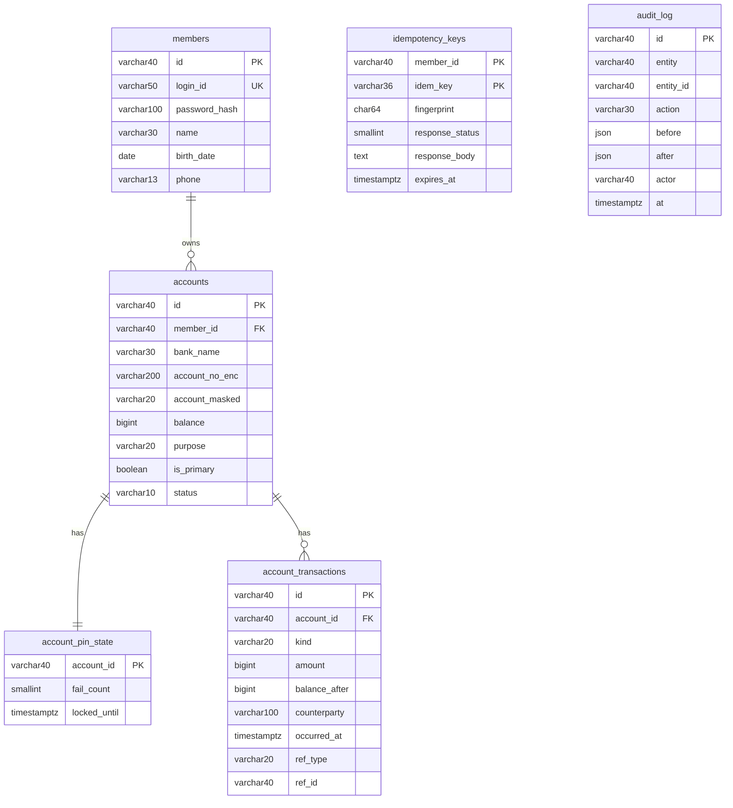
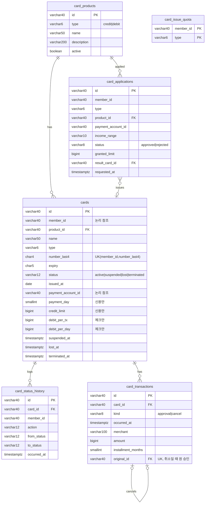

# ERD (Mermaid)

[db-design.md](db-design.md)의 통합 설계를 ERD로 그린 것이다. 실선(`--`)은 FK, 점선(`..`)은 **도메인 간 논리 참조**(FK 없음)다.
GitHub·VS Code(Mermaid 미리보기)·Notion 코드블록(Mermaid)에서 바로 렌더링된다. 컬럼은 키와 핵심 컬럼만 적었고 전체는 `backend/app/models.py`가 정본이다.

## 1. 전체 관계도 (테이블 단위)

```mermaid
erDiagram
    %% ── 공통 · 계좌 ──
    members ||--o{ accounts : "소유"
    accounts ||--|| account_pin_state : "암호 오류 상태"
    accounts ||--o{ account_transactions : "입출금"

    %% ── 카드 ──
    card_products ||--o{ cards : "상품"
    cards ||--o{ card_status_history : "상태 이력"
    cards ||--o{ card_transactions : "거래"
    card_transactions |o--o| card_transactions : "취소 → 원 승인"
    card_products ||--o{ card_applications : "신청 상품"
    card_applications }o--o| cards : "result_card_id"

    members ||..o{ cards : "member_id"
    members ||..o{ card_applications : "member_id"
    accounts ||..o{ cards : "payment_account_id"

    %% ── 가계부 ──
    card_transactions ||--o| ledger_tx_category : "분류"
    budgets ||--o{ category_budgets : "카테고리 예산"
    chat_sessions ||--o{ chat_messages : "대화"
    card_transactions |o--o{ payment_attempts : "허용된 시도"

    members ||..o{ budgets : "member_id"
    members ||..o{ planned_outflows : "member_id"
    members ||..o{ payment_attempts : "member_id"
    members ||..|| ledger_settings : "member_id"
    members ||..o{ ledger_goals : "member_id"
    members ||..o{ chat_sessions : "member_id"
    members ||..o{ ledger_tx_category : "member_id"

    %% ── 대출 (공통) ──
    members ||..o{ loan_application : "member_id"
    loan_application ||--o{ consent_record : "동의"
    loan_application ||--o| applicant_profile : "고객정보"
    loan_application ||--o| suitability_result : "적합성"
    loan_application ||--o{ evidence : "증빙"
    loan_application ||--o| review_result : "심사"
    loan_application ||--o{ recommendation_log : "추천"
    loan_application ||--o| loan_terms : "조건"
    loan_application ||--o| pricing : "금리"
    loan_application ||--o{ explanation_record : "설명의무"
    loan_application ||--o| contract : "약정"
    product_catalog ||--o{ loan_terms : "상품"
    contract ||--o{ repayment_schedule : "상환 스케줄"
    contract ||--o{ collateral : "담보"
    contract ||--o{ disbursement : "지급"
    accounts ||..o{ disbursement : "account_id"
    repayment_schedule ||..o{ planned_outflows : "loan_repayment 연결"
    account_transactions }o..o| disbursement : "ref_id"
```

## 2. 도메인별 상세 (컬럼 포함)

### 2.1 공통 · 계좌

### 2.2 카드

### 2.3 가계부

```mermaid
erDiagram
    card_transactions {
        varchar40 id PK
    }
    ledger_tx_category {
        varchar40 card_transaction_id PK
        varchar40 member_id
        varchar20 category
        varchar4 source "auto|user"
    }
    budgets {
        varchar40 id PK
        varchar40 member_id "UK(member_id,month)"
        char7 month "YYYY-MM"
        bigint total_amount
        bigint emergency_floor
    }
    category_budgets {
        varchar40 budget_id PK
        varchar20 category PK
        bigint amount
    }
    planned_outflows {
        varchar40 id PK
        varchar40 member_id
        date due_date
        bigint amount
        varchar20 type "card_bill|fixed|loan_repayment"
        varchar20 ref_type
        varchar40 ref_id
        varchar10 status
    }
    payment_attempts {
        varchar40 id PK
        varchar40 member_id
        bigint amount
        varchar20 category
        varchar8 result "allowed|held"
        varchar20 reason "MONTH_BUDGET|CATEGORY_BUDGET|BALANCE"
        bigint over_amount
        varchar40 card_transaction_id FK
    }
    ledger_settings {
        varchar40 member_id PK
        varchar8 mode "roast|basic|kind|numbers"
        smallint roast_level
    }
    ledger_goals {
        varchar40 id PK
        varchar40 member_id
        varchar7 month "YYYY-MM, 회원당 월 1건"
        varchar30 name
        bigint target_amount
    }
    chat_sessions {
        varchar40 id PK
        varchar40 member_id
    }
    chat_messages {
        varchar40 id PK
        varchar40 session_id FK
        varchar10 role
        text content
        varchar30 intent
        json context_json
    }
    rag_documents {
        varchar40 id PK
        varchar300 source_url
        varchar200 title
        varchar20 version
        text chunk_text
        date effective_date
    }
    card_transactions ||--o| ledger_tx_category : classified
    card_transactions |o--o{ payment_attempts : approved
    budgets ||--o{ category_budgets : has
    chat_sessions ||--o{ chat_messages : has
```

### 2.4 대출 (공통 테이블)

```mermaid
erDiagram
    loan_application {
        varchar40 id PK
        varchar40 member_id "논리 참조"
        varchar20 product_type
        varchar20 status
        varchar10 channel
        timestamptz expires_at
    }
    consent_record {
        varchar40 id PK
        varchar40 application_id FK
        varchar30 consent_code
        char64 doc_version_hash
        boolean agreed
        timestamptz agreed_at
    }
    applicant_profile {
        varchar40 application_id PK
        varchar20 job_type
        bigint annual_income
        bigint debts
        varchar20 purpose_code
        json prefs
    }
    suitability_result {
        varchar40 application_id PK
        varchar20 result
        json reason_codes
        varchar20 rule_version
    }
    evidence {
        varchar40 id PK
        varchar40 application_id FK
        varchar30 doc_type
        varchar6 source "API|UPLOAD"
        json extracted
        json confidence
    }
    review_result {
        varchar40 application_id PK
        varchar20 result_code
        bigint approved_limit
        varchar10 grade
        numeric dsr
        varchar40 reviewer_id
    }
    product_catalog {
        varchar40 product_id PK
        varchar20 type
        varchar100 name
        json rules
        date sale_from
        date sale_to
        int version
    }
    reg_param {
        varchar40 key PK
        int version PK
        varchar100 value
        date effective_from
    }
    recommendation_log {
        varchar40 id PK
        varchar40 application_id FK
        json candidates
        json excluded_reasons
        json llm_output
        json validation
    }
    loan_terms {
        varchar40 application_id PK
        varchar40 product_id FK
        bigint amount
        smallint term_months
        varchar20 repay_method
    }
    pricing {
        varchar40 application_id PK
        numeric base_rate
        numeric spread
        numeric preferential
        numeric final_rate
    }
    explanation_record {
        varchar40 id PK
        varchar40 application_id FK
        varchar40 doc_id
        int read_seconds
        boolean scrolled
    }
    contract {
        varchar30 contract_no PK
        varchar40 application_id FK "UK"
        timestamptz signed_at
        char64 doc_hash
    }
    repayment_schedule {
        varchar30 contract_no PK
        int seq PK
        date due_date
        bigint principal
        bigint interest
        bigint balance "납부 후 잔액"
    }
    collateral {
        varchar40 id PK
        varchar30 contract_no FK
        varchar20 type
        json detail
    }
    disbursement {
        varchar40 id PK
        varchar30 contract_no FK
        varchar50 payee
        varchar40 account_id "논리 참조 accounts"
        bigint amount
        timestamptz executed_at
        varchar10 result
    }
    loan_application ||--o{ consent_record : has
    loan_application ||--o| applicant_profile : has
    loan_application ||--o| suitability_result : has
    loan_application ||--o{ evidence : has
    loan_application ||--o| review_result : has
    loan_application ||--o{ recommendation_log : has
    loan_application ||--o| loan_terms : has
    loan_application ||--o| pricing : has
    loan_application ||--o{ explanation_record : has
    loan_application ||--o| contract : signs
    product_catalog ||--o{ loan_terms : selected
    contract ||--o{ repayment_schedule : has
    contract ||--o{ collateral : has
    contract ||--o{ disbursement : pays
```

## 3. 참고

- 대출 쪽 `inquiry_log`, `rule_version`, `llm_call_log`, `saga_instance`, `notification` 등 main 13.1의 "공통 추가" 테이블은 스켈레톤 단계라 모델·ERD에서 뺐다.
- 업무별 확장 테이블(정부·기관·대환·대출관리)은 설계에서 제외했다.
