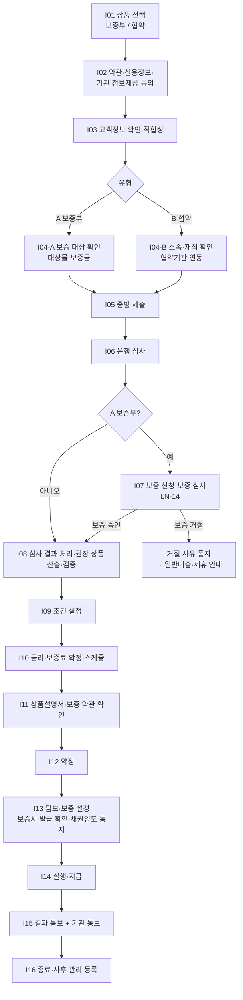
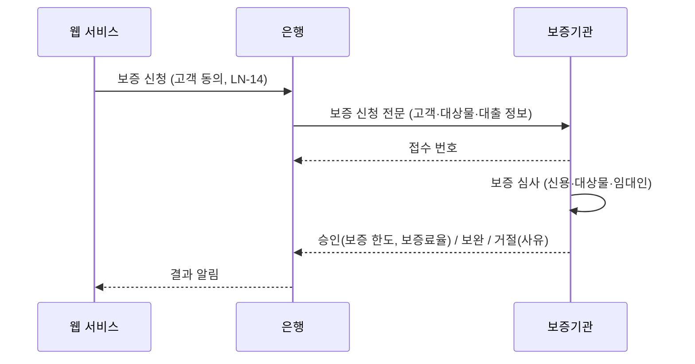

# 기관대출(보증기관·협약기관 연계 대출) 서비스 기획서

| 항목 | 내용 |
|---|---|
| 문서 | 대출 서비스 > 기관대출 업무 로직 및 구현 기획서 |
| 버전 | v0.3 (공유 검토본) |
| 표기 원칙 | 은행명은 'OO은행'(본문에서는 '당행')으로 씁니다. 본문에 나오는 실제 기관·제도·회사 이름(신용평가회사, 보증기관, 시세 제공처, 정책자금 상품명 등)은 업무를 설명하기 위한 공개 정보 기준 예시이며 제휴·승인 관계를 뜻하지 않습니다. 금리·한도·기준값은 모두 예시이고, 법령·약관 내용은 요약이므로 실제 적용 전 법무·준법감시 확인이 필요합니다. |
| 작성일 | 2026-11-04 |
| 상위 문서 | [Loan_Service_main.md](../Loan_Service_main.md) |
| 기준 문서 | [일반대출_기획서.md](일반대출_기획서.md) — 일반대출과 겹치는 내용은 이 문서 안에 **"공통 (일반대출 Sxx과 동일)"** 제목으로 두되 본문을 다시 적지 않고 **참조 줄**(`일반대출 S01과 같다 → 링크`)만 적었습니다. 일반대출과 다른 점은 참조 줄 아래 **"<변경>"** 표로, 기관대출에만 있는 내용은 **"<추가>"** 제목의 별도 표로 적었습니다. 같은 내용은 링크를 따라 일반대출 기획서에서 읽습니다. |
| 사용 서류 | `Contract_Document/` LN-01 ~ LN-18 (특히 LN-14 전세자금 보증신청·채권양도 동의서) + 협약 전용 LN-22 ~ LN-24 |

> **범위 (2026-11-04 확정)**: 이 문서에서 "기관대출"은 **외부 기관이 대출에 참여하는 개인 대출**로 정의합니다. ① 보증기관의 보증서를 담보로 하는 대출, ② 은행과 협약을 맺은 기관(기업·공공기관·직역 단체)의 소속 직원 전용 대출 두 가지입니다. 기업 대출(법인 대출)이나 정책자금(정부대출 기획서)은 포함하지 않습니다.

> **읽는 법**: 각 구간은 `#### 공통 (일반대출 Sxx과 동일)`(참조 줄, 다른 점이 있으면 `<변경>` 표) → `#### <추가> 기관대출 추가 항목` 순서입니다. <추가> 표의 `구분` 칸에서 **추가**는 공통 내용에 더하는 것, **변경**은 공통 내용을 기관대출에서 바꿔 적용하는 것입니다. <변경> 표의 `구분` 칸은 "변경"이면 그 내용으로 바꿔 읽고, "제외"면 일반대출 원문의 그 부분을 쓰지 않는다는 뜻입니다.
>
> **구간 코드 대응**: S01→I01, S02→I02, S03→I03, S04→I05, S05→I06, S06→I08, S07→I09, S08→I10, S09→I11, S10→I12, S11→I13, S12→I14, S13→I15, S14→I16 (I04-A·I04-B·I07은 기관대출 고유 구간). 참조 줄의 구간 코드(S01 등)와 원문 속 장·절 번호(예: 4.2 ⑧, 미결 사항 13장)는 일반대출 기획서의 것이므로 이 대응표로 읽습니다.

---

## 1. 개요

### 1.1 대상 상품 (예시 분류)
| 유형 | 예시 | 참여 기관 (예시) | 기관의 역할 |
|---|---|---|---|
| A-1. 전세자금 보증부 대출 | 은행 자체 전세자금대출 | 주택도시보증공사(HUG), 한국주택금융공사(HF), SGI서울보증 | 보증서 발급, 보증 심사, 사고 시 대위변제 |
| A-2. 개인 신용 보증부 대출 | 보증서 담보 신용대출 | SGI서울보증 등 | 보증서 발급 |
| A-3. 서민 보증부 대출 | 보증 기반 서민 대출 | 서민금융진흥원 등 | 보증 (정책 성격이면 정부대출 기획서 우선) |
| B-1. 기업 임직원 협약대출 | ○○전자 임직원 신용대출 | 협약 기업 | 소속·재직 확인, (선택) 급여 공제 상환, 금리 우대 근거 |
| B-2. 직역 협약대출 | 공무원·군인·교직원 대출 | 공공기관·연금공단 등 | 소속 확인, 협약 금리 |
| B-3. 단체 협약대출 | 전문직(의사·변호사 등) 단체 대출 | 협회·단체 | 자격 확인 |

### 1.2 일반대출과 다른 점
| 구분 | 일반대출 | 기관대출 |
|---|---|---|
| 심사 | 은행 단독 | 은행 + **보증기관 보증 심사** (A) / 은행 + **기관 소속 확인** (B) |
| 한도 | 은행 산출 | min(은행 한도, 보증 한도) (A) / 협약 한도 (B) |
| 금리 | 은행 금리 체계 | 보증으로 위험이 줄어든 가산금리 + 보증료 별도 (A) / 협약 금리표 (B) |
| 비용 | 인지세 등 | + 보증료 (A) |
| 실행 조건 | 약정·담보 설정 | + **보증서 발급 확인** (A) / + 협약 유효·소속 유지 확인 (B) |
| 사후 관리 | 상환 관리 | + 보증 사고 처리·대위변제 (A) / + **퇴직·협약 해지 시 조건 변경** (B) |

### 1.3 설계 원칙 (공통, 일반대출 1.3 기준, 기관대출에 맞게 일부 표현 변경)
일반대출 1.3과 같다 → [일반대출_기획서.md 1.3](일반대출_기획서.md#13-설계-원칙). 다른 점은 아래 <변경> 표뿐이다.

**<변경> 일반대출 원문과 다른 부분**
| 구분 | 항목 (일반대출 원문의 위치) | 내용 |
|---|---|---|
| 변경 | 원칙 2 | "…공공기관 연동, 제3자 제공(보증기관·협약기관 포함)은 해당 동의가 기록된 뒤에만 호출합니다." |
| 변경 | 원칙 3 | "…추천 순위는 고객 부담(금리·총이자·월 상환액, 기관대출은 보증료 포함 실질 비용) 기준이며…" |

### 1.4 용어 (공통, 일반대출 1.4와 동일)
일반대출 1.4와 같다 → [일반대출_기획서.md 1.4](일반대출_기획서.md#14-용어).

**<추가> 용어**
| 구분 | 용어 | 뜻 |
|---|---|---|
| 추가 | 보증서 | 보증기관이 대출 상환을 보증한다는 증서. 보증부 대출(A)의 담보 역할 |
| 추가 | 보증료 | 보증서 발급 대가로 고객이 내는 비용 (보증금액 × 보증료율 × 기간, 기관별 산식) |
| 추가 | 대위변제·구상권 | 고객이 갚지 못하면 보증기관이 대신 갚고(대위변제), 그 금액을 고객에게 청구하는 권리(구상권) |
| 추가 | 협약기관 | 은행과 임직원 대출 협약을 맺은 기업·공공기관·단체 |
| 추가 | 실질 비용 | 총 이자 + 총 보증료 + 부대비용. 기관대출 추천 순위의 기준 |

---

## 2. 전체 처리 흐름

### 2.1 흐름도


### 2.2 신청 상태(State) 정의

#### 공통 (일반대출 2.2와 동일)
일반대출 2.2와 같다 → [일반대출_기획서.md 2.2](일반대출_기획서.md#22-신청-상태state-정의). 구간 코드는 위 표기 규칙의 대응표로 읽는다.

#### <추가> 기관대출 추가 상태
**<추가> 상태 코드**
| 구분 | 상태 코드 | 의미 | 진입 위치 |
|---|---|---|---|
| 추가 | `AFFILIATION_CHECKING` | 협약기관 소속 확인 중 | I04-B (`PROFILED` 다음) |
| 추가 | `AFFILIATION_FAILED` | 소속 확인 실패 (일반대출 전환 가능) | I04-B |
| 추가 | `GUARANTEE_REQUESTED` | 보증 신청 완료, 보증 심사 중 | I07 |
| 추가 | `GUARANTEE_APPROVED` / `GUARANTEE_REJECTED` | 보증 승인 / 거절 | I07 |
| 추가 | `GUARANTEE_ISSUED` | 보증서 발급 완료 (실행 가능) | I13 |
| 변경 | `COLLATERAL_SET` | 보증부(A)는 `GUARANTEE_ISSUED` + 채권양도 통지 확인 완료 시 진입 | I13 |

---

## 3. 구간별 상세 설계

각 구간은 **역할 → 화면 구성 → 입력 항목 → 시스템 조회 데이터 → LLM 활용 → 처리 로직 → 예외 → 산출물** 순서로 적습니다.

### I01. 상품 선택

#### 공통 (일반대출 S01과 동일)
일반대출 S01과 같다 → [일반대출_기획서.md S01](일반대출_기획서.md#s01-대출-상품-선택). 구간 코드는 I01로 읽는다. 다른 점은 아래 <변경> 표뿐이다.

**<변경> 일반대출 원문과 다른 부분**
| 구분 | 항목 (일반대출 원문의 위치) | 내용 |
|---|---|---|
| 변경 | 화면 구성 첫째 항목 | "상품 유형 카드 (신용 / 전월세 / 부동산담보 / 자동차 / 예금담보 중 기관대출 대상 유형)" (원문: "상품 유형 카드 5개 (…)") |
| 제외 | **<추가> 상품 카드 표시 규칙 (main 3.5)** 표 | 이 문서 I01의 "<추가>" 아래에 같은 이름의 표를 따로 적었다 |

#### <추가> 기관대출 추가 항목
**<추가> 화면·처리**
| 구분 | 대상 | 내용 |
|---|---|---|
| 추가 | 협약(B) | 고객이 소속 기관을 검색해 선택합니다(협약기관 목록 `agreement_org`). 회사 이메일 도메인이나 회원 정보의 직장명으로 **추천 후보**를 띄울 수 있습니다(확정은 I04-B). 기관명 정규화는 ILLM-1 |
| 추가 | 보증부(A) | 보증기관을 고객이 고르지 않아도 되도록, 조건에 맞는 보증기관을 I04-A 다음 사전 비교 화면에서 실질 비용 순으로 권장하고(고객이 신청할 기관 선택), I07 보증 승인 후 I08에서 확정 금액으로 다시 권장합니다 |

**<추가> 입력 항목**
| 구분 | 필드 | 타입 | 필수 | 비고 |
|---|---|---|---|---|
| 추가 | `agreement_org_id` | string | B 유형 Y | 협약기관 코드 |
| 추가 | `guarantee_pref` | enum | N | 선호 보증기관 (없으면 자동 비교) |

**<추가> 조회 데이터**
| 구분 | 데이터 | 출처 | 용도 |
|---|---|---|---|
| 추가 | 협약기관 목록·협약 유효기간 | `agreement_org` | 기관 검색, 협약 종료 기관 제외 |

**<추가> 상품 카드 표시 규칙 (main 3.5)**
| 구분 | 항목 | 내용 |
|---|---|---|
| 추가 | 대출 기간 표시 | 상품 카드와 상품 상세 화면의 **"최대 N원" 바로 옆에 "기간 최소 ~ 최대"**를 표시 (예: 최대 1억원 \| 기간 1년 ~ 5년). 12개월 단위면 "년", 아니면 "개월"로 표시하고, 허용 기간이 하나뿐이면 그 기간만 표시 (예: 기간 2년) |
| 추가 | 진입 순서 | 상품 카드 클릭, 카드의 「대출신청」·「갈아타기 신청」 버튼, 배너 클릭 **모두 상품 상세(상품 정보) 화면을 먼저** 보여 줌. 상세 화면 아래의 신청 버튼을 눌러야 C02 동의 단계로 들어감 (상품 정보 확인 없이 동의로 바로 넘어가지 않음) |
| 추가 | 화면 보기 방식 | 기본은 **한 화면 전환(모바일 보기)**: 메인에서 상품을 누르면 같은 자리가 상품 상세·신청 단계로 바뀌고, 뒤로 가면 메인으로 돌아옴. 폭 900px 이상에서는 「분할 보기」로 바꿔 메인을 왼쪽에 두고 하위 화면을 오른쪽에 열 수 있음. 900px 미만은 항상 한 화면 전환. 상단 ≡ 메뉴 창(대출/대환/대출관리)도 메인 화면과 같은 자리에 열리고, 항목을 누르면 같은 자리에 해당 메인 화면이 열림 (main 3.6) |
| 유지 | 값 출처 | `product_catalog`의 최대 한도(`max_amount`)와 허용 기간 목록(`term_options`)의 최솟값·최댓값 |

---

### I02. 동의

#### 공통 (일반대출 S02와 동일)
일반대출 S02와 같다 → [일반대출_기획서.md S02](일반대출_기획서.md#s02-대출-약관-및-신용정보-조회-동의). 구간 코드는 I02로 읽는다.

#### <추가> 기관대출 추가 항목
**<추가> 동의**
| 구분 | 동의 | 필수 | 이유 | 서류 |
|---|---|---|---|---|
| 추가 | 보증기관 개인(신용)정보 제공 동의 | A: Y | 보증 심사, 보증서 발급, 사고 관리 | LN-14 |
| 추가 | 보증기관 약관 동의 | A: Y | 보증 약정 (보증기관 약관은 보증기관 문서 사용) | 보증기관 문서 |
| 추가 | 협약기관 재직 정보 조회·제공 동의 | B: Y | 소속·재직 확인, 퇴직 시 통보 | LN-22 |
| 추가 | 급여 공제 상환 동의 | B: 선택 | 급여에서 원리금 공제 (협약에 따라) | LN-23 (I09에서 받을 수도 있음) |

---

### I03. 고객정보 확인·적합성

#### 공통 (일반대출 S03과 동일)
일반대출 S03과 같다 → [일반대출_기획서.md S03](일반대출_기획서.md#s03-고객정보-확인-적합성-검사). 구간 코드는 I03으로 읽는다.

#### <추가> 기관대출 추가 항목
**<추가> 입력·판정**
| 구분 | 항목 | 내용 |
|---|---|---|
| 추가 | 협약(B) 입력 | `employee_no`(사번), `employment_type`(정규/계약) — I04-B 재직 확인에 사용 |
| 변경 | 협약(B) `employer_name` | 고객 직접 입력 대신 I01에서 고른 협약기관명을 자동으로 채움 (수정 불가) |
| 변경 | 보증부(A) `expected_payment` | 보증료(월 환산 예상액)를 더해 상환 부담률을 계산 |

#### 공통 (I03) 적합성 판정 창 화면 규칙 — 네 업무 공통
일반대출 S03의 "적합성 판정 창 화면 규칙"과 같다 → [일반대출_기획서.md S03 적합성 판정 창 화면 규칙](일반대출_기획서.md#공통-s03-적합성-판정-창-화면-규칙--네-업무-공통). 구간 코드는 I03으로 읽는다.

---

### I04-A. 보증 대상 확인 (보증부, 기관대출 고유)

**역할**: 보증기관 기준에 맞는 대상인지 먼저 확인해, 보증 거절로 늦게 탈락하는 일을 줄입니다.

| 확인 항목 | 데이터 | 비고 |
|---|---|---|
| 임차 주택 유형 | 임대차계약서, 건축물대장 | 보증 가능 주택 유형 (기관별 기준) |
| 보증금 상한 | 임대차계약서 | 지역별 상한 (`guarantee_rule`) |
| 선순위 채권 | 등기부 | 선순위 근저당 + 보증금 ≤ 주택 가격 × 기준 비율 |
| 임대인 | 등기부 소유자 = 계약서 임대인 | 불일치 시 보증 불가 가능성 |
| 계약 기간 | 임대차계약서 | 최소 기간 기준 |
| 신청 시점 | 계약일·잔금일·전입일 | 기관별 신청 가능 기간 |

**처리 로직**
```
for agency in [HUG, HF, SGI]:
    agency.pre_result = guarantee_rule[agency, effective_on=today] 평가
가능한 보증기관 목록을 I08 후보로 넘김
모두 불가 → 사유 표시 + 신용대출 등 다른 상품 안내
```

**LLM 활용 (ILLM-2)**: 임대차계약서·등기부를 비교해 보증 위험 요소(선순위 채권, 임대인 불일치, 신탁 등기 등)를 정리합니다. 사전 안내·심사 참고용이며, 규칙 엔진 결과와 상충하면 규칙 결과만 표시합니다.

**<추가> 화면 규칙 — 모든 보증기관 보증 불가 시 (main 3.4)**
| 구분 | 항목 | 내용 |
|---|---|---|
| 추가 | 하단 버튼 | 「다음」을 비활성화하지 않고 **「처음으로」**로 바꿈 |
| 추가 | 화면 표시 | 보증 불가 사유 (`COL-DEPOSIT-OVER-VALUE` 등), 보증기관별 불가 배지 |

### I04-B. 소속·재직 확인 (협약, 기관대출 고유)

**역할**: 고객이 협약기관 소속인지 확인합니다. 협약 금리의 근거라서 고객 진술만으로 확정하지 않습니다.

| 확인 방식 | 우선순위 | 처리 |
|---|---|---|
| 협약기관 재직 확인 API | 1 | 사번·생년월일로 재직 여부·입사일·고용 형태 조회 |
| 건강보험 직장 가입 정보 | 2 | 사업장명이 협약기관인지 확인 (사업자번호 매칭) |
| 재직증명서 업로드 | 3 | OCR + LLM-3 추출 → 발급기관 = 협약기관, 발급일 1개월 이내 |
| 협약기관 담당자 확인 | 4 | 위 방법 실패 시 기관 담당자에게 확인 요청 (기한 3영업일) |

```
status = AFFILIATION_CHECKING
result = 확인 방식을 순서대로 시도, 처음 성공한 결과 사용
검증: 고용 형태(정규/계약) 및 재직 기간이 협약 조건(agreement_org.conditions) 충족
실패 → AFFILIATION_FAILED → 일반대출 전환 제안
```

**<추가> 화면 규칙 — 소속 확인 실패(`AFFILIATION_FAILED`) 시 (main 3.4)**
| 구분 | 항목 | 내용 |
|---|---|---|
| 추가 | 하단 버튼 | 「다음」을 비활성화하지 않고 **「처음으로」**로 바꿈 |
| 추가 | 화면 안 버튼 | 「일반 신용대출로 전환」 |

---

### I05. 증빙 제출

#### 공통 (일반대출 S04와 동일)
일반대출 S04와 같다 → [일반대출_기획서.md S04](일반대출_기획서.md#s04-소득담보-증빙-제출). 구간 코드는 I05로 읽는다.

#### <추가> 기관대출 추가 항목
**<추가> 필요 서류·처리**
| 구분 | 대상 | 내용 |
|---|---|---|
| 변경 | 전세 보증부(A) | 임대차계약서, **확정일자**, 주민등록등본이 **필수** (확정일자 없으면 보완 요청) |
| 변경 | 협약(B) | I04-B에서 재직이 확인되면 재직 서류(재직증명서·건강보험 자격득실)를 **생략** |
| 추가 | 보증부(A) | 보증기관이 추가로 요구하는 서류(I07 보완 요청)도 같은 업로드·검증 절차로 받음 |

---

### I06. 은행 심사

#### 공통 (일반대출 S05와 동일)
일반대출 S05와 같다 → [일반대출_기획서.md S05](일반대출_기획서.md#s05-심사). 구간 코드는 I06으로 읽는다.

#### <추가> 기관대출 추가 항목
**<추가> 심사 단계 변경**
| 구분 | 대상 | 심사 단계 | 내용 |
|---|---|---|---|
| 변경 | 보증부(A) | 5. 담보 평가 | 보증서가 담보 역할을 하므로 담보 평가 대신 **보증 예정 금액**을 한도 산정에 씀 |
| 변경 | 보증부(A) | 6. 한도 | min(은행 한도, 보증 예정 금액) — 보증 승인 후(I07) 보증 한도로 다시 확정 |
| 변경 | 보증부(A) | 7. 판정 | 은행 판정이 승인이어도 보증 승인 전까지는 최종 승인이 아님 → I07로 진행 |
| 추가 | 협약(B) | 2·6. 소득·한도 | 협약 조건(대상 등급, 협약 한도, 재직 기간)을 등급별 한도와 함께 적용 |
| 추가 | 협약(B) | 1. 결격 | `AFFILIATION_FAILED`이면 협약 상품 심사 불가 (일반대출 전환만 가능) |

---

### I07. 보증 신청·보증 심사 (보증부, 기관대출 고유)


| 결과 | 처리 |
|---|---|
| 승인 | `GUARANTEE_APPROVED`, 보증 한도·보증료율 저장 → I08 |
| 보완 | 보증기관 요청 서류를 I05와 같은 방식으로 받아 재전송 |
| 거절 | `GUARANTEE_REJECTED` → 보증기관 거절 사유를 고객에게 알림(ILLM-3 쉬운 설명). 다른 보증기관이 가능하면 그 기관으로 다시 신청할지 고객에게 묻기 |

- 보증 신청은 고객 신용조회 기록을 남길 수 있으므로, **여러 보증기관에 동시에 신청하지 않고** 고객이 고른(또는 I04-A 사전 비교에서 권장한) 기관 한 곳에 먼저 신청합니다.

**<추가> 화면 규칙 — 보증기관 보증 거절(`GUARANTEE_REJECTED`) 시 (main 3.4)**
| 구분 | 항목 | 내용 |
|---|---|---|
| 추가 | 다른 보증기관 가능 | 다른 보증기관으로 다시 신청할지 묻는 버튼을 보여 주고 하단 버튼은 「다음」 유지 |
| 추가 | 가능한 보증기관 없음 | 하단 「다음」을 비활성화하지 않고 **「처음으로」**로 바꿈 |

---

### I08. 심사 결과 처리·권장 상품 산출·검증

#### 공통 (일반대출 S06과 동일)
일반대출 S06과 같다 → [일반대출_기획서.md S06](일반대출_기획서.md#s06-심사-결과-처리와-권장-상품-산출-적합-시). 구간 코드는 I08로 읽는다. 다른 점은 아래 <변경> 표뿐이다.

**<변경> 일반대출 원문과 다른 부분**
| 구분 | 항목 (일반대출 원문의 위치) | 내용 |
|---|---|---|
| 변경 | S06-A 첫 문단 | "같은 유형 안에도 여러 세부 상품이 있습니다."로 시작하고 "…정하고 검증합니다(아래 "권장 상품 산출·검증 로직")."로 끝낸다. 원문의 "(예: 신용대출 = …)" 예시와 "상세 로직은 **4장**에 있습니다."는 쓰지 않는다 |
| 제외 | S06-C의 **<추가> 화면 규칙 (main 3.4)** 표 | 이 문서 I08의 "<추가>" 아래 "화면 규칙 — 거절(`REJECTED`) 시 (main 3.4, 일반대출 S06-C와 동일)"에 따로 적었다 |

#### 공통 — 권장 상품 산출·검증 로직 (일반대출 4장과 동일)
일반대출 4장과 같다 → [일반대출_기획서.md 4장](일반대출_기획서.md#4-적합-시-권장-대출-상품-산출-및-검증-로직).

#### <추가> 기관대출 추가 항목
**<추가> 추천 단계별 차이**
| 구분 | 단계 | 기관대출에서의 내용 |
|---|---|---|
| 변경 | ① 후보 | (A) 보증기관별 상품 조합 (예: 전세대출 × HUG / × HF / × SGI) (B) 협약 상품 + 비교용 일반 신용대출 |
| 변경 | ② 자격 필터 | I04-A·I04-B 결과 + 보증기관·협약 조건 |
| 변경 | ③ 비용 계산 | **실질 비용 = 총 이자 + 총 보증료 + 부대비용.** 보증료는 보증금액 × 보증료율 × 기간 (기관별 산식, `guarantee_rule.fee_formula`) |
| 변경 | ⑤ 순위 | `f_cost`를 **실질 비용** 기준으로 계산 (금리만 낮고 보증료가 비싼 상품이 1위가 되지 않도록) |
| 추가 | ⑥ LLM 사유 | 보증료, 보증 사고 시 구상권, 협약 해지·퇴직 시 금리 변경을 `cautions`에 포함 |
| 추가 | 보증 거절 시 (I08-C) | 보증기관 거절 사유는 ILLM-3으로 쉬운 설명, LLM-6과 같은 검증 적용 |

**<추가> 검증 (IV)**
| 구분 | 번호 | 검증 | 방법 | 실패 시 |
|---|---|---|---|---|
| 추가 | IV1 | 보증료 일치 | 표시 보증료 = 기관 산식 재계산 (승인 후에는 기관이 준 보증료율 사용) | 재계산 |
| 추가 | IV2 | 실질 비용 순위 | 순위가 실질 비용 기준인지 재확인 | 순위 재산정 |
| 추가 | IV3 | 보증 한도 | 표시 한도 ≤ 보증 한도(승인 시) 또는 보증 기준 한도(사전) | 한도 조정 |
| 추가 | IV4 | 협약 금리 | 표시 금리 = 협약 금리표(`agreement_org.rate_table`, 유효기간 안) | 재계산 |
| 추가 | IV5 | 협약 유효 | 협약 종료일 > 오늘, 협약 잔여 한도 > 신청 금액 (협약 총한도가 있는 경우) | 해당 상품 제외 |
| 추가 | IV6 | 기관 중립성 | 특정 보증기관을 근거 없이 우대하는 문구("가장 안전" 등)가 없는지 | 문장 제거 |

**<추가> 보증기관 선택 시점**
```
보증 신청 전(I04-A 후): 사전 기준으로 계산한 '예상' 비교 → 고객이 신청할 보증기관 선택
보증 승인 후(I07 후): 승인 결과로 확정 금액 재계산 → 최종 권장 표시
```

**<추가> 화면 규칙 — 거절(`REJECTED`) 시 (main 3.4, 일반대출 S06-C와 동일)**
| 항목 | 내용 |
|---|---|
| 하단 버튼 | 「다음」을 비활성화하지 않고 **「처음으로」** 버튼으로 바꿈 → 누르면 메인 화면(상품 목록)으로 이동. 「이전」 버튼은 그대로 둠 |
| 화면 구성 | 거절 사유 코드 목록 → 근거 신용정보·제공 기관 → 함께 발견된 서류 결함(참고) → 「제휴사 대출 안내」 버튼 |

---

### I09. 조건 설정

#### 공통 (일반대출 S07과 동일)
일반대출 S07과 같다 → [일반대출_기획서.md S07](일반대출_기획서.md#s07-대출-조건-설정). 구간 코드는 I09로 읽는다.

#### <추가> 기관대출 추가 항목
**<추가> 입력 항목**
| 구분 | 필드 | 타입 | 필수 | 검증 규칙 |
|---|---|---|---|---|
| 변경 | `term_months` | int | Y | 보증 기간(A) 또는 협약 조건(B) 안에서만 선택. 전세대출은 임대차 기간에 맞춤 |
| 변경 | `loan_amount` | int | Y | 보증부(A)는 ≤ 보증 한도, 협약(B)은 ≤ 협약 잔여 한도 |
| 추가 | `guarantee_fee_payment` | enum | A: Y | 보증료 납부 방식 `LUMP_SUM`(일시납) / `INSTALLMENT`(분할납) |
| 추가 | `payroll_deduction` | bool | B: N | 급여 공제 상환 선택 (LN-23) |
| 변경 | `payment_day` | int | Y | 급여 공제를 고르면 급여일 기준으로 자동 설정 |

**<추가> 실시간 계산**
| 구분 | 내용 |
|---|---|
| 추가 | 월 상환액 옆에 보증료(분할납이면 월 환산)를 따로 보여 주고, 실질 비용 합계를 함께 표시 |

---

### I10. 금리·보증료 확정

#### 공통 (일반대출 S08과 동일)
일반대출 S08과 같다 → [일반대출_기획서.md S08](일반대출_기획서.md#s08-대출-금액-및-금리-확정). 구간 코드는 I10으로 읽는다.

#### <추가> 기관대출 추가 항목
**<추가> 금리·비용 산출**
| 구분 | 대상 | 내용 |
|---|---|---|
| 변경 | 보증부(A) 가산금리 | 보증으로 줄어든 리스크를 반영한 가산금리 (상품 테이블의 보증부 가산금리) |
| 변경 | 협약(B) 금리 | 협약 금리표(`agreement_org.rate_table`, 유효기간 안)의 금리를 적용 |
| 추가 | 보증부(A) 보증료 | 보증료 = 보증금액 × 보증료율 × 기간 (승인 시 보증기관이 준 보증료율). `pricing`에 `guarantee_fee`, `fee_payment` 저장 |
| 추가 | 상환 스케줄 | 보증료를 **별도 행**으로 표시 (일시납: 실행일 1회 / 분할납: 회차별) |
| 추가 | 협약(B) 일반 전환 금리 | 퇴직 등으로 협약이 끝날 때 적용할 일반 금리(약정일 기준)도 함께 계산해 I11·I12에 표시 |

---

### I11. 상품설명서·보증 약관 확인

#### 공통 (일반대출 S09와 동일)
일반대출 S09와 같다 → [일반대출_기획서.md S09](일반대출_기획서.md#s09-상품설명서-확인). 구간 코드는 I11로 읽는다.

#### <추가> 기관대출 추가 항목
**<추가> 고지 사항**
| 구분 | 유형 | 추가 고지 |
|---|---|---|
| 추가 | A 보증부 | 보증료, 보증 사고 시 보증기관의 대위변제와 구상권(고객에게 청구), 임대차 계약 변경·이사 시 신고 의무 |
| 추가 | B 협약 | 퇴직·휴직·협약 해지 시 금리 변경(일반 금리 전환) 또는 기한 전 상환 조건, 급여 공제 중단 시 자동이체 전환 |

**<추가> 화면·LLM**
| 구분 | 항목 | 내용 |
|---|---|---|
| 추가 | 보증 약관 | 보증기관 약관을 상품설명서 다음에 보여 주고 확인받음 (A) |
| 추가 | 이해 확인 질문 | 보증료·구상권(A) 또는 퇴직 시 금리 전환(B) 문항을 최소 1개 포함 |
| 추가 | ILLM-4 | 보증 약관 질의응답 (보증기관 약관 RAG). 근거 조항 필수, 없으면 보증기관 안내 연결 |
| 변경 | LLM-7 필수 고지 | 위 추가 고지 항목도 요약문 필수 포함 항목에 넣음 |

---

### I12. 약정

#### 공통 (일반대출 S10과 동일)
일반대출 S10과 같다 → [일반대출_기획서.md S10](일반대출_기획서.md#s10-대출-약정). 구간 코드는 I12로 읽는다.

#### <추가> 기관대출 추가 항목
**<추가> 약정 서류**
| 구분 | 유형 | 서류 | 내용 |
|---|---|---|---|
| 추가 | A 보증부 | 보증부 특약 (약정서 첨부) | 보증서 발급 조건부 실행, 보증료, 구상권, 임대차 변경 신고 |
| 추가 | B 협약 | LN-24 협약대출 특약서 | 협약 금리 적용, 신분 변동 시 처리(30일 선택 기간), 협약 해지, 급여 공제 |
| 추가 | B 협약 (선택) | LN-23 급여공제 상환 동의서 | I09에서 급여 공제를 고른 경우 |

---

### I13. 담보·보증 설정 (보증서 발급 확인·채권양도 통지)

#### 공통 (일반대출 S11과 동일)
일반대출 S11과 같다 → [일반대출_기획서.md S11](일반대출_기획서.md#s11-담보보증-설정-해당-상품만). 구간 코드는 I13으로 읽는다. 다른 점은 아래 <변경> 표뿐이다.

**<변경> 일반대출 원문과 다른 부분**
| 구분 | 항목 (일반대출 원문의 위치) | 내용 |
|---|---|---|
| 제외 | "공통 (기관대출 I07·I13 보증 처리와 동일) — 전월세 보증부" 표, 담보 표 전월세 행의 "(아래 "공통" 참고)" 문구 | 쓰지 않음. 보증 처리는 이 문서 I07·I13에 따로 적었다 |

#### <추가> 기관대출 추가 항목
**<추가> 보증서 발급·채권양도 처리 (보증부 A)**
```
약정 완료 → 보증기관에 보증서 발급 요청 → 보증서 번호 수신 → GUARANTEE_ISSUED
전세대출: 임대인에게 채권양도(또는 질권설정) 통지 → 임대인 확인 (LN-14)
임대인 확인이 필요한 상품은 확인 완료 전 실행 불가
보증서 발급 + (필요 시) 임대인 확인 완료 → COLLATERAL_SET
```

**<추가> 처리 항목**
| 구분 | 유형 | 내용 |
|---|---|---|
| 추가 | A 보증부 | 보증서 발급 요청·번호 수신, `guarantee_request.cert_no` 저장 |
| 추가 | A 전세 | 채권양도 통지 발송·임대인 확인 기록 (`assignment_notice`) |
| 변경 | B 협약 (신용) | 담보·보증 설정 없음 → I12 다음 바로 I14 |

---

### I14. 실행·지급

#### 공통 (일반대출 S12와 동일)
일반대출 S12와 같다 → [일반대출_기획서.md S12](일반대출_기획서.md#s12-대출-실행-및-지급). 구간 코드는 I14로 읽는다.

#### <추가> 기관대출 추가 항목
**<추가> 실행 직전 체크리스트**
| 구분 | 유형 | 점검 항목 | 실패 시 |
|---|---|---|---|
| 추가 | A 보증부 | 보증서 발급 상태 유효, 보증 금액 ≥ 대출 금액 × 보증 비율 | 실행 차단 |
| 추가 | B 협약 | 실행일 기준 재직 재확인(협약기관 API), 협약 유효 | 실행 보류, 고객 확인 요청 |
| 변경 | A 전세 지급처 | 임대인 계좌 (예금주 = 등기부 소유자 = 계약서 임대인) | 지급 보류 |

---

### I15. 결과 통보 + 기관 통보

#### 공통 (일반대출 S13과 동일)
일반대출 S13과 같다 → [일반대출_기획서.md S13](일반대출_기획서.md#s13-결과-통보-및-계약서류-교부). 구간 코드는 I15로 읽는다.

#### <추가> 기관대출 추가 항목
**<추가> 통보·교부**
| 구분 | 유형 | 내용 |
|---|---|---|
| 추가 | A 보증부 | 실행 내역을 보증기관에 통보 (대출 번호, 금액, 실행일, 보증서 번호) |
| 추가 | B 협약 | 협약상 통보 의무가 있으면 협약기관에 실행 사실 통보 (협약 한도 관리) |
| 추가 | 교부 서류 | 보증부 특약(A) 또는 LN-24 협약대출 특약서·LN-23 급여공제 동의서(B)를 함께 교부 |

---

### I16. 종료·사후 관리 등록

#### 공통 (일반대출 S14와 동일)
일반대출 S14와 같다 → [일반대출_기획서.md S14](일반대출_기획서.md#s14-종료). 구간 코드는 I16으로 읽는다.

#### <추가> 기관대출 추가 항목
**<추가> 사후 관리 등록**
| 구분 | 유형 | 사후 관리 항목 | 처리 |
|---|---|---|---|
| 추가 | A | 보증 만기·연장, 임대차 계약 변경, 연체 시 보증기관 통보, 보증 사고·대위변제 | 만기 전 연장 안내 배치, 연체 일수 기준 기관 통보 |
| 추가 | B | 퇴직·휴직 통보 수신, 협약 해지, 급여 공제 실패 | 협약기관 통보 수신 → 고객 알림 → 약정에 따라 금리 전환 또는 상환 요청 (소명 기한 부여) |

---

## 4. LLM 활용 종합

### 4.1 활용 목록

#### 공통 (일반대출 5.1과 동일)
일반대출 5.1과 같다 → [일반대출_기획서.md 5.1](일반대출_기획서.md#51-활용-목록). 구간 코드는 위 표기 규칙의 대응표로 읽는다. 다른 점은 아래 <변경> 표뿐이다.

**<변경> 일반대출 원문과 다른 부분**
| 구분 | 항목 (일반대출 원문의 위치) | 내용 |
|---|---|---|
| 변경 | 5.1 활용 목록 표, LLM-3 행의 구간 칸 | "I05 (I04-B 재직증명서 포함)" (원문: "S04") |

#### <추가> 기관대출 추가 LLM
**<추가> 활용 목록**
| 구분 | ID | 구간 | 용도 | 결정에 쓰는가 | 검증·대체 |
|---|---|---|---|---|---|
| 추가 | ILLM-1 | I01 | 소속 기관 이름 정규화 (예: "OO전자 수원" → 협약기관 코드 후보) | 아니오 (후보 제시만) | 협약기관 목록에 있는 코드만 허용, 확정은 I04-B |
| 추가 | ILLM-2 | I04-A | 임대차계약서·등기부 비교로 보증 위험 요소 정리 (선순위 채권, 임대인 불일치, 신탁 등기 등) | 아니오 (사전 안내·심사 참고) | 규칙 엔진 결과와 상충하면 규칙 결과만 표시 |
| 추가 | ILLM-3 | I07 | 보증기관 거절 사유 쉬운 설명 | 아니오 | LLM-6과 같은 검증, 실패 시 고정 템플릿 |
| 추가 | ILLM-4 | I11 | 보증 약관 질의응답 (보증기관 약관 RAG) | 아니오 | 근거 조항 필수, 없으면 보증기관 안내 연결 |

### 4.2 LLM이 조회하는 데이터 (도구·RAG)

#### 공통 (일반대출 5.2와 동일)
일반대출 5.2와 같다 → [일반대출_기획서.md 5.2](일반대출_기획서.md#52-llm이-조회하는-데이터-도구rag).

#### <추가> 기관대출 추가 데이터
**<추가> 조회 데이터**
| 구분 | 데이터 | 접근 방식 | 접근 가능한 LLM | 비고 |
|---|---|---|---|---|
| 추가 | 보증기관 약관 | RAG (조항 단위 청크, 보증기관·버전 필터) | ILLM-4 | 보증기관이 제공한 최신 약관만 색인 |
| 추가 | 협약기관 목록 (이름·별칭·코드) | 요청 단위 입력 | ILLM-1 | 협약 유효 기관만 |
| 추가 | 임대차계약서·등기부 추출값 | 요청 단위 입력 | ILLM-2 | 색인하지 않음 |
| 추가 | 보증기관 거절 사유 코드·문구 | 요청 단위 입력 | ILLM-3 | |

### 4.3 공통 안전장치 (일반대출 5.3과 동일)
일반대출 5.3과 같다 → [일반대출_기획서.md 5.3](일반대출_기획서.md#53-공통-안전장치).

**<추가> 안전장치**
| 구분 | 내용 |
|---|---|
| 추가 | 보증기관 중립성: 특정 보증기관을 근거 없이 우대하는 표현을 금지어 사전에 추가 (IV6) |
| 추가 | 사번(직원번호)도 마스킹 대상에 포함 |

#### 공통 (main 8장 LLM 게이트웨이와 동일) — 호출 방식
일반대출 5.3의 "호출 방식" 표와 같다 → [일반대출_기획서.md 5.3 호출 방식](일반대출_기획서.md#공통-main-8장-llm-게이트웨이와-동일--호출-방식).

---

## 5. 데이터 모델

### 공통 (일반대출 6장과 동일)
일반대출 6장과 같다 → [일반대출_기획서.md 6장](일반대출_기획서.md#6-데이터-모델-주요-테이블).

### <추가> 기관대출 추가 테이블
**<추가> 테이블**
| 구분 | 테이블 | 주요 컬럼 | 설명 |
|---|---|---|---|
| 추가 | `agreement_org` | org_id, name, biz_no, conditions(json), rate_table(json), total_limit, used_limit, valid_from, valid_to, payroll_deduction | 협약기관 |
| 추가 | `affiliation_check` | application_id, org_id, method, result, employee_type, hire_date, checked_at | 소속 확인 결과 |
| 추가 | `guarantee_rule` | agency, product, version, effective_from, items(json), fee_formula(json) | 보증 기준 |
| 추가 | `guarantee_request` | application_id, agency, request_no, status, approved_amount, fee_rate, cert_no, issued_at, reason_codes | 보증 신청·발급 |
| 추가 | `assignment_notice` | contract_no, landlord, notice_sent_at, confirmed_at | 채권양도 통지 |
| 추가 | `org_event` | contract_no, org_id, event_type(퇴직/휴직/협약해지), received_at, action | 협약기관 통보 |
| 변경 | `pricing` | + guarantee_fee, fee_payment, org_rate_table_version, fallback_general_rate | 보증료·협약 금리 정보 추가 |

---

## 6. API

> 아래 표는 기획 원안이다. 경로는 공통.md 1장에 따라 모두 `/api` 아래에 둔다. 구현된 API(`/api/loans/...`: 신청 흐름은 `/applications/{id}/<단계>`, 대출관리는 `/{no}/...`)와 오류·멱등 규칙은 [loan/README.md](../README.md)와 [오류코드.md 5.1](../../common/오류코드.md)이 기준이고, 다르면 그쪽을 따른다.


### 공통 (일반대출 7장과 동일)
일반대출 7장과 같다 → [일반대출_기획서.md 7장](일반대출_기획서.md#7-api-설계-주요-엔드포인트). 구간 코드는 위 표기 규칙의 대응표로 읽는다.

### <추가> 기관대출 추가 API
**<추가> 엔드포인트**
| 구분 | 메서드 | 경로 | 구간 | 설명 | 구현 |
|---|---|---|---|---|---|
| 추가 | GET | `/api/loans/agreement-orgs?q=` | I01 | 협약기관 검색 | 미구현 |
| 추가 | POST | `/api/loans/applications/{id}/affiliation-check` | I04-B | 소속·재직 확인 | 구현 `POST …/affiliation` |
| 추가 | POST | `/api/loans/applications/{id}/guarantee-precheck` | I04-A | 보증 대상 사전 확인 | 구현 `GET …/guarantee-options` |
| 추가 | POST | `/api/loans/applications/{id}/guarantee` | I07 | 보증 신청 | 구현 `POST …/guarantee` |
| 추가 | GET | `/api/loans/applications/{id}/guarantee` | I07 | 보증 심사 상태 | 미구현 (결과는 POST 응답에 담긴다) |
| 추가 | POST | `/api/loans/contracts/{no}/assignment-notice` | I13 | 채권양도 통지 | 미구현 |
| 추가 | POST | `/api/webhooks/agreement-orgs/{org}/events` | I16 | 협약기관 퇴직·휴직 통보 수신 | 미구현 |

---

## 7. 예외 및 오류 처리

### 공통 (일반대출 8장과 동일)
일반대출 8장과 같다 → [일반대출_기획서.md 8장](일반대출_기획서.md#8-예외-및-오류-처리).

### <추가> 기관대출 추가 예외
**<추가> 예외 처리**
| 구분 | 상황 | 처리 |
|---|---|---|
| 추가 | 보증 심사 지연 | `GUARANTEE_REQUESTED` 유지, 잔금일 임박 시 고객·담당자 알림 |
| 추가 | 보증 승인 후 임대차 조건 변경 | 보증 재심사 필요, 기존 승인 무효 |
| 추가 | 임대인 채권양도 확인 거부 | 실행 불가, 고객에게 안내 |
| 추가 | 협약 총한도 소진 | 신규 신청 차단, 일반대출 안내 |
| 추가 | 실행일 재직 확인 실패 | 실행 보류, 고객 확인 요청 |
| 추가 | 협약기관 API 장애 | 건강보험 직장 정보 → 서류 순서로 대체 |
| 변경 | 실행 실패 (보증부) | 실행 취소 + 보증기관에 보증 취소 요청 |

---

## 8. 규제·준법 체크리스트

### 공통 (일반대출 9장과 동일)
일반대출 9장과 같다 → [일반대출_기획서.md 9장](일반대출_기획서.md#9-규제준법-체크리스트). 구간 코드는 위 표기 규칙의 대응표로 읽는다.

### <추가> 기관대출 추가 요구 사항
**<추가> 체크리스트**
| 구분 | 요구 사항 | 구현 위치 |
|---|---|---|
| 추가 | 보증기관에 정보 제공 전 동의 | I02 |
| 추가 | 보증료·구상권 설명 | I11 |
| 추가 | 실질 비용 기준 비교 (보증료 포함) | I08 IV1·IV2 |
| 추가 | 협약기관에 재직 정보 조회·퇴직 통보 수신 동의 | I02 (LN-22) |
| 추가 | 협약 해지·퇴직 시 조건 변경을 계약 전에 고지 | I11, I12 (LN-24) |

---

## 9. 운영 지표 (KPI)

### 공통 (일반대출 10장과 동일)
일반대출 10장과 같다 → [일반대출_기획서.md 10장](일반대출_기획서.md#10-운영-지표-kpi).

### <추가> 기관대출 추가 지표
**<추가> 지표**
| 구분 | 지표 | 정의 | 용도 |
|---|---|---|---|
| 추가 | 보증 승인률 | 보증 신청 대비 승인 비율 (기관별) | I04-A 사전 확인 정확도 점검 |
| 추가 | 보증 심사 소요 시간 | 보증 신청 → 결과 (기관별) | 잔금일 일정 안내 |
| 추가 | 소속 확인 자동화율 | I04-B에서 API·건강보험으로 끝난 비율 | 협약기관 연동 개선 |
| 추가 | IV 검증 실패율 | IV1~IV6 실패 비율 | 보증료·협약 금리 데이터 품질 |

---

## 10. 테스트 시나리오

### 공통 (일반대출 11장과 동일)
일반대출 11장과 같다 → [일반대출_기획서.md 11장](일반대출_기획서.md#11-테스트-시나리오-예시). 구간 코드는 위 표기 규칙의 대응표로 읽는다.

### <추가> 기관대출 추가 시나리오
**<추가> 시나리오**
| 구분 | ID | 시나리오 | 기대 결과 |
|---|---|---|---|
| 추가 | IT01 | 등기부 소유자 ≠ 계약서 임대인 | I04-A 위험 표시, 보증 불가 가능성 안내 |
| 추가 | IT02 | 금리는 낮고 보증료가 비싼 조합 | 실질 비용 기준으로 순위 하락 |
| 추가 | IT03 | LLM 사유에 "가장 안전한 보증기관" 표현 | IV6 → 문장 제거 |
| 추가 | IT04 | 계약직 직원, 협약 조건은 정규직만 | `AFFILIATION_FAILED`, 일반대출 전환 제안 |
| 추가 | IT05 | 실행 전날 퇴직 | 실행일 재직 재확인 실패 → 실행 보류 |
| 추가 | IT06 | 보증서 미발급 상태에서 실행 요청 | 실행 차단 |
| 추가 | IT07 | 실행 후 퇴직 통보 수신 | 고객 알림, 약정에 따른 금리 전환 처리 대기 |

---

## 11. 추가 제안

1. **보증기관 비교 화면**: 보증기관별 예상 한도·보증료·실질 비용을 한 표로 보여 주고, 고객이 신청할 기관을 고르게 합니다.
2. **잔금일 역산 일정 안내**: 전세 잔금일에서 거꾸로 계산해 "언제까지 서류를 내야 하는지" 알려 줍니다(보증 심사 소요 기간 반영).
3. **협약기관 관리자 화면**: 협약기관 담당자가 재직 확인 요청을 처리하고, 협약 한도 사용 현황을 볼 수 있게 합니다.
4. ~~협약 대출 서류 추가~~ → **완료**: LN-22 재직정보 조회·제공 동의서, LN-23 급여공제 상환 동의서, LN-24 협약대출 특약서

## 12. 미결 사항

| 번호 | 내용 | 결정 주체 |
|---|---|---|
| ~~IQ1~~ | ~~"기관대출" 범위 확정~~ → **확정 (2026-11-04)**: 보증기관(A)·협약기관(B) 연계 개인 대출 | 기획 |
| IQ2 | 보증기관별 연계 방식과 응답 시간(SLA) | IT + 보증기관 협의 |
| IQ3 | 퇴직 시 처리 방식 기본값 → **기획안 반영**: 통보 후 30일 안에 고객이 선택(일반 금리 전환 / 상환), 미선택 시 일반 금리 전환 (LN-24 제2조, 대출관리 M12). 최종 확정은 상품기획 | 상품기획 + 협약 조건 |
| IQ4 | 보증기관 사전 비교에서 신용조회 없이 계산할 수 있는 범위 | 준법감시 |
| (공통) | 적합성 부적합 고객의 직접 신청 허용, 추천 가중치, 적합성 설정값 — 일반대출 미결 Q1~Q3과 같은 결정을 따름 | 준법감시·상품기획·여신심사 |
