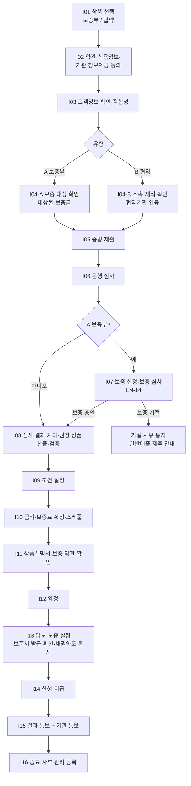
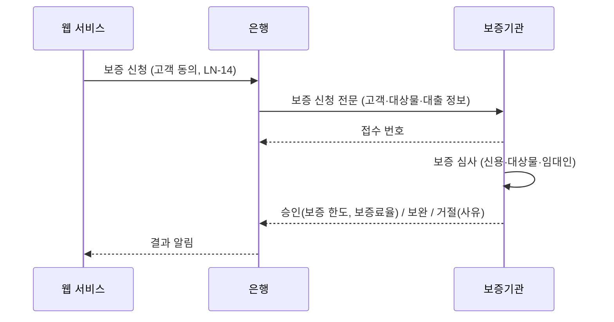
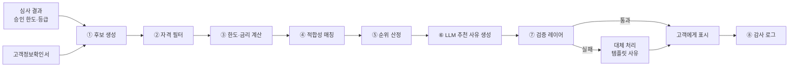

# 기관대출(보증기관·협약기관 연계 대출) 서비스 기획서

| 항목 | 내용 |
|---|---|
| 문서 | 대출 서비스 > 기관대출 업무 로직 및 구현 기획서 |
| 버전 | v0.3 (공유 검토본) |
| 표기 원칙 | 은행명은 'OO은행'(본문에서는 '당행')으로 씁니다. 본문에 나오는 실제 기관·제도·회사 이름(신용평가회사, 보증기관, 시세 제공처, 정책자금 상품명 등)은 업무를 설명하기 위한 공개 정보 기준 예시이며 제휴·승인 관계를 뜻하지 않습니다. 금리·한도·기준값은 모두 예시이고, 법령·약관 내용은 요약이므로 실제 적용 전 법무·준법감시 확인이 필요합니다. |
| 작성일 | 2026-11-04 |
| 상위 문서 | [Loan_Service_main.md](../Loan_Service_main.md) |
| 기준 문서 | [일반대출_기획서.md](일반대출_기획서.md) — 일반대출과 겹치는 내용은 이 문서 안에 **"공통 (일반대출 Sxx과 동일)"** 제목으로 전부 옮겨 적었고, 기관대출에만 있는 내용은 **"<추가>"** 제목의 별도 표로 적었습니다. 이 문서만 읽어도 기관대출 전체를 알 수 있습니다. |
| 사용 서류 | `Contract_Document/` LN-01 ~ LN-18 (특히 LN-14 전세자금 보증신청·채권양도 동의서) + 협약 전용 LN-22 ~ LN-24 |

> **범위 (2026-11-04 확정)**: 이 문서에서 "기관대출"은 **외부 기관이 대출에 참여하는 개인 대출**로 정의합니다. ① 보증기관의 보증서를 담보로 하는 대출, ② 은행과 협약을 맺은 기관(기업·공공기관·직역 단체)의 소속 직원 전용 대출 두 가지입니다. 기업 대출(법인 대출)이나 정책자금(정부대출 기획서)은 포함하지 않습니다.

> **읽는 법**: 각 구간은 `#### 공통 (일반대출 Sxx과 동일)` → `#### <추가> 기관대출 추가 항목` 순서입니다. <추가> 표의 `구분` 칸에서 **추가**는 공통 내용에 더하는 것, **변경**은 공통 내용을 기관대출에서 바꿔 적용하는 것입니다.

---

## 1. 개요

### 1.1 대상 상품 (예시 분류)
| 유형 | 예시 | 참여 기관 (예시) | 기관의 역할 |
|---|---|---|---|
| A-1. 전세자금 보증부 대출 | 은행 자체 전세자금대출 | 주택도시보증공사(HUG), 한국주택금융공사(HF), SGI서울보증 | 보증서 발급, 보증 심사, 사고 시 대위변제 |
| A-2. 개인 신용 보증부 대출 | 보증서 담보 신용대출 | SGI서울보증 등 | 보증서 발급 |
| A-3. 서민 보증부 대출 | 보증 기반 서민 대출 | 서민금융진흥원 등 | 보증 (정책 성격이면 정부대출 기획서 우선) |
| B-1. 기업 임직원 협약대출 | ○○전자 임직원 신용대출 | 협약 기업 | 소속·재직 확인, (선택) 급여 공제 상환, 금리 우대 근거 |
| B-2. 직역 협약대출 | 공무원·군인·교직원 대출 | 공공기관·연금공단 등 | 소속 확인, 협약 금리 |
| B-3. 단체 협약대출 | 전문직(의사·변호사 등) 단체 대출 | 협회·단체 | 자격 확인 |

### 1.2 일반대출과 다른 점
| 구분 | 일반대출 | 기관대출 |
|---|---|---|
| 심사 | 은행 단독 | 은행 + **보증기관 보증 심사** (A) / 은행 + **기관 소속 확인** (B) |
| 한도 | 은행 산출 | min(은행 한도, 보증 한도) (A) / 협약 한도 (B) |
| 금리 | 은행 금리 체계 | 보증으로 위험이 줄어든 가산금리 + 보증료 별도 (A) / 협약 금리표 (B) |
| 비용 | 인지세 등 | + 보증료 (A) |
| 실행 조건 | 약정·담보 설정 | + **보증서 발급 확인** (A) / + 협약 유효·소속 유지 확인 (B) |
| 사후 관리 | 상환 관리 | + 보증 사고 처리·대위변제 (A) / + **퇴직·협약 해지 시 조건 변경** (B) |

### 1.3 설계 원칙 (공통, 일반대출 1.3 기준, 기관대출에 맞게 일부 표현 변경)
1. **결정은 규칙 엔진이, 설명은 LLM이 합니다.** 승인 여부, 한도, 금리는 결정적(deterministic) 규칙 엔진과 신용평가 모델만 계산합니다. LLM은 정보 추출, 요약, 설명, 질의응답만 맡고, 그 결과는 항상 검증 레이어를 거칩니다.
2. **동의 없이 조회하지 않습니다.** 신용정보 조회, 공공기관 연동, 제3자 제공(보증기관·협약기관 포함)은 해당 동의가 기록된 뒤에만 호출합니다.
3. **고객 이익 우선으로 추천합니다.** 추천 순위는 고객 부담(금리·총이자·월 상환액, 기관대출은 보증료 포함 실질 비용) 기준이며, 은행 수익성은 순위 산정에 쓰지 않습니다(금소법 불공정영업·부당권유 방지).
4. **모든 판단은 재현할 수 있어야 합니다.** 규칙 버전, 입력값, 모델·프롬프트 버전, 결과를 감사 로그로 남깁니다.

### 1.4 용어 (공통, 일반대출 1.4와 동일)
| 용어 | 뜻 |
|---|---|
| DSR | 총부채원리금상환비율 = 모든 대출의 연간 원리금 상환액 ÷ 연 소득 |
| LTV | 담보인정비율 = 대출 금액 ÷ 담보 가치 |
| CB | 신용평가회사(NICE평가정보, 코리아크레딧뷰로) |
| CSS | 은행 내부 신용평가시스템 |
| 규칙 엔진 | 자격·한도·금리를 계산하는 결정적 로직 (버전 관리되는 규칙 테이블 기반) |
| 검증 레이어 | LLM 출력과 추천 결과가 규칙·사실과 맞는지 확인하는 단계 |

**<추가> 용어**
| 구분 | 용어 | 뜻 |
|---|---|---|
| 추가 | 보증서 | 보증기관이 대출 상환을 보증한다는 증서. 보증부 대출(A)의 담보 역할 |
| 추가 | 보증료 | 보증서 발급 대가로 고객이 내는 비용 (보증금액 × 보증료율 × 기간, 기관별 산식) |
| 추가 | 대위변제·구상권 | 고객이 갚지 못하면 보증기관이 대신 갚고(대위변제), 그 금액을 고객에게 청구하는 권리(구상권) |
| 추가 | 협약기관 | 은행과 임직원 대출 협약을 맺은 기업·공공기관·단체 |
| 추가 | 실질 비용 | 총 이자 + 총 보증료 + 부대비용. 기관대출 추천 순위의 기준 |

---

## 2. 전체 처리 흐름

### 2.1 흐름도


### 2.2 신청 상태(State) 정의

#### 공통 (일반대출 2.2와 동일)
| 상태 코드 | 의미 | 진입 조건 | 다음 상태 |
|---|---|---|---|
| `DRAFT` | 신청서 작성 시작 | I01 상품 선택 | `CONSENTED`, `CANCELLED` |
| `CONSENTED` | 필수 동의 완료 | I02 필수 동의 전부 Y | `PROFILED` |
| `PROFILED` | 고객정보확인서 완료, 적합성 1차 통과 | I03 | `DOCS_SUBMITTED`, `UNSUITABLE` |
| `UNSUITABLE` | 적합성 부적합 (권유 불가) | I03 판정 | `PROFILED`(정보 수정), `CANCELLED` |
| `DOCS_SUBMITTED` | 증빙 제출·연동 완료 | I05 | `UNDER_REVIEW` |
| `UNDER_REVIEW` | 심사 중 | I06 시작 | `APPROVED`, `COND_APPROVED`, `DOCS_REQUIRED`, `REJECTED` |
| `DOCS_REQUIRED` | 서류 보완 요청 | 심사 결과 | `DOCS_SUBMITTED`, `EXPIRED` |
| `APPROVED` / `COND_APPROVED` | 승인 / 조건부 승인 | 심사 결과 | `TERMS_SET` |
| `REJECTED` | 거절 | 심사 결과 | 종료 |
| `TERMS_SET` | 대출 조건 설정 완료 | I09 | `PRICED` |
| `PRICED` | 금액·금리 확정 | I10 | `EXPLAINED` |
| `EXPLAINED` | 상품설명서 확인 완료 | I11 | `CONTRACTED` |
| `CONTRACTED` | 약정 완료 | I12 | `COLLATERAL_SET`, `DISBURSED` |
| `COLLATERAL_SET` | 담보·보증 설정 완료 | I13 | `DISBURSED` |
| `DISBURSED` | 실행·지급 완료 | I14 | `COMPLETED`, `WITHDRAWN` |
| `COMPLETED` | 결과 통보·서류 교부 완료 | I15 | (대출 관리) |
| `WITHDRAWN` | 청약철회 | 실행 완료(`COMPLETED`) 후 14일 이내 철회. 실제 처리는 대출 계좌 상태(대출관리 M07, `ACTIVE → WITHDRAWN`)에서 함 | 종료 |
| `CANCELLED` / `EXPIRED` | 고객 취소 / 기한 경과 | 언제든 / 유효기간 경과 | 종료 |

**유효기간 규칙 (설정값)**
| 대상 | 기본값 | 경과 시 |
|---|---|---|
| 신청서 `DRAFT` ~ `DOCS_SUBMITTED` | 7일 | `EXPIRED` |
| 서류 보완 요청 | 14일 | `EXPIRED` |
| 심사 결과 (승인 한도·금리) | 30일 | 재심사 필요 |
| 금리 확정 (`PRICED`) | 당일 영업 마감까지 (변동금리 기준금리 고시 변경 시 재산출) | `TERMS_SET`로 되돌림 |

#### <추가> 기관대출 추가 상태
**<추가> 상태 코드**
| 구분 | 상태 코드 | 의미 | 진입 위치 |
|---|---|---|---|
| 추가 | `AFFILIATION_CHECKING` | 협약기관 소속 확인 중 | I04-B (`PROFILED` 다음) |
| 추가 | `AFFILIATION_FAILED` | 소속 확인 실패 (일반대출 전환 가능) | I04-B |
| 추가 | `GUARANTEE_REQUESTED` | 보증 신청 완료, 보증 심사 중 | I07 |
| 추가 | `GUARANTEE_APPROVED` / `GUARANTEE_REJECTED` | 보증 승인 / 거절 | I07 |
| 추가 | `GUARANTEE_ISSUED` | 보증서 발급 완료 (실행 가능) | I13 |
| 변경 | `COLLATERAL_SET` | 보증부(A)는 `GUARANTEE_ISSUED` + 채권양도 통지 확인 완료 시 진입 | I13 |

---

## 3. 구간별 상세 설계

각 구간은 **역할 → 화면 구성 → 입력 항목 → 시스템 조회 데이터 → LLM 활용 → 처리 로직 → 예외 → 산출물** 순서로 적습니다.

### I01. 상품 선택

#### 공통 (일반대출 S01과 동일)
**역할**: 고객이 원하는 대출 유형을 고르고, 신청서(`loan_application`)를 만듭니다.

**화면 구성**
- 상품 유형 카드 (신용 / 전월세 / 부동산담보 / 자동차 / 예금담보 중 기관대출 대상 유형)
- 유형별 간단 안내: 대상, 최대 기간, 금리 범위(고시 금리 기준), 필요 서류
- (선택) "어떤 대출이 맞을지 모르겠어요" → 자연어 상담 입력창 (LLM-1)

**입력 항목**
| 필드 | 타입 | 필수 | 검증 규칙 | 예시 |
|---|---|---|---|---|
| `product_type` | enum | Y | `CREDIT`, `JEONSE`, `MORTGAGE`, `AUTO`, `DEPOSIT_SECURED` 중 하나 | `CREDIT` |
| `purpose_text` | string(500) | N | 개인정보 패턴(주민번호, 계좌번호) 입력 시 마스킹 후 저장 | "결혼 자금이 3천만원 정도 필요해요" |
| `channel` | enum | Y (자동) | `WEB`, `APP` | `WEB` |

**시스템 조회 데이터**
| 데이터 | 출처 | 용도 |
|---|---|---|
| 상품 카탈로그 (판매 중 상품, 고시 금리 범위) | 내부 상품 DB `product_catalog` | 카드 표시 |
| 고객의 진행 중 신청서 | `loan_application` | 중복 신청 방지, 이어하기 |

**LLM 활용 (LLM-1: 상담 의도 구조화)**
| 항목 | 내용 |
|---|---|
| 입력 | `purpose_text`, 상품 카탈로그 요약 (RAG로 검색한 상품 설명) |
| 출력(JSON) | `{ "purpose_code": "LIVING", "desired_amount": 30000000, "desired_term_months": null, "candidate_types": ["CREDIT"], "clarify_questions": ["상환 기간은 어느 정도 생각하세요?"] }` |
| 검증 | JSON 스키마 검증, `candidate_types`가 enum 안에 있는지, 금액이 숫자 범위(1만원 ~ 50억) 안인지 |
| 사용 | 상품 카드 강조 표시와 I03 입력값 **미리 채우기(고객 수정 가능)**에만 사용. 자격 판단에는 쓰지 않음 |

**처리 로직**
```
if 진행 중 신청서(같은 product_type, 상태 ∉ {종료 상태}) 있음:
    "이어하기 / 새로 시작" 선택 제공
create loan_application(status=DRAFT, product_type, created_at)
```

**예외**: 판매 중지 상품 선택 시 안내 후 다른 상품 추천 / 같은 유형 진행 중 신청 2건 이상 생성 불가

#### <추가> 기관대출 추가 항목
**<추가> 화면·처리**
| 구분 | 대상 | 내용 |
|---|---|---|
| 추가 | 협약(B) | 고객이 소속 기관을 검색해 선택합니다(협약기관 목록 `agreement_org`). 회사 이메일 도메인이나 회원 정보의 직장명으로 **추천 후보**를 띄울 수 있습니다(확정은 I04-B). 기관명 정규화는 ILLM-1 |
| 추가 | 보증부(A) | 보증기관을 고객이 고르지 않아도 되도록, 조건에 맞는 보증기관을 I04-A 다음 사전 비교 화면에서 실질 비용 순으로 권장하고(고객이 신청할 기관 선택), I07 보증 승인 후 I08에서 확정 금액으로 다시 권장합니다 |

**<추가> 입력 항목**
| 구분 | 필드 | 타입 | 필수 | 비고 |
|---|---|---|---|---|
| 추가 | `agreement_org_id` | string | B 유형 Y | 협약기관 코드 |
| 추가 | `guarantee_pref` | enum | N | 선호 보증기관 (없으면 자동 비교) |

**<추가> 조회 데이터**
| 구분 | 데이터 | 출처 | 용도 |
|---|---|---|---|
| 추가 | 협약기관 목록·협약 유효기간 | `agreement_org` | 기관 검색, 협약 종료 기관 제외 |

**<추가> 상품 카드 표시 규칙 (main 3.5)**
| 구분 | 항목 | 내용 |
|---|---|---|
| 추가 | 대출 기간 표시 | 상품 카드와 상품 상세 화면의 **"최대 N원" 바로 옆에 "기간 최소 ~ 최대"**를 표시 (예: 최대 1억원 \| 기간 1년 ~ 5년). 12개월 단위면 "년", 아니면 "개월"로 표시하고, 허용 기간이 하나뿐이면 그 기간만 표시 (예: 기간 2년) |
| 추가 | 진입 순서 | 상품 카드 클릭, 카드의 「대출신청」·「갈아타기 신청」 버튼, 배너 클릭 **모두 상품 상세(상품 정보) 화면을 먼저** 보여 줌. 상세 화면 아래의 신청 버튼을 눌러야 C02 동의 단계로 들어감 (상품 정보 확인 없이 동의로 바로 넘어가지 않음) |
| 추가 | 화면 보기 방식 | 기본은 **한 화면 전환(모바일 보기)**: 메인에서 상품을 누르면 같은 자리가 상품 상세·신청 단계로 바뀌고, 뒤로 가면 메인으로 돌아옴. 폭 900px 이상에서는 「분할 보기」로 바꿔 메인을 왼쪽에 두고 하위 화면을 오른쪽에 열 수 있음. 900px 미만은 항상 한 화면 전환. 상단 ≡ 메뉴 창(대출/대환/대출관리)도 메인 화면과 같은 자리에 열리고, 항목을 누르면 같은 자리에 해당 메인 화면이 열림 (main 3.6) |
| 유지 | 값 출처 | `product_catalog`의 최대 한도(`max_amount`)와 허용 기간 목록(`term_options`)의 최솟값·최댓값 |

---

### I02. 동의

#### 공통 (일반대출 S02와 동일)
**역할**: 이후 모든 조회의 법적 근거가 되는 동의를 받고 기록합니다.

**사용 서류**: LN-01 여신거래기본약관, LN-02 개인(신용)정보 수집·이용·조회 동의서

**입력 항목**
| 필드 | 타입 | 필수 | 검증 규칙 |
|---|---|---|---|
| `consent_terms_basic` | bool | Y | true여야 다음 진행 |
| `consent_collect_use` | bool | Y | true |
| `consent_unique_id` | bool | Y | true (고유식별정보 처리) |
| `consent_credit_inquiry` | bool | Y | true |
| `consent_provide_3rd` | bool | Y | true (한국신용정보원, 보증기관, 법무사) |
| `consent_marketing` | bool | N | 채널별(문자/이메일/앱/전화) 하위 선택 |
| `consent_public_scraping` | bool | N | 공공기관 자동 연동 (I05에서 다시 물을 수 있음) |

**처리 로직**
```
각 동의 항목마다 consent_record 저장:
  (application_id, consent_code, document_version, agreed(Y/N), agreed_at, ip, user_agent, 화면 스크롤 완료 여부)
필수 동의 하나라도 N → 다음 진행 불가, "필수 동의가 필요한 이유" 안내
문서 버전(document_version)은 동의 당시 PDF 해시값으로 고정 저장
status = CONSENTED
```

**LLM 활용 (LLM-2: 약관 질의응답, 선택 기능)**
- 고객이 "이 동의 안 하면 어떻게 돼요?" 같은 질문을 하면, **약관·동의서 원문만을 근거로** 답합니다(RAG).
- 답변에 근거 조항 번호를 반드시 포함하고, 근거를 찾지 못하면 "상담원 연결"로 넘깁니다.
- 동의 여부 선택을 LLM이 대신하거나 유도하는 문구("동의하시는 게 좋아요")는 금지어 필터로 차단합니다.

**예외**: 동의 철회 시 진행 중 신청은 `CANCELLED`, 이미 조회한 신용정보는 보유기간 규칙에 따라 관리

#### <추가> 기관대출 추가 항목
**<추가> 동의**
| 구분 | 동의 | 필수 | 이유 | 서류 |
|---|---|---|---|---|
| 추가 | 보증기관 개인(신용)정보 제공 동의 | A: Y | 보증 심사, 보증서 발급, 사고 관리 | LN-14 |
| 추가 | 보증기관 약관 동의 | A: Y | 보증 약정 (보증기관 약관은 보증기관 문서 사용) | 보증기관 문서 |
| 추가 | 협약기관 재직 정보 조회·제공 동의 | B: Y | 소속·재직 확인, 퇴직 시 통보 | LN-22 |
| 추가 | 급여 공제 상환 동의 | B: 선택 | 급여에서 원리금 공제 (협약에 따라) | LN-23 (I09에서 받을 수도 있음) |

---

### I03. 고객정보 확인·적합성

#### 공통 (일반대출 S03과 동일)
**역할**: 금소법 적합성 원칙에 따라 고객 정보를 받고, 고객에게 맞지 않는 상품을 권유하지 않도록 1차 판정을 합니다.

**사용 서류**: LN-03 고객정보확인서

**입력 항목**
| 그룹 | 필드 | 타입 | 필수 | 검증 규칙 | 미리 채우기 출처 |
|---|---|---|---|---|---|
| 기본 | `name`, `birth_date`, `phone`, `email`, `address` | string/date | Y | 형식 검증 | 회원 정보 (main) |
| 기본 | `housing_type` | enum | Y | 자가/전세/월세/기타 | - |
| 직업 | `job_type` | enum | Y | 급여/사업/프리랜서/연금/무직·기타 | - |
| 직업 | `employer_name`, `position`, `employment_months` | string/int | 조건부 (급여·사업) | `employment_months` ≥ 0 | - |
| 소득 | `annual_income` | int(원) | Y | 0 이상, 30억 이하 | LLM-1 결과 없음 (고객 입력) |
| 재산 | `assets_amount` | int | N | 0 이상 | - |
| 부채 | `existing_debt_total`, `monthly_debt_payment` | int | Y | 0 이상 | I06에서 CB 조회값으로 교차 검증 |
| 부채 | `delinquency_1y`, `guarantee_debt` | bool | Y | - | - |
| 목적 | `purpose_code` | enum | Y | 생활/주택구입/보증금/자동차/대환/기타 | LLM-1 |
| 계획 | `desired_amount`, `desired_term_months` | int | Y | 상품별 최소·최대 | LLM-1 |
| 계획 | `repayment_pref` | enum | Y | 만기일시/원리금균등/원금균등 | - |
| 계획 | `repayment_source` | enum | Y | 소득/금융자산/부동산 처분/기타 | - |
| 계획 | `rate_pref` | enum | Y | 고정/변동/혼합/무관 | - |

**적합성 1차 판정 로직 (규칙 엔진 `SUIT-RULE v1`)**
```
monthly_income = annual_income / 12
expected_payment = 상환액 추정(desired_amount, desired_term_months, repayment_pref, 상품 고시 최고 금리)
burden_ratio = (monthly_debt_payment + expected_payment) / monthly_income

판정:
  if annual_income == 0 and product_type != DEPOSIT_SECURED and repayment_source == "소득": UNSUITABLE("상환 재원 부족")
  elif burden_ratio > SUIT_MAX_BURDEN(설정값, 예 0.7): UNSUITABLE("상환 부담 과다")
  elif delinquency_1y == true: WARNING("연체 이력 — 심사에서 불리할 수 있음") → 진행 가능
  elif purpose_code 와 product_type 불일치 (예: 목적=자동차, 상품=전월세): WARNING("목적에 맞는 상품 안내") → I01로 이동 제안
  else: SUITABLE
```
- `UNSUITABLE`이면 은행은 권유할 수 없습니다. 고객에게 판정 사유를 알리고, 정보 수정 또는 신청 종료를 고르게 합니다.
- 고객이 그래도 직접 신청을 원하면 **적정성 원칙** 흐름(부적정 사실 고지 → 고객 확인 기록)을 거쳐 진행할 수 있게 하되, 이 판단은 준법감시 협의 후 정책으로 확정합니다(일반대출 미결 Q1).

**LLM 활용**: 이 구간에서는 판정에 LLM을 쓰지 않습니다. 판정 사유 안내 문장은 사유 코드별 **고정 문구 템플릿**을 씁니다.

**산출물**: `applicant_profile` 저장, `suitability_result(SUITABLE|WARNING|UNSUITABLE, reason_codes[], rule_version)`

#### <추가> 기관대출 추가 항목
**<추가> 입력·판정**
| 구분 | 항목 | 내용 |
|---|---|---|
| 추가 | 협약(B) 입력 | `employee_no`(사번), `employment_type`(정규/계약) — I04-B 재직 확인에 사용 |
| 변경 | 협약(B) `employer_name` | 고객 직접 입력 대신 I01에서 고른 협약기관명을 자동으로 채움 (수정 불가) |
| 변경 | 보증부(A) `expected_payment` | 보증료(월 환산 예상액)를 더해 상환 부담률을 계산 |

#### 공통 (I03) 적합성 판정 창 화면 규칙 — 네 업무 공통

**적합성 판정 창 화면 규칙 (main 5.2.1)**
| 항목 | 내용 |
|---|---|
| 주의 문구 | 판정 창 맨 아래에 항상 표시: "※ 본 결과는 입력한 정보에 따른 결과이므로 심사 결과는 달라질 수 있습니다." |
| 법 설명 팝업 | 화면의 **「금소법 적합성 원칙」** 글자를 누르면 작은 창으로 설명 표시 (제17조 적합성 원칙: 정보 파악 → 부적합 권유 금지 → 확인·보관 / 제18조 적정성 원칙: 적정성 원칙 대상 상품을 고객이 권유 없이 신청할 때 부적정 사실 고지·확인. 대상이 아닌 대출에도 같은 고지·확인 절차를 적용하는 것은 이 서비스의 기획안이며 적용 범위는 준법감시 확인) |
| 부적합(`UNSUITABLE`) 시 체크박스 | 판정 창 안에 "대출 업무 진행이 불가할 수 있는 점을 인지하고 있으며, 신용 조회 등 관련 심사 절차 진행에 동의합니다." 체크박스 표시. 체크 전에는 「다음」 비활성화(입력 미완료 상태) |
| 조정 안내 창 | 체크하면 작은 창이 열려 적합 기준 안으로 들어오는 방법을 계산해 보여 줌 (아래 계산식) |
| 창의 선택지 | ① 기간 유지 → 금액을 X원 이하로 조정 ② 금액 유지 → 기간을 N개월로 조정 ③ 조정 없이 현재 조건으로 심사 진행 (불가능한 선택지는 이유와 함께 비활성 표시) |
| 창의 버튼 | **「이전」**: 창을 닫고 고객정보 화면에 머무름 (직접 수정 가능) / **「다음」**: 고른 선택지를 적용하고 다음 단계로 이동 |
| 기록 | ①·② 선택 시 조정된 금액·기간으로 다시 적합 판정. ③ 선택 시 `suitability_override` 기록(고지 문구 버전, 시각)을 남기고, 심사 화면 첫 단계에 "적합성 확인 — 고객 동의로 진행" 표시 |

**조정 안내 계산식 (규칙 엔진, 예시 기준)**
```
월 상환 가능액 B = 월 소득 × 0.7 − 유지되는 기존 대출 월 상환액      (대환이면 대환 대상 상환분 제외)
금리 r = 상품 고시 최고 금리 ÷ 12
① 기간 n 유지 → 최대 금액
     원리금균등: A = B × (1 − (1 + r)^−n) ÷ r
     원금균등:   A = B ÷ (1/n + r)
     만기일시:   A = B ÷ r
     → 100만원 단위 내림, 상품 최소 금액 미만이면 "금액 조정 불가"
② 금액 유지 → 최소 기간
     월 상환액(금액, 금리, t) ≤ B 를 만족하는 가장 짧은 t (계산상 최소 개월)
     → 상품이 허용하는 기간 중 그 이상인 가장 짧은 기간을 제안, 없으면 "기간 조정 불가"
     → 만기일시상환은 기간을 바꿔도 월 이자가 같으므로 "기간 조정 불가"
B ≤ 0 (기존 대출만으로 기준 초과) → ①·② 모두 불가, ③만 선택 가능
대환은 금액이 상환 필요 금액으로 고정 → ①은 불가, ②·③만 선택 가능
```

**<추가> 희망 금액 한도 초과 안내 (main 3.5)**
| 구분 | 항목 | 내용 |
|---|---|---|
| 추가 | 입력란 안내 | 희망 금액 라벨 옆에 "(최대 N원)"을 미리 표시 |
| 추가 | 초과 판정 | 입력할 때마다 `desired_amount > 상품 최대 한도(max_amount)`인지 확인 |
| 추가 | 초과 시 메시지 | 화면 아래쪽에 짧은 알림 **"한도금액을 초과하였습니다."**를 띄우고, 입력란 바로 아래에 빨간 글씨로 "한도금액을 초과하였습니다. 이 상품의 최대 한도는 N원입니다." 표시, 입력란 테두리를 빨간색으로 표시 |
| 추가 | 진행 제한 | 초과 상태에서는 「다음」 비활성화 (입력 미완료 상태이므로 main 3.4의 '처음으로' 규칙 대상 아님). 금액을 한도 이내로 고치면 메시지가 사라지고 「다음」이 다시 활성화 |
| 유지 | 심사 한도와의 관계 | 이 검사는 **상품 최대 한도** 기준의 입력 검증입니다. 고객별 승인 한도(DSR·담보 등)는 C05 심사에서 따로 정하며, 승인 한도가 희망 금액보다 작으면 조건부 승인(감액)으로 처리 |
| 예외 | 대환대출 | 금액을 고객이 입력하지 않고 상환 필요 금액으로 자동 설정하므로 이 검사를 하지 않음 |

---

### I04-A. 보증 대상 확인 (보증부, 기관대출 고유)

**역할**: 보증기관 기준에 맞는 대상인지 먼저 확인해, 보증 거절로 늦게 탈락하는 일을 줄입니다.

| 확인 항목 | 데이터 | 비고 |
|---|---|---|
| 임차 주택 유형 | 임대차계약서, 건축물대장 | 보증 가능 주택 유형 (기관별 기준) |
| 보증금 상한 | 임대차계약서 | 지역별 상한 (`guarantee_rule`) |
| 선순위 채권 | 등기부 | 선순위 근저당 + 보증금 ≤ 주택 가격 × 기준 비율 |
| 임대인 | 등기부 소유자 = 계약서 임대인 | 불일치 시 보증 불가 가능성 |
| 계약 기간 | 임대차계약서 | 최소 기간 기준 |
| 신청 시점 | 계약일·잔금일·전입일 | 기관별 신청 가능 기간 |

**처리 로직**
```
for agency in [HUG, HF, SGI]:
    agency.pre_result = guarantee_rule[agency, effective_on=today] 평가
가능한 보증기관 목록을 I08 후보로 넘김
모두 불가 → 사유 표시 + 신용대출 등 다른 상품 안내
```

**LLM 활용 (ILLM-2)**: 임대차계약서·등기부를 비교해 보증 위험 요소(선순위 채권, 임대인 불일치, 신탁 등기 등)를 정리합니다. 사전 안내·심사 참고용이며, 규칙 엔진 결과와 상충하면 규칙 결과만 표시합니다.

**<추가> 화면 규칙 — 모든 보증기관 보증 불가 시 (main 3.4)**
| 구분 | 항목 | 내용 |
|---|---|---|
| 추가 | 하단 버튼 | 「다음」을 비활성화하지 않고 **「처음으로」**로 바꿈 |
| 추가 | 화면 표시 | 보증 불가 사유 (`COL-DEPOSIT-OVER-VALUE` 등), 보증기관별 불가 배지 |

### I04-B. 소속·재직 확인 (협약, 기관대출 고유)

**역할**: 고객이 협약기관 소속인지 확인합니다. 협약 금리의 근거라서 고객 진술만으로 확정하지 않습니다.

| 확인 방식 | 우선순위 | 처리 |
|---|---|---|
| 협약기관 재직 확인 API | 1 | 사번·생년월일로 재직 여부·입사일·고용 형태 조회 |
| 건강보험 직장 가입 정보 | 2 | 사업장명이 협약기관인지 확인 (사업자번호 매칭) |
| 재직증명서 업로드 | 3 | OCR + LLM-3 추출 → 발급기관 = 협약기관, 발급일 1개월 이내 |
| 협약기관 담당자 확인 | 4 | 위 방법 실패 시 기관 담당자에게 확인 요청 (기한 3영업일) |

```
status = AFFILIATION_CHECKING
result = 확인 방식을 순서대로 시도, 처음 성공한 결과 사용
검증: 고용 형태(정규/계약) 및 재직 기간이 협약 조건(agreement_org.conditions) 충족
실패 → AFFILIATION_FAILED → 일반대출 전환 제안
```

**<추가> 화면 규칙 — 소속 확인 실패(`AFFILIATION_FAILED`) 시 (main 3.4)**
| 구분 | 항목 | 내용 |
|---|---|---|
| 추가 | 하단 버튼 | 「다음」을 비활성화하지 않고 **「처음으로」**로 바꿈 |
| 추가 | 화면 안 버튼 | 「일반 신용대출로 전환」 |

---

### I05. 증빙 제출

#### 공통 (일반대출 S04와 동일)
**역할**: 심사에 필요한 소득·재직·담보 정보를 모읍니다. 자동 연동을 먼저 시도하고, 안 되면 서류 업로드를 받습니다.

**사용 서류**: LN-04 증빙서류 제출 안내서

**입력 방식**
| 방식 | 대상 | 처리 |
|---|---|---|
| 공공기관 자동 연동 | 건강보험 자격득실·납부, 소득금액증명, 근로소득원천징수, 사업자등록 | 연동 동의 → 연동 API 호출 → 구조화 데이터 저장 |
| 서류 업로드 | 연동 실패, 연동 대상이 아닌 서류(임대차계약서, 매매계약서, 차량 견적서 등) | 파일 업로드 → OCR → LLM-3 추출 → 고객 확인 |

**상품별 필요 데이터**
| 상품 | 필수 데이터 | 시스템 조회 |
|---|---|---|
| 신용 | 연 소득, 재직 정보 | 공공 연동, CB |
| 전월세 | 임대차계약서(보증금, 기간, 임대인, 주소, 확정일자), 등본 | 등기부(선순위 채권 확인), 보증기관 사전 심사 |
| 부동산담보 | 담보 주소, 매매계약서(구입 시), 등기부 | 시세 API(KB시세 등), 등기부 조회 |
| 자동차 | 차량 정보(모델, 연식, 가격), 판매자 정보 | 차량 시세 API, 자동차등록원부(중고차) |
| 예금담보 | 담보 예금 계좌 | 내부 예금 잔액·만기 조회 (소득 증빙 생략 가능) |

**업로드 파일 검증**: PDF/JPG/PNG, 10MB 이하, 발급일 1개월 이내, 악성 파일 검사, 이미지 해상도 최소 기준

**LLM 활용 (LLM-3: 증빙서류 정보 추출)**
| 항목 | 내용 |
|---|---|
| 입력 | OCR 텍스트 + 문서 유형 후보 (이미지 원본은 LLM 서버로 보내기 전 주민번호 뒷자리 등 마스킹) |
| 출력(JSON) | `{ "doc_type": "WITHHOLDING_RECEIPT", "issuer": "...", "issue_date": "2026-10-20", "holder_name": "...", "fields": { "annual_income": 52000000, "tax_year": 2025 }, "confidence": { "annual_income": 0.93 } }` |
| 검증 1 | 스키마·타입 검증, 날짜 형식, 금액 양수 |
| 검증 2 | **교차 검증**: 추출 연 소득 vs 고객 입력 연 소득 vs 공공 연동 값. 차이가 허용 범위(설정값, 예 ±10%)를 넘으면 `MISMATCH` 플래그 |
| 검증 3 | 문서 명의자 = 신청인 이름(전월세 임대차계약서는 임차인) |
| 검증 4 | `confidence` < 0.85 인 필드는 고객에게 확인 화면을 보여 주고, 고객이 고친 값은 "고객 수정" 표시 |
| 사용 | 심사 입력값 후보. **공공 연동 값이 있으면 연동 값을 우선**하고, LLM 추출 값은 보조 근거로만 저장 |

**LLM 활용 (LLM-4: 서류 일관성 보조 점검)**
- 임대차계약서의 임대인 이름 ↔ 등기부 소유자, 계약 기간 ↔ 대출 기간, 주소 ↔ 등기부 주소가 맞는지 비교해 불일치 목록을 냅니다.
- 결과는 **심사자 참고용 플래그**입니다. 자동 거절에 쓰지 않습니다.

**처리 로직**
```
for 필요 데이터 in 상품별 목록:
    if 연동 동의 and 연동 가능: 연동 호출 (타임아웃 10초, 재시도 2회)
    if 연동 실패 or 연동 대상 아님: 업로드 요청
    업로드 → OCR → LLM-3 → 검증 1~4 → evidence 저장
모든 필수 데이터 확보 → status = DOCS_SUBMITTED
```

#### <추가> 기관대출 추가 항목
**<추가> 필요 서류·처리**
| 구분 | 대상 | 내용 |
|---|---|---|
| 변경 | 전세 보증부(A) | 임대차계약서, **확정일자**, 주민등록등본이 **필수** (확정일자 없으면 보완 요청) |
| 변경 | 협약(B) | I04-B에서 재직이 확인되면 재직 서류(재직증명서·건강보험 자격득실)를 **생략** |
| 추가 | 보증부(A) | 보증기관이 추가로 요구하는 서류(I07 보완 요청)도 같은 업로드·검증 절차로 받음 |

---

### I06. 은행 심사

#### 공통 (일반대출 S05와 동일)
**역할**: 신용·소득·담보를 평가해 승인 여부, 승인 한도, 적용 가능 금리 범위를 정합니다.

**시스템 조회 데이터**
| 데이터 | 출처 | 비고 |
|---|---|---|
| 신용평점, 대출·연체·보증 현황 | CB(NICE, KCB), 한국신용정보원 | I02 조회 동의 필요 |
| 내부 거래 실적 | 내부 DB (급여이체, 예금, 카드) | 우대금리 판단에도 사용 |
| 금융사기·명의도용 이력 | 내부 FDS, 금융권 공유 정보 | |
| 담보 가치 | 시세 API, 감정평가(필요 시) | 부동산·자동차 |
| 규제값 | 규제 테이블 `reg_param` (DSR 한도, 지역별 LTV, 스트레스 금리 등) | 버전·시행일 관리 |

**심사 단계 (파이프라인)**
| 순서 | 단계 | 로직 | 결과 |
|---|---|---|---|
| 1 | 결격 사유 확인 | 연체·부도·신용회복·명의도용 등 KO 규칙 | KO 해당 → `REJECTED` |
| 2 | 소득 확정 | 공공 연동 값 > 원천징수 등 서류 값 > 고객 입력 값 순서로 채택. `MISMATCH`면 보완 요청 또는 낮은 값 채택(설정) | `confirmed_income` |
| 3 | 신용평가 | CSS 점수 = f(CB 점수, 내부 실적, 소득, 직업 안정성) → 등급 1~10 | `internal_grade` |
| 4 | DSR 계산 | 아래 공식 | `dsr` |
| 5 | 담보 평가 (담보 상품) | 담보 가치 × LTV − 선순위 채권 − 소액임차보증금 공제 | `collateral_limit` |
| 6 | 한도 산출 | min(상품 최대 한도, 소득 기반 한도, DSR 여유 한도, 담보 한도, 등급별 한도) | `approved_limit` |
| 7 | 판정 | 아래 판정표 | 결과 코드 |
| 8 | 수기 심사 분기 | 자동 심사 불가 조건(고액, 플래그 다수, 경계 점수) → 심사역 배정 | `MANUAL_REVIEW` |

**DSR 계산식**
```
연간 원리금 상환액(기존) = Σ 기존 대출별 연간 상환액
   - 분할상환: 실제 연간 원리금
   - 만기일시: 원금 ÷ 규제상 인정 만기 + 연 이자   (인정 만기 등은 reg_param)
연간 원리금 상환액(신규) = 신규 대출을 (적용 금리 + 스트레스 가산금리)로 계산한 연간 원리금
DSR = (기존 + 신규) ÷ confirmed_income
DSR 여유 한도 = DSR ≤ reg_param.dsr_limit 를 만족하는 최대 신규 대출 금액 (이분 탐색)
```

**판정표**
| 조건 | 결과 |
|---|---|
| KO 규칙 해당, 또는 `internal_grade` > 컷오프, 또는 `approved_limit` < 상품 최소 금액 | `REJECTED` (거절 사유 코드 기록) |
| 필수 데이터 누락, `MISMATCH` 미해결 | `DOCS_REQUIRED` (보완 서류 목록) |
| `approved_limit` < `desired_amount` 또는 조건(보증서, 기존 대출 일부 상환 등) 필요 | `COND_APPROVED` |
| 그 외 | `APPROVED` |

**LLM 활용 (LLM-5: 심사역 요약 보조, 수기 심사 시)**
- 입력: 심사 데이터 요약(수치), LLM-4 불일치 목록, 고객 진술
- 출력: 심사역용 요약 메모 (위험 요인, 확인 필요 항목). **승인·거절 의견을 내지 않도록** 프롬프트와 출력 스키마로 제한합니다.

**산출물**: `review_result(result_code, approved_limit, rate_range, conditions[], reason_codes[], rule_version, model_version, reviewer_id?)`

#### <추가> 기관대출 추가 항목
**<추가> 심사 단계 변경**
| 구분 | 대상 | 심사 단계 | 내용 |
|---|---|---|---|
| 변경 | 보증부(A) | 5. 담보 평가 | 보증서가 담보 역할을 하므로 담보 평가 대신 **보증 예정 금액**을 한도 산정에 씀 |
| 변경 | 보증부(A) | 6. 한도 | min(은행 한도, 보증 예정 금액) — 보증 승인 후(I07) 보증 한도로 다시 확정 |
| 변경 | 보증부(A) | 7. 판정 | 은행 판정이 승인이어도 보증 승인 전까지는 최종 승인이 아님 → I07로 진행 |
| 추가 | 협약(B) | 2·6. 소득·한도 | 협약 조건(대상 등급, 협약 한도, 재직 기간)을 등급별 한도와 함께 적용 |
| 추가 | 협약(B) | 1. 결격 | `AFFILIATION_FAILED`이면 협약 상품 심사 불가 (일반대출 전환만 가능) |

---

### I07. 보증 신청·보증 심사 (보증부, 기관대출 고유)


| 결과 | 처리 |
|---|---|
| 승인 | `GUARANTEE_APPROVED`, 보증 한도·보증료율 저장 → I08 |
| 보완 | 보증기관 요청 서류를 I05와 같은 방식으로 받아 재전송 |
| 거절 | `GUARANTEE_REJECTED` → 보증기관 거절 사유를 고객에게 알림(ILLM-3 쉬운 설명). 다른 보증기관이 가능하면 그 기관으로 다시 신청할지 고객에게 묻기 |

- 보증 신청은 고객 신용조회 기록을 남길 수 있으므로, **여러 보증기관에 동시에 신청하지 않고** 고객이 고른(또는 I04-A 사전 비교에서 권장한) 기관 한 곳에 먼저 신청합니다.

**<추가> 화면 규칙 — 보증기관 보증 거절(`GUARANTEE_REJECTED`) 시 (main 3.4)**
| 구분 | 항목 | 내용 |
|---|---|---|
| 추가 | 다른 보증기관 가능 | 다른 보증기관으로 다시 신청할지 묻는 버튼을 보여 주고 하단 버튼은 「다음」 유지 |
| 추가 | 가능한 보증기관 없음 | 하단 「다음」을 비활성화하지 않고 **「처음으로」**로 바꿈 |

---

### I08. 심사 결과 처리·권장 상품 산출·검증

#### 공통 (일반대출 S06과 동일)
**사용 서류**: LN-05 심사결과 통지서, LN-06 거절사유 통지서, LN-07 제3자 정보제공 동의서

**I08-A. 승인 / 조건부 승인 → 권장 상품 산출**
같은 유형 안에도 여러 세부 상품이 있습니다. 승인된 고객에게 **어떤 세부 상품을 어떤 조건으로 권장할지** 정하고 검증합니다(아래 "권장 상품 산출·검증 로직").

화면 표시:
- 권장 상품 1~3개 카드 (상품명, 한도, 예상 금리, 월 상환액, 총 이자, 추천 사유)
- 조건부 승인이면 조건 내용과 충족 기한
- "다른 상품 직접 선택" (선택 시 적정성 확인 흐름)

**I08-B. 서류 보완**
- 보완 서류 목록, 사유, 기한(14일)을 알리고 I05로 돌아갑니다.
- 보완 후 재심사는 I06 전체가 아니라 영향받는 단계부터 다시 합니다(예: 소득 서류 보완 → 2단계부터).

**I08-C. 부적합**
- 거절 사유 코드를 고객용 문장으로 바꿔 LN-06에 담습니다.
- 신용정보법에 따라 **거절 근거가 된 신용정보와 제공 기관**을 함께 알립니다.
- 자동화 평가로 거절된 경우 "설명 요구·정정 후 재평가 요청" 버튼을 제공합니다.

**LLM 활용 (LLM-6: 거절 사유 쉬운 말 설명)**
| 항목 | 내용 |
|---|---|
| 입력 | 거절 사유 코드, 고정 템플릿 문장, 고객의 해당 수치(DSR 등) |
| 출력 | 고객이 이해하기 쉬운 설명 2~4문장 + 개선 방법 일반 안내 |
| 검증 | 템플릿의 핵심 사실(사유, 근거 정보, 제공 기관)이 빠지지 않았는지, 수치가 입력과 같은지, 차별적·단정적 표현이 없는지 확인. 실패하면 고정 템플릿만 표시 |

**I08-D. 제휴사 안내**
- 제3자 제공 동의(LN-07, 선택) 없이: 제휴사 상품 목록만 표시
- 동의 시: 고객이 고른 제휴사에만 정보를 보내고, 예상 한도·금리를 받아 표시
- 제휴사 노출 순서는 고객 조건 기준(예상 금리 낮은 순)으로 정하고, 은행이 받는 수수료는 순서에 반영하지 않습니다.

#### 공통 — 권장 상품 산출·검증 로직 (일반대출 4장과 동일)

**전체 구조**


**① 후보 생성**
- `product_catalog`에서 `product_type` 일치 + 판매 중 + 채널(WEB/APP) 판매 가능 + 오늘 날짜가 판매 기간 안인 세부 상품을 모두 가져옵니다.

**② 자격 필터 (하드 규칙, 하나라도 어기면 제외)**
| 규칙 | 예 |
|---|---|
| 연령 | 만 19세 이상, 만기 시 상품 상한 연령 이하 |
| 직업·재직 | 직장인 전용 상품 → 급여소득자 + 재직 3개월 이상 |
| 소득 | 상품 최소 소득 이상 |
| 신용등급 | 상품 허용 등급 이내 |
| 거래 실적 | 우수고객 전용 → 내부 실적 기준 충족 |
| 담보 | 담보 종류·지역·가치 조건 |
| 중복 제한 | 같은 상품 보유 시 추가 불가 등 |

제외된 상품은 `excluded_reason`과 함께 저장합니다(고객이 "왜 이 상품은 안 되나요?"라고 물을 때 근거).

**③ 한도·금리 계산**
- 상품별로 `limit = min(상품 한도, approved_limit, DSR 여유 한도, 담보 한도)`
- 상품별 `final_rate`를 RATE-RULE로 계산 (우대금리는 현재 충족 조건만 반영한 값과, 약속 조건까지 반영한 최대 우대 값을 함께 계산)
- 고객 희망 금액·기간으로 월 상환액, 총 이자 계산

**④ 적합성 매칭 (소프트 점수, 0~1)**
| 항목 | 점수 규칙 |
|---|---|
| 금액 충족 `f_amount` | `min(limit / desired_amount, 1)` |
| 금리 유형 선호 `f_rate_type` | 선호와 일치 1.0 / 혼합 0.6 / 불일치 0.2 / 무관 1.0 |
| 상환 방식 선호 `f_repay` | 허용 방식에 선호 포함 1.0, 아니면 0.3 |
| 상환 부담 `f_burden` | `1 − min(월 상환액 / 월 소득 / SUIT_MAX_BURDEN, 1)` |
| 기간 충족 `f_term` | 희망 기간 허용 1.0, 근접 기간만 허용 0.5 |

`f_burden`이 0(부담 기준 초과)인 상품은 **권장하지 않습니다**(적합성 원칙).

**⑤ 순위 산정 (고객 이익 기준)**
```
f_cost = 1 − (총 이자 − 후보 중 최소 총 이자) / (후보 중 최대 총 이자 − 최소 총 이자 + ε)
score = 0.40·f_cost + 0.20·f_amount + 0.15·f_burden + 0.10·f_rate_type + 0.10·f_repay + 0.05·f_term
```
- 가중치는 설정값이며 변경 시 준법감시 승인과 버전 기록이 필요합니다.
- **은행 수익성, 판매 목표, 직원 성과 지표는 점수에 넣지 않습니다.**
- 상위 3개를 권장 상품으로 표시하고, 1위에 "고객님 조건에 가장 유리한 상품" 표시를 합니다.

**⑥ LLM 추천 사유 생성 (LLM-8)**
| 항목 | 내용 |
|---|---|
| 입력 | 상위 3개 상품의 계산 결과(JSON), 각 점수 항목, 상품 설명(RAG 검색 결과, 상품 코드로 한정), 고객의 선호 항목 |
| 프롬프트 제약 | 입력에 없는 숫자를 만들지 말 것, 상품 코드·이름을 입력 그대로 쓸 것, "승인 확정", "무조건", "최저" 같은 단정·과장 표현 금지, 각 상품의 단점(예: 변동금리 위험)도 1개 이상 적을 것 |
| 출력(JSON) | `[{ "product_id": "CR-101", "headline": "...", "reasons": ["...", "..."], "cautions": ["..."], "cited_facts": [{"field": "final_rate", "value": "4.85"}] }]` |

**⑦ 검증 레이어 (모두 통과해야 표시)**
| 번호 | 검증 | 방법 | 실패 시 |
|---|---|---|---|
| V1 | 스키마 | JSON 스키마 검증 | 1회 재생성 → 실패 시 템플릿 사유 |
| V2 | 상품 실재 | `product_id`가 ②를 통과한 후보 안에 있는지 | 해당 항목 제거 |
| V3 | 수치 일치 | 출력 문장 안의 모든 숫자를 추출해 ③ 계산값과 비교 (금리 소수 둘째 자리, 금액 원 단위까지 일치) | 템플릿 사유로 교체 |
| V4 | 근거 일치 | `cited_facts`의 필드·값이 계산 결과와 같은지 | 템플릿 사유로 교체 |
| V5 | 금지 표현 | 금지어 사전(단정, 과장, 차별, 부당권유 표현) 매칭 + 분류 모델 | 해당 문장 제거 후 재검증 |
| V6 | 필수 주의사항 | 변동금리 상품에 금리 변동 위험, 담보 상품에 담보 처분 위험 문구가 있는지 | 고정 주의 문구 자동 추가 |
| V7 | 순위 보존 | LLM이 순서를 바꾸거나 다른 상품을 더 낫다고 쓰지 않았는지 (1위 상품 언급 순서 확인) | 템플릿 사유로 교체 |
| V8 | 규칙 재계산 | 표시 직전 규칙 엔진으로 한도·금리를 한 번 더 계산해 ③ 결과와 같은지 (계산 중 규제값·기준금리 변경 감지) | ③부터 다시 계산 |
| V9 | 적합성 | 권장 목록에 `f_burden = 0` 상품이 없는지, `UNSUITABLE` 고객이 아닌지 | 해당 상품 제거 |

**템플릿 사유 (대체 처리)**: 점수 항목별 고정 문장 조합. 예) `f_cost` 1위 → "후보 상품 중 총 이자가 가장 적습니다(약 {총이자}원)."

**⑧ 감사 로그**
```
recommendation_log:
  application_id, candidate_ids[], excluded[{id, reason}], scores[{id, 항목별 점수, score}],
  weights_version, rule_version, rate_snapshot(기준금리 고시값·고시일),
  llm_model, prompt_version, llm_raw_output(마스킹), validation_results[V1~V9], displayed_output, displayed_at
```

**고객이 권장하지 않은 상품을 직접 고를 때 (적정성 확인)**
1. 해당 상품이 ② 자격 필터를 통과했는지 확인 (통과 못 하면 선택 불가, 사유 표시)
2. 적합성 점수가 낮은 이유(예: 상환 부담 과다)를 고지
3. 고객이 "그래도 이 상품으로 진행" 확인 → `suitability_override` 기록 (고지 문구 버전, 시각)
4. `f_burden = 0`인 상품은 직접 선택도 막을지 여부는 준법감시 결정 사항입니다(일반대출 미결 Q1).

#### <추가> 기관대출 추가 항목
**<추가> 추천 단계별 차이**
| 구분 | 단계 | 기관대출에서의 내용 |
|---|---|---|
| 변경 | ① 후보 | (A) 보증기관별 상품 조합 (예: 전세대출 × HUG / × HF / × SGI) (B) 협약 상품 + 비교용 일반 신용대출 |
| 변경 | ② 자격 필터 | I04-A·I04-B 결과 + 보증기관·협약 조건 |
| 변경 | ③ 비용 계산 | **실질 비용 = 총 이자 + 총 보증료 + 부대비용.** 보증료는 보증금액 × 보증료율 × 기간 (기관별 산식, `guarantee_rule.fee_formula`) |
| 변경 | ⑤ 순위 | `f_cost`를 **실질 비용** 기준으로 계산 (금리만 낮고 보증료가 비싼 상품이 1위가 되지 않도록) |
| 추가 | ⑥ LLM 사유 | 보증료, 보증 사고 시 구상권, 협약 해지·퇴직 시 금리 변경을 `cautions`에 포함 |
| 추가 | 보증 거절 시 (I08-C) | 보증기관 거절 사유는 ILLM-3으로 쉬운 설명, LLM-6과 같은 검증 적용 |

**<추가> 검증 (IV)**
| 구분 | 번호 | 검증 | 방법 | 실패 시 |
|---|---|---|---|---|
| 추가 | IV1 | 보증료 일치 | 표시 보증료 = 기관 산식 재계산 (승인 후에는 기관이 준 보증료율 사용) | 재계산 |
| 추가 | IV2 | 실질 비용 순위 | 순위가 실질 비용 기준인지 재확인 | 순위 재산정 |
| 추가 | IV3 | 보증 한도 | 표시 한도 ≤ 보증 한도(승인 시) 또는 보증 기준 한도(사전) | 한도 조정 |
| 추가 | IV4 | 협약 금리 | 표시 금리 = 협약 금리표(`agreement_org.rate_table`, 유효기간 안) | 재계산 |
| 추가 | IV5 | 협약 유효 | 협약 종료일 > 오늘, 협약 잔여 한도 > 신청 금액 (협약 총한도가 있는 경우) | 해당 상품 제외 |
| 추가 | IV6 | 기관 중립성 | 특정 보증기관을 근거 없이 우대하는 문구("가장 안전" 등)가 없는지 | 문장 제거 |

**<추가> 보증기관 선택 시점**
```
보증 신청 전(I04-A 후): 사전 기준으로 계산한 '예상' 비교 → 고객이 신청할 보증기관 선택
보증 승인 후(I07 후): 승인 결과로 확정 금액 재계산 → 최종 권장 표시
```

**<추가> 화면 규칙 — 거절(`REJECTED`) 시 (main 3.4, 일반대출 S06-C와 동일)**
| 항목 | 내용 |
|---|---|
| 하단 버튼 | 「다음」을 비활성화하지 않고 **「처음으로」** 버튼으로 바꿈 → 누르면 메인 화면(상품 목록)으로 이동. 「이전」 버튼은 그대로 둠 |
| 화면 구성 | 거절 사유 코드 목록 → 근거 신용정보·제공 기관 → 함께 발견된 서류 결함(참고) → 「제휴사 대출 안내」 버튼 |

---

### I09. 조건 설정

#### 공통 (일반대출 S07과 동일)
**역할**: 승인 범위 안에서 고객이 금액·기간·상환 방식·납입일·자동이체를 정합니다.

**사용 서류**: LN-08 자동이체 출금 동의서

**입력 항목**
| 필드 | 타입 | 필수 | 검증 규칙 |
|---|---|---|---|
| `selected_product_id` | string | Y | I08에서 권장했거나 적정성 확인을 마친 상품 |
| `loan_amount` | int | Y | 상품 최소 ≤ 금액 ≤ `approved_limit`, 1만원 단위 |
| `term_months` | int | Y | 상품별 허용 기간 목록 안 |
| `repayment_method` | enum | Y | 상품이 허용하는 방식만 |
| `grace_months` | int | N | 상품 허용 범위, 기간보다 짧아야 함 |
| `rate_type` | enum | Y | 상품이 허용하는 유형만 |
| `payment_day` | int | Y | 1~28 |
| `debit_account` | 계좌 | Y | 예금주 실명 확인(main 공통 기능), 타행이면 CMS 동의 |
| `consent_auto_debit` | bool | Y | true |

**실시간 계산**: 입력이 바뀔 때마다 월 상환액, 총 이자, 상환 부담률(월 상환액 ÷ 월 소득)을 다시 계산해 보여 줍니다. 상환 부담률이 적합성 기준을 넘으면 경고합니다.

**처리 로직**
```
검증 통과 → loan_terms 저장
금액·기간이 바뀌면 DSR 재계산 → 한도 초과 시 저장 불가
status = TERMS_SET
```

#### <추가> 기관대출 추가 항목
**<추가> 입력 항목**
| 구분 | 필드 | 타입 | 필수 | 검증 규칙 |
|---|---|---|---|---|
| 변경 | `term_months` | int | Y | 보증 기간(A) 또는 협약 조건(B) 안에서만 선택. 전세대출은 임대차 기간에 맞춤 |
| 변경 | `loan_amount` | int | Y | 보증부(A)는 ≤ 보증 한도, 협약(B)은 ≤ 협약 잔여 한도 |
| 추가 | `guarantee_fee_payment` | enum | A: Y | 보증료 납부 방식 `LUMP_SUM`(일시납) / `INSTALLMENT`(분할납) |
| 추가 | `payroll_deduction` | bool | B: N | 급여 공제 상환 선택 (LN-23) |
| 변경 | `payment_day` | int | Y | 급여 공제를 고르면 급여일 기준으로 자동 설정 |

**<추가> 실시간 계산**
| 구분 | 내용 |
|---|---|
| 추가 | 월 상환액 옆에 보증료(분할납이면 월 환산)를 따로 보여 주고, 실질 비용 합계를 함께 표시 |

---

### I10. 금리·보증료 확정

#### 공통 (일반대출 S08과 동일)
**역할**: 최종 금리를 확정하고 상환 스케줄표를 만듭니다.

**사용 서류**: LN-09 상환 스케줄표

**금리 산출 로직 (규칙 엔진 `RATE-RULE`)**
```
기준금리 = 상품의 기준금리 종류(COFIX 신규, 금융채 6M/1Y/5Y 등)의 오늘 고시값
가산금리 = 신용등급별 리스크 프리미엄 + 업무원가 + 법정비용 + 목표이익률 (상품 테이블, 금리산정 내부 기준에 따름)
우대금리 = Σ 충족한 우대 조건 (상한 있음)
최종 금리 = 기준금리 + 가산금리 − 우대금리
제약: 상품 최저 금리 ≤ 최종 금리 ≤ min(상품 최고 금리, 법정 최고 금리 연 20%)
```
- 우대 조건은 "현재 충족"과 "약속(향후 충족 예정)"을 나눠 저장합니다. 약속 조건을 지키지 못하면 다음 금리 변경일에 빠진다는 사실을 I11에서 고지합니다.

**상환 스케줄 생성**: 상환 방식별 공식으로 회차별 원금·이자·잔액을 만들고, 휴일이면 다음 영업일로 조정합니다. 첫 회차 이자는 실행일~첫 납입일 일수로 계산합니다(일할).

**산출물**: `pricing(base_rate, spread, preferential[], final_rate, rate_fixed_until)`, `repayment_schedule[]`, LN-09 PDF 생성

#### <추가> 기관대출 추가 항목
**<추가> 금리·비용 산출**
| 구분 | 대상 | 내용 |
|---|---|---|
| 변경 | 보증부(A) 가산금리 | 보증으로 줄어든 리스크를 반영한 가산금리 (상품 테이블의 보증부 가산금리) |
| 변경 | 협약(B) 금리 | 협약 금리표(`agreement_org.rate_table`, 유효기간 안)의 금리를 적용 |
| 추가 | 보증부(A) 보증료 | 보증료 = 보증금액 × 보증료율 × 기간 (승인 시 보증기관이 준 보증료율). `pricing`에 `guarantee_fee`, `fee_payment` 저장 |
| 추가 | 상환 스케줄 | 보증료를 **별도 행**으로 표시 (일시납: 실행일 1회 / 분할납: 회차별) |
| 추가 | 협약(B) 일반 전환 금리 | 퇴직 등으로 협약이 끝날 때 적용할 일반 금리(약정일 기준)도 함께 계산해 I11·I12에 표시 |

---

### I11. 상품설명서·보증 약관 확인

#### 공통 (일반대출 S09와 동일)
**역할**: 금소법 설명의무를 이행하고, 고객이 이해했음을 확인·기록합니다.

**사용 서류**: LN-10 상품설명서(핵심설명서 포함), LN-11 금융소비자 권리 안내서

**화면 구성**
1. 핵심설명서 (고객 조건이 채워진 1쪽 요약)
2. 상품설명서 전문 (끝까지 스크롤해야 다음 진행)
3. 권리 안내 (청약철회, 금리인하요구권, 위법계약해지권, 자료열람요구권)
4. 이해 확인 질문 3개 (예: "변동금리는 금리가 오르면 월 상환액이 늘어난다 — O/X")

**LLM 활용 (LLM-7: 개인화 핵심 요약 + 질의응답)**
| 항목 | 내용 |
|---|---|
| 역할 | 고객 조건을 넣은 쉬운 요약문 생성, 고객 질문에 상품설명서 근거로 답변 |
| 입력 | 확정 조건(I10 결과), 상품설명서·약관 원문(RAG) |
| 검증 | 요약문의 모든 숫자(금리, 금액, 기간, 수수료율)가 I10 결과와 문자 그대로 같은지 비교. 필수 고지 항목(금리 변동 위험, 연체 시 불이익, 중도상환수수료, 청약철회) 포함 여부 확인. 하나라도 빠지면 고정 핵심설명서만 표시 |
| 한계 | LLM 요약은 **보조 자료**입니다. 법정 설명서는 확정된 PDF(LN-10)이며, 동의 대상도 PDF입니다 |

**처리 로직**: 설명서 열람 시간, 스크롤 완료, 이해 확인 응답(오답이면 해당 부분 재설명 후 재질문)을 `explanation_record`에 저장 → status = `EXPLAINED`

#### <추가> 기관대출 추가 항목
**<추가> 고지 사항**
| 구분 | 유형 | 추가 고지 |
|---|---|---|
| 추가 | A 보증부 | 보증료, 보증 사고 시 보증기관의 대위변제와 구상권(고객에게 청구), 임대차 계약 변경·이사 시 신고 의무 |
| 추가 | B 협약 | 퇴직·휴직·협약 해지 시 금리 변경(일반 금리 전환) 또는 기한 전 상환 조건, 급여 공제 중단 시 자동이체 전환 |

**<추가> 화면·LLM**
| 구분 | 항목 | 내용 |
|---|---|---|
| 추가 | 보증 약관 | 보증기관 약관을 상품설명서 다음에 보여 주고 확인받음 (A) |
| 추가 | 이해 확인 질문 | 보증료·구상권(A) 또는 퇴직 시 금리 전환(B) 문항을 최소 1개 포함 |
| 추가 | ILLM-4 | 보증 약관 질의응답 (보증기관 약관 RAG). 근거 조항 필수, 없으면 보증기관 안내 연결 |
| 변경 | LLM-7 필수 고지 | 위 추가 고지 항목도 요약문 필수 포함 항목에 넣음 |

---

### I12. 약정

#### 공통 (일반대출 S10과 동일)
**역할**: 대출거래약정서에 고객이 동의(전자서명은 main 공통 기능)해 계약을 성립시킵니다.

**사용 서류**: LN-12 대출거래약정서

**처리 로직**
```
약정서 PDF 생성 (I09, I10 확정값 주입) → 해시 저장
고객 확인 항목 4개 체크 → 전자서명 (main 공통 기능 호출)
계약 번호 발급, 계약 성립 시각 기록 (청약철회 기산점)
status = CONTRACTED
```
- 약정 직전 금리 재확인: 기준금리가 I10 이후 바뀌었으면 I10으로 돌아가 재확정합니다.

#### <추가> 기관대출 추가 항목
**<추가> 약정 서류**
| 구분 | 유형 | 서류 | 내용 |
|---|---|---|---|
| 추가 | A 보증부 | 보증부 특약 (약정서 첨부) | 보증서 발급 조건부 실행, 보증료, 구상권, 임대차 변경 신고 |
| 추가 | B 협약 | LN-24 협약대출 특약서 | 협약 금리 적용, 신분 변동 시 처리(30일 선택 기간), 협약 해지, 급여 공제 |
| 추가 | B 협약 (선택) | LN-23 급여공제 상환 동의서 | I09에서 급여 공제를 고른 경우 |

---

### I13. 담보·보증 설정 (보증서 발급 확인·채권양도 통지)

#### 공통 (일반대출 S11과 동일)
| 상품 | 서류 | 처리 | 외부 연계 |
|---|---|---|---|
| 부동산담보 | LN-13 근저당권 설정계약서 | 법무사 배정 → 전자등기 신청 → 접수번호 확인 | 법무사 시스템, 인터넷등기소 |
| 전월세 | LN-14 보증신청·채권양도 동의서 | 보증 신청·발급, 임대인 통지 | 보증기관 API |
| 자동차 | LN-15 저당권 설정계약서 | 저당권 설정 등록 | 자동차등록 시스템/대행사 |
| 예금담보 | LN-16 질권설정 승낙서 | 예금에 질권 표시(지급 정지 코드) | 내부 계정계 |

- 담보 설정이 실행과 같은 날 끝나야 하는 경우(부동산 잔금일), I13과 I14를 한 트랜잭션처럼 묶어 **설정 접수 확인 후 실행**합니다.
- status = `COLLATERAL_SET`

#### <추가> 기관대출 추가 항목
**<추가> 보증서 발급·채권양도 처리 (보증부 A)**
```
약정 완료 → 보증기관에 보증서 발급 요청 → 보증서 번호 수신 → GUARANTEE_ISSUED
전세대출: 임대인에게 채권양도(또는 질권설정) 통지 → 임대인 확인 (LN-14)
임대인 확인이 필요한 상품은 확인 완료 전 실행 불가
보증서 발급 + (필요 시) 임대인 확인 완료 → COLLATERAL_SET
```

**<추가> 처리 항목**
| 구분 | 유형 | 내용 |
|---|---|---|
| 추가 | A 보증부 | 보증서 발급 요청·번호 수신, `guarantee_request.cert_no` 저장 |
| 추가 | A 전세 | 채권양도 통지 발송·임대인 확인 기록 (`assignment_notice`) |
| 변경 | B 협약 (신용) | 담보·보증 설정 없음 → I12 다음 바로 I14 |

---

### I14. 실행·지급

#### 공통 (일반대출 S12와 동일)
**사용 서류**: LN-17 대출금 지급 의뢰서

**처리 로직**
```
실행 전 최종 점검 (실행 직전 체크리스트):
  - 계약 상태 CONTRACTED (+ 담보 상품은 COLLATERAL_SET)
  - 신용 재조회: 약정 후 새 연체·대출 발생 여부 (설정값: 약정 후 N일 경과 시)
  - 지급처 확인: 본인 계좌 / 임대인 / 매도인 / 판매자 → 예금주와 계약서상 상대방 일치
  - FDS(금융사기 탐지) 통과
  - 실행 가능 시간 (계정계 운영 시간)
계정계에 대출 계좌 개설 + 실행 전문 → 지급 이체
실패 시: 재시도 1회 → 실패하면 실행 취소(대출 계좌 해지) + 담당자 알림
status = DISBURSED
```

#### <추가> 기관대출 추가 항목
**<추가> 실행 직전 체크리스트**
| 구분 | 유형 | 점검 항목 | 실패 시 |
|---|---|---|---|
| 추가 | A 보증부 | 보증서 발급 상태 유효, 보증 금액 ≥ 대출 금액 × 보증 비율 | 실행 차단 |
| 추가 | B 협약 | 실행일 기준 재직 재확인(협약기관 API), 협약 유효 | 실행 보류, 고객 확인 요청 |
| 변경 | A 전세 지급처 | 임대인 계좌 (예금주 = 등기부 소유자 = 계약서 임대인) | 지급 보류 |

---

### I15. 결과 통보 + 기관 통보

#### 공통 (일반대출 S13과 동일)
**사용 서류**: LN-18 실행 완료 통지서 (+ LN-01, LN-09, LN-10, LN-11, LN-12 교부)

- 앱 알림·문자로 실행 완료 통지, 계약서류 보관함에 PDF 저장, 이메일 교부 선택
- 청약철회 기한(계약서류 수령일과 실행일 중 늦은 날 + 14일)을 계산해 통지서에 표시
- status = `COMPLETED`

#### <추가> 기관대출 추가 항목
**<추가> 통보·교부**
| 구분 | 유형 | 내용 |
|---|---|---|
| 추가 | A 보증부 | 실행 내역을 보증기관에 통보 (대출 번호, 금액, 실행일, 보증서 번호) |
| 추가 | B 협약 | 협약상 통보 의무가 있으면 협약기관에 실행 사실 통보 (협약 한도 관리) |
| 추가 | 교부 서류 | 보증부 특약(A) 또는 LN-24 협약대출 특약서·LN-23 급여공제 동의서(B)를 함께 교부 |

---

### I16. 종료·사후 관리 등록

#### 공통 (일반대출 S14와 동일)
- 대출 관리 메뉴로 연결합니다. 상세는 [대출관리_기획서.md](../대출관리_기획서.md)(M01~M12)를 따릅니다.

#### <추가> 기관대출 추가 항목
**<추가> 사후 관리 등록**
| 구분 | 유형 | 사후 관리 항목 | 처리 |
|---|---|---|---|
| 추가 | A | 보증 만기·연장, 임대차 계약 변경, 연체 시 보증기관 통보, 보증 사고·대위변제 | 만기 전 연장 안내 배치, 연체 일수 기준 기관 통보 |
| 추가 | B | 퇴직·휴직 통보 수신, 협약 해지, 급여 공제 실패 | 협약기관 통보 수신 → 고객 알림 → 약정에 따라 금리 전환 또는 상환 요청 (소명 기한 부여) |

---

## 4. LLM 활용 종합

### 4.1 활용 목록

#### 공통 (일반대출 5.1과 동일)
| ID | 구간 | 용도 | 결정에 쓰는가 | 실패 시 대체 |
|---|---|---|---|---|
| LLM-1 | I01 | 상담 의도 구조화, 입력 미리 채우기 | 아니오 (고객 확인 후 사용) | 빈 입력 폼 |
| LLM-2 | I02 | 약관·동의서 질의응답 (RAG) | 아니오 | 상담원 연결 |
| LLM-3 | I05 (I04-B 재직증명서 포함) | 증빙서류 정보 추출 | 보조 근거 (연동 값 우선, 교차 검증) | 고객 직접 입력 |
| LLM-4 | I05 | 서류 간 일관성 점검 | 아니오 (심사자 참고) | 점검 생략, 심사자 수동 확인 |
| LLM-5 | I06 | 심사역 요약 메모 | 아니오 | 원 데이터만 표시 |
| LLM-6 | I08 | 거절 사유 쉬운 설명 | 아니오 | 고정 템플릿 |
| LLM-7 | I11 | 개인화 핵심 요약, 설명서 질의응답 | 아니오 | 고정 핵심설명서 |
| LLM-8 | I08 | 권장 상품 추천 사유 | 아니오 (순위는 규칙 엔진) | 템플릿 사유 |

#### <추가> 기관대출 추가 LLM
**<추가> 활용 목록**
| 구분 | ID | 구간 | 용도 | 결정에 쓰는가 | 검증·대체 |
|---|---|---|---|---|---|
| 추가 | ILLM-1 | I01 | 소속 기관 이름 정규화 (예: "OO전자 수원" → 협약기관 코드 후보) | 아니오 (후보 제시만) | 협약기관 목록에 있는 코드만 허용, 확정은 I04-B |
| 추가 | ILLM-2 | I04-A | 임대차계약서·등기부 비교로 보증 위험 요소 정리 (선순위 채권, 임대인 불일치, 신탁 등기 등) | 아니오 (사전 안내·심사 참고) | 규칙 엔진 결과와 상충하면 규칙 결과만 표시 |
| 추가 | ILLM-3 | I07 | 보증기관 거절 사유 쉬운 설명 | 아니오 | LLM-6과 같은 검증, 실패 시 고정 템플릿 |
| 추가 | ILLM-4 | I11 | 보증 약관 질의응답 (보증기관 약관 RAG) | 아니오 | 근거 조항 필수, 없으면 보증기관 안내 연결 |

### 4.2 LLM이 조회하는 데이터 (도구·RAG)

#### 공통 (일반대출 5.2와 동일)
| 데이터 | 접근 방식 | 접근 가능한 LLM | 비고 |
|---|---|---|---|
| 상품 카탈로그·상품설명서 | RAG (벡터 검색, 상품 코드 필터) | 1, 2, 7, 8 | 판매 중 버전만 색인 |
| 약관·동의서 원문 | RAG (조항 단위 청크) | 2, 7 | 문서 버전별 색인 |
| 고객 서류 OCR 텍스트 | 요청 단위 입력 (색인하지 않음) | 3, 4 | 처리 후 LLM 측 보관 금지 |
| 심사·계산 결과 | 요청 단위 입력 (JSON) | 5, 6, 7, 8 | 읽기 전용 |
| FAQ·대출 안내 | RAG | 1, 2 | |
| 고객 신용정보 원본(CB 응답) | **접근 불가** | - | 요약 수치만 전달 |

#### <추가> 기관대출 추가 데이터
**<추가> 조회 데이터**
| 구분 | 데이터 | 접근 방식 | 접근 가능한 LLM | 비고 |
|---|---|---|---|---|
| 추가 | 보증기관 약관 | RAG (조항 단위 청크, 보증기관·버전 필터) | ILLM-4 | 보증기관이 제공한 최신 약관만 색인 |
| 추가 | 협약기관 목록 (이름·별칭·코드) | 요청 단위 입력 | ILLM-1 | 협약 유효 기관만 |
| 추가 | 임대차계약서·등기부 추출값 | 요청 단위 입력 | ILLM-2 | 색인하지 않음 |
| 추가 | 보증기관 거절 사유 코드·문구 | 요청 단위 입력 | ILLM-3 | |

### 4.3 공통 안전장치 (일반대출 5.3과 동일)
- **개인정보 마스킹**: 주민번호, 계좌번호, 카드번호, 전화번호는 LLM 호출 전에 토큰으로 바꾸고, 응답을 받은 뒤 되돌립니다.
- **출력 구조화**: 모든 LLM 출력은 JSON 스키마로 받고, 스키마 검증에 실패하면 1회만 재시도합니다.
- **근거 강제**: RAG 답변에는 근거 문서 ID와 조항을 포함하고, 근거가 없으면 답하지 않습니다.
- **금지 표현 필터**: 단정적 승인 약속, 과장 광고, 차별 표현, 동의 유도 표현을 차단합니다.
- **사람에게 넘기기**: 고객 불만, 법률 판단, 근거 없는 질문은 상담원에게 연결합니다.
- **기록**: 모델 ID, 프롬프트 버전, 입력 해시, 출력, 검증 결과를 남깁니다. (모델 선택, 호출 방식, 공통 로깅은 main 문서 8장)

**<추가> 안전장치**
| 구분 | 내용 |
|---|---|
| 추가 | 보증기관 중립성: 특정 보증기관을 근거 없이 우대하는 표현을 금지어 사전에 추가 (IV6) |
| 추가 | 사번(직원번호)도 마스킹 대상에 포함 |

#### 공통 (main 8장 LLM 게이트웨이와 동일) — 호출 방식
| 항목 | 내용 |
|---|---|
| 호출 경로 | 업무 서비스 → 자체 LLM 게이트웨이 API(`/internal/llm/v1/invoke`) → 외부 LLM 제공사 API. 업무 코드는 외부 LLM을 직접 부르지 않음 |
| 모델 등급 | 분류·정규화는 경량 모델, 추출·요약·설명·RAG는 표준 모델. 모델 ID는 설정값 |
| 게이트웨이 처리 | 호출 권한 확인 → 프롬프트 버전 선택 → 마스킹 → RAG → 1순위 제공사 호출(실패 시 2순위) → 출력 검증 → 복원 → 기록 |
| 시간 제한 | 분류·생성 3초, RAG 10초, 추출 15초. 넘으면 대체 처리 |
| 외부 연동 조건 | 학습 미사용·최소 보관 계약, 마스킹된 최소 정보만 전송, 게이트웨이만 외부 통로 보유 |

---

## 5. 데이터 모델

### 공통 (일반대출 6장과 동일)
| 테이블 | 주요 컬럼 | 설명 |
|---|---|---|
| `loan_application` | id, user_id, product_type, status, channel, created_at, expires_at | 신청서 |
| `consent_record` | application_id, consent_code, doc_version_hash, agreed, agreed_at, ip | 동의 이력 |
| `applicant_profile` | application_id, job_type, annual_income, debts, purpose_code, prefs(json) | 고객정보확인서 |
| `suitability_result` | application_id, result, reason_codes, rule_version | 적합성 판정 |
| `evidence` | id, application_id, doc_type, source(API/UPLOAD), extracted(json), confidence(json), mismatch_flags | 증빙 |
| `review_result` | application_id, result_code, approved_limit, grade, dsr, conditions, reason_codes, rule_version, reviewer_id | 심사 결과 |
| `product_catalog` | product_id, type, name, rules(json), rate_rule_id, sale_from, sale_to, version | 상품 |
| `reg_param` | key, value, effective_from, version | 규제값 |
| `recommendation_log` | I08 ⑧ 참고 | 추천·검증 기록 |
| `loan_terms` / `pricing` | 금액, 기간, 방식, 금리 구성 | 조건·금리 |
| `repayment_schedule` | contract_id, seq, due_date, principal, interest, balance | 상환 스케줄 |
| `explanation_record` | application_id, doc_id, read_seconds, scrolled, quiz_results | 설명의무 이행 |
| `contract` | contract_no, application_id, signed_at, doc_hash | 약정 |
| `collateral` | contract_no, type, detail(json), registered_at | 담보 |
| `disbursement` | contract_no, payee, account, amount, executed_at, result | 지급 |
| `audit_log` | entity, entity_id, action, before, after, actor, at | 공통 감사 |

### <추가> 기관대출 추가 테이블
**<추가> 테이블**
| 구분 | 테이블 | 주요 컬럼 | 설명 |
|---|---|---|---|
| 추가 | `agreement_org` | org_id, name, biz_no, conditions(json), rate_table(json), total_limit, used_limit, valid_from, valid_to, payroll_deduction | 협약기관 |
| 추가 | `affiliation_check` | application_id, org_id, method, result, employee_type, hire_date, checked_at | 소속 확인 결과 |
| 추가 | `guarantee_rule` | agency, product, version, effective_from, items(json), fee_formula(json) | 보증 기준 |
| 추가 | `guarantee_request` | application_id, agency, request_no, status, approved_amount, fee_rate, cert_no, issued_at, reason_codes | 보증 신청·발급 |
| 추가 | `assignment_notice` | contract_no, landlord, notice_sent_at, confirmed_at | 채권양도 통지 |
| 추가 | `org_event` | contract_no, org_id, event_type(퇴직/휴직/협약해지), received_at, action | 협약기관 통보 |
| 변경 | `pricing` | + guarantee_fee, fee_payment, org_rate_table_version, fallback_general_rate | 보증료·협약 금리 정보 추가 |

---

## 6. API

> 아래 표는 기획 원안이다. 경로는 공통.md 1장에 따라 모두 `/api` 아래에 둔다. 구현된 API(`/api/loans/...`: 신청 흐름은 `/applications/{id}/<단계>`, 대출관리는 `/{no}/...`)와 오류·멱등 규칙은 [loan/README.md](../README.md)와 [오류코드.md 5.1](../../common/오류코드.md)이 기준이고, 다르면 그쪽을 따른다.


### 공통 (일반대출 7장과 동일)
| 메서드 | 경로 | 구간 | 설명 |
|---|---|---|---|
| POST | `/api/loans/applications` | I01 | 신청서 생성 |
| POST | `/api/loans/applications/{id}/intent` | I01 | 상담 문장 구조화 (LLM-1) |
| POST | `/api/loans/applications/{id}/consents` | I02 | 동의 저장 |
| PUT | `/api/loans/applications/{id}/profile` | I03 | 고객정보 저장 + 적합성 판정 |
| POST | `/api/loans/applications/{id}/evidence/sync` | I05 | 공공기관 연동 |
| POST | `/api/loans/applications/{id}/evidence/upload` | I05 | 서류 업로드 (OCR + LLM-3) |
| POST | `/api/loans/applications/{id}/review` | I06 | 심사 요청 (비동기, 결과는 알림) |
| GET | `/api/loans/applications/{id}/review` | I06 | 심사 상태·결과 조회 |
| GET | `/api/loans/applications/{id}/recommendations` | I08 | 권장 상품 (검증 완료본) |
| POST | `/api/loans/applications/{id}/suitability-override` | I08 | 직접 선택 적정성 확인 |
| PUT | `/api/loans/applications/{id}/terms` | I09 | 조건 설정 |
| POST | `/api/loans/applications/{id}/pricing` | I10 | 금리 확정 + 스케줄 생성 |
| POST | `/api/loans/applications/{id}/explanation` | I11 | 설명 확인 기록 |
| POST | `/api/loans/applications/{id}/contract` | I12 | 약정 |
| POST | `/api/loans/contracts/{no}/collateral` | I13 | 담보 설정 |
| POST | `/api/loans/contracts/{no}/disburse` | I14 | 실행 |
| POST | `/api/loans/contracts/{no}/withdrawal` | 사후 | 청약철회 |

### <추가> 기관대출 추가 API
**<추가> 엔드포인트**
| 구분 | 메서드 | 경로 | 구간 | 설명 |
|---|---|---|---|---|
| 추가 | GET | `/loans/agreement-orgs?q=` | I01 | 협약기관 검색 |
| 추가 | POST | `/loans/applications/{id}/affiliation-check` | I04-B | 소속·재직 확인 |
| 추가 | POST | `/loans/applications/{id}/guarantee-precheck` | I04-A | 보증 대상 사전 확인 |
| 추가 | POST | `/loans/applications/{id}/guarantee` | I07 | 보증 신청 |
| 추가 | GET | `/loans/applications/{id}/guarantee` | I07 | 보증 심사 상태 |
| 추가 | POST | `/loans/contracts/{no}/assignment-notice` | I13 | 채권양도 통지 |
| 추가 | POST | `/webhooks/agreement-orgs/{org}/events` | I16 | 협약기관 퇴직·휴직 통보 수신 |

---

## 7. 예외 및 오류 처리

### 공통 (일반대출 8장과 동일)
| 상황 | 처리 |
|---|---|
| 외부 연동(CB, 공공기관, 시세) 장애 | 재시도 2회 → 실패 시 "잠시 후 이어하기" 안내, 신청서 상태 유지 |
| LLM 응답 지연·장애 | 3초(질의응답 10초, 추출 15초) 타임아웃 → 대체 처리(템플릿·고객 직접 입력) |
| 심사 중 고객 정보 변경 | 심사 결과 무효화, 영향 단계부터 재심사 |
| 금리 확정 후 기준금리 변경 | 약정 전이면 재산출 후 고객 재확인 |
| 실행 실패 | 대출 계좌 개설 취소, 고객·담당자 알림, 재실행 요청 버튼 |
| 같은 요청 중복 전송 | 실행·중도상환은 `Idempotency-Key`(같은 키 재요청은 첫 결과 반환), 나머지는 단계 순서(상태 머신)로 중복을 막음 (구현 기준) |
| 의심 거래(FDS) | 실행 보류, 고객 확인 전화, 심사역 배정 |

### <추가> 기관대출 추가 예외
**<추가> 예외 처리**
| 구분 | 상황 | 처리 |
|---|---|---|
| 추가 | 보증 심사 지연 | `GUARANTEE_REQUESTED` 유지, 잔금일 임박 시 고객·담당자 알림 |
| 추가 | 보증 승인 후 임대차 조건 변경 | 보증 재심사 필요, 기존 승인 무효 |
| 추가 | 임대인 채권양도 확인 거부 | 실행 불가, 고객에게 안내 |
| 추가 | 협약 총한도 소진 | 신규 신청 차단, 일반대출 안내 |
| 추가 | 실행일 재직 확인 실패 | 실행 보류, 고객 확인 요청 |
| 추가 | 협약기관 API 장애 | 건강보험 직장 정보 → 서류 순서로 대체 |
| 변경 | 실행 실패 (보증부) | 실행 취소 + 보증기관에 보증 취소 요청 |

---

## 8. 규제·준법 체크리스트

### 공통 (일반대출 9장과 동일)
| 근거 | 요구 사항 | 구현 위치 |
|---|---|---|
| 금소법 적합성 원칙 | 고객 정보 확인, 부적합 상품 권유 금지 | I03, I08 ④·V9 |
| 금소법 적정성 원칙 | 고객이 직접 고른 상품이 부적정하면 고지 | I08 (적정성 확인) |
| 금소법 설명의무 | 중요 사항 설명, 이해 확인 | I11 |
| 금소법 불공정영업·부당권유 금지 | 다른 상품 끼워팔기 금지, 단정적 표현 금지 | I08 ⑤·V5 |
| 금소법 청약철회권 | 14일 이내 철회 | I15, 사후 API |
| 신용정보법 | 조회 전 동의, 거절 사유·근거 정보 고지, 자동화 평가 설명 요구권 | I02, I08-C |
| 개인정보 보호법 | 최소 수집, 보유기간, 마스킹 | I02, 4.3 |
| 은행법 금리인하요구권 | 안내, 10영업일 내 결과 통지 | I11, 대출 관리 |
| 가계대출 규제 | DSR, LTV, 스트레스 DSR | I06, `reg_param` |
| 법정 최고 금리 | 연 20% 상한 | I10 |

> 규제값과 법령 해석은 시점에 따라 바뀝니다. 시스템은 값을 코드에 박지 않고 `reg_param`에서 읽으며, 반영 전 준법감시 승인을 거칩니다.

### <추가> 기관대출 추가 요구 사항
**<추가> 체크리스트**
| 구분 | 요구 사항 | 구현 위치 |
|---|---|---|
| 추가 | 보증기관에 정보 제공 전 동의 | I02 |
| 추가 | 보증료·구상권 설명 | I11 |
| 추가 | 실질 비용 기준 비교 (보증료 포함) | I08 IV1·IV2 |
| 추가 | 협약기관에 재직 정보 조회·퇴직 통보 수신 동의 | I02 (LN-22) |
| 추가 | 협약 해지·퇴직 시 조건 변경을 계약 전에 고지 | I11, I12 (LN-24) |

---

## 9. 운영 지표 (KPI)

### 공통 (일반대출 10장과 동일)
| 지표 | 정의 | 용도 |
|---|---|---|
| 단계별 이탈률 | 단계 진입 대비 다음 단계 진입 비율 | UX 개선 |
| 자동 심사 비율 | 수기 심사 없이 끝난 비율 | 심사 효율 |
| 심사 소요 시간 | 심사 요청 → 결과 | SLA |
| LLM-3 추출 정확도 | 심사자가 고친 필드 비율 | 모델·프롬프트 개선 |
| 추천 검증 실패율 | V1~V9 중 하나라도 실패한 비율 (항목별) | LLM 품질 감시 |
| 권장 1위 선택률 | 고객이 1위 상품을 고른 비율 | 추천 품질 |
| 적정성 override 비율 | 직접 선택 + 부적정 고지 비율 | 준법 감시 |
| 청약철회율 | 실행 대비 철회 | 불완전판매 징후 |

### <추가> 기관대출 추가 지표
**<추가> 지표**
| 구분 | 지표 | 정의 | 용도 |
|---|---|---|---|
| 추가 | 보증 승인률 | 보증 신청 대비 승인 비율 (기관별) | I04-A 사전 확인 정확도 점검 |
| 추가 | 보증 심사 소요 시간 | 보증 신청 → 결과 (기관별) | 잔금일 일정 안내 |
| 추가 | 소속 확인 자동화율 | I04-B에서 API·건강보험으로 끝난 비율 | 협약기관 연동 개선 |
| 추가 | IV 검증 실패율 | IV1~IV6 실패 비율 | 보증료·협약 금리 데이터 품질 |

---

## 10. 테스트 시나리오

### 공통 (일반대출 11장과 동일)
| ID | 시나리오 | 기대 결과 |
|---|---|---|
| T01 | 필수 동의 1개 미동의 | I03 진입 불가 |
| T02 | 소득 0원 + 신용대출 + 상환재원 소득 | `UNSUITABLE` |
| T03 | 원천징수영수증 소득과 연동 소득 20% 차이 | `MISMATCH` → `DOCS_REQUIRED` |
| T04 | DSR 한도 직전 금액 신청 | 한도 = DSR 여유 한도, `COND_APPROVED` |
| T05 | LLM이 금리를 4.85% 대신 4.58%로 출력 | V3 실패 → 템플릿 사유 표시 |
| T06 | LLM이 후보에 없는 상품 코드 출력 | V2 → 해당 항목 제거 |
| T07 | LLM 출력에 "무조건 승인" 포함 | V5 → 문장 제거 |
| T08 | 추천 계산 중 기준금리 고시 변경 | V8 → 재계산 |
| T09 | 약정 후 실행 전 신규 연체 발생 | 실행 보류 |
| T10 | 실행 후 10일째 청약철회 | `WITHDRAWN`, 원금·이자·부대비용 반환 안내 |
| T11 | 신용대출(최대 1억원)에 희망 금액 1억 5천만원 입력 | "한도금액을 초과하였습니다." 알림, 입력란 아래 빨간 안내, 「다음」 비활성화 → 1억원 이하로 고치면 해제 |

### <추가> 기관대출 추가 시나리오
**<추가> 시나리오**
| 구분 | ID | 시나리오 | 기대 결과 |
|---|---|---|---|
| 추가 | IT01 | 등기부 소유자 ≠ 계약서 임대인 | I04-A 위험 표시, 보증 불가 가능성 안내 |
| 추가 | IT02 | 금리는 낮고 보증료가 비싼 조합 | 실질 비용 기준으로 순위 하락 |
| 추가 | IT03 | LLM 사유에 "가장 안전한 보증기관" 표현 | IV6 → 문장 제거 |
| 추가 | IT04 | 계약직 직원, 협약 조건은 정규직만 | `AFFILIATION_FAILED`, 일반대출 전환 제안 |
| 추가 | IT05 | 실행 전날 퇴직 | 실행일 재직 재확인 실패 → 실행 보류 |
| 추가 | IT06 | 보증서 미발급 상태에서 실행 요청 | 실행 차단 |
| 추가 | IT07 | 실행 후 퇴직 통보 수신 | 고객 알림, 약정에 따른 금리 전환 처리 대기 |

---

## 11. 추가 제안

1. **보증기관 비교 화면**: 보증기관별 예상 한도·보증료·실질 비용을 한 표로 보여 주고, 고객이 신청할 기관을 고르게 합니다.
2. **잔금일 역산 일정 안내**: 전세 잔금일에서 거꾸로 계산해 "언제까지 서류를 내야 하는지" 알려 줍니다(보증 심사 소요 기간 반영).
3. **협약기관 관리자 화면**: 협약기관 담당자가 재직 확인 요청을 처리하고, 협약 한도 사용 현황을 볼 수 있게 합니다.
4. ~~협약 대출 서류 추가~~ → **완료**: LN-22 재직정보 조회·제공 동의서, LN-23 급여공제 상환 동의서, LN-24 협약대출 특약서

## 12. 미결 사항

| 번호 | 내용 | 결정 주체 |
|---|---|---|
| ~~IQ1~~ | ~~"기관대출" 범위 확정~~ → **확정 (2026-11-04)**: 보증기관(A)·협약기관(B) 연계 개인 대출 | 기획 |
| IQ2 | 보증기관별 연계 방식과 응답 시간(SLA) | IT + 보증기관 협의 |
| IQ3 | 퇴직 시 처리 방식 기본값 → **기획안 반영**: 통보 후 30일 안에 고객이 선택(일반 금리 전환 / 상환), 미선택 시 일반 금리 전환 (LN-24 제2조, 대출관리 M12). 최종 확정은 상품기획 | 상품기획 + 협약 조건 |
| IQ4 | 보증기관 사전 비교에서 신용조회 없이 계산할 수 있는 범위 | 준법감시 |
| (공통) | 적합성 부적합 고객의 직접 신청 허용, 추천 가중치, 적합성 설정값 — 일반대출 미결 Q1~Q3과 같은 결정을 따름 | 준법감시·상품기획·여신심사 |
