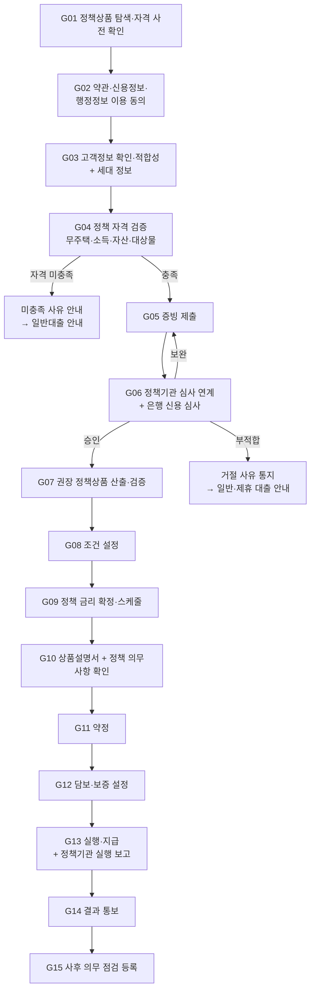
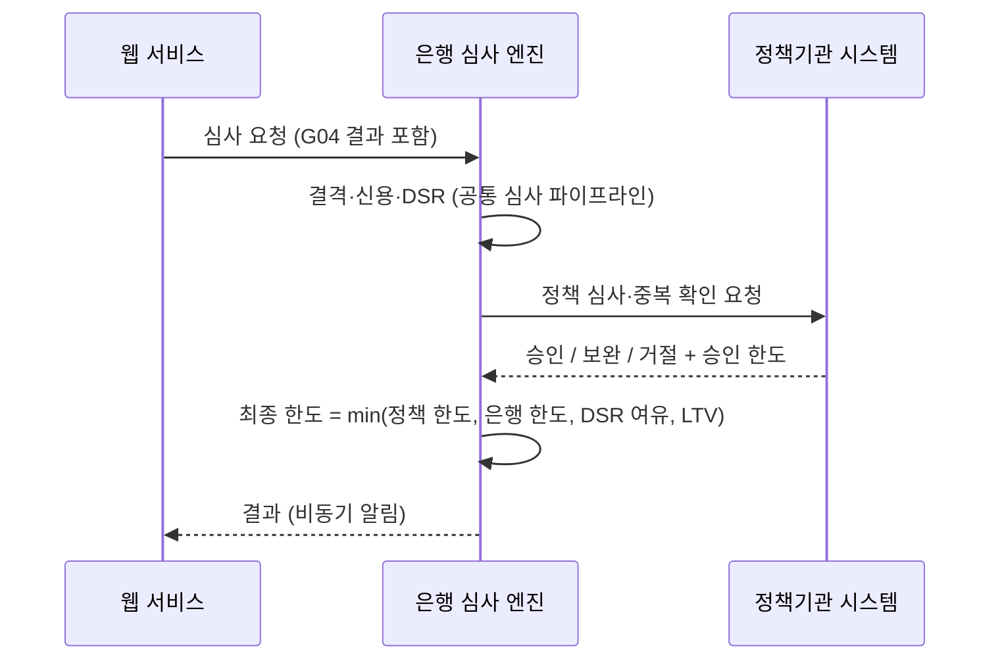
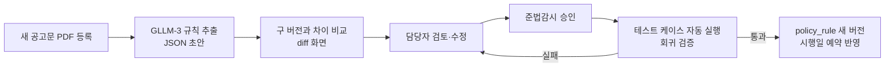

# 정부대출(정책자금 대출) 서비스 기획서

| 항목 | 내용 |
|---|---|
| 문서 | 대출 서비스 > 정부대출 업무 로직 및 구현 기획서 |
| 버전 | v0.3 (공유 검토본) |
| 표기 원칙 | 은행명은 'OO은행'(본문에서는 '당행')으로 씁니다. 본문에 나오는 실제 기관·제도·회사 이름(신용평가회사, 보증기관, 시세 제공처, 정책자금 상품명 등)은 업무를 설명하기 위한 공개 정보 기준 예시이며 제휴·승인 관계를 뜻하지 않습니다. 금리·한도·기준값은 모두 예시이고, 법령·약관 내용은 요약이므로 실제 적용 전 법무·준법감시 확인이 필요합니다. |
| 작성일 | 2026-11-04 |
| 상위 문서 | [Loan_Service_main.md](../Loan_Service_main.md) |
| 기준 문서 | [일반대출_기획서.md](일반대출_기획서.md) — 일반대출과 같은 내용은 각 구간의 **"공통 (일반대출 Sxx과 동일)"** 제목 아래에 **참조 줄**(`일반대출 S01과 같다 → 링크`)만 두고 다시 적지 않았습니다. 일반대출과 다른 점은 참조 줄 아래 **"<변경>"** 표로, 정부대출에만 있는 내용은 **"<추가>"** 제목의 별도 표로 적었습니다. 같은 내용은 링크를 따라 일반대출 기획서에서 읽습니다 |
| 사용 서류 | `Contract_Document/` LN-01 ~ LN-18 + 정책자금 전용 LN-19 ~ LN-21 |

> **표기 규칙**
> - `공통 (일반대출 Sxx과 동일)`: 일반대출 기획서의 해당 구간과 내용이 같다는 뜻이며, 본문을 다시 적지 않고 **참조 줄**(`일반대출 S01과 같다 → [링크]`)만 둡니다. 참조 줄의 구간 코드(S01 등)와 원문 속 장·절 번호(예: 4.2 ⑧, 미결 사항 13장)는 일반대출 기획서의 것이며, 구간 코드는 아래 대응표대로 이 문서의 코드로 읽습니다.
> - `<변경>`: 참조 줄 아래에 붙는 표로, 일반대출 원문과 다른 줄만 적습니다. `구분` 칸이 "변경"이면 이 문서에서는 그 내용으로 바꿔 읽고, "제외"면 원문의 그 부분을 이 문서에서는 쓰지 않습니다. <변경> 표가 없는 구간은 원문과 같습니다.
> - `<추가>`: 정부대출에서 더하거나 바꾸는 부분입니다. 표의 **구분** 칸이 "추가"면 공통 내용에 더하는 것이고, "변경"이면 공통 내용 대신 적용하는 것입니다.
> - 구간 코드 대응: S01→G01, S02→G02, S03→G03, S04→G05, S05→G06, S06→G07, S07→G08, S08→G09, S09→G10, S10→G11, S11→G12, S12→G13, S13→G14, S14→G15

---

## 1. 개요

### 1.1 목적
정부·공공기관이 재원을 대거나 금리·자격 기준을 정한 **정책자금 대출**을 은행이 취급(수탁)할 때의 업무 로직을 정의합니다. 일반대출과 가장 다른 점은 **자격 요건 검증이 복잡하고, 기준이 공고에 따라 자주 바뀐다**는 것입니다.

### 1.2 대상 상품 (예시 분류)
| 분류 | 예시 상품 | 재원·운영 기관 (예시) | 주요 자격 기준 유형 |
|---|---|---|---|
| 주택 구입 | 디딤돌대출, 신혼부부·생애최초 구입자금 | 주택도시기금 | 무주택, 부부합산 소득, 순자산, 주택 가격·면적 |
| 전세 자금 | 버팀목 전세자금, 청년·신혼부부 전용 전세자금 | 주택도시기금 | 무주택, 소득, 자산, 보증금 상한, 연령 |
| 장기 고정금리 주담대 | 보금자리론 | 한국주택금융공사 | 소득, 주택 가격, 주택 수 |
| 서민 금융 | 햇살론 계열, 새희망홀씨 | 서민금융진흥원 보증 / 은행 자체(정책성) | 소득 상한, 신용평점 하위 구간 |
| 청년·특수 대상 | 청년 전용 상품 | 각 기관 | 연령, 소득, 취업 여부 |

> 상품명, 금리, 소득·자산 기준값은 **매 공고마다 바뀝니다.** 이 문서에 숫자를 적지 않고, 모두 `policy_rule` 테이블(6장)에서 관리합니다.

### 1.3 범위
| 포함 | 제외 |
|---|---|
| 정책자금 대출 신청부터 실행까지의 대출 업무, 정책 자격 검증, 정책기관 연계, 사후 의무 관리 | 공통 기능(main 문서), 은행 자체 상품(일반대출), 보증서 처리 상세(기관대출), 대환(대환대출), 실행 후 대출관리 상세(대출관리 기획서) |

### 1.4 설계 원칙

#### 공통 (일반대출 1.3과 동일)
일반대출 1.3과 같다 → [일반대출_기획서.md 1.3](일반대출_기획서.md#13-설계-원칙).

#### <추가> 정부대출 원칙
**<추가> 설계 원칙**
| 구분 | 원칙 |
|---|---|
| 추가 | 자격은 고객 진술이 아니라 **공공 데이터 조회 결과**로 판단합니다. |
| 추가 | 판단 기준은 **신청일 기준 공고**(`policy_rule` 버전)를 씁니다. |
| 추가 | 정책 의무 위반은 **자동으로 회수·금리 가산하지 않고**, 고객 소명과 담당자 결정을 거칩니다. |

### 1.5 용어

#### 공통 (일반대출 1.4와 동일)
일반대출 1.4와 같다 → [일반대출_기획서.md 1.4](일반대출_기획서.md#14-용어).

#### <추가> 정부대출 용어
**<추가> 용어**
| 구분 | 용어 | 뜻 |
|---|---|---|
| 추가 | 정책 규칙 (`policy_rule`) | 공고별 자격 기준·금리표·의무 사항을 버전으로 관리하는 테이블 |
| 추가 | 정책기관 | 정책자금의 재원·운영 기관 (주택도시기금 수탁 기관, 한국주택금융공사 등) |
| 추가 | 행정정보 공동이용 | 주민등록·가족관계·주택 소유·소득 정보를 공공 시스템으로 확인하는 방식 |
| 추가 | 의무 점검 | 실행 후 실거주·추가 주택 취득 여부 등 정책 의무 이행을 확인하는 절차 |

### 1.6 일반대출과 다른 점 요약
| 구분 | 일반대출 | 정부대출 |
|---|---|---|
| 자격 판단 | 은행 내부 기준 | 정책 공고 기준 (은행이 바꿀 수 없음) + 은행 신용 심사 |
| 금리 | 은행 금리 산정 체계 | 정책기관이 고시한 금리표 + 정책 우대금리 |
| 심사 주체 | 은행 | 정책기관(또는 위탁 심사) + 은행 |
| 확인 대상 | 신청인 | 신청인 + **세대원·배우자**(소득, 주택 소유) |
| 사후 관리 | 상환 관리 | 상환 관리 + **의무 사항 점검**(실거주, 추가 주택 취득 금지 등), 위반 시 회수·금리 가산 |
| 상품 추천 | 고객 조건에 맞는 은행 상품 | 자격을 충족하는 정책 상품 중 고객에게 유리한 것 + 미충족 시 일반대출 안내 |

---

## 2. 전체 처리 흐름

### 2.1 흐름도


### 2.2 신청 상태(State) 정의

#### 공통 (일반대출 2.2와 동일)
일반대출 2.2와 같다 → [일반대출_기획서.md 2.2](일반대출_기획서.md#22-신청-상태state-정의). 구간 코드는 위 표기 규칙의 대응표로 읽는다.

#### <추가> 정부대출 상태 코드
**<추가> 상태 코드**
| 구분 | 상태 코드 | 의미 | 진입 조건 | 다음 상태 |
|---|---|---|---|---|
| 추가 | `POLICY_CHECKING` | 정책 자격 검증 중 | G03 완료 후 G04 시작 | `DOCS_SUBMITTED`(G05로), `POLICY_INELIGIBLE` |
| 추가 | `POLICY_INELIGIBLE` | 정책 자격 미충족 (일반대출 전환 가능) | G04 FAIL | 일반대출 전환, `CANCELLED` |
| 추가 | `AGENCY_REVIEW` | 정책기관 심사 중 | G06 정책기관 심사 요청 | `APPROVED`, `COND_APPROVED`, `DOCS_REQUIRED`, `REJECTED` |
| 추가 | `OBLIGATION_MONITORING` | 실행 후 의무 점검 대상 | G15 등록 | `POLICY_VIOLATION`, 상환 완료 |
| 추가 | `POLICY_VIOLATION` | 의무 위반 확인 (회수·금리 가산 처리 대상) | G15 점검 FAIL + 담당자 결정 | 회수·금리 가산 처리 |

**<추가> 유효기간 규칙**
| 구분 | 대상 | 기본값 | 경과 시 |
|---|---|---|---|
| 추가 | 배우자 동의 요청 | 7일 | `EXPIRED` (재요청 가능) |

---

## 3. 구간별 상세 설계

각 구간은 **역할 → 화면 구성 → 입력 항목 → 시스템 조회 데이터 → LLM 활용 → 처리 로직 → 예외 → 산출물** 순서로 적습니다.

### G01. 정책상품 탐색·자격 사전 확인

#### 공통 (일반대출 S01과 동일)
일반대출 S01과 같다 → [일반대출_기획서.md S01](일반대출_기획서.md#s01-대출-상품-선택). 구간 코드는 G01로 읽는다. 다른 점은 아래 <변경> 표뿐이다.

**<변경> 일반대출 원문과 다른 부분**
| 구분 | 항목 (일반대출 원문의 위치) | 내용 |
|---|---|---|
| 제외 | **화면 구성** 문단, **입력 항목** 표 | 쓰지 않음. 입력은 아래 "<추가> 입력 항목 (간이 질문)"으로 대신한다 |
| 제외 | **<추가> 상품 카드 표시 규칙 (main 3.5)** 표 | 이 문서 G01의 "<추가>" 아래에 같은 이름의 표를 따로 적었다 |

#### <추가> 정부대출 추가 항목
**<추가> 역할**: 고객이 받을 수 있을 것 같은 정책 상품을 간단한 질문으로 좁혀 줍니다. 이 단계는 **조회 동의 전**이라 고객이 입력한 값만 씁니다.

**<추가> 입력 항목 (간이 질문)**
| 구분 | 필드 | 타입 | 필수 | 비고 |
|---|---|---|---|---|
| 변경 | `purpose` | enum | Y | 주택 구입 / 전세 / 생활자금 (일반대출 `product_type` 카드 선택 대신 사용) |
| 추가 | `age` | int | Y | 청년 상품 판단 |
| 추가 | `marital_status` | enum | Y | 미혼 / 기혼 / 예비 신혼(결혼 예정일) |
| 추가 | `children_count` | int | N | 다자녀·신생아 우대 판단 |
| 추가 | `household_income` | int | Y | 부부합산 연 소득 (기혼) |
| 추가 | `net_assets` | int | Y | 세대 순자산 (대략) |
| 추가 | `homeless` | bool | Y | 세대원 전원 무주택 여부 |
| 추가 | `target_price_or_deposit` | int | 조건부 | 주택 가격 또는 전세 보증금 |
| 추가 | `region` | enum | 조건부 | 수도권 / 비수도권 등 (보증금·가격 상한이 지역별로 다름) |

**<추가> 처리 로직**
```
active_policies = policy_rule 중 오늘 시행 중인 것
for p in active_policies:
    p.pre_result = 간이 규칙 평가(입력값)  → ELIGIBLE / LIKELY / INELIGIBLE(사유)
ELIGIBLE·LIKELY 상품을 예상 금리 낮은 순으로 표시
모두 INELIGIBLE → 사유 표시 + 일반대출 안내
```
- 화면에 "사전 확인 결과는 참고용이며, 실제 자격은 서류 확인 후 확정됩니다"를 반드시 표시합니다.

**<추가> LLM 활용 (GLLM-1: 정책 공고 질의응답)**
| 구분 | 항목 | 내용 |
|---|---|---|
| 추가 | 용도 | "신혼부부 기준이 결혼 몇 년 이내예요?", "부모님 집이 있어도 무주택인가요?" 같은 질문에 답변 |
| 추가 | 근거 | **현재 시행 중인 공고문·상품 안내서만** 색인한 RAG (공고 번호, 시행일, 조항 표시) |
| 추가 | 검증 | 답변 속 숫자(소득 기준, 연령, 기간)를 `policy_rule` 값과 비교해 다르면 답변을 막고 `policy_rule` 값으로 만든 고정 문장을 보여 줌 |
| 추가 | 금지 | 자격이 "된다/안 된다"고 단정하지 않음. "사전 확인 결과 ○○ 조건을 충족하는 것으로 보입니다" 형식으로만 답변 |

**<추가> 시스템 조회 데이터**
| 구분 | 데이터 | 출처 | 용도 |
|---|---|---|---|
| 추가 | 시행 중 정책 규칙 | `policy_rule` (오늘 시행 버전) | 간이 자격 평가, 예상 금리 |

**<추가> 화면 규칙 — 사전 확인 미충족 시 (main 3.4)**
| 구분 | 항목 | 내용 |
|---|---|---|
| 추가 | 하단 버튼 | 「다음」을 비활성화하지 않고 **「처음으로」**로 바꿈 → 메인 화면으로 이동 |
| 추가 | 화면 안 버튼 | 「같은 목적의 일반대출로 전환」 (입력값 재사용) |

**<추가> 상품 카드 표시 규칙 (main 3.5)**
| 구분 | 항목 | 내용 |
|---|---|---|
| 추가 | 대출 기간 표시 | 상품 카드와 상품 상세 화면의 **"최대 N원" 바로 옆에 "기간 최소 ~ 최대"**를 표시 (예: 최대 1억원 \| 기간 1년 ~ 5년). 12개월 단위면 "년", 아니면 "개월"로 표시하고, 허용 기간이 하나뿐이면 그 기간만 표시 (예: 기간 2년) |
| 추가 | 진입 순서 | 상품 카드 클릭, 카드의 「대출신청」·「갈아타기 신청」 버튼, 배너 클릭 **모두 상품 상세(상품 정보) 화면을 먼저** 보여 줌. 상세 화면 아래의 신청 버튼을 눌러야 C02 동의 단계로 들어감 (상품 정보 확인 없이 동의로 바로 넘어가지 않음) |
| 추가 | 화면 보기 방식 | 기본은 **한 화면 전환(모바일 보기)**: 메인에서 상품을 누르면 같은 자리가 상품 상세·신청 단계로 바뀌고, 뒤로 가면 메인으로 돌아옴. 폭 900px 이상에서는 「분할 보기」로 바꿔 메인을 왼쪽에 두고 하위 화면을 오른쪽에 열 수 있음. 900px 미만은 항상 한 화면 전환. 상단 ≡ 메뉴 창(대출/대환/대출관리)도 메인 화면과 같은 자리에 열리고, 항목을 누르면 같은 자리에 해당 메인 화면이 열림 (main 3.6) |
| 유지 | 값 출처 | `product_catalog`의 최대 한도(`max_amount`)와 허용 기간 목록(`term_options`)의 최솟값·최댓값 |

---

### G02. 약관·신용정보·행정정보 이용 동의

#### 공통 (일반대출 S02와 동일)
일반대출 S02와 같다 → [일반대출_기획서.md S02](일반대출_기획서.md#s02-대출-약관-및-신용정보-조회-동의). 구간 코드는 G02로 읽는다.

#### <추가> 정부대출 추가 항목
**<추가> 사용 서류**: LN-19 행정정보 공동이용 동의서, LN-20 배우자·세대원 개인(신용)정보 조회 동의서

**<추가> 동의**
| 구분 | 동의 | 필수 | 이유 |
|---|---|---|---|
| 추가 | 행정정보 공동이용 동의 (주민등록, 가족관계, 주택 소유, 소득) — LN-19 | Y | 무주택·세대 구성·소득을 공공 시스템으로 확인 |
| 추가 | **배우자·세대원 정보 조회 동의** — LN-20 | Y (해당 시) | 부부합산 소득, 세대원 주택 소유 확인. **배우자 본인의 별도 동의·인증 필요** |
| 추가 | 정책기관 정보 제공 동의 | Y | 정책기관 심사·실행 보고, 중복 대출 확인 |
| 추가 | 사후 점검 정보 조회 동의 | Y | 실행 후 실거주·주택 소유 변동 확인 |

**<추가> 처리 로직**
```
배우자 동의가 필요한 상품이면:
    배우자에게 동의 요청 링크 발송 (main 공통 인증)
    배우자 동의 완료 전까지 G04 진입 불가, 유효기간 7일
```

---

### G03. 고객정보 확인·적합성

#### 공통 (일반대출 S03과 동일)
일반대출 S03과 같다 → [일반대출_기획서.md S03](일반대출_기획서.md#s03-고객정보-확인-적합성-검사). 구간 코드는 G03으로 읽는다.

#### <추가> 정부대출 추가 항목
**<추가> 입력 항목**
| 구분 | 필드 | 타입 | 필수 | 비고 |
|---|---|---|---|---|
| 추가 | `household_members[]` | 목록 | Y | 세대원 관계, 생년월일 (주민등록 연동으로 자동 채움) |
| 추가 | `spouse_income` | int | 조건부 | 기혼, 연동 가능 시 자동 |
| 추가 | `marriage_date` / `planned_marriage_date` | date | 조건부 | 신혼·예비신혼 |
| 추가 | `first_home_buyer` | bool | 조건부 | 생애최초 |
| 추가 | `special_category[]` | 목록 | N | 다자녀, 신생아, 장애인, 한부모 등 (우대금리) |

**<추가> 처리 로직**
| 구분 | 내용 |
|---|---|
| 추가 | G03 완료 후 status = `POLICY_CHECKING`으로 G04에 진입합니다 (공통 흐름의 G05 직행 대신). |
| 추가 | 세대 정보는 `household_info` 테이블에 저장합니다. |

#### 공통 (G03) 적합성 판정 창 화면 규칙 — 네 업무 공통
일반대출 S03의 "적합성 판정 창 화면 규칙"과 같다 → [일반대출_기획서.md S03 적합성 판정 창 화면 규칙](일반대출_기획서.md#공통-s03-적합성-판정-창-화면-규칙--네-업무-공통). 구간 코드는 G03으로 읽는다.

---

### G04. 정책 자격 검증 (정부대출 전용 핵심 구간)

**역할**: 공고 기준을 공공 데이터로 확인해 자격을 확정합니다. 고객 진술이 아니라 **조회 결과**로 판단합니다.

**검증 항목과 데이터 출처**
| 검증 | 데이터 출처 | 판단 방식 |
|---|---|---|
| 세대 구성 | 주민등록 정보 (행정정보 공동이용) | 세대주 여부, 세대원 목록 |
| 무주택 | 주택 소유 정보 (세대원 전원) | 소유 주택 0건, 예외 규정(소형·저가 주택 등)은 `policy_rule` |
| 소득 | 국세청 소득 정보, 건강보험 (본인 + 배우자) | 부부합산 연 소득 ≤ 상품 기준 (우대 대상별 기준 다름) |
| 자산 | 공시가격·자동차·금융자산 (가능 범위) | 세대 순자산 ≤ 기준 |
| 대상물 | 매매·임대차계약서, 공시가격, 면적 | 주택 가격·전용면적·보증금 ≤ 지역별 기준 |
| 중복 이용 | 정책기관 조회 | 같은 계열 정책 대출 보유 여부 |
| 연령·혼인 | 주민등록, 가족관계 | 상품 기준 |
| 신용 결격 | CB, 한국신용정보원 | 연체·신용회복 등 |

**처리 로직**
```
rule_set = policy_rule[selected_policy, effective_on = 신청일]   # 신청일 기준 공고 적용
results = []
for rule in rule_set.items:
    value = 조회값(rule.data_source)   # 조회 실패 시 UNKNOWN
    results.append(evaluate(rule, value))   # PASS / FAIL(reason) / UNKNOWN
if 하나라도 FAIL: status = POLICY_INELIGIBLE, 사유 목록 저장
elif UNKNOWN 있음: 해당 항목 서류 제출 요청 (G05)
else: PASS → G05
```
- **적용 기준 시점**: 공고가 바뀌는 날 전후로 신청한 고객은 "신청일 기준 공고"를 씁니다. 경과 규정이 있으면 `policy_rule.transition`으로 처리합니다.
- **미충족 시**: 어떤 조건이 얼마만큼 부족한지 보여 주고(예: "부부합산 소득이 기준보다 약 ○○만원 많습니다"), 같은 목적의 **일반대출로 바로 전환**할 수 있게 합니다(이미 받은 동의·정보 재사용, 고객 확인 후).

**LLM 활용 (GLLM-2: 미충족 사유 설명)**
| 항목 | 내용 |
|---|---|
| 입력 | 실패 규칙 목록(규칙 코드, 기준값, 고객 값, 차이), 고정 템플릿 문장 |
| 출력 | 고객이 이해하기 쉬운 설명 2~4문장 + 일반대출 전환 등 선택지 안내 |
| 검증 | (LLM-6과 같은 검증) 템플릿의 핵심 사실(실패 조건, 기준값, 근거 공고)이 빠지지 않았는지, 수치가 입력과 같은지, 차별적·단정적 표현이 없는지 확인. 실패하면 고정 템플릿만 표시 |

**산출물**: `policy_check_result` (항목별 값·결과·출처·규칙 버전)

**<추가> 화면 규칙 — 정책 자격 미충족(`POLICY_INELIGIBLE`) 시 (main 3.4)**
| 구분 | 항목 | 내용 |
|---|---|---|
| 추가 | 하단 버튼 | 「다음」을 비활성화하지 않고 **「처음으로」**로 바꿈 |
| 추가 | 화면 안 버튼 | 「일반대출로 전환」 (받은 동의·정보 재사용, 고객 확인 후) |

---

### G05. 증빙 제출

#### 공통 (일반대출 S04와 동일)
일반대출 S04와 같다 → [일반대출_기획서.md S04](일반대출_기획서.md#s04-소득담보-증빙-제출). 구간 코드는 G05로 읽는다.

#### <추가> 정부대출 추가 항목
**<추가> 정책 상품 서류**
| 구분 | 서류 | 대상 | 자동 연동 |
|---|---|---|---|
| 추가 | 주민등록등본·초본 | 전체 | 가능 (행정정보) |
| 추가 | 가족관계증명서, 혼인관계증명서 | 기혼·신혼·자녀 우대 | 가능 |
| 추가 | 배우자 소득 증빙 | 기혼 | 가능 (배우자 동의 시) |
| 추가 | 청첩장·예식장 계약서 | 예비 신혼 | 불가 → 업로드 + GLLM-4 추출 |
| 추가 | 임신·출산 증빙 | 신생아 우대 | 일부 가능 |
| 추가 | 매매·임대차계약서 | 주택 구입·전세 | 불가 → 업로드 + LLM-3 |
| 추가 | G04에서 `UNKNOWN`이 나온 항목의 대체 서류 | 해당 시 | 항목별 |

**<추가> LLM 활용**
| 구분 | ID | 내용 |
|---|---|---|
| 추가 | GLLM-4 | 청첩장·예식장 계약서 같은 비정형 서류에서 예식일·당사자 이름을 추출. LLM-3과 같은 검증(스키마, 명의자 일치, 낮은 신뢰도 고객 확인) 적용 |

---

### G06. 정책기관 심사 연계 + 은행 신용 심사

#### 공통 (일반대출 S05와 동일)
일반대출 S05와 같다 → [일반대출_기획서.md S05](일반대출_기획서.md#s05-심사). 구간 코드는 G06으로 읽는다.

#### <추가> 정부대출 추가 항목
**<추가> 역할**: 위 은행 신용 심사와 **정책기관 심사(또는 보증 심사)**를 함께 진행합니다.



**<추가> 심사 단계 변경·추가**
| 구분 | 단계 | 내용 |
|---|---|---|
| 변경 | 2 소득 확정 | 본인 소득 대신 **부부합산 소득**(배우자 동의 시 공공 연동 값)을 확정 소득으로 씁니다. G04에서 확인한 값을 그대로 재사용합니다. |
| 변경 | 4 DSR 계산 | 정책 상품 중 DSR 산정에서 예외로 두는 상품이 있을 수 있습니다. 예외 여부는 `reg_param.dsr_exempt_products`에서 읽고, 예외 상품은 DSR 판정을 건너뜁니다. |
| 변경 | 6 한도 산출 | 최종 한도 = min(**정책 한도**, 은행 한도, DSR 여유 한도, LTV 한도) |
| 추가 | 6-1 정책기관 심사 | 정책 심사·중복 이용 확인 요청 → 승인 / 보완 / 거절 + 승인 한도 수신. 응답이 오래 걸리면 status = `AGENCY_REVIEW`로 두고, 결과를 받으면 알림을 보냅니다. |
| 변경 | 7 판정 | 정책기관 결과와 은행 판정을 병합합니다. 어느 한쪽이 거절이면 `REJECTED`, 어느 한쪽이 보완이면 `DOCS_REQUIRED` |

**<추가> 시스템 조회 데이터**
| 구분 | 데이터 | 출처 | 비고 |
|---|---|---|---|
| 추가 | 정책 심사 결과, 중복 이용 여부, 정책 승인 한도 | 정책기관 시스템 | 정책기관 정보 제공 동의 필요 |

**<추가> 산출물**: `agency_review(agency, request_at, response_at, result, approved_limit, agency_ref_no)`

---

### G07. 심사 결과 처리와 권장 정책상품 산출·검증

#### 공통 (일반대출 S06과 동일)
일반대출 S06과 같다 → [일반대출_기획서.md S06](일반대출_기획서.md#s06-심사-결과-처리와-권장-상품-산출-적합-시). 구간 코드는 G07로 읽는다. 다른 점은 아래 <변경> 표뿐이다.

**<변경> 일반대출 원문과 다른 부분**
| 구분 | 항목 (일반대출 원문의 위치) | 내용 |
|---|---|---|
| 변경 | S06-A 첫 문단 | "같은 유형 안에도 여러 세부 상품이 있습니다."로 쓰고, 원문의 "(예: 신용대출 = 직장인 신용대출, 우수고객 신용대출, 비대면 전용 신용대출)" 예시는 쓰지 않는다 |
| 제외 | S06-C의 **<추가> 화면 규칙 (main 3.4)** 표 | 이 문서 G07의 "<추가>" 아래 "화면 규칙 — 거절(`REJECTED`) 시 (main 3.4, 일반대출 S06-C와 동일)"에 따로 적었다 |

#### <추가> 정부대출 추가 항목
**<추가> 결과 처리**
| 구분 | 대상 | 내용 |
|---|---|---|
| 추가 | G07-A | 권장 카드에 정책 의무 사항 요약(실거주, 추가 주택 취득 금지 등)을 함께 표시하고, 비교용 일반대출 상품을 별도 줄로 보여 줍니다. |
| 추가 | G07-C | 정책 심사 거절이면 정책기관이 준 거절 사유를 함께 안내하고, **같은 목적의 일반대출 전환**과 제휴 대출 안내를 함께 제공합니다. 정부지원 서민금융 상담(서민금융진흥원) 안내도 표시합니다. |
| 변경 | G07-A 상세 | 권장 상품 산출·검증은 4장의 공통 흐름에 4장 <추가> 차이점과 GV1~GV5 검증을 더해 실행합니다. |

**<추가> 화면 규칙 — 거절(`REJECTED`) 시 (main 3.4, 일반대출 S06-C와 동일)**
| 항목 | 내용 |
|---|---|
| 하단 버튼 | 「다음」을 비활성화하지 않고 **「처음으로」** 버튼으로 바꿈 → 누르면 메인 화면(상품 목록)으로 이동. 「이전」 버튼은 그대로 둠 |
| 화면 구성 | 거절 사유 코드 목록 → 근거 신용정보·제공 기관 → 함께 발견된 서류 결함(참고) → 「제휴사 대출 안내」 버튼 |

---

### G08. 조건 설정

#### 공통 (일반대출 S07과 동일)
일반대출 S07과 같다 → [일반대출_기획서.md S07](일반대출_기획서.md#s07-대출-조건-설정). 구간 코드는 G08로 읽는다.

#### <추가> 정부대출 추가 항목
**<추가> 입력 검증**
| 구분 | 필드 | 내용 |
|---|---|---|
| 변경 | `term_months`, `repayment_method`, `grace_months` | **정책 상품이 허용한 값만** 고를 수 있습니다 (`policy_rule` 상품 조건 기준). |
| 변경 | `loan_amount` | 상한 = min(`approved_limit`, 정책기관 승인 한도) |
| 변경 | DSR 재계산 | DSR 예외 정책 상품은 재계산을 건너뜁니다. |

---

### G09. 정책 금리 확정·스케줄

#### 공통 (일반대출 S08과 동일)
일반대출 S08과 같다 → [일반대출_기획서.md S08](일반대출_기획서.md#s08-대출-금액-및-금리-확정). 구간 코드는 G09로 읽는다.

#### <추가> 정부대출 추가 항목
**<추가> 금리 산출**
| 구분 | 항목 | 내용 |
|---|---|---|
| 변경 | 기준금리 | 정책 금리표(`policy_rule.rate_table`, 소득 구간·만기별)의 기준 금리. 신청일 기준 공고 버전을 씁니다. |
| 변경 | 가산금리 | 없음 (은행 가산금리·재량 없음) |
| 변경 | 우대금리 | 정책 우대금리(신혼, 다자녀, 신생아, 청약저축 가입 등). **근거 서류(예: 자녀 수)가 없으면 해당 우대금리는 적용하지 않습니다.** |
| 변경 | 최종 금리 | 정책 금리표 기준 금리 − 정책 우대금리. 정책 금리 하한이 있으면 적용합니다. |

---

### G10. 상품설명서 + 정책 의무사항 확인

#### 공통 (일반대출 S09와 동일)
일반대출 S09와 같다 → [일반대출_기획서.md S09](일반대출_기획서.md#s09-상품설명서-확인). 구간 코드는 G10으로 읽는다.

#### <추가> 정부대출 추가 항목
**<추가> 사용 서류**: LN-21 정책자금 대출 의무사항 확인서 (추가로 보여 주고 항목별 확인을 받습니다)

**<추가> 의무 사항 고지 (예시, 실제는 공고 기준)**
| 구분 | 의무 사항 | 위반 시 |
|---|---|---|
| 추가 | 대출 실행 후 일정 기간 안에 전입·실거주 | 대출금 회수 또는 금리 가산 |
| 추가 | 대출 기간 중 추가 주택 취득 금지 | 대출금 회수 |
| 추가 | 소득·자산 허위 신고 금지 | 회수 + 일정 기간 정책 대출 제한 |
| 추가 | 임대차 계약 변경 시 신고 | 한도 조정 |

**<추가> 화면·검증**
| 구분 | 내용 |
|---|---|
| 추가 | 이해 확인 질문에 의무 사항 문항을 최소 1개 넣습니다. |
| 추가 | LLM-7 필수 고지 항목에 정책 의무 사항을 더합니다. 빠지면 고정 핵심설명서만 표시합니다. |

---

### G11. 약정

#### 공통 (일반대출 S10과 동일)
일반대출 S10과 같다 → [일반대출_기획서.md S10](일반대출_기획서.md#s10-대출-약정). 구간 코드는 G11로 읽는다.

#### <추가> 정부대출 추가 항목
**<추가> 약정**
| 구분 | 내용 |
|---|---|
| 추가 | 약정서에 **정책 상품 특약**(의무 사항, 위반 시 조치, 의무 점검 동의)을 붙입니다. |
| 변경 | 약정 직전 금리 재확인은 기준금리 대신 **정책 금리표 버전**이 바뀌었는지 확인합니다 (경과 규정 적용). |

---

### G12. 담보·보증 설정

#### 공통 (일반대출 S11과 동일)
일반대출 S11과 같다 → [일반대출_기획서.md S11](일반대출_기획서.md#s11-담보보증-설정-해당-상품만). 구간 코드는 G12로 읽는다. 다른 점은 아래 <변경> 표뿐이다.

**<변경> 일반대출 원문과 다른 부분**
| 구분 | 항목 (일반대출 원문의 위치) | 내용 |
|---|---|---|
| 제외 | "공통 (기관대출 I07·I13 보증 처리와 동일) — 전월세 보증부" 표, 담보 표 전월세 행의 "(아래 "공통" 참고)" 문구 | 쓰지 않음. 정책 전세 자금의 보증 처리는 아래 "<추가> 정책 상품별 담보·보증"에 적었다 |

#### <추가> 정부대출 추가 항목
**<추가> 정책 상품별 담보·보증**
| 구분 | 상품 | 처리 |
|---|---|---|
| 변경 | 정책 주택 구입 자금 | 근저당 설정(LN-13). 공통과 같은 절차 |
| 변경 | 정책 전세 자금 | 보증기관 보증서를 담보로 실행 (기관대출 기획서 I07·I13 요약: ① 보증 신청 전문 발송 → ② 보증기관 심사 → ③ 승인 시 보증 한도·보증료율 수신 → ④ 약정 후 보증서 발급 요청 → ⑤ 보증서 번호 수신 → ⑥ 임대인에게 채권양도(또는 질권설정) 통지·확인. 보증서 발급과 임대인 확인 전에는 실행 불가) |
| 추가 | 서민 금융 (보증부) | 서민금융 보증기관 보증서 발급 확인 후 실행 |

---

### G13. 실행·지급 + 정책기관 실행 보고

#### 공통 (일반대출 S12와 동일)
일반대출 S12와 같다 → [일반대출_기획서.md S12](일반대출_기획서.md#s12-대출-실행-및-지급). 구간 코드는 G13으로 읽는다.

#### <추가> 정부대출 추가 항목
**<추가> 실행 체크리스트·후처리**
| 구분 | 내용 |
|---|---|
| 추가 | 실행 직전 체크리스트에 **정책기관 승인 유효 여부**를 더합니다. |
| 추가 | 실행 직후 정책기관에 실행 내역을 보고합니다 (대출 번호, 금액, 금리, 대상 주택). |
| 추가 | 보고 실패 시 재전송 큐에 넣고, 정해진 시간 안에 보고되지 않으면 담당자에게 알립니다. **실행 자체는 취소하지 않습니다.** |

**<추가> 산출물**: `agency_report(contract_no, report_type, sent_at, ack_at, retry_count)`

---

### G14. 결과 통보

#### 공통 (일반대출 S13과 동일)
일반대출 S13과 같다 → [일반대출_기획서.md S13](일반대출_기획서.md#s13-결과-통보-및-계약서류-교부). 구간 코드는 G14로 읽는다.

#### <추가> 정부대출 추가 항목
**<추가> 통지·교부**
| 구분 | 내용 |
|---|---|
| 추가 | 통지서에 정책 의무 사항과 **첫 의무 점검 예정일**을 넣습니다. |
| 추가 | 교부 서류에 LN-21 정책자금 대출 의무사항 확인서를 더합니다. |

---

### G15. 종료 + 사후 의무 점검 등록

#### 공통 (일반대출 S14와 동일)
일반대출 S14와 같다 → [일반대출_기획서.md S14](일반대출_기획서.md#s14-종료). 구간 코드는 G15로 읽는다.

#### <추가> 정부대출 추가 항목 (사후 의무 점검)
**<추가> 역할**: 실행 후 정책 의무를 지키는지 주기적으로 확인합니다. status = `OBLIGATION_MONITORING`

**<추가> 처리 로직**
```
obligation_check 등록: (contract_no, obligation_code, check_due_date, data_source)
배치(일 1회):
  for 점검일 도래 건:
     조회(전입 여부: 주민등록 / 주택 소유 변동: 주택 소유 정보)
     PASS → 다음 점검일 등록
     FAIL → POLICY_VIOLATION 후보 → 고객 소명 요청(기한) → 담당자 검토 → 회수·금리 가산 결정
```
- **자동으로 회수·금리 가산하지 않습니다.** 반드시 고객 소명 기회와 담당자 결정을 거칩니다.
- 고객에게 점검 예정일 전에 미리 알립니다(예: 30일 전).

---

## 4. 적합 시 권장 정책상품 산출 및 검증 로직

### 공통 (일반대출 4장과 동일)
일반대출 4장과 같다 → [일반대출_기획서.md 4장](일반대출_기획서.md#4-적합-시-권장-대출-상품-산출-및-검증-로직).

### <추가> 정부대출 차이점과 추가 검증

**<추가> 단계별 차이**
| 구분 | 단계 | 정부대출에서의 내용 |
|---|---|---|
| 변경 | ① 후보 생성 | G04를 통과한 정책 상품 + (선택) 같은 목적의 일반대출 상품을 **비교용**으로 함께 가져옴 |
| 변경 | ② 자격 필터 | G04 결과 그대로 사용 (재판단하지 않음) |
| 변경 | ③ 금리 계산 | 정책 금리표(소득 구간·만기별) + 정책 우대금리(신혼, 다자녀, 청약저축 가입 등) − 은행 재량 없음. 한도는 정책기관 승인 한도 이내 |
| 변경 | ④ 적합성 | 공통과 같은 점수 규칙 사용 (변경 없음) |
| 추가 | ⑤ 순위 | 공통 고객 이익 점수에 **우대 조건 유지 의무, 중도상환 제한 등 제약 항목**을 `f_constraint` 감점으로 반영 |
| 추가 | `f_constraint` 정의 | `f_constraint = max(0, 1 − 0.1 × 제약 항목 수)` (제약 항목: 우대 조건 유지 의무, 중도상환 제한, 실거주·전입 의무, 추가 주택 취득 제한 등 `obligations[]` 개수, 최대 5개 반영). 점수 = 공통 점수 − 0.10 × (1 − `f_constraint`) |
| 추가 | ⑥ LLM 사유 | 정책 상품의 의무 사항(실거주, 전입, 추가 주택 취득 시 회수 등)을 `cautions`에 **반드시** 포함 |
| 추가 | ⑦ 검증 | 공통 V1~V9 + 아래 GV1~GV5 |
| 추가 | ⑧ 감사 로그 | `policy_rule.version`, 정책 금리표 버전, 정책기관 승인 번호를 함께 기록 |

**<추가> 검증 (GV)**
| 구분 | 번호 | 검증 | 방법 | 실패 시 |
|---|---|---|---|---|
| 추가 | GV1 | 정책 금리 일치 | 표시 금리 = 정책 금리표(공고 버전) 계산값 | 재계산 |
| 추가 | GV2 | 공고 버전 일치 | 추천에 쓴 `policy_rule.version` = 오늘 시행 중인 버전 (경과 규정 고려) | 재검증 |
| 추가 | GV3 | 의무 사항 고지 | 상품의 `obligations[]` 항목이 모두 `cautions`에 있는지 | 고정 의무 문구 추가 |
| 추가 | GV4 | 일반대출 비교 공정성 | 비교용 일반대출을 정책 상품보다 유리하게 꾸미는 문구가 없는지, 실제 총 이자 비교가 맞는지 | 템플릿 사유 |
| 추가 | GV5 | 정책기관 승인 범위 | 표시 한도 ≤ 정책기관 승인 한도 | 한도 조정 |

---

## 5. LLM 활용 종합

### 공통 (일반대출 5장과 동일)
일반대출 5장과 같다 → [일반대출_기획서.md 5장](일반대출_기획서.md#5-llm-활용-종합). 구간 코드는 위 표기 규칙의 대응표로 읽는다.

### <추가> 정부대출 LLM

**<추가> 활용 목록**
| 구분 | ID | 구간 | 용도 | 결정에 쓰는가 | 검증·대체 |
|---|---|---|---|---|---|
| 추가 | GLLM-1 | G01 | 정책 공고 질의응답 (RAG) | 아니오 | 수치를 `policy_rule`과 대조, 불일치 시 고정 문장 |
| 추가 | GLLM-2 | G04 | 자격 미충족 사유 설명 | 아니오 | LLM-6과 같은 검증 (사실 누락, 수치 일치, 단정 표현) |
| 추가 | GLLM-3 | 운영 | **공고문 → 정책 규칙 초안 변환** | 아니오 (사람 승인 필수) | 아래 5.4 |
| 추가 | GLLM-4 | G05 | 청첩장 등 비정형 서류 추출 | 보조 근거 | LLM-3과 같은 검증 |

**<추가> LLM이 조회하는 데이터**
| 구분 | 데이터 | 접근 방식 | 접근 가능한 LLM | 비고 |
|---|---|---|---|---|
| 추가 | 정책 공고문·정책 상품 안내서 | RAG (공고 번호·시행일 필터) | GLLM-1, GLLM-3 | 시행 중 버전만 답변 근거로 사용 |
| 추가 | `policy_rule` 값 | 요청 단위 입력 (검증용) | GLLM-1, GLLM-2 | 답변 수치 대조 기준 |
| 추가 | 세대·배우자 정보 | **접근 불가** | - | 자격 결과 코드만 전달 |

#### 5.4 공고문 → 정책 규칙 초안 변환 (GLLM-3, 운영 도구)
정책 공고가 바뀔 때마다 사람이 규칙을 직접 고치면 실수가 생기기 쉽습니다. LLM으로 초안을 만들고 사람이 승인하는 방식을 씁니다.


| 항목 | 내용 |
|---|---|
| 출력 스키마 | `{ policy_id, version, effective_from, items: [{ code, description, data_source, operator, value, unit, applies_to(세대/본인/부부), source_clause }] }` |
| 검증 | 모든 항목에 `source_clause`(공고 조항 원문 위치)가 있는지, 단위(만원/원, ㎡) 정규화, 숫자 범위 상식 검사 |
| 원칙 | LLM 초안은 **절대 바로 반영하지 않습니다.** 담당자 수정·승인 기록과 회귀 테스트 통과가 있어야 반영됩니다 |

#### 공통 (main 8장 LLM 게이트웨이와 동일) — 호출 방식
일반대출 5.3의 "호출 방식" 표와 같다 → [일반대출_기획서.md 5.3 호출 방식](일반대출_기획서.md#공통-main-8장-llm-게이트웨이와-동일--호출-방식).

---

## 6. 데이터 모델

### 공통 (일반대출 6장과 동일)
일반대출 6장과 같다 → [일반대출_기획서.md 6장](일반대출_기획서.md#6-데이터-모델-주요-테이블).

### <추가> 정부대출 테이블
**<추가> 테이블**
| 구분 | 테이블 | 주요 컬럼 | 설명 |
|---|---|---|---|
| 추가 | `policy_rule` | policy_id, version, effective_from, effective_to, items(json), rate_table(json), obligations(json), source_doc_hash, approved_by | 정책 규칙 (버전 관리) |
| 추가 | `policy_check_result` | application_id, policy_id, rule_version, item_code, value, result, data_source, checked_at | 자격 검증 결과 |
| 추가 | `household_info` | application_id, members(json), spouse_consent_at | 세대 정보 |
| 추가 | `agency_review` | application_id, agency, request_at, response_at, result, approved_limit, agency_ref_no | 정책기관 심사 |
| 추가 | `agency_report` | contract_no, report_type, sent_at, ack_at, retry_count | 실행 보고 |
| 추가 | `obligation_check` | contract_no, obligation_code, due_date, result, evidence, decided_by | 사후 의무 점검 |

---

## 7. API

> 아래 표는 기획 원안이다. 경로는 공통.md 1장에 따라 모두 `/api` 아래에 둔다. 구현된 API(`/api/loans/...`: 신청 흐름은 `/applications/{id}/<단계>`, 대출관리는 `/{no}/...`)와 오류·멱등 규칙은 [loan/README.md](../README.md)와 [오류코드.md 5.1](../../common/오류코드.md)이 기준이고, 다르면 그쪽을 따른다.


### 공통 (일반대출 7장과 동일)
일반대출 7장과 같다 → [일반대출_기획서.md 7장](일반대출_기획서.md#7-api-설계-주요-엔드포인트). 구간 코드는 위 표기 규칙의 대응표로 읽는다.

### <추가> 정부대출 API
**<추가> 엔드포인트**
| 구분 | 메서드 | 경로 | 구간 | 설명 | 구현 |
|---|---|---|---|---|---|
| 추가 | POST | `/api/loans/policy/pre-check` | G01 | 간이 자격 사전 확인 (조회 없음) | 구현 `POST …/precheck` (신청서를 만든 뒤 호출) |
| 추가 | POST | `/api/loans/applications/{id}/spouse-consent` | G02 | 배우자 동의 요청 발송 | 미구현 (DB 컬럼만 있다) |
| 추가 | POST | `/api/loans/applications/{id}/policy-check` | G04 | 정책 자격 검증 | 구현 `POST …/policy-check` |
| 추가 | POST | `/api/loans/applications/{id}/convert-to-general` | G04 | 일반대출로 전환 | 미구현 |
| 추가 | GET | `/api/loans/applications/{id}/agency-review` | G06 | 정책기관 심사 상태 | 미구현 |
| 추가 | POST | `/api/admin/policy-rules/drafts` | 운영 | 공고문 업로드 → 규칙 초안 생성 | 미구현 |
| 추가 | POST | `/api/admin/policy-rules/{id}/approve` | 운영 | 규칙 승인·시행 예약 | 미구현 |

---

## 8. 예외 및 오류 처리

### 공통 (일반대출 8장과 동일)
일반대출 8장과 같다 → [일반대출_기획서.md 8장](일반대출_기획서.md#8-예외-및-오류-처리).

### <추가> 정부대출 예외
**<추가> 예외 처리**
| 구분 | 상황 | 처리 |
|---|---|---|
| 추가 | 배우자 동의 기한 경과 | 신청 `EXPIRED`, 재요청 가능 |
| 추가 | 공고 변경일에 걸친 신청 | 신청일 기준 공고 적용, 경과 규정 우선 |
| 추가 | 정책 재원 소진(한도 마감) 공지 | 신규 신청 차단, 진행 중 신청은 정책기관 지침에 따라 처리 |
| 추가 | 정책기관 시스템 장애 | `AGENCY_REVIEW` 유지, 복구 후 자동 재요청 |
| 추가 | 실행 보고 실패 | 재전송 큐, 기한 내 미보고 시 담당자 알림 |
| 추가 | 행정정보 조회 불가 | 해당 항목 `UNKNOWN` → 서류 제출로 대체 |
| 변경 | 금리 확정 후 기준금리 변경 | 기준금리 대신 정책 금리표 버전 변경 여부로 판단 (경과 규정 적용) |

---

## 9. 규제·준법 체크리스트

### 공통 (일반대출 9장과 동일)
일반대출 9장과 같다 → [일반대출_기획서.md 9장](일반대출_기획서.md#9-규제준법-체크리스트). 구간 코드는 위 표기 규칙의 대응표로 읽는다.

### <추가> 정부대출 체크리스트
**<추가> 요구 사항**
| 구분 | 요구 사항 | 구현 위치 |
|---|---|---|
| 추가 | 정책 공고 기준 준수, 기준 시점 관리 | G04, `policy_rule` 버전 |
| 추가 | 세대원·배우자 정보 처리 시 본인 동의 | G02 (LN-20) |
| 추가 | 행정정보 공동이용 범위 준수 (목적 외 사용 금지) | G02 (LN-19), G04 |
| 추가 | 정책기관 보고 의무 | G13 |
| 추가 | 의무 사항 사전 고지 | G10 (LN-21) |
| 추가 | 의무 위반 처리 시 소명 기회 보장 | G15 |
| 변경 | 금리인하요구권 | 정책 금리표가 미리 정해진 상품은 대상에서 빠질 수 있으므로 G10에서 해당 여부를 안내 |

---

## 10. 테스트 시나리오

### 공통 (일반대출 11장과 동일)
일반대출 11장과 같다 → [일반대출_기획서.md 11장](일반대출_기획서.md#11-테스트-시나리오-예시). 구간 코드는 위 표기 규칙의 대응표로 읽는다. 다른 점은 아래 <변경> 표뿐이다.

**<변경> 일반대출 원문과 다른 부분**
| 구분 | 항목 (일반대출 원문의 위치) | 내용 |
|---|---|---|
| 변경 | 테스트 시나리오 표, T02 행의 시나리오 칸 | "소득 0원 + 상환재원 소득" (원문: "소득 0원 + 신용대출 + 상환재원 소득") |

### <추가> 정부대출 시나리오
**<추가> 테스트 시나리오**
| 구분 | ID | 시나리오 | 기대 결과 |
|---|---|---|---|
| 추가 | GT01 | 배우자 명의 주택 보유 | 무주택 FAIL → `POLICY_INELIGIBLE`, 일반대출 전환 제안 |
| 추가 | GT02 | 부부합산 소득이 기준보다 1만원 초과 | FAIL, 초과 금액 안내 |
| 추가 | GT03 | 공고 시행일 전날 신청, 다음 날 심사 | 신청일 기준 구 공고 적용 |
| 추가 | GT04 | GLLM-1이 구 공고의 소득 기준을 답변 | 수치 불일치 감지 → 고정 문장 표시 |
| 추가 | GT05 | GLLM-3 초안에 `source_clause` 누락 항목 | 초안 저장 불가 |
| 추가 | GT06 | 실행 후 전입 미확인 | 소명 요청 발송, 자동 회수 없음 |
| 추가 | GT07 | 자녀 우대금리 서류 미제출 | 우대금리 미적용 |
| 추가 | GT08 | 정책 금리 표시값이 금리표 계산값과 다름 | GV1 → 재계산 |
| 추가 | GT09 | 배우자 동의 없이 G04 진입 시도 | 진입 차단 |

---

## 11. 추가 제안

1. ~~정책자금 전용 서류 추가~~ → **완료**: LN-19 행정정보 공동이용 동의서, LN-20 배우자·세대원 정보조회 동의서, LN-21 정책자금 의무사항 확인서
2. **정책 상품 비교 화면**: 자격을 충족하는 정책 상품이 여러 개면 금리·한도·의무 사항을 한 표로 비교해 줍니다.
3. **공고 변경 알림**: 진행 중 신청 고객에게 공고 변경 사실과 적용 기준(신청일 기준)을 알립니다.
4. **의무 점검 셀프 제출**: 고객이 전입 증빙 등을 앱에서 미리 제출할 수 있게 해 소명 절차를 줄입니다.

## 12. 미결 사항

| 번호 | 내용 | 결정 주체 |
|---|---|---|
| GQ1 | 취급할 정책 상품 범위 (기금 수탁 여부 포함) | 상품기획 |
| GQ2 | 정책기관별 연계 방식 (API / 파일 / 기관 시스템 직접 입력) | IT + 정책기관 협의 |
| GQ3 | 일반대출 자동 전환 시 다시 받아야 하는 동의 범위 | 준법감시 |
| GQ4 | 의무 위반 처리 기준과 소명 기한 | 여신관리 (공고 기준 확인) |
