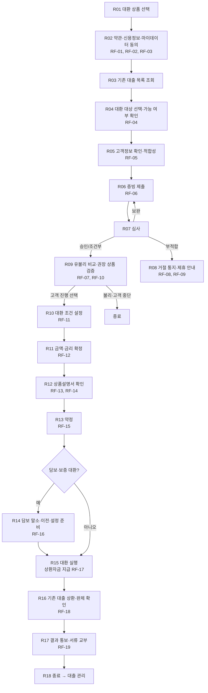
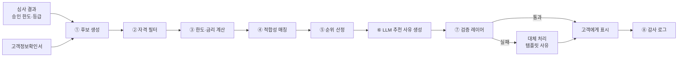
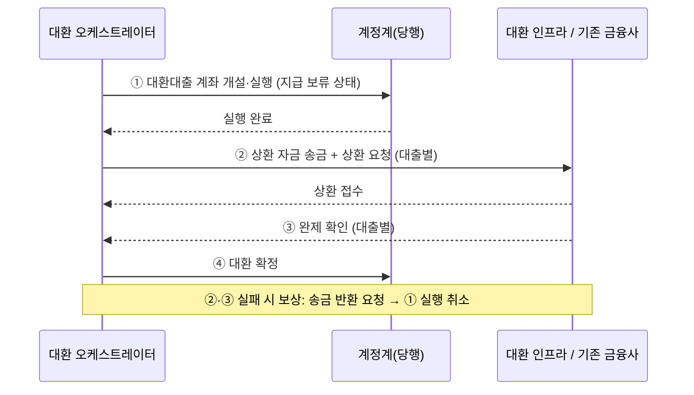

# 대환대출 서비스 기획서

| 항목 | 내용 |
|---|---|
| 문서 | 대환 서비스 > 대환대출 업무 로직 및 구현 기획서 |
| 버전 | v0.3 (공유 검토본) |
| 표기 원칙 | 은행명은 'OO은행'(본문에서는 '당행')으로 씁니다. 본문에 나오는 실제 기관·제도·회사 이름(신용평가회사, 보증기관, 시세 제공처, 정책자금 상품명 등)은 업무를 설명하기 위한 공개 정보 기준 예시이며 제휴·승인 관계를 뜻하지 않습니다. 금리·한도·기준값은 모두 예시이고, 법령·약관 내용은 요약이므로 실제 적용 전 법무·준법감시 확인이 필요합니다. |
| 작성일 | 2026-11-04 |
| 상위 문서 | [Loan_Service_main.md](../Loan_Service_main.md) |
| 참고 문서 | [일반대출_기획서.md](../Loan_Service/일반대출_기획서.md), [정부대출_기획서.md](../Loan_Service/정부대출_기획서.md), [기관대출_기획서.md](../Loan_Service/기관대출_기획서.md) — 이 문서만 읽어도 되도록, 다른 기획서와 같은 내용은 각 구간의 **"공통"** 제목 아래에 그대로 옮겨 적었고, 대환대출에서 더하거나 바뀌는 내용은 **"<추가>"** 표로 따로 적었습니다 |
| 사용 서류 | `Contract Document/` RF-01 ~ RF-19, 대출관리 신청서 LN-25 ~ LN-28 (공용) |

> **표 읽는 법**: `<추가>` 표의 "구분" 칸이 **추가**면 공통 내용에 더해지는 항목이고, **변경**이면 공통 내용을 대환대출에서 바꿔 적용하는 항목입니다.

---

## 1. 개요

### 1.1 목적
고객이 다른 금융사(또는 당행)에 가진 기존 대출을 당행의 새 대출로 갈아타는 **대환대출**의 업무 로직, 구간별 기능, 입력 항목, 조회 데이터, LLM 활용 방식, **대환 유불리 판단과 권장 상품 검증 로직**을 정의합니다.

### 1.2 범위
| 포함 | 제외 |
|---|---|
| 기존 대출 조회, 대환 대상 선택, 심사, 유불리 비교, 약정, 기존 대출 상환, 완제 확인, 결과 통보 | 공통 플랫폼 기능(로그인, 본인인증, 실명확인, 계좌개설 — main 문서) |
| 대환 유형: 일반대출 대환, 정부대출(정책자금) 대환, 기관대출(보증부·협약) 대환 — 차이점은 9장 | 실행 후 대출 관리(대출관리 기획서) |

### 1.3 신규 대출과 다른 점
| 구분 | 신규 대출 | 대환대출 |
|---|---|---|
| 출발점 | 고객의 자금 필요 | 고객의 **기존 대출** (마이데이터로 조회) |
| 대출금 지급 | 고객·임대인·매도인 등 | **기존 금융사에 바로 지급** (고객 계좌를 거치지 않음) |
| 한도 | 소득·신용·담보 기준 | 위 기준 + **기존 대출 상환에 필요한 금액**이 상한 (증액 대환은 신규 대출 심사로 봄) |
| 핵심 판단 | 승인 여부, 상품 추천 | 승인 여부 + **갈아타는 게 고객에게 이득인가** (순 절감액) |
| 실행 | 단일 거래 | **두 거래가 묶임**: 새 대출 실행 + 기존 대출 상환 → 하나라도 실패하면 보상 처리(롤백) |
| 종료 조건 | 지급 완료 | **기존 대출 완제 확인 + 담보 말소** 까지 |

### 1.4 설계 원칙

#### 공통 (일반대출 1.3 기준, 대환에 맞게 일부 표현 변경)
1. **결정은 규칙 엔진이, 설명은 LLM이 합니다.** 승인 여부, 한도, 금리는 결정적(deterministic) 규칙 엔진과 신용평가 모델만 계산합니다. LLM은 정보 추출, 요약, 설명, 질의응답만 맡고, 그 결과는 항상 검증 레이어를 거칩니다.
2. **동의 없이 조회하지 않습니다.** 신용정보 조회, 공공기관 연동, 마이데이터, 제3자 제공은 해당 동의가 기록된 뒤에만 호출합니다.
3. **고객 이익 우선으로 추천합니다.** 추천 순위는 고객 부담(금리·총이자·월 상환액) 기준이며, 은행 수익성은 순위 산정에 쓰지 않습니다(금소법 불공정영업·부당권유 방지).
4. **모든 판단은 재현할 수 있어야 합니다.** 규칙 버전, 입력값, 모델·프롬프트 버전, 결과를 감사 로그로 남깁니다.

#### <추가> 대환대출 추가 원칙
**<추가> 설계 원칙**
| 구분 | 원칙 | 내용 |
|---|---|---|
| 추가 | 불리한 대환은 권하지 않음 | 순 절감액이 0 이하인 대환은 권장하지 않고, 고객이 원하면 불리하다는 사실을 고지한 뒤에만 진행합니다. |
| 추가 | 돈이 중간에 멈추지 않게 함 | 새 대출 실행과 기존 대출 상환은 같은 처리 단위(사가, Saga)로 묶고, 실패 시 보상 거래로 원래 상태로 되돌립니다. |
| 추가 | 실행일 기준 금액으로 확정 | 기존 대출 잔액·이자·중도상환수수료는 조회일과 실행일 사이에 바뀌므로, 실행 직전에 다시 조회해 확정합니다. |

---

## 2. 전체 처리 흐름

### 2.1 흐름도


### 2.2 상태 코드

#### 공통 (일반대출 2.2와 동일)
**공통 신청 상태**
| 상태 코드 | 의미 | 진입 조건 | 다음 상태 |
|---|---|---|---|
| `DRAFT` | 신청서 작성 시작 | R01 상품 선택 | `CONSENTED`, `CANCELLED` |
| `CONSENTED` | 필수 동의 완료 | R02 필수 동의 전부 Y | (대환) `LOANS_FETCHED` |
| `PROFILED` | 고객정보확인서 완료, 적합성 1차 통과 | R05 | `DOCS_SUBMITTED`, `UNSUITABLE` |
| `UNSUITABLE` | 적합성 부적합 (권유 불가) | R05 판정 | `PROFILED`(정보 수정), `CANCELLED` |
| `DOCS_SUBMITTED` | 증빙 제출·연동 완료 | R06 | `UNDER_REVIEW` |
| `UNDER_REVIEW` | 심사 중 | R07 시작 | `APPROVED`, `COND_APPROVED`, `DOCS_REQUIRED`, `REJECTED` |
| `DOCS_REQUIRED` | 서류 보완 요청 | 심사 결과 | `DOCS_SUBMITTED`, `EXPIRED` |
| `APPROVED` / `COND_APPROVED` | 승인 / 조건부 승인 | 심사 결과 | (대환) `COMPARED` |
| `REJECTED` | 거절 | 심사 결과 | 종료 |
| `TERMS_SET` | 조건 설정 완료 | R10 | `PRICED` |
| `PRICED` | 금액·금리 확정 | R11 | `EXPLAINED` |
| `EXPLAINED` | 상품설명서 확인 완료 | R12 | `CONTRACTED` |
| `CONTRACTED` | 약정 완료 | R13 | `COLLATERAL_SET`, (대환) `PAYOFF_QUOTED` |
| `COLLATERAL_SET` | 담보·보증 설정 준비 완료 | R14 | (대환) `PAYOFF_QUOTED` |
| `COMPLETED` | 결과 통보·서류 교부 완료 | R17 | (대출 관리) |
| `WITHDRAWN` | 청약철회 | 실행 완료(`COMPLETED`) 후 14일 이내 철회. 실제 처리는 대출 계좌 상태(대출관리 M07, `ACTIVE → WITHDRAWN`)에서 함 | 종료 |
| `CANCELLED` / `EXPIRED` | 고객 취소 / 기한 경과 | 언제든 / 유효기간 경과 | 종료 |

**공통 유효기간 규칙 (설정값)**
| 대상 | 기본값 | 경과 시 |
|---|---|---|
| 신청서 `DRAFT` ~ `DOCS_SUBMITTED` | 7일 | `EXPIRED` |
| 서류 보완 요청 | 14일 | `EXPIRED` |
| 심사 결과 (승인 한도·금리) | 30일 | 재심사 필요 |
| 금리 확정 (`PRICED`) | 당일 영업 마감까지 (변동금리 기준금리 고시 변경 시 재산출) | `TERMS_SET`로 되돌림 |

#### <추가> 대환대출 추가 상태
**<추가> 상태 코드**
| 구분 | 상태 코드 | 의미 | 다음 상태 |
|---|---|---|---|
| 추가 | `LOANS_FETCHED` | 기존 대출 조회 완료 | `TARGET_SELECTED` |
| 추가 | `TARGET_SELECTED` | 대환 대상 선택·가능 여부 확인 완료 | `PROFILED` |
| 추가 | `COMPARED` | 유불리 비교 확인 완료 | `TERMS_SET`, `CANCELLED` |
| 추가 | `PAYOFF_QUOTED` | 실행일 기준 상환 금액 확정 | `REFI_EXECUTING` |
| 추가 | `REFI_EXECUTING` | 실행 중 (새 대출 실행 + 상환 요청) | `PAYOFF_PENDING`, `REFI_FAILED` |
| 추가 | `PAYOFF_PENDING` | 상환 자금 송금 완료, 기존 금융사 완제 확인 대기 | `PAID_OFF`, `PAYOFF_PARTIAL`, `REFI_FAILED` |
| 추가 | `PAID_OFF` | 기존 대출 완제 확인 | `LIEN_RELEASED`(담보) / `COMPLETED` |
| 추가 | `PAYOFF_PARTIAL` | 일부만 상환됨 (금액 차이 등) | 보정 처리 후 `PAID_OFF` |
| 추가 | `LIEN_RELEASED` | 기존 담보 말소·새 담보 설정 완료 | `COMPLETED` |
| 추가 | `REFI_FAILED` | 실행 실패 → 보상 처리 완료 | 종료 (재신청 가능) |
| 변경 | `DISBURSED` | 대환에서는 쓰지 않고 `REFI_EXECUTING` ~ `PAID_OFF`로 대체 | - |

**<추가> 유효기간 규칙**
| 구분 | 대상 | 기본값 | 경과 시 |
|---|---|---|---|
| 추가 | 기존 대출 조회 데이터 (R03) | 24시간 | 재조회 |
| 추가 | 실행일 상환 금액 견적 (R15) | 견적의 유효 시각까지 | 재견적 |

---

## 3. 구간별 상세 설계

### R01. 대환 상품 선택

#### 공통 (일반대출 S01과 동일)
**역할**: 고객이 원하는 대출 유형을 고르고, 신청서(`loan_application`)를 만듭니다.

**공통 입력 항목**
| 필드 | 타입 | 필수 | 검증 규칙 | 예시 |
|---|---|---|---|---|
| `product_type` | enum | Y | `CREDIT`, `JEONSE`, `MORTGAGE`, `AUTO`, `DEPOSIT_SECURED` 중 하나 | `CREDIT` |
| `purpose_text` | string(500) | N | 개인정보 패턴(주민번호, 계좌번호) 입력 시 마스킹 후 저장 | "이자가 너무 비싸서 바꾸고 싶어요" |
| `channel` | enum | Y (자동) | `WEB`, `APP` | `WEB` |

**공통 조회 데이터**
| 데이터 | 출처 | 용도 |
|---|---|---|
| 상품 카탈로그 (판매 중 상품, 고시 금리 범위) | 내부 상품 DB `product_catalog` | 카드 표시 |
| 고객의 진행 중 신청서 | `loan_application` | 중복 신청 방지, 이어하기 |

**공통 LLM 활용 (LLM-1: 상담 의도 구조화)**
| 항목 | 내용 |
|---|---|
| 입력 | `purpose_text`, 상품 카탈로그 요약 (RAG로 검색한 상품 설명) |
| 출력(JSON) | 목적 코드, 희망 금액·기간, 후보 유형, 되물을 질문 |
| 검증 | JSON 스키마 검증, 후보 유형이 enum 안에 있는지, 금액이 숫자 범위 안인지 |
| 사용 | 화면 강조 표시와 입력값 **미리 채우기(고객 수정 가능)**에만 사용. 자격 판단에는 쓰지 않음 |

**공통 처리 로직**
```
if 진행 중 신청서(같은 product_type, 상태 ∉ {종료 상태}) 있음:
    "이어하기 / 새로 시작" 선택 제공
create loan_application(status=DRAFT, product_type, created_at)
```

**공통 예외**: 판매 중지 상품 선택 시 안내 후 다른 상품 추천 / 같은 유형 진행 중 신청 2건 이상 생성 불가

#### <추가> 대환대출 추가 항목
**<추가> 입력 항목**
| 구분 | 필드 | 타입 | 필수 | 검증 규칙 |
|---|---|---|---|---|
| 변경 | `product_type` → `refi_type` | enum | Y | 갈아탈 대출 종류. 값 목록은 공통과 같음 |
| 추가 | `refi_category` | enum | Y (자동) | `GENERAL`, `POLICY`, `INSTITUTIONAL` (R04에서 기존 대출 성격에 따라 확정) |
| 추가 | `goal` | enum | N | 금리 낮추기 / 월 상환액 줄이기 / 여러 대출 합치기 / 고정금리로 바꾸기 |

**<추가> LLM 활용 (RLLM-1: 대환 목적 구조화)**
| 구분 | 항목 | 내용 |
|---|---|---|
| 변경 | 출력 | LLM-1 출력 대신 `goal` 값 (예: "이자가 너무 비싸서 바꾸고 싶어요" → `LOWER_RATE`) |
| 변경 | 사용 | R09 순위 가중치의 **고객 선호 입력**으로만 사용 |

**<추가> 상품 카드 표시 규칙 (main 3.5)**
| 구분 | 항목 | 내용 |
|---|---|---|
| 추가 | 대출 기간 표시 | 상품 카드와 상품 상세 화면의 **"최대 N원" 바로 옆에 "기간 최소 ~ 최대"**를 표시 (예: 최대 1억원 \| 기간 1년 ~ 5년). 12개월 단위면 "년", 아니면 "개월"로 표시하고, 허용 기간이 하나뿐이면 그 기간만 표시 (예: 기간 2년) |
| 추가 | 진입 순서 | 상품 카드 클릭, 카드의 「대출신청」·「갈아타기 신청」 버튼, 배너 클릭 **모두 상품 상세(상품 정보) 화면을 먼저** 보여 줌. 상세 화면 아래의 신청 버튼을 눌러야 C02 동의 단계로 들어감 (상품 정보 확인 없이 동의로 바로 넘어가지 않음) |
| 추가 | 화면 보기 방식 | 기본은 **한 화면 전환(모바일 보기)**: 메인에서 상품을 누르면 같은 자리가 상품 상세·신청 단계로 바뀌고, 뒤로 가면 메인으로 돌아옴. 폭 900px 이상에서는 「분할 보기」로 바꿔 메인을 왼쪽에 두고 하위 화면을 오른쪽에 열 수 있음. 900px 미만은 항상 한 화면 전환. 상단 ≡ 메뉴 창(대출/대환/대출관리)도 메인 화면과 같은 자리에 열리고, 항목을 누르면 같은 자리에 해당 메인 화면이 열림 (main 3.6) |
| 유지 | 값 출처 | `product_catalog`의 최대 한도(`max_amount`)와 허용 기간 목록(`term_options`)의 최솟값·최댓값 |

---

### R02. 약관·신용정보·마이데이터 동의

#### 공통 (일반대출 S02와 동일)
**역할**: 이후 모든 조회의 법적 근거가 되는 동의를 받고 기록합니다.

**공통 입력 항목**
| 필드 | 타입 | 필수 | 검증 규칙 |
|---|---|---|---|
| `consent_terms_basic` | bool | Y | true여야 다음 진행 (여신거래기본약관) |
| `consent_collect_use` | bool | Y | true (개인(신용)정보 수집·이용) |
| `consent_unique_id` | bool | Y | true (고유식별정보 처리) |
| `consent_credit_inquiry` | bool | Y | true (신용정보 조회) |
| `consent_provide_3rd` | bool | Y | true (한국신용정보원, 보증기관, 법무사) |
| `consent_marketing` | bool | N | 채널별(문자/이메일/앱/전화) 하위 선택 |
| `consent_public_scraping` | bool | N | 공공기관 자동 연동 (R06에서 다시 물을 수 있음) |

**공통 처리 로직**
```
각 동의 항목마다 consent_record 저장:
  (application_id, consent_code, document_version, agreed(Y/N), agreed_at, ip, user_agent, 화면 스크롤 완료 여부)
필수 동의 하나라도 N → 다음 진행 불가, "필수 동의가 필요한 이유" 안내
문서 버전(document_version)은 동의 당시 PDF 해시값으로 고정 저장
status = CONSENTED
```

**공통 LLM 활용 (LLM-2: 약관 질의응답, 선택 기능)**
- 고객 질문에 **약관·동의서 원문만을 근거로** 답합니다(RAG).
- 답변에 근거 조항 번호를 반드시 포함하고, 근거를 찾지 못하면 "상담원 연결"로 넘깁니다.
- 동의 여부 선택을 LLM이 대신하거나 유도하는 문구("동의하시는 게 좋아요")는 금지어 필터로 차단합니다.

**공통 예외**: 동의 철회 시 진행 중 신청은 `CANCELLED`, 이미 조회한 신용정보는 보유기간 규칙에 따라 관리

#### <추가> 대환대출 추가 항목
**사용 서류**: RF-01 여신거래기본약관, RF-02 개인(신용)정보 수집·이용·조회 동의서, RF-03 마이데이터 전송요구 동의서

**<추가> 동의 항목**
| 구분 | 동의 | 필수 | 비고 |
|---|---|---|---|
| 추가 | 마이데이터 개인신용정보 전송요구 (`MYDATA_TRANSFER`) | Y (자동 조회 시) | 전송 요구 대상 금융사, 정보 항목, 기간 기록. 거부하면 기존 대출 **직접 입력** 경로 제공 |
| 추가 | 기존 금융사 상환 처리를 위한 정보 제공 (`PAYOFF_PROVIDE`) | Y | 대환 실행 시 기존 금융사에 상환 요청을 보내기 위해 필요 |

**<추가> 처리 로직**
| 구분 | 내용 |
|---|---|
| 변경 | 필수 동의 완료 후 다음 상태는 `PROFILED` 경로가 아니라 R03(기존 대출 조회)으로 이동 |
| 추가 | 마이데이터 동의를 거부한 고객은 R03에서 직접 입력 화면으로 바로 이동 |

---

### R03. 기존 대출 목록 조회 (대환 고유)

**역할**: 고객의 기존 대출을 모두 가져와 대환 대상 후보로 보여 줍니다.

**조회 데이터**
| 데이터 | 출처 | 용도 |
|---|---|---|
| 대출 상품명, 계좌번호, 잔액, 금리, 금리 유형, 실행일, 만기일, 상환 방식, 월 납입액 | 마이데이터 (전송 요구한 금융사) | 대상 후보, 유불리 비교 |
| 중도상환수수료율·면제 시점 | 마이데이터 (제공되는 경우) / 대환 인프라 상환 조회 | 대환 비용 |
| 담보·보증 정보 | 마이데이터, 등기부 | 담보 대환 여부 |
| 대출 현황 전체 | CB, 한국신용정보원 | 마이데이터 누락 대출 확인 (교차 검증) |

**처리 로직**
```
mydata_loans = 마이데이터 조회 (금융사별 병렬, 타임아웃 10초)
cb_loans = CB 대출 현황 (금융사·잔액 수준)
누락 의심 = cb_loans 중 mydata_loans 에 짝이 없는 대출 → "다른 대출이 더 있을 수 있어요" 안내 + 직접 입력 옵션
직접 입력 대출은 source=MANUAL 로 표시하고, R15 직전 대환 인프라 상환 조회로 반드시 검증
status = LOANS_FETCHED
```

**LLM 활용 (RLLM-2: 대출 정보 정규화)**
- 금융사마다 상품명·금리 표기가 달라(예: "가계일반자금대출(변동)", "직장인신용 6M") 대출 종류와 금리 유형을 정규화할 때 LLM을 씁니다.
- 출력은 `{loan_kind, rate_type, rate_reset_months}` 같은 **분류 값만**이고, 잔액·금리 같은 숫자는 마이데이터 원본 값을 그대로 씁니다.
- 검증: 분류 값이 enum 안에 있는지, 신뢰도 낮으면 "기타"로 두고 고객 확인.

---

### R04. 대환 대상 선택 및 대환 가능 여부 확인 (대환 고유)

**사용 서류**: RF-04 대환 대상 대출 확인서

**입력 항목**
| 필드 | 타입 | 필수 | 검증 |
|---|---|---|---|
| `target_loans[]` | 대출 ID 목록 | Y | 1건 이상, 같은 `refi_type`으로 합칠 수 있는 대출만 (예: 신용대출 여러 건 → 신용대출 1건) |
| `include_extra_cash` | bool | N | 증액(추가 자금) 희망 여부 → 증액분은 신규 대출 심사 |

**대환 가능 규칙 (규칙 엔진 `REFI-ELIG`, 값은 설정 테이블)**
| 규칙 | 예시 기준 | 결과 |
|---|---|---|
| 대출 종류 | 대환 지원 대상 종류인지 (신용, 주담대, 전세 등) | 아니면 제외 |
| 경과 기간 | 기존 대출 실행 후 일정 기간 경과 (설정값) | 미경과 시 제외 또는 안내 |
| 연체 | 기존 대출 연체 중 아님 | 연체 중이면 제외 |
| 법적 제한 | 압류·가압류·소송 중 아님 | 제외 |
| 정책자금 | 정책자금 → 정책자금 대환은 정책 기준 적용 (9장) | 별도 경로 |
| 당행 대출 | 같은 은행 내 대환 허용 여부 (설정) | 정책에 따름 |
| 만기 임박 | 잔여 만기가 너무 짧으면 실익 적음 | 경고 |

**처리 로직**
```
for loan in target_loans:
    loan.elig = REFI-ELIG 평가 → ELIGIBLE / INELIGIBLE(사유) / WARNING
refi_category 확정:
    기존 대출이 정책자금 → POLICY, 보증부/협약 → INSTITUTIONAL, 그 외 → GENERAL
requested_amount = Σ 대상 잔액 + 예상 중도상환수수료 + 미납 이자 (+ 증액분)
status = TARGET_SELECTED
```

**<추가> 화면 규칙 — 대환 가능한 대출이 0건일 때 (main 3.4)**
| 구분 | 항목 | 내용 |
|---|---|---|
| 추가 | 하단 버튼 | 「다음」을 비활성화하지 않고 **「처음으로」**로 바꿈 → 메인 화면으로 이동 |
| 추가 | 화면 표시 | 대출별 대환 불가 사유(`REFI-DELINQ`, `REFI-TOO-RECENT`, `REFI-LEGAL-HOLD`, `REFI-SHORT-REMAIN`, `ASSET-MISMATCH`), 기존 금융사 금리인하요구권 안내 |
| 유지 | 일부만 가능할 때 | 가능한 대출을 하나도 고르지 않았으면 「다음」 비활성화 (불가가 아니라 선택 전 상태) |

---

### R05. 고객정보 확인·적합성

#### 공통 (일반대출 S03과 동일)
**역할**: 금소법 적합성 원칙에 따라 고객 정보를 받고, 고객에게 맞지 않는 상품을 권유하지 않도록 1차 판정을 합니다.

**사용 서류**: RF-05 고객정보확인서

**공통 입력 항목**
| 그룹 | 필드 | 타입 | 필수 | 검증 규칙 | 미리 채우기 출처 |
|---|---|---|---|---|---|
| 기본 | `name`, `birth_date`, `phone`, `email`, `address` | string/date | Y | 형식 검증 | 회원 정보 (main) |
| 기본 | `housing_type` | enum | Y | 자가/전세/월세/기타 | - |
| 직업 | `job_type` | enum | Y | 급여/사업/프리랜서/연금/무직·기타 | - |
| 직업 | `employer_name`, `position`, `employment_months` | string/int | 조건부 (급여·사업) | `employment_months` ≥ 0 | - |
| 소득 | `annual_income` | int(원) | Y | 0 이상, 30억 이하 | 고객 입력 |
| 재산 | `assets_amount` | int | N | 0 이상 | - |
| 부채 | `existing_debt_total`, `monthly_debt_payment` | int | Y | 0 이상 | R07에서 CB 조회값으로 교차 검증 |
| 부채 | `delinquency_1y`, `guarantee_debt` | bool | Y | - | - |
| 목적 | `purpose_code` | enum | Y | 생활/주택구입/보증금/자동차/대환/기타 | LLM-1 |
| 계획 | `desired_amount`, `desired_term_months` | int | Y | 상품별 최소·최대 | LLM-1 |
| 계획 | `repayment_pref` | enum | Y | 만기일시/원리금균등/원금균등 | - |
| 계획 | `repayment_source` | enum | Y | 소득/금융자산/부동산 처분/기타 | - |
| 계획 | `rate_pref` | enum | Y | 고정/변동/혼합/무관 | - |

**공통 적합성 1차 판정 로직 (규칙 엔진 `SUIT-RULE v1`)**
```
monthly_income = annual_income / 12
expected_payment = 상환액 추정(desired_amount, desired_term_months, repayment_pref, 상품 고시 최고 금리)
burden_ratio = (monthly_debt_payment + expected_payment) / monthly_income

판정:
  if annual_income == 0 and product_type != DEPOSIT_SECURED and repayment_source == "소득": UNSUITABLE("상환 재원 부족")
  elif burden_ratio > SUIT_MAX_BURDEN(설정값, 예 0.7): UNSUITABLE("상환 부담 과다")
  elif delinquency_1y == true: WARNING("연체 이력 — 심사에서 불리할 수 있음") → 진행 가능
  elif purpose_code 와 product_type 불일치: WARNING("목적에 맞는 상품 안내")
  else: SUITABLE
```
- `UNSUITABLE`이면 은행은 권유할 수 없습니다. 고객에게 판정 사유를 알리고, 정보 수정 또는 신청 종료를 고르게 합니다.
- 고객이 그래도 직접 신청을 원하면 **적정성 원칙** 흐름(부적정 사실 고지 → 고객 확인 기록)을 거쳐 진행할 수 있게 하되, 이 판단은 준법감시 협의 후 정책으로 확정합니다(12장 미결).

**공통 LLM 활용**: 이 구간에서는 판정에 LLM을 쓰지 않습니다. 판정 사유 안내 문장은 사유 코드별 **고정 문구 템플릿**을 씁니다.

**공통 산출물**: `applicant_profile` 저장, `suitability_result(SUITABLE|WARNING|UNSUITABLE, reason_codes[], rule_version)`

#### <추가> 대환대출 추가 항목
**<추가> 입력·판정**
| 구분 | 항목 | 내용 |
|---|---|---|
| 변경 | `purpose_code` | "기존 대출 상환(대환)"으로 고정 (고객 선택 없음) |
| 변경 | `desired_amount` | R04의 `requested_amount`로 자동 설정 |
| 변경 | 상환 부담 계산 | **대환 후 월 상환액** 기준: `burden_ratio = (monthly_debt_payment − 대환 대상 대출 월 상환액 + 새 대출 예상 상환액) / monthly_income` |
| 변경 | 목적-상품 불일치 판정 | 쓰지 않음 (목적이 대환으로 고정) |

#### 공통 (R05) 적합성 판정 창 화면 규칙 — 네 업무 공통

**적합성 판정 창 화면 규칙 (main 5.2.1)**
| 항목 | 내용 |
|---|---|
| 주의 문구 | 판정 창 맨 아래에 항상 표시: "※ 본 결과는 입력한 정보에 따른 결과이므로 심사 결과는 달라질 수 있습니다." |
| 법 설명 팝업 | 화면의 **「금소법 적합성 원칙」** 글자를 누르면 작은 창으로 설명 표시 (제17조 적합성 원칙: 정보 파악 → 부적합 권유 금지 → 확인·보관 / 제18조 적정성 원칙: 적정성 원칙 대상 상품을 고객이 권유 없이 신청할 때 부적정 사실 고지·확인. 대상이 아닌 대출에도 같은 고지·확인 절차를 적용하는 것은 이 서비스의 기획안이며 적용 범위는 준법감시 확인) |
| 부적합(`UNSUITABLE`) 시 체크박스 | 판정 창 안에 "대출 업무 진행이 불가할 수 있는 점을 인지하고 있으며, 신용 조회 등 관련 심사 절차 진행에 동의합니다." 체크박스 표시. 체크 전에는 「다음」 비활성화(입력 미완료 상태) |
| 조정 안내 창 | 체크하면 작은 창이 열려 적합 기준 안으로 들어오는 방법을 계산해 보여 줌 (아래 계산식) |
| 창의 선택지 | ① 기간 유지 → 금액을 X원 이하로 조정 ② 금액 유지 → 기간을 N개월로 조정 ③ 조정 없이 현재 조건으로 심사 진행 (불가능한 선택지는 이유와 함께 비활성 표시) |
| 창의 버튼 | **「이전」**: 창을 닫고 고객정보 화면에 머무름 (직접 수정 가능) / **「다음」**: 고른 선택지를 적용하고 다음 단계로 이동 |
| 기록 | ①·② 선택 시 조정된 금액·기간으로 다시 적합 판정. ③ 선택 시 `suitability_override` 기록(고지 문구 버전, 시각)을 남기고, 심사 화면 첫 단계에 "적합성 확인 — 고객 동의로 진행" 표시 |

**조정 안내 계산식 (규칙 엔진, 예시 기준)**
```
월 상환 가능액 B = 월 소득 × 0.7 − 유지되는 기존 대출 월 상환액      (대환이면 대환 대상 상환분 제외)
금리 r = 상품 고시 최고 금리 ÷ 12
① 기간 n 유지 → 최대 금액
     원리금균등: A = B × (1 − (1 + r)^−n) ÷ r
     원금균등:   A = B ÷ (1/n + r)
     만기일시:   A = B ÷ r
     → 100만원 단위 내림, 상품 최소 금액 미만이면 "금액 조정 불가"
② 금액 유지 → 최소 기간
     월 상환액(금액, 금리, t) ≤ B 를 만족하는 가장 짧은 t (계산상 최소 개월)
     → 상품이 허용하는 기간 중 그 이상인 가장 짧은 기간을 제안, 없으면 "기간 조정 불가"
     → 만기일시상환은 기간을 바꿔도 월 이자가 같으므로 "기간 조정 불가"
B ≤ 0 (기존 대출만으로 기준 초과) → ①·② 모두 불가, ③만 선택 가능
대환은 금액이 상환 필요 금액으로 고정 → ①은 불가, ②·③만 선택 가능
```

**<추가> 대환 기간 선택과 기간별 적합성 판정**
| 구분 | 항목 | 내용 |
|---|---|---|
| 변경 | 대출 금액 | 고객이 입력하지 않음. **대환 대상 잔액 + 예상 중도상환수수료 + 미납 이자**(R04와 같은 산식)로 자동 설정하고 화면에 고정 표시 |
| 추가 | `refi_term_months` (희망 대환 기간) | 고객이 직접 선택 (상품이 허용하는 기간 목록). 처음에는 **기존 대출 남은 기간과 가장 가까운 기간**을 기본값으로 보여 주고, 고객이 바꿀 수 있음 |
| 추가 | 실시간 계산 | 기간을 바꿀 때마다 다시 계산해서 표시: 예상 월 상환액, 예상 총 이자, 기존 대상 대출 월 상환액, **월 부담 변화(±)** |
| 추가 | 기간별 적합성 판정 | 선택한 기간으로 상환 부담률을 다시 계산해 적합 / 주의 / 부적합을 바로 바꿔 보여 줌 |
| 추가 | 판정용 금리 | 상품 고시 최고 금리로 보수적으로 계산 (실제 금리는 R07 심사 후 확정) |
| 추가 | 기간 함정 안내 | 선택 기간 > 기존 남은 기간이면 "월 부담은 줄어도 총 이자가 늘 수 있음" 안내 → R09에서 다시 확인 (RV4) |
| 추가 | 부적합 시 | 공통 판정 창 규칙을 따름. 금액이 고정이라 "금액 조정"은 불가로 표시하고, **"금액 유지 → 기간을 N개월로 조정"**과 "현재 조건으로 진행"만 고를 수 있음 |

**기간별 적합성 계산 (R05)**
```
대환 금액 A = Σ 대환 대상 잔액 + Σ 예상 중도상환수수료 + Σ 미납 이자     (자동, 고정, R04와 같은 산식 · 증액분은 별도 심사)
기간 n = 고객 선택 (기본값: 상품 허용 기간 중 기존 남은 기간과 가장 가까운 값)
신규 월 상환액 = 월상환(A, 상품 최고 금리, n, 상환 방법)
상환 부담률 = (유지되는 기존 대출 월 상환액 + 신규 월 상환액) ÷ 월 소득      (대환 대상 상환분은 제외)
판정 = 부담률 ≤ 70% → 적합 / 연체 이력 → 주의 / 초과 → 부적합          (기준값은 예시)
```
- 선택한 기간은 이후 단계에 그대로 이어집니다: R07 심사(DSR 계산 기간), R09 유불리 비교(새 대출 기간), R10 조건 설정(기본 선택값), R11 상환 스케줄.

---

### R06. 증빙 제출

#### 공통 (일반대출 S04와 동일)
**역할**: 심사에 필요한 소득·재직·담보 정보를 모읍니다. 자동 연동을 먼저 시도하고, 안 되면 서류 업로드를 받습니다.

**사용 서류**: RF-06 증빙서류 제출 안내서

**공통 입력 방식**
| 방식 | 대상 | 처리 |
|---|---|---|
| 공공기관 자동 연동 | 건강보험 자격득실·납부, 소득금액증명, 근로소득원천징수, 사업자등록 | 연동 동의 → 연동 API 호출 → 구조화 데이터 저장 |
| 서류 업로드 | 연동 실패, 연동 대상이 아닌 서류(임대차계약서, 매매계약서, 차량 서류 등) | 파일 업로드 → OCR → LLM-3 추출 → 고객 확인 |

**공통 상품별 필요 데이터**
| 상품 | 필수 데이터 | 시스템 조회 |
|---|---|---|
| 신용 | 연 소득, 재직 정보 | 공공 연동, CB |
| 전월세 | 임대차계약서(보증금, 기간, 임대인, 주소, 확정일자), 등본 | 등기부(선순위 채권 확인), 보증기관 사전 심사 |
| 부동산담보 | 담보 주소, 등기부 | 시세 API, 등기부 조회 |
| 자동차 | 차량 정보(모델, 연식, 차량번호) | 차량 시세 API, 자동차등록원부 |
| 예금담보 | 담보 예금 계좌 | 내부 예금 잔액·만기 조회 (소득 증빙 생략 가능) |

**공통 업로드 파일 검증**: PDF/JPG/PNG, 10MB 이하, 발급일 1개월 이내, 악성 파일 검사, 이미지 해상도 최소 기준

**공통 LLM 활용 (LLM-3: 증빙서류 정보 추출)**
| 항목 | 내용 |
|---|---|
| 입력 | OCR 텍스트 + 문서 유형 후보 (LLM 서버로 보내기 전 주민번호 뒷자리 등 마스킹) |
| 출력(JSON) | 문서 유형, 발급자, 발급일, 명의자, 필드 값, 필드별 신뢰도 |
| 검증 1 | 스키마·타입 검증, 날짜 형식, 금액 양수 |
| 검증 2 | **교차 검증**: 추출 연 소득 vs 고객 입력 연 소득 vs 공공 연동 값. 차이가 허용 범위(설정값, 예 ±10%)를 넘으면 `MISMATCH` 플래그 |
| 검증 3 | 문서 명의자 = 신청인 이름 |
| 검증 4 | 신뢰도 0.85 미만 필드는 고객에게 확인 화면을 보여 주고, 고객이 고친 값은 "고객 수정" 표시 |
| 사용 | 심사 입력값 후보. **공공 연동 값이 있으면 연동 값을 우선**하고, LLM 추출 값은 보조 근거로만 저장 |

**공통 LLM 활용 (LLM-4: 서류 일관성 보조 점검)**
- 임대차계약서 임대인 ↔ 등기부 소유자, 계약 기간 ↔ 대출 기간, 주소 ↔ 등기부 주소를 비교해 불일치 목록을 냅니다.
- 결과는 **심사자 참고용 플래그**입니다. 자동 거절에 쓰지 않습니다.

**공통 처리 로직**
```
for 필요 데이터 in 상품별 목록:
    if 연동 동의 and 연동 가능: 연동 호출 (타임아웃 10초, 재시도 2회)
    if 연동 실패 or 연동 대상 아님: 업로드 요청
    업로드 → OCR → LLM-3 → 검증 1~4 → evidence 저장
모든 필수 데이터 확보 → status = DOCS_SUBMITTED
```

#### <추가> 대환대출 추가 항목
**<추가> 필요 데이터**
| 구분 | 상품 | 데이터 | 용도 |
|---|---|---|---|
| 추가 | 전체 | 기존 대출 잔액증명서 (마이데이터로 확인되지 않은 대출, 직접 입력 대출) | 잔액·금리·중도상환수수료 확인 |
| 추가 | 부동산담보 | **현재 보유 주택**의 등기부·시세 (매매계약서는 필요 없음) | 담보 재평가, 기존 근저당·가압류 확인 |
| 추가 | 전월세 | **현재 거주 주택**의 임대차계약서 (남은 임대차 기간 확인) | 대환 대출 기간·보증 기간 판단 |
| 추가 | 자동차 | 기존 차량의 자동차등록원부 (저당권자 확인) | 기존 저당과 대상 차량 일치 확인 |
| 추가 | 검증 | 잔액증명서 담보 표시(차량번호·주소) ↔ 등록원부·등기부 일치 | 불일치 시 `ASSET-MISMATCH` |

---

### R07. 심사

#### 공통 (일반대출 S05와 동일)
**역할**: 신용·소득·담보를 평가해 승인 여부, 승인 한도, 적용 가능 금리 범위를 정합니다.

**공통 조회 데이터**
| 데이터 | 출처 | 비고 |
|---|---|---|
| 신용평점, 대출·연체·보증 현황 | CB(NICE, KCB), 한국신용정보원 | R02 조회 동의 필요 |
| 내부 거래 실적 | 내부 DB (급여이체, 예금, 카드) | 우대금리 판단에도 사용 |
| 금융사기·명의도용 이력 | 내부 FDS, 금융권 공유 정보 | |
| 담보 가치 | 시세 API, 감정평가(필요 시) | 부동산·자동차 |
| 규제값 | 규제 테이블 `reg_param` (DSR 한도, 지역별 LTV, 스트레스 금리 등) | 버전·시행일 관리 |

**공통 심사 단계 (파이프라인)**
| 순서 | 단계 | 로직 | 결과 |
|---|---|---|---|
| 1 | 결격 사유 확인 | 연체·부도·신용회복·명의도용 등 KO 규칙 | KO 해당 → `REJECTED` |
| 2 | 소득 확정 | 공공 연동 값 > 원천징수 등 서류 값 > 고객 입력 값 순서로 채택. `MISMATCH`면 보완 요청 또는 낮은 값 채택(설정) | `confirmed_income` |
| 3 | 신용평가 | CSS 점수 = f(CB 점수, 내부 실적, 소득, 직업 안정성) → 등급 1~10 | `internal_grade` |
| 4 | DSR 계산 | 아래 공식 | `dsr` |
| 5 | 담보 평가 (담보 상품) | 담보 가치 × LTV − 선순위 채권 − 소액임차보증금 공제 | `collateral_limit` |
| 6 | 한도 산출 | min(상품 최대 한도, 소득 기반 한도, DSR 여유 한도, 담보 한도, 등급별 한도) | `approved_limit` |
| 7 | 판정 | 아래 판정표 | 결과 코드 |
| 8 | 수기 심사 분기 | 자동 심사 불가 조건(고액, 플래그 다수, 경계 점수) → 심사역 배정 | `MANUAL_REVIEW` |

**공통 DSR 계산식**
```
연간 원리금 상환액(기존) = Σ 기존 대출별 연간 상환액
   - 분할상환: 실제 연간 원리금
   - 만기일시: 원금 ÷ 규제상 인정 만기 + 연 이자   (인정 만기 등은 reg_param)
연간 원리금 상환액(신규) = 신규 대출을 (적용 금리 + 스트레스 가산금리)로 계산한 연간 원리금
DSR = (기존 + 신규) ÷ confirmed_income
DSR 여유 한도 = DSR ≤ reg_param.dsr_limit 를 만족하는 최대 신규 대출 금액 (이분 탐색)
```

**공통 판정표**
| 조건 | 결과 |
|---|---|
| KO 규칙 해당, 또는 `internal_grade` > 컷오프, 또는 `approved_limit` < 상품 최소 금액 | `REJECTED` (거절 사유 코드 기록) |
| 필수 데이터 누락, `MISMATCH` 미해결 | `DOCS_REQUIRED` (보완 서류 목록) |
| `approved_limit` < 신청 금액 또는 조건(보증서, 기존 대출 일부 상환 등) 필요 | `COND_APPROVED` |
| 그 외 | `APPROVED` |

**공통 LLM 활용 (LLM-5: 심사역 요약 보조, 수기 심사 시)**
- 입력: 심사 데이터 요약(수치), LLM-4 불일치 목록, 고객 진술
- 출력: 심사역용 요약 메모 (위험 요인, 확인 필요 항목). **승인·거절 의견을 내지 않도록** 프롬프트와 출력 스키마로 제한합니다.

**공통 산출물**: `review_result(result_code, approved_limit, rate_range, conditions[], reason_codes[], rule_version, model_version, reviewer_id?)`

#### <추가> 대환대출 추가 항목
**<추가> DSR 계산**
| 구분 | 항목 | 내용 |
|---|---|---|
| 변경 | 기존 연간 상환액 | `Σ (대환 대상이 아닌 기존 대출의 연간 상환액)` — 대환 대상은 상환될 것이므로 제외 |
| 변경 | 신규 연간 상환액 | 대환대출의 연간 원리금 (스트레스 가산금리 포함) |
| 추가 | 전제 조건 | 대환 대상을 빼는 것은 **실행 시 실제로 상환된다는 전제**. 그래서 R15에서 상환이 실패하면 새 대출도 반드시 되돌림(사가 보상) |
| 추가 | 특례 | 대환 시 DSR 규제 예외·특례(예: 기존 잔액 범위 안의 대환) 적용 여부는 `reg_param.refi_dsr_rule`에서 읽음 |

**<추가> 한도 산출**
```
refi_limit = min(상품 한도, 신용 등급 한도, DSR 여유 한도, 담보 한도, requested_amount)
증액분 = include_extra_cash 이면 별도 심사 (신규 대출 규칙 전부 적용)
refi_limit < Σ 대상 잔액 이면 → COND_APPROVED ("일부 대출만 대환 가능" 또는 "고객이 차액 먼저 상환")
```

**<추가> 판정표**
| 구분 | 조건 | 결과 |
|---|---|---|
| 변경 | `approved_limit` 대신 `refi_limit` 사용 | 위 공통 판정표와 같은 규칙으로 판정 |
| 추가 | 승인·조건부 승인 후 다음 단계 | 바로 조건 설정이 아니라 **R09 유불리 비교**로 이동 |

---

### R08. 부적합 처리

#### 공통 (일반대출 S06-C·S06-D와 동일)
**사용 서류**: RF-08 거절사유 통지서, RF-09 제3자 정보제공 동의서

**공통 부적합 처리**
- 거절 사유 코드를 고객용 문장으로 바꿔 거절사유 통지서에 담습니다.
- 신용정보법에 따라 **거절 근거가 된 신용정보와 제공 기관**을 함께 알립니다.
- 자동화 평가로 거절된 경우 "설명 요구·정정 후 재평가 요청" 버튼을 제공합니다.

**공통 LLM 활용 (LLM-6: 거절 사유 쉬운 말 설명)**
| 항목 | 내용 |
|---|---|
| 입력 | 거절 사유 코드, 고정 템플릿 문장, 고객의 해당 수치(DSR 등) |
| 출력 | 고객이 이해하기 쉬운 설명 2~4문장 + 개선 방법 일반 안내 |
| 검증 | 템플릿의 핵심 사실(사유, 근거 정보, 제공 기관)이 빠지지 않았는지, 수치가 입력과 같은지, 차별적·단정적 표현이 없는지 확인. 실패하면 고정 템플릿만 표시 |

**공통 제휴사 안내**
- 제3자 제공 동의(RF-09, 선택) 없이: 제휴사 상품 목록만 표시
- 동의 시: 고객이 고른 제휴사에만 정보를 보내고, 예상 한도·금리를 받아 표시
- 제휴사 노출 순서는 고객 조건 기준(예상 금리 낮은 순)으로 정하고, 은행이 받는 수수료는 순서에 반영하지 않습니다.

#### <추가> 대환대출 추가 항목
**<추가> 안내 항목**
| 구분 | 항목 | 내용 |
|---|---|---|
| 추가 | 기존 대출 금리인하요구권 안내 | 대환이 안 되더라도 기존 금융사에 금리인하요구를 직접 신청할 수 있다고 안내 |
| 추가 | `REFI-ELIG` 부적합 사유 | 연체, 경과 기간 미달, 법적 제한, 만기 임박 등 R04 사유도 같은 통지 방식으로 안내 |

---

### R09. 대환 유불리 비교 및 권장 상품 검증 (핵심 구간)

**사용 서류**: RF-07 심사결과 통지서, RF-10 대환대출 비교 안내서

#### R09-1 유불리 계산 로직 (대환 고유, 규칙 엔진 `REFI-BENEFIT`)
```
[기존 대출 — 대환하지 않을 경우]
old_remaining_interest = Σ 대상 대출별, 남은 기간 동안의 이자 합계
    - 변동금리: 현재 금리 유지 가정 (+ 민감도: ±1%p 시나리오 별도 계산)
old_monthly = Σ 대상 대출 월 납입액

[새 대출 — 대환할 경우]
new_total_interest = 새 대출 조건(금액, 기간, 금리, 상환 방식)의 총 이자
new_monthly = 새 대출 월 납입액

[대환 비용]
cost = 기존 대출 중도상환수수료 합 + 인지세(고객 부담분) + 담보 말소·설정 비용(고객 부담분) + 보증료(해당 시)

[비교 기간 맞추기]
새 대출 기간 ≠ 기존 잔여 기간 이면:
    같은 기간 기준 비교(min 기간)와 전체 기간 기준 비교를 둘 다 계산
    "기간을 늘려 월 납입액은 줄지만 총 이자는 늘어남" 같은 경우를 잡아냄

net_saving = old_remaining_interest − new_total_interest − cost
break_even_month = 누적 이자 절감액 ≥ cost 가 되는 첫 달
monthly_change = old_monthly − new_monthly
```

**판정**
| 조건 | 판정 | 화면 처리 |
|---|---|---|
| `net_saving` > 기준값(설정, 예: 0원 초과) | `BENEFICIAL` | 권장 (손익분기 시점은 판정에 쓰지 않고 참고로 표시. 새 기간이 기존 남은 기간과 다르면 RV4 기간 함정 문구를 함께 표시) |
| `net_saving` ≤ 0 이지만 `monthly_change` > 0 (기간 연장으로 월 부담만 줄어듦) | `TRADE_OFF` | 권장하지 않음, "월 부담은 줄지만 총 이자는 ○○원 늘어납니다" 고지 후 고객 선택 |
| `net_saving` ≤ 0 이고 `monthly_change` ≤ 0 | `NOT_BENEFICIAL` | 권장하지 않음, 진행하려면 불리 고지 확인 필요 |
| 변동금리 민감도에서 판정이 바뀜 | 위 판정 + `RATE_SENSITIVE` | "금리가 ○%p 오르면 결과가 달라질 수 있어요" 표시 |

**<추가> 고객이 고른 기간으로 비교 (R05 연계)**
| 구분 | 항목 | 내용 |
|---|---|---|
| 변경 | 새 대출 기간 | 기존 남은 기간으로 맞추지 않고, R05에서 **고객이 고른 기간**으로 새 대출 총 이자·월 납입액을 계산 |
| 추가 | 비교표 | "기간" 행 추가: 기존 = 남은 N개월 / 대환 후 = M개월 (고객 선택) |
| 유지 | 기간 차이 처리 | 새 기간 ≠ 기존 남은 기간이면 같은 기간 기준 비교와 전체 기간 기준 비교를 둘 다 계산 (RV4 기간 함정) |

#### R09-2 권장 상품 산출

##### 공통 (일반대출 4.1·4.2와 동일)
**공통 전체 구조**


**공통 단계별 로직**
| 단계 | 공통 로직 |
|---|---|
| ① 후보 생성 | `product_catalog`에서 유형 일치 + 판매 중 + 채널 판매 가능 + 판매 기간 안인 세부 상품을 모두 가져옴 |
| ② 자격 필터 | 하드 규칙(연령, 직업·재직, 최소 소득, 허용 등급, 거래 실적, 담보 조건, 중복 제한). 하나라도 어기면 제외하고 `excluded_reason` 저장 |
| ③ 한도·금리 계산 | 상품별 `limit = min(상품 한도, 승인 한도, DSR 여유 한도, 담보 한도)`, 상품별 최종 금리(현재 충족 우대만 반영한 값과 최대 우대 값), 월 상환액·총 이자 |
| ④ 적합성 매칭 | 금액 충족 `f_amount = min(limit / 희망 금액, 1)`, 금리 유형 선호 `f_rate_type`(일치 1.0 / 혼합 0.6 / 불일치 0.2 / 무관 1.0), 상환 방식 선호 `f_repay`(포함 1.0, 아니면 0.3), 상환 부담 `f_burden = 1 − min(월 상환액 / 월 소득 / SUIT_MAX_BURDEN, 1)`, 기간 충족 `f_term`(허용 1.0, 근접 0.5). `f_burden = 0` 상품은 권장하지 않음 |
| ⑤ 순위 산정 | `score = 0.40·f_cost + 0.20·f_amount + 0.15·f_burden + 0.10·f_rate_type + 0.10·f_repay + 0.05·f_term`. 가중치는 설정값(변경 시 준법감시 승인). **은행 수익성·판매 목표·직원 성과는 넣지 않음.** 상위 3개 표시 |
| ⑥ LLM 사유 | 입력에 없는 숫자 금지, 상품 코드·이름 그대로, 단정·과장 표현 금지, 각 상품의 단점 1개 이상 포함. 출력: `product_id`, `headline`, `reasons`, `cautions`, `cited_facts` |
| ⑦ 검증 | R09-4의 V1~V9 |
| ⑧ 감사 로그 | 후보, 제외 사유, 점수, 가중치·규칙 버전, 기준금리 스냅샷, LLM 모델·프롬프트 버전, 원 출력(마스킹), 검증 결과, 표시 결과·시각 |

**공통 템플릿 사유 (대체 처리)**: 점수 항목별 고정 문장 조합. 예) `f_cost` 1위 → "후보 상품 중 고객님께 가장 유리한 조건입니다(○○원)."

**공통 직접 선택 (적정성 확인)**: 고객이 권장하지 않은 상품을 고르면 ① 자격 필터 통과 확인 → ② 적합성 점수가 낮은 이유 고지 → ③ 고객 확인 기록(`suitability_override`).

##### <추가> 대환대출 추가 항목
**<추가> 단계별 차이**
| 구분 | 단계 | 대환에서의 차이 |
|---|---|---|
| 변경 | ① 후보 | `refi_type`에 맞는 대환 가능 상품 (대환 전용 상품 + 일반 상품 중 대환 허용 상품) |
| 변경 | ③ 계산 | 상품별로 R09-1 `REFI-BENEFIT` 계산 (총 이자 외에 순 절감액·손익분기·월 납입액 변화) |
| 추가 | ④ 적합성 | `BENEFICIAL`이 아닌 상품은 **권장 목록에서 제외** (비교표에는 표시) |
| 변경 | ⑤ 순위 | `f_cost`를 `net_saving` 기준으로 계산. 고객 `goal`이 "월 상환액 줄이기"면 `f_monthly` 가중치를 높이되, `net_saving` ≤ 0 상품은 여전히 제외 |
| 추가 | `f_monthly` 정의 | `f_monthly = min(max((기존 월 납입 − 새 월 납입) ÷ 기존 월 납입, 0), 1)`. 기본 가중치 0. 고객 `goal`이 '월 상환액 줄이기'면 `f_cost` 가중치 0.40 → 0.25로 낮추고 `f_monthly`에 0.15를 줌 |
| 변경 | ⑥ LLM 사유 | RLLM-3 사용 (R09-3) |
| 변경 | 직접 선택 | 불리 대환(`TRADE_OFF`·`NOT_BENEFICIAL`)을 고르면 `refi_override` 기록 (R09-5) |

#### R09-3 LLM 활용 (대환 고유, RLLM-3: 대환 비교 설명)
| 항목 | 내용 |
|---|---|
| 입력 | 기존 대출 목록(요약 수치), 상품별 `REFI-BENEFIT` 결과, 판정, 고객 `goal` |
| 출력(JSON) | `{ product_id, verdict_text, saving_explanation, cautions[], cited_facts[] }` |
| 프롬프트 제약 | 입력에 없는 숫자 금지, `NOT_BENEFICIAL`·`TRADE_OFF` 상품을 유리하다고 쓰지 않기, 대환 비용(중도상환수수료)을 반드시 언급, 변동금리면 금리 상승 위험 언급 |

#### R09-4 검증 레이어

##### 공통 (일반대출 4.2 ⑦과 동일)
**공통 검증 V1~V9 (모두 통과해야 표시)**
| 번호 | 검증 | 방법 | 실패 시 |
|---|---|---|---|
| V1 | 스키마 | JSON 스키마 검증 | 1회 재생성 → 실패 시 템플릿 사유 |
| V2 | 상품 실재 | `product_id`가 ②를 통과한 후보 안에 있는지 | 해당 항목 제거 |
| V3 | 수치 일치 | 출력 문장 안의 모든 숫자를 추출해 계산값과 비교 (금리 소수 둘째 자리, 금액 원 단위까지 일치) | 템플릿 사유로 교체 |
| V4 | 근거 일치 | `cited_facts`의 필드·값이 계산 결과와 같은지 | 템플릿 사유로 교체 |
| V5 | 금지 표현 | 금지어 사전(단정, 과장, 차별, 부당권유 표현) 매칭 + 분류 모델 | 해당 문장 제거 후 재검증 |
| V6 | 필수 주의사항 | 변동금리 상품에 금리 변동 위험, 담보 상품에 담보 처분 위험 문구가 있는지 | 고정 주의 문구 자동 추가 |
| V7 | 순위 보존 | LLM이 순서를 바꾸거나 다른 상품을 더 낫다고 쓰지 않았는지 | 템플릿 사유로 교체 |
| V8 | 규칙 재계산 | 표시 직전 규칙 엔진으로 한도·금리를 한 번 더 계산해 같은지 | ③부터 다시 계산 |
| V9 | 적합성 | 권장 목록에 `f_burden = 0` 상품이 없는지, `UNSUITABLE` 고객이 아닌지 | 해당 상품 제거 |

##### <추가> 대환대출 추가 검증
**<추가> 검증 RV1~RV6**
| 구분 | 번호 | 검증 | 방법 | 실패 시 |
|---|---|---|---|---|
| 추가 | RV1 | 절감액 재계산 | `net_saving`, `break_even_month`, `monthly_change`를 독립 구현(별도 모듈)으로 다시 계산해 같은지 | 표시 중단, 오류 알림 |
| 추가 | RV2 | 판정·문장 일치 | `verdict_text`의 의미(유리/불리)가 판정 코드와 같은지 (분류 모델 + 키워드) | 템플릿 문장 |
| 추가 | RV3 | 비용 고지 | `cost` > 0이면 중도상환수수료 금액이 문장에 있는지 | 고정 문구 추가 |
| 추가 | RV4 | 기간 함정 | 새 기간 > 기존 잔여 기간이면 "총 이자 증가 여부" 문장이 있는지 | 고정 문구 추가 |
| 추가 | RV5 | 불리 대환 미권장 | 권장 목록에 `BENEFICIAL`이 아닌 상품이 없는지 | 해당 상품 제거 |
| 추가 | RV6 | 입력 최신성 | 비교에 쓴 기존 대출 데이터 조회 시각이 기준 시간(설정, 예: 24시간) 이내인지 | R03 재조회 |
| 변경 | V3·V4 | 수치·근거 일치 | 비교 대상에 순 절감액·손익분기·대환 비용까지 포함 | 위와 같음 |

#### R09-5 화면 (대환 고유)
- 기존 대출 vs 새 대출 비교표 (RF-10 형식): 금리, 월 납입액, 남은 총 이자, 대환 비용, **순 절감액**, 손익분기 시점
- 판정 배지: 유리 / 월 부담만 감소 / 불리
- "진행" 버튼: `BENEFICIAL`은 바로, `TRADE_OFF`·`NOT_BENEFICIAL`은 불리 고지 확인 체크 후 활성화 → `refi_override` 기록
- status = `COMPARED`

**<추가> 화면 규칙 — 불리한 대환일 때 (main 3.4)**
| 구분 | 판정 | 하단 버튼 |
|---|---|---|
| 추가 | `BENEFICIAL` | 「대환 진행」 |
| 추가 | `TRADE_OFF`·`NOT_BENEFICIAL`, 불리 고지 미확인 | **「처음으로」** (비활성화하지 않음) |
| 추가 | `TRADE_OFF`·`NOT_BENEFICIAL`, 불리 고지 확인 체크 | 「대환 진행」으로 바뀜 (`refi_override` 기록) |
| 추가 | R08 거절 (`REJECTED`) | **「처음으로」** |

---

### R10. 대환 조건 설정

#### 공통 (일반대출 S07과 동일)
**역할**: 승인 범위 안에서 고객이 금액·기간·상환 방식·납입일·자동이체를 정합니다.

**사용 서류**: RF-11 자동이체 출금 동의서

**공통 입력 항목**
| 필드 | 타입 | 필수 | 검증 규칙 |
|---|---|---|---|
| `selected_product_id` | string | Y | R09에서 권장했거나 확인(override)을 마친 상품 |
| `loan_amount` | int | Y | 상품 최소 ≤ 금액 ≤ 승인 한도, 1만원 단위 |
| `term_months` | int | Y | 상품별 허용 기간 목록 안 |
| `repayment_method` | enum | Y | 상품이 허용하는 방식만 |
| `grace_months` | int | N | 상품 허용 범위, 기간보다 짧아야 함 |
| `rate_type` | enum | Y | 상품이 허용하는 유형만 |
| `payment_day` | int | Y | 1~28 |
| `debit_account` | 계좌 | Y | 예금주 실명 확인(main 공통 기능), 타행이면 CMS 동의 |
| `consent_auto_debit` | bool | Y | true |

**공통 실시간 계산**: 입력이 바뀔 때마다 월 상환액, 총 이자, 상환 부담률(월 상환액 ÷ 월 소득)을 다시 계산해 보여 줍니다. 상환 부담률이 적합성 기준을 넘으면 경고합니다.

**공통 처리 로직**
```
검증 통과 → loan_terms 저장
금액·기간이 바뀌면 DSR 재계산 → 한도 초과 시 저장 불가
status = TERMS_SET
```

#### <추가> 대환대출 추가 항목
**<추가> 입력 항목**
| 구분 | 필드 | 내용 |
|---|---|---|
| 변경 | `loan_amount` | 고객이 정하지 않고 **상환 필요 금액으로 자동 설정** (증액분은 별도 표시) |
| 변경 | 지급 계좌 | 입력 없음. 기존 금융사 상환 계좌로 자동 지급 (자동이체 출금 계좌만 받음) |
| 추가 | `refi_date` | 실행일(대환일). 영업일이어야 하며, 기존 대출 납입일 직전·직후를 피하도록 안내 (이중 출금 방지) |

**<추가> 실시간 계산**
| 구분 | 내용 |
|---|---|
| 추가 | 조건을 바꿀 때마다 R09-1 유불리를 다시 계산해 판정이 바뀌면 경고 (예: 기간을 늘려 `TRADE_OFF`가 됨) |

**<추가> 조건 설정의 기간 기본값**
| 구분 | 항목 | 내용 |
|---|---|---|
| 변경 | 기간 기본값 | R05에서 고객이 고른 대환 기간을 기본 선택값으로 보여 줌. 여기서 바꾸면 R09 판정을 다시 계산하고 판정이 바뀌면 경고 |

---

### R11. 대환 금액 및 금리 확정

#### 공통 (일반대출 S08과 동일)
**역할**: 최종 금리를 확정하고 상환 스케줄표를 만듭니다.

**사용 서류**: RF-12 상환 스케줄표

**공통 금리 산출 로직 (규칙 엔진 `RATE-RULE`)**
```
기준금리 = 상품의 기준금리 종류(COFIX 신규, 금융채 6M/1Y/5Y 등)의 오늘 고시값
가산금리 = 신용등급별 리스크 프리미엄 + 업무원가 + 법정비용 + 목표이익률 (상품 테이블, 금리산정 내부 기준에 따름)
우대금리 = Σ 충족한 우대 조건 (상한 있음)
최종 금리 = 기준금리 + 가산금리 − 우대금리
제약: 상품 최저 금리 ≤ 최종 금리 ≤ min(상품 최고 금리, 법정 최고 금리 연 20%)
```
- 우대 조건은 "현재 충족"과 "약속(향후 충족 예정)"을 나눠 저장합니다. 약속 조건을 지키지 못하면 다음 금리 변경일에 빠진다는 사실을 R12에서 고지합니다.

**공통 상환 스케줄 생성**: 상환 방식별 공식으로 회차별 원금·이자·잔액을 만들고, 휴일이면 다음 영업일로 조정합니다. 첫 회차 이자는 실행일~첫 납입일 일수로 계산합니다(일할).

**공통 산출물**: `pricing(base_rate, spread, preferential[], final_rate, rate_fixed_until)`, `repayment_schedule[]`, 스케줄표 PDF 생성

#### <추가> 대환대출 추가 항목
**<추가> 확정 항목**
| 구분 | 항목 | 내용 |
|---|---|---|
| 변경 | 금리 체계 | 대환 대상 유형에 따라 다름: 일반 대환은 위 공통 체계, 정부 대환은 정책 금리표, 기관 대환은 보증 반영 금리·협약 금리표 (9장) |
| 추가 | 비교표 갱신 | 확정 금리로 RF-10 비교표를 다시 계산해 R12 설명서에 첨부 |
| 추가 | 첫 회차 기산 | 첫 이자 기산일은 **완제 확인 후 대환 확정 시점**(R15 ④) 기준 |

---

### R12. 상품설명서 확인

#### 공통 (일반대출 S09와 동일)
**역할**: 금소법 설명의무를 이행하고, 고객이 이해했음을 확인·기록합니다.

**사용 서류**: RF-13 상품설명서(핵심설명서 포함), RF-14 금융소비자 권리 안내서

**공통 화면 구성**
1. 핵심설명서 (고객 조건이 채워진 1쪽 요약)
2. 상품설명서 전문 (끝까지 스크롤해야 다음 진행)
3. 권리 안내 (청약철회, 금리인하요구권, 위법계약해지권, 자료열람요구권)
4. 이해 확인 질문 3개 (예: "변동금리는 금리가 오르면 월 상환액이 늘어난다 — O/X")

**공통 LLM 활용 (LLM-7: 개인화 핵심 요약 + 질의응답)**
| 항목 | 내용 |
|---|---|
| 역할 | 고객 조건을 넣은 쉬운 요약문 생성, 고객 질문에 상품설명서 근거로 답변 |
| 입력 | 확정 조건(R11 결과), 상품설명서·약관 원문(RAG) |
| 검증 | 요약문의 모든 숫자(금리, 금액, 기간, 수수료율)가 R11 결과와 같은지 비교. 필수 고지 항목(금리 변동 위험, 연체 시 불이익, 중도상환수수료, 청약철회) 포함 여부 확인. 하나라도 빠지면 고정 핵심설명서만 표시 |
| 한계 | LLM 요약은 **보조 자료**입니다. 법정 설명서는 확정된 PDF(RF-13)이며, 동의 대상도 PDF입니다 |

**공통 처리 로직**: 설명서 열람 시간, 스크롤 완료, 이해 확인 응답(오답이면 해당 부분 재설명 후 재질문)을 `explanation_record`에 저장 → status = `EXPLAINED`

#### <추가> 대환대출 추가 항목
**<추가> 설명 항목**
| 구분 | 항목 | 내용 |
|---|---|---|
| 추가 | 비교 결과 첨부 | 상품설명서에 대환 비교 결과(RF-10)를 첨부 |
| 추가 | 이해 확인 문항 | "대환 비용(중도상환수수료)은 고객 부담" 문항 추가 |
| 추가 | LLM-7 필수 고지 | 대환 비용, (불리 대환 시) 불리 판정 사실을 필수 고지 항목에 추가 |

---

### R13. 대환 약정

#### 공통 (일반대출 S10과 동일)
**역할**: 약정서에 고객이 동의(전자서명은 main 공통 기능)해 계약을 성립시킵니다.

**사용 서류**: RF-15 대환대출 거래약정서

**공통 처리 로직**
```
약정서 PDF 생성 (R10, R11 확정값 주입) → 해시 저장
고객 확인 항목 체크 → 전자서명 (main 공통 기능 호출)
계약 번호 발급, 계약 성립 시각 기록 (청약철회 기산점)
status = CONTRACTED
```
- 약정 직전 금리 재확인: 기준금리가 R11 이후 바뀌었으면 R11로 돌아가 재확정합니다.

#### <추가> 대환대출 추가 항목
**<추가> 약정 내용**
| 구분 | 항목 | 내용 |
|---|---|---|
| 추가 | 기존 대출 목록 | 약정서에 대환 대상 기존 대출(금융사, 계좌, 상환 예정 금액) 기재 |
| 추가 | 용도 제한 조항 | "대출금은 기존 대출 상환에만 쓰인다" |
| 추가 | 상환 실패 조항 | "기존 대출이 상환되지 않으면 대환대출 취소" (RF-15 제9조) |

---

### R14. 담보 말소·이전·설정 준비 (담보·보증 대환만)

#### 공통 (일반대출 S11과 동일)
**공통 담보 설정 방식**
| 상품 | 처리 | 외부 연계 |
|---|---|---|
| 부동산담보 | 법무사 배정 → 전자등기 신청 → 접수번호 확인 | 법무사 시스템, 인터넷등기소 |
| 전월세 | 보증 신청·발급, 임대인 통지 | 보증기관 API |
| 자동차 | 저당권 설정 등록 | 자동차등록 시스템/대행사 |
| 예금담보 | 예금에 질권 표시(지급 정지 코드) | 내부 계정계 |

- 담보 설정이 실행과 같은 날 끝나야 하는 경우, 설정과 실행을 한 트랜잭션처럼 묶어 **설정 접수 확인 후 실행**합니다.
- status = `COLLATERAL_SET`

#### <추가> 대환대출 추가 항목
**사용 서류**: RF-16 담보 말소·이전·설정 동의서

**<추가> 담보 처리**
| 구분 | 담보 | 처리 | 동시 처리 조건 |
|---|---|---|---|
| 변경 | 부동산 근저당 | 기존 근저당 **말소** + 새 근저당 설정 | 상환일 = 말소·설정 등기 접수일 (법무사가 같은 날 처리) |
| 변경 | 전세 보증 | 기존 보증 해지 + 새 보증서 발급 (아래 보증 절차) | 새 보증서 발급 확인 후 실행 |
| 변경 | 자동차 저당 | 기존 저당 말소 + 새 저당 설정 | 상환 후 말소 서류 수령 → 설정 |
| 변경 | 예금 질권 | 기존 질권 해지 + 새 질권 | 같은 날 |
| 추가 | 실행 조건 | 새 담보 설정이 기존 말소와 같은 날 이뤄지지 않으면 그 사이 다른 권리가 끼어들 수 있으므로, 법무사 일정 확정을 **R15 실행 조건**으로 둠 | - |

**<추가> 전세 보증 절차 (기관대출 I07·I13 내용)**
| 구분 | 단계 | 내용 |
|---|---|---|
| 추가 | 보증 신청 | 고객 동의 후 보증기관에 보증 신청 전문(고객·대상물·대출 정보) 전송 → 접수 번호 수신 |
| 추가 | 보증 심사 결과 | 승인(보증 한도, 보증료율) / 보완(요청 서류 재전송) / 거절(사유 통지, 다른 보증기관 재신청 여부 확인) |
| 추가 | 동시 신청 금지 | 신용조회 기록이 남을 수 있어 여러 보증기관에 동시에 신청하지 않음 |
| 추가 | 보증서 발급 | 약정 완료 후 발급 요청 → 보증서 번호 수신 (`GUARANTEE_ISSUED`) |
| 추가 | 채권양도 통지 | 임대인에게 채권양도(또는 질권설정) 통지 → 임대인 확인이 필요한 상품은 확인 전 실행 불가 |

---

### R15. 대환 실행 (사가 처리)

#### 공통 (일반대출 S12와 동일)
**공통 실행 전 최종 점검 (실행 직전 체크리스트)**
```
- 계약 상태 CONTRACTED (+ 담보 상품은 COLLATERAL_SET)
- 신용 재조회: 약정 후 새 연체·대출 발생 여부 (설정값: 약정 후 N일 경과 시)
- 지급처 확인: 예금주와 계약서상 상대방 일치
- FDS(금융사기 탐지) 통과
- 실행 가능 시간 (계정계 운영 시간)
계정계에 대출 계좌 개설 + 실행 전문 → 지급 이체
실패 시: 재시도 1회 → 실패하면 실행 취소(대출 계좌 해지) + 담당자 알림
```

#### <추가> 대환대출 추가 항목
**사용 서류**: RF-17 기존대출 상환자금 지급 위임장

**<추가> 실행 방식 변경**
| 구분 | 항목 | 내용 |
|---|---|---|
| 변경 | 지급처 | 고객 계좌가 아니라 **기존 금융사 상환 계좌** |
| 변경 | 실행 단위 | 단일 이체가 아니라 15.2 사가(새 대출 실행 → 상환 송금 → 완제 확인) |
| 추가 | 실행 가능 시간 | 계정계 + **대환 인프라 운영 시간** 안에서만, 마감 임박 시 다음 영업일로 미룸(설정값) |
| 추가 | 실행 직전 확정 | 15.1 상환 금액 확정 후에만 실행 |

**15.1 실행 직전 확정 (PAYOFF QUOTE)**
```
for loan in target_loans:
    quote = 대환 인프라(또는 기존 금융사) 상환 금액 조회(실행일 기준)
            → 원금, 경과 이자, 중도상환수수료, 미납 이자, 합계, 유효 시각
diff = Σ quote.합계 − 약정 대출 금액
if diff > 0:
    if diff ≤ 허용 차액(설정): 고객에게 차액 입금 요청 (실행 시각 전까지)
    else: 실행 중단 → R10으로 (조건 재설정)
if diff < 0: 남는 금액은 상환 후 고객 계좌로 반환 (또는 대출 금액 감액 — 설정)
R09-1 재계산 → 판정이 BENEFICIAL에서 바뀌면 고객 재확인
status = PAYOFF_QUOTED
```

**15.2 사가(Saga) 단계와 보상 처리**

| 단계 | 동작 | 실패 시 보상 |
|---|---|---|
| ① | 새 대출 실행, 자금을 상환 전용 가상 계정에 보관 (고객 계좌로 안 감) | 실패 = 아무것도 안 됨, 고객 알림 |
| ② | 대출별로 상환 자금 송금 + 상환 요청 | 송금 실패 → 재시도 2회 → 실패하면 ① 실행 취소 |
| ③ | 기존 금융사 완제 확인 수신 (마감 시각 설정) | 일부만 완제 → 15.3 / 미확인 → 송금 반환 요청 → ① 취소 |
| ④ | 모든 대상 완제 → 대환 확정, 이자 기산 | - |

- **멱등성**: 각 단계는 고유 거래 ID로 요청해, 장애 후 재시도해도 두 번 송금되지 않게 합니다.

**15.3 일부 상환 처리 (`PAYOFF_PARTIAL`)**
- 여러 대출 중 일부만 완제된 경우: 완제되지 않은 대출 몫의 새 대출 금액을 **즉시 부분 상환 처리(감액)** 하고 송금액 반환을 요청합니다.
- DSR은 실제 완제된 대출만 빼고 다시 계산해, 규제를 넘으면 담당자 검토로 넘깁니다.
- 고객에게 결과와 남은 기존 대출을 알립니다.

---

### R16. 기존 대출 상환·완제 확인 (대환 고유)

**사용 서류**: RF-18 기존대출 상환(완제) 확인서

```
완제 확인 수신 (대출별) → payoff_record 저장
담보 대환이면: 말소 서류 수령 → 말소·설정 등기 완료 확인 → LIEN_RELEASED
기존 대출에 연결된 자동이체가 있으면 고객에게 해지 안내 (기존 금융사에서 해지되지 않을 수 있음)
완제 정보가 신용정보에 반영됐는지 일정 기간 후 확인 (배치)
status = PAID_OFF
```

---

### R17. 결과 통보·서류 교부

#### 공통 (일반대출 S13과 동일)
- 앱 알림·문자로 실행 완료 통지, 계약서류 보관함에 PDF 저장, 이메일 교부 선택
- 청약철회 기한(계약서류 수령일과 실행일 중 늦은 날 + 14일)을 계산해 통지서에 표시
- status = `COMPLETED`

#### <추가> 대환대출 추가 항목
**사용 서류**: RF-19 대환대출 실행 완료 통지서

**<추가> 통보 내용**
| 구분 | 항목 | 내용 |
|---|---|---|
| 추가 | 상환 결과 | 기존 대출별 상환 금액, 완제 여부 |
| 추가 | 변화 요약 | 금리 변화, 월 납입액 변화, 예상 절감액 |
| 추가 | 청약철회 효과 | 대환대출을 철회하면 **기존 대출이 되살아나지 않으므로**, 철회 시 고객이 대출금 전액을 직접 갚아야 한다는 점 고지 |

### R18. 종료

#### 공통 (일반대출 S14와 동일)
- 대출 관리 메뉴로 연결합니다. 상세는 [대출관리_기획서.md](../대출관리_기획서.md)(M01~M12)를 따릅니다.

#### <추가> 대환대출 추가 항목
**<추가> 종료 후 처리**
| 구분 | 항목 | 내용 |
|---|---|---|
| 추가 | 공용 신청서 | 중도상환·금리인하요구·청약철회·조건변경 신청서는 LN-25~28을 함께 씀 |
| 추가 | 절감액 리포트 | 대환 후 3·6·12개월 시점에 "실제 절감액" 리포트 발송 (11장) |

---

## 4. LLM 활용 종합

### 공통 (일반대출 5장과 동일)
**공통 LLM 용도 (대환에서 쓰는 것)**
| ID | 구간 | 용도 | 결정에 쓰는가 | 실패 시 대체 |
|---|---|---|---|---|
| LLM-1 | R01 | 상담 의도 구조화 (대환은 RLLM-1로 대체) | 아니오 | 빈 입력 폼 |
| LLM-2 | R02, R12 | 약관·동의서·설명서 질의응답 (RAG) | 아니오 | 상담원 연결 |
| LLM-3 | R06 | 증빙서류 정보 추출 | 보조 근거 (연동 값 우선, 교차 검증) | 고객 직접 입력 |
| LLM-4 | R06 | 서류 간 일관성 점검 | 아니오 (심사자 참고) | 점검 생략, 심사자 수동 확인 |
| LLM-5 | R07 | 심사역 요약 메모 | 아니오 | 원 데이터만 표시 |
| LLM-6 | R08 | 거절 사유 쉬운 설명 | 아니오 | 고정 템플릿 |
| LLM-7 | R12 | 개인화 핵심 요약, 설명서 질의응답 | 아니오 | 고정 핵심설명서 |

**공통 LLM이 조회하는 데이터 (도구·RAG)**
| 데이터 | 접근 방식 | 비고 |
|---|---|---|
| 상품 카탈로그·상품설명서 | RAG (벡터 검색, 상품 코드 필터) | 판매 중 버전만 색인 |
| 약관·동의서 원문 | RAG (조항 단위 청크) | 문서 버전별 색인 |
| 고객 서류 OCR 텍스트 | 요청 단위 입력 (색인하지 않음) | 처리 후 LLM 측 보관 금지 |
| 심사·계산 결과 | 요청 단위 입력 (JSON) | 읽기 전용 |
| FAQ·대출 안내 | RAG | |
| 고객 신용정보 원본(CB 응답) | **접근 불가** | 요약 수치만 전달 |

**공통 안전장치**
- **개인정보 마스킹**: 주민번호, 계좌번호, 카드번호, 전화번호는 LLM 호출 전에 토큰으로 바꾸고, 응답을 받은 뒤 되돌립니다.
- **출력 구조화**: 모든 LLM 출력은 JSON 스키마로 받고, 스키마 검증에 실패하면 1회만 재시도합니다.
- **근거 강제**: RAG 답변에는 근거 문서 ID와 조항을 포함하고, 근거가 없으면 답하지 않습니다.
- **금지 표현 필터**: 단정적 승인 약속, 과장 광고, 차별 표현, 동의 유도 표현을 차단합니다.
- **사람에게 넘기기**: 고객 불만, 법률 판단, 근거 없는 질문은 상담원에게 연결합니다.
- **기록**: 모델 ID, 프롬프트 버전, 입력 해시, 출력, 검증 결과를 남깁니다. (호출 방식·외부 LLM 연동은 main 8장)

### <추가> 대환대출 추가 LLM
**<추가> LLM 용도**
| 구분 | ID | 구간 | 용도 | 결정에 쓰는가 | 실패 시 대체 |
|---|---|---|---|---|---|
| 추가 | RLLM-1 | R01 | 대환 목적 구조화 | 아니오 (순위 선호 입력) | 목적 선택 버튼 |
| 추가 | RLLM-2 | R03 | 기존 대출 종류·금리 유형 정규화 | 분류만 (숫자는 원본) | "기타" + 고객 확인 |
| 추가 | RLLM-3 | R09 | 대환 비교 설명 | 아니오 | 템플릿 문장 |

**<추가> LLM이 조회하는 데이터**
| 구분 | 데이터 | 접근 방식 | 비고 |
|---|---|---|---|
| 추가 | 기존 대출 정보 (마이데이터) | 요청 단위 입력 (색인하지 않음) | 금리·잔액·수수료 같은 숫자는 LLM 출력에서 절대 가져오지 않음 |

#### 공통 (main 8장 LLM 게이트웨이와 동일) — 호출 방식
| 항목 | 내용 |
|---|---|
| 호출 경로 | 업무 서비스 → 자체 LLM 게이트웨이 API(`/internal/llm/v1/invoke`) → 외부 LLM 제공사 API. 업무 코드는 외부 LLM을 직접 부르지 않음 |
| 모델 등급 | 분류·정규화는 경량 모델, 추출·요약·설명·RAG는 표준 모델. 모델 ID는 설정값 |
| 게이트웨이 처리 | 호출 권한 확인 → 프롬프트 버전 선택 → 마스킹 → RAG → 1순위 제공사 호출(실패 시 2순위) → 출력 검증 → 복원 → 기록 |
| 시간 제한 | 분류·생성 3초, RAG 10초, 추출 15초. 넘으면 대체 처리 |
| 외부 연동 조건 | 학습 미사용·최소 보관 계약, 마스킹된 최소 정보만 전송, 게이트웨이만 외부 통로 보유 |

---

## 5. 데이터 모델

### 공통 (일반대출 6장과 동일)
**공통 테이블**
| 테이블 | 주요 컬럼 | 설명 |
|---|---|---|
| `loan_application` | id, user_id, product_type, status, channel, created_at, expires_at | 신청서 |
| `consent_record` | application_id, consent_code, doc_version_hash, agreed, agreed_at, ip | 동의 이력 |
| `applicant_profile` | application_id, job_type, annual_income, debts, purpose_code, prefs(json) | 고객정보확인서 |
| `suitability_result` | application_id, result, reason_codes, rule_version | 적합성 판정 |
| `evidence` | id, application_id, doc_type, source(API/UPLOAD), extracted(json), confidence(json), mismatch_flags | 증빙 |
| `review_result` | application_id, result_code, approved_limit, grade, dsr, conditions, reason_codes, rule_version, reviewer_id | 심사 결과 |
| `product_catalog` | product_id, type, name, rules(json), rate_rule_id, sale_from, sale_to, version | 상품 |
| `reg_param` | key, value, effective_from, version | 규제값 |
| `recommendation_log` | 후보, 제외 사유, 점수, 버전, LLM 출력, 검증 결과 | 추천·검증 기록 |
| `loan_terms` / `pricing` | 금액, 기간, 방식, 금리 구성 | 조건·금리 |
| `repayment_schedule` | contract_id, seq, due_date, principal, interest, balance | 상환 스케줄 |
| `explanation_record` | application_id, doc_id, read_seconds, scrolled, quiz_results | 설명의무 이행 |
| `contract` | contract_no, application_id, signed_at, doc_hash | 약정 |
| `collateral` | contract_no, type, detail(json), registered_at | 담보 |
| `disbursement` | contract_no, payee, account, amount, executed_at, result | 지급 |
| `audit_log` | entity, entity_id, action, before, after, actor, at | 공통 감사 |

### <추가> 대환대출 추가 테이블
**<추가> 테이블**
| 구분 | 테이블 | 주요 컬럼 | 설명 |
|---|---|---|---|
| 추가 | `existing_loan` | id, application_id, source(MYDATA/MANUAL/CB), institution, account_no(암호화), kind, balance, rate, rate_type, start_date, maturity, monthly_payment, prepay_fee_rule, fetched_at | 기존 대출 |
| 추가 | `refi_target` | application_id, existing_loan_id, eligibility, reason_codes | 대환 대상 |
| 추가 | `refi_benefit` | application_id, product_id, old_remaining_interest, new_total_interest, cost(json), net_saving, break_even_month, monthly_change, verdict, sensitivity(json), calc_version | 유불리 계산 |
| 추가 | `refi_override` | application_id, verdict, notice_version, confirmed_at | 불리 대환 진행 확인 |
| 추가 | `payoff_quote` | application_id, existing_loan_id, principal, interest, prepay_fee, total, valid_until, quoted_at | 실행일 상환 금액 |
| 추가 | `refi_saga` | saga_id, application_id, step, status, tx_id, started_at, finished_at, compensation(json) | 실행 사가 |
| 추가 | `payoff_record` | existing_loan_id, paid_amount, paid_at, confirmed_at, result | 완제 확인 |
| 추가 | `lien_change` | contract_no, old_lien(json), new_lien(json), released_at, registered_at | 담보 변경 |
| 변경 | `disbursement` | payee = 기존 금융사, 대출별 1행 | 상환 송금 기록으로 사용 |

## 6. API (대환 전용 경로)

> 아래 표는 기획 원안이다. 경로는 공통.md 1장에 따라 모두 `/api` 아래에 둔다. 구현된 API(`/api/loans/...`: 신청 흐름은 `/applications/{id}/<단계>`, 대출관리는 `/{no}/...`)와 오류·멱등 규칙은 [loan/README.md](../README.md)와 [오류코드.md 5.1](../../common/오류코드.md)이 기준이고, 다르면 그쪽을 따른다.


원안은 대환을 신규 대출 API와 분리해 아래 `/refi/...` 경로로 설계했습니다. 구현은 별도 경로 없이 신규 대출과 같은 `/api/loans/applications/{id}/<단계>`를 쓰고, 대환 전용 단계(`existing`, `targets`, `compare`)만 더했습니다. 멱등 키, 비동기 처리, 오류 형식은 main 13.2 공통 API 규약을 따릅니다.

| 메서드 | 경로 | 구간 | 설명 |
|---|---|---|---|
| POST | `/api/refi/applications` | R01 | 대환 신청서 생성 |
| POST | `/api/refi/applications/{id}/consents` | R02 | 동의 저장 (마이데이터 포함) |
| POST | `/api/refi/applications/{id}/existing-loans/fetch` | R03 | 마이데이터 조회 |
| POST | `/api/refi/applications/{id}/existing-loans/manual` | R03 | 기존 대출 직접 입력 |
| PUT | `/api/refi/applications/{id}/targets` | R04 | 대상 선택 + 가능 여부 |
| PUT | `/api/refi/applications/{id}/profile` | R05 | 고객정보 저장 + 적합성 판정 |
| POST | `/api/refi/applications/{id}/evidence/sync` · `/evidence/upload` | R06 | 공공기관 연동 / 서류 업로드 |
| POST | `/api/refi/applications/{id}/review` | R07 | 심사 (비동기) |
| GET | `/api/refi/applications/{id}/comparison` | R09 | 유불리 비교·권장 상품 (검증 완료본) |
| POST | `/api/refi/applications/{id}/override` | R09 | 불리 대환 진행 확인 |
| PUT | `/api/refi/applications/{id}/terms` | R10 | 조건 설정 |
| POST | `/api/refi/applications/{id}/pricing` | R11 | 금리 확정 + 스케줄 생성 |
| POST | `/api/refi/applications/{id}/explanation` | R12 | 설명 확인 기록 |
| POST | `/api/refi/applications/{id}/contract` | R13 | 약정 |
| POST | `/api/refi/applications/{id}/payoff-quote` | R15 | 실행일 상환 금액 확정 |
| POST | `/api/refi/contracts/{no}/execute` | R15 | 사가 실행 (비동기) |
| GET | `/api/refi/contracts/{no}/execution` | R15~R16 | 실행·완제 진행 상태 |
| POST | `/api/webhooks/refi-infra/payoff` | R16 | 완제 확인 수신 |

## 7. 예외 및 오류 처리

### 공통 (일반대출 8장과 동일)
**공통 예외**
| 상황 | 처리 |
|---|---|
| 외부 연동(CB, 공공기관, 시세) 장애 | 재시도 2회 → 실패 시 "잠시 후 이어하기" 안내, 신청서 상태 유지 |
| LLM 응답 지연·장애 | 3초(질의응답 10초, 추출 15초) 타임아웃 → 대체 처리(템플릿·고객 직접 입력) |
| 심사 중 고객 정보 변경 | 심사 결과 무효화, 영향 단계부터 재심사 |
| 금리 확정 후 기준금리 변경 | 약정 전이면 재산출 후 고객 재확인 |
| 실행 실패 | 대출 계좌 개설 취소, 고객·담당자 알림, 재실행 요청 버튼 |
| 같은 요청 중복 전송 | 실행·중도상환은 `Idempotency-Key`(같은 키 재요청은 첫 결과 반환), 나머지는 단계 순서(상태 머신)로 중복을 막음 (구현 기준) |
| 의심 거래(FDS) | 실행 보류, 고객 확인 전화, 심사역 배정 |

### <추가> 대환대출 추가 예외
**<추가> 예외**
| 구분 | 상황 | 처리 |
|---|---|---|
| 추가 | 마이데이터 일부 금융사 응답 없음 | 받은 것만 표시 + 재조회 버튼 + 직접 입력 |
| 추가 | 직접 입력 대출이 실제와 다름 | R15 상환 조회에서 불일치 → 실행 중단, 조건 재설정 |
| 추가 | 실행일 상환 금액이 대출 금액보다 많음 | 허용 차액 이내면 고객 입금 요청, 넘으면 재설정 |
| 추가 | 송금 후 완제 확인이 마감 시각까지 안 옴 | 송금 반환 요청 → 새 대출 취소 → 고객 알림 |
| 추가 | 일부 대출만 완제 | 15.3 처리 |
| 추가 | 기존 대출 납입일과 대환일이 겹침 | 이중 출금 위험 안내, 기존 금융사 자동이체 해지 요청 안내 |
| 추가 | 실행 후 청약철회 | 새 대출 철회 → 고객이 대출금 전액 상환 필요 (기존 대출은 이미 완제) |
| 추가 | 담보 말소·설정 등기 지연 | 담당자 알림, 일정 재조정 (새 담보 설정 전까지 리스크 모니터링) |
| 변경 | 실행 실패 | 대출 계좌 취소에 더해 **사가 보상**(송금 반환 요청)까지 수행 |

## 8. 규제·준법 체크리스트

### 공통 (일반대출 9장과 동일)
**공통 체크리스트**
| 근거 | 요구 사항 | 구현 위치 (대환) |
|---|---|---|
| 금소법 적합성 원칙 | 고객 정보 확인, 부적합 상품 권유 금지 | R05, R09 V9 |
| 금소법 적정성 원칙 | 고객이 직접 고른 상품이 부적정하면 고지 | R09 직접 선택 |
| 금소법 설명의무 | 중요 사항 설명, 이해 확인 | R12 |
| 금소법 불공정영업·부당권유 금지 | 끼워팔기 금지, 단정적 표현 금지 | R09 ⑤·V5 |
| 금소법 청약철회권 | 14일 이내 철회 | R17, 대출관리 M07 |
| 신용정보법 | 조회 전 동의, 거절 사유·근거 정보 고지, 자동화 평가 설명 요구권 | R02, R08 |
| 개인정보 보호법 | 최소 수집, 보유기간, 마스킹 | R02, 4장 |
| 은행법 금리인하요구권 | 안내, 10영업일 내 결과 통지 | R12, 대출관리 M06 |
| 가계대출 규제 | DSR, LTV, 스트레스 DSR | R07, `reg_param` |
| 법정 최고 금리 | 연 20% 상한 | R11 |

> 규제값과 법령 해석은 시점에 따라 바뀝니다. 시스템은 값을 코드에 박지 않고 `reg_param`에서 읽으며, 반영 전 준법감시 승인을 거칩니다.

### <추가> 대환대출 추가 항목
**<추가> 체크리스트**
| 구분 | 요구 사항 | 구현 위치 |
|---|---|---|
| 추가 | 마이데이터 전송요구 동의·철회권 | R02 |
| 추가 | 대환 비용(중도상환수수료)과 순 절감액 고지 | R09, RF-10 |
| 추가 | 불리한 대환 권유 금지 (적합성) | R09 RV5, `refi_override` |
| 추가 | 대출금 용도(기존 대출 상환) 제한 | R13 약정, R15 지급 방식 |
| 추가 | 대환 시 DSR 산정 기준 | R07, `reg_param.refi_dsr_rule` |
| 추가 | 청약철회 시 효과 설명 (기존 대출 미복원) | R17 |

---

## 9. 대환 유형별 차이 (일반 / 정부 / 기관)

### 9.1 요약
| 구분 | 일반대출 대환 | 정부대출(정책자금) 대환 | 기관대출(보증·협약) 대환 |
|---|---|---|---|
| 대상 | 은행·2금융권 일반 대출 | 기존 정책자금 → 같은 계열 정책자금, 또는 일반 대출 → 정책자금 | 기존 보증부 전세대출, 협약 대출 |
| 자격 | REFI-ELIG | REFI-ELIG + **정책 자격 재검증** (9.2) | REFI-ELIG + **보증기관 재보증** 또는 협약 소속 확인 (9.3) |
| 금리 | 은행 금리 체계 (R11 공통) | 정책 금리표 | 보증 반영 금리 / 협약 금리표 |
| 유불리 비용 | 중도상환수수료, 인지세, 담보 비용 | + 정책 대출 이용 횟수 제한 영향 | + 기존 보증 해지·새 보증료 |
| 실행 | R15 사가 | R15 사가 + 정책기관 실행 보고 (9.2) | R15 사가 + 새 보증서 발급 확인, 임대인 채권양도 재통지 (9.3) |
| 사후 | 대출 관리 | + 정책 의무 점검 승계 (9.2) | + 보증·협약 사후 관리 (9.3) |
| 주의 | - | 정책자금을 일반대출로 바꾸면 **정책 혜택을 잃고 다시 받기 어려울 수 있음** → RLLM-3 `cautions` 필수 항목 | 전세대출 대환은 임대차 계약 기간·보증 만기와 맞춰야 함 |

### 9.2 정부대출(정책자금) 대환 상세

#### 공통 (정부대출 G04·G13·G15와 동일)
**공통 정책 자격 검증 항목 (G04)**
| 검증 | 데이터 출처 | 판단 방식 |
|---|---|---|
| 세대 구성 | 주민등록 정보 (행정정보 공동이용) | 세대주 여부, 세대원 목록 |
| 무주택 | 주택 소유 정보 (세대원 전원) | 소유 주택 0건, 예외 규정은 `policy_rule` |
| 소득 | 국세청 소득 정보, 건강보험 (본인 + 배우자) | 부부합산 연 소득 ≤ 상품 기준 |
| 자산 | 공시가격·자동차·금융자산 (가능 범위) | 세대 순자산 ≤ 기준 |
| 대상물 | 매매·임대차계약서, 공시가격, 면적 | 주택 가격·전용면적·보증금 ≤ 지역별 기준 |
| 중복 이용 | 정책기관 조회 | 같은 계열 정책 대출 보유 여부 |
| 연령·혼인 | 주민등록, 가족관계 | 상품 기준 |
| 신용 결격 | CB, 한국신용정보원 | 연체·신용회복 등 |

**공통 처리 로직 (G04)**
```
rule_set = policy_rule[selected_policy, effective_on = 신청일]   # 신청일 기준 공고 적용
for rule in rule_set.items:
    value = 조회값(rule.data_source)   # 조회 실패 시 UNKNOWN
    evaluate → PASS / FAIL(reason) / UNKNOWN
하나라도 FAIL → POLICY_INELIGIBLE (일반대출 대환 전환 제안)
UNKNOWN → 해당 항목 서류 제출 요청
```

**공통 실행 보고 (G13)**: 실행 직후 정책기관에 실행 내역(대출 번호, 금액, 금리, 대상 주택)을 보고합니다. 실패 시 재전송 큐에 넣고, 기한 안에 보고되지 않으면 담당자에게 알립니다(실행 자체는 취소하지 않음).

**공통 의무 점검 (G15)**: 의무 사항(전입·실거주, 추가 주택 취득 금지 등)을 점검일마다 행정정보로 확인합니다. 위반 의심 시 고객 소명 요청 → 담당자 결정. **자동으로 회수·금리 가산하지 않습니다.** 점검 예정일 전(예: 30일 전)에 미리 알립니다.

#### <추가> 대환 시 차이
**<추가> 정부대출 대환**
| 구분 | 항목 | 내용 |
|---|---|---|
| 추가 | 동의 | R02에 행정정보 공동이용(LN-19), 배우자·세대원 조회(LN-20) 동의 추가 |
| 변경 | 자격 기준 시점 | **대환 신청일** 기준 공고로 다시 검증 (최초 대출 때 기준이 아님) |
| 추가 | 의무 승계 | 기존 정책 대출의 의무 점검 일정·이력을 새 대출로 이어받음 |
| 추가 | 정책 → 일반 대환 | 정책 혜택 상실 고지 필수, RV3·V6에서 고지 누락 검사 |

### 9.3 기관대출(보증부·협약) 대환 상세

#### 공통 (기관대출 I04·I07·I13·I16과 동일)
**공통 보증 대상 확인 항목 (I04-A)**
| 확인 항목 | 데이터 | 비고 |
|---|---|---|
| 임차 주택 유형 | 임대차계약서, 건축물대장 | 보증 가능 주택 유형 (기관별 기준) |
| 보증금 상한 | 임대차계약서 | 지역별 상한 (`guarantee_rule`) |
| 선순위 채권 | 등기부 | 선순위 근저당 + 보증금 ≤ 주택 가격 × 기준 비율 |
| 임대인 | 등기부 소유자 = 계약서 임대인 | 불일치 시 보증 불가 가능성 |
| 계약 기간 | 임대차계약서 | 최소 기간 기준 |
| 신청 시점 | 계약일·잔금일·전입일 | 기관별 신청 가능 기간 |

**공통 소속·재직 확인 (I04-B)**
| 확인 방식 | 우선순위 | 처리 |
|---|---|---|
| 협약기관 재직 확인 API | 1 | 사번·생년월일로 재직 여부·입사일·고용 형태 조회 |
| 건강보험 직장 가입 정보 | 2 | 사업장명이 협약기관인지 확인 (사업자번호 매칭) |
| 재직증명서 업로드 | 3 | OCR + LLM-3 추출 → 발급기관 = 협약기관, 발급일 1개월 이내 |
| 협약기관 담당자 확인 | 4 | 위 방법 실패 시 기관 담당자에게 확인 요청 (기한 3영업일) |

**공통 보증 신청·발급 (I07·I13)**: R14 <추가> 전세 보증 절차 표와 같습니다.

**공통 사후 관리 (I16)**
| 유형 | 사후 관리 항목 |
|---|---|
| 보증부 | 보증 만기·연장, 임대차 계약 변경, 연체 시 보증기관 통보, 보증 사고·대위변제 |
| 협약 | 퇴직·휴직 통보 수신 → 고객 알림 → 약정에 따라 금리 전환 또는 상환 요청 (소명 기한 부여) |

#### <추가> 대환 시 차이
**<추가> 기관대출 대환**
| 구분 | 항목 | 내용 |
|---|---|---|
| 추가 | 기존 보증 해지 | 새 보증서 발급 확인 후 기존 보증 해지 (해지 전 공백 없음) |
| 추가 | 보증료 비교 | 기존 보증의 남은 보증료 반환분과 새 보증료를 R09 `cost`에 반영 |
| 변경 | 임대차 기간 | 대환 대출 기간 ≤ 남은 임대차 기간. 남은 기간이 짧으면 `REFI-SHORT-REMAIN` |
| 추가 | 협약 대환 | 실행일 재직 재확인, 협약 금리표 유효 여부 확인 (LN-22, LN-24) |

---

## 10. 테스트 시나리오

| ID | 시나리오 | 기대 결과 |
|---|---|---|
| RT01 | 마이데이터 동의 거부 | 직접 입력 경로로 진행 가능 |
| RT02 | 실행 후 일정 기간 미경과 대출 선택 | `INELIGIBLE` (사유 표시) |
| RT03 | 금리는 1%p 낮지만 중도상환수수료로 순 절감액 음수 | `NOT_BENEFICIAL`, 권장 목록 제외 |
| RT04 | 기간을 늘려 월 납입액만 감소 | `TRADE_OFF`, 총 이자 증가 고지 |
| RT05 | RLLM-3가 불리 상품을 "이득"이라고 표현 | RV2 실패 → 템플릿 문장 |
| RT06 | 실행일 상환 금액이 조회 때보다 5만원 많음 | 허용 범위 내 → 고객 입금 요청 |
| RT07 | 송금 후 완제 확인 미수신 (마감 경과) | 송금 반환 → 새 대출 취소 → `REFI_FAILED` |
| RT08 | 2건 중 1건만 완제 | `PAYOFF_PARTIAL` → 감액 처리, DSR 재계산 |
| RT09 | 같은 실행 요청 두 번 전송 | 멱등 처리, 한 번만 송금 |
| RT10 | 정책자금을 일반대출로 대환 시도 | 정책 혜택 상실 고지 필수 표시 |

## 11. 추가 제안

1. **대환 사전 진단**: 로그인 후 동의만 하면 기존 대출을 보여 주고 "갈아타면 얼마나 아낄 수 있는지"를 바로 보여 주는 진입 화면 (신용조회 없이 고시 금리 기준 추정).
2. **대환 후 실제 절감액 리포트**: 3·6·12개월 시점에 실제로 아낀 이자를 알려 줘 신뢰를 높입니다.
3. **금리 변동 알림**: 대환 비교 때 `RATE_SENSITIVE`였던 고객에게 기준금리가 크게 바뀌면 알림을 보냅니다.
4. **대환 실패 재시도 도우미**: `REFI_FAILED` 고객에게 실패 원인과 다시 신청할 수 있는 날짜를 안내합니다.
5. **사가 모니터링 대시보드**: 진행 중 실행 건의 단계, 마감 시각, 보상 처리 건을 운영자가 실시간으로 봅니다.

## 12. 미결 사항

| 번호 | 내용 | 결정 주체 |
|---|---|---|
| RQ1 | 대환 인프라(온라인 대환대출 인프라) 연계 범위와 직접 연계 금융사 범위 | IT + 대외 협의 |
| RQ2 | 같은 은행 내 대환 허용 여부 | 상품기획 |
| RQ3 | `BENEFICIAL` 판정 기준값 (0원 초과 / 최소 절감액) | 상품기획 + 준법감시 |
| RQ4 | 실행일 상환 금액 차이 허용 범위와 처리 방식 (고객 입금 / 대출 증액) | 여신관리 |
| RQ5 | 불리 대환(`NOT_BENEFICIAL`) 진행 허용 여부 | 준법감시 |
| RQ6 | 적합성 `UNSUITABLE` 고객의 직접 신청(적정성 흐름) 허용 여부 (일반대출 Q1과 같은 결정) | 준법감시 |
