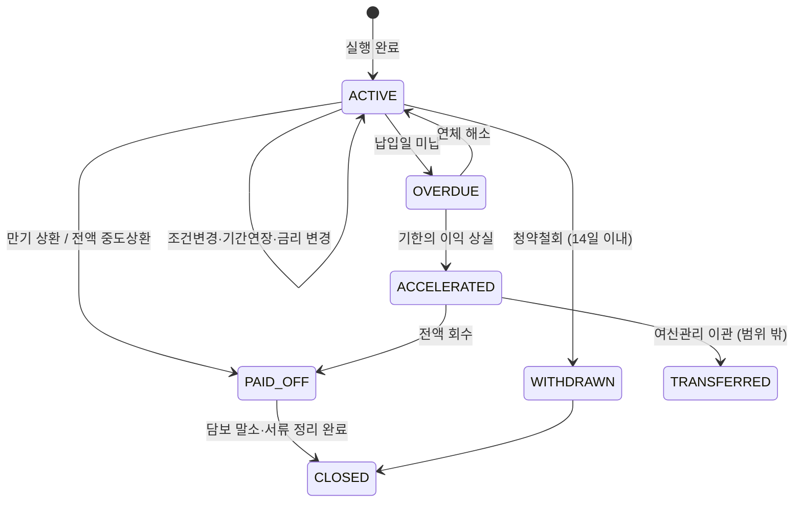

# 대출관리(사후 관리) 서비스 기획서

| 항목 | 내용 |
|---|---|
| 문서 | 대출 서비스 > 실행 후 대출관리 업무 로직 및 구현 기획서 |
| 버전 | v0.3 (공유 검토본) |
| 표기 원칙 | 은행명은 'OO은행'(본문에서는 '당행')으로 씁니다. 본문에 나오는 실제 기관·제도·회사 이름(신용평가회사, 보증기관, 시세 제공처, 정책자금 상품명 등)은 업무를 설명하기 위한 공개 정보 기준 예시이며 제휴·승인 관계를 뜻하지 않습니다. 금리·한도·기준값은 모두 예시이고, 법령·약관 내용은 요약이므로 실제 적용 전 법무·준법감시 확인이 필요합니다. |
| 작성일 | 2026-11-04 |
| 위치 | docs/loan/ 루트 (대출·대환 공통 문서) |
| 상위 문서 | [Loan_Service_main.md](Loan_Service_main.md) (공통 로직: 4~10장). **이 문서만 읽어도 되도록**, 다른 문서에서 정의한 로직은 각 기능 아래 **"공통 (… 와 동일)"** 제목으로 그대로 옮겨 적었고, 대출관리에서 더하거나 바꾼 내용은 **"<추가>"** 표로 따로 적었습니다 |
| 관련 문서 | [일반대출](Loan_Service/일반대출_기획서.md) · [정부대출](Loan_Service/정부대출_기획서.md) G15 · [기관대출](Loan_Service/기관대출_기획서.md) I16 · [대환대출](Refinancing_Service/대환대출_기획서.md) R16~R18 |
| 사용 서류 | LN-25 중도상환 신청서, LN-26 금리인하요구 신청서, LN-27 청약철회 신청서, LN-28 조건변경(기간연장) 신청서, LN-08·RF-11 자동이체 동의서, LN-09·RF-12 상환 스케줄표 (양식 폴더: [Loan_Service/Contract Document](<Loan_Service/Contract Document>), [Refinancing_Service/Contract Document](<Refinancing_Service/Contract Document>)) |

> **읽는 법**: 각 기능(M01~M12)은 "역할 → 공통 (다른 문서와 동일한 로직) → <추가> (대출관리 고유 내용)" 순서입니다. <추가> 표의 `구분` 칸은 공통 로직에 새로 더한 것이면 **추가**, 공통 로직을 대출관리에 맞게 바꾼 것이면 **변경**입니다.

---

## 1. 개요

### 1.1 목적
대출이 실행된 뒤(`COMPLETED` 상태부터) 상환이 끝날 때까지 고객이 대출을 조회·변경·상환하고, 은행이 납입·연체·금리 변경·업무별 의무를 관리하는 로직을 정의합니다. **네 업무(일반·정부·기관·대환)의 실행 후 단계가 모두 이 문서로 이어집니다.**

### 1.2 범위
| 포함 | 제외 |
|---|---|
| 대출 현황·스케줄 조회, 납입 처리, 연체 관리, 변동금리 재산정, 중도상환, 금리인하요구, 청약철회, 조건변경·기간연장, 자동이체 변경, 증명서 발급, 완제·담보 말소, 업무별 사후 의무(정부 의무 점검, 기관 보증·협약, 대환 사후 확인) | 채권 추심 실무, 법적 절차(경매 등), 부실채권 매각 (별도 여신관리 업무) |

### 1.3 공통 설계 원칙 (main 1.4와 동일)
| 원칙 | 내용 |
|---|---|
| 결정은 규칙 엔진, 설명은 LLM | 수수료, 금리, 수용 여부, 연체 단계는 결정적 계산만 씁니다. LLM 출력은 항상 검증을 거칩니다 |
| 동의 없이 조회하지 않음 | 재조회(신용, 행정정보, 재직)는 동의 확인을 통과해야 호출됩니다 |
| 고객 이익 우선 | 안내·견적은 고객 부담 기준으로 보여 줍니다 |
| 규칙은 데이터 | 수수료율, 면제 규칙, 연체 단계, 연장 자격은 버전 관리되는 규칙 테이블에 둡니다 |
| 재현 가능 | 같은 입력과 같은 규칙 버전이면 같은 결과가 나와야 하며, 근거를 모두 기록합니다 |
| 실패해도 안전하게 | 외부 연동이나 LLM이 실패하면 진행을 멈추거나 정해진 대체 경로로 갑니다 |

**<추가> 대출관리 원칙**
| 구분 | 원칙 |
|---|---|
| 추가 | 고객에게 불리한 조치(기한의 이익 상실, 금리 전환, 정책자금 회수)는 **자동으로 확정하지 않습니다.** 사전 통지와 소명·선택 기간을 반드시 거칩니다 |
| 추가 | 돈이 나가는 처리(중도상환 출금, 청약철회 반환)는 견적을 고객이 확인한 뒤에만 실행합니다 |

### 1.4 관리 기능 한눈에 보기
| 코드 | 기능 | 시작 주체 | 주기 | 서류 |
|---|---|---|---|---|
| M01 | 대출 현황·상환 스케줄 조회 | 고객 | 수시 | LN-09, RF-12 |
| M02 | 납입 처리 (자동이체·급여공제·즉시 납입) | 시스템 | 납입일 | LN-08, LN-23 |
| M03 | 연체 관리·기한의 이익 상실 통지 | 시스템 | 일 배치 | - |
| M04 | 변동금리 재산정 | 시스템 | 금리 변동 주기 | - |
| M05 | 중도상환 (일부·전액) | 고객 | 수시 | LN-25 |
| M06 | 금리인하요구 | 고객 | 수시 | LN-26 |
| M07 | 청약철회 | 고객 | 실행 후 14일 이내 | LN-27 |
| M08 | 조건변경·기간연장 | 고객 / 시스템(만기 안내) | 수시 / 만기 전 | LN-28 |
| M09 | 자동이체 계좌 변경 | 고객 | 수시 | LN-08 |
| M10 | 증명서 발급 (잔액증명, 이자납입증명) | 고객 | 수시 | - |
| M11 | 완제·담보 말소 | 시스템 | 상환 완료 시 | - |
| M12 | 업무별 사후 관리 (정부·기관·대환) | 시스템 | 업무별 | LN-21, LN-22, LN-24 |

### 1.5 대출 계좌 상태


---

## 2. 기능별 상세 설계

### M01. 대출 현황·상환 스케줄 조회

**역할**: 고객이 보유 대출의 잔액, 금리, 다음 납입, 스케줄, 서류를 한 화면에서 봅니다.

**화면**: 대출 목록 (상품, 잔액, 금리, 다음 납입일·금액, 상태 배지), 상세(상환 스케줄, 납입 내역, 금리 변경 이력, 계약서류 보관함)

#### 공통 (main 6.3 상환 스케줄 생성기, main 9.1 문서 보관함과 동일)
| 공통 기능 | 내용 |
|---|---|
| 상환 스케줄 생성 | 만기일시·원리금균등·원금균등 공식, 거치 기간, 휴일이면 다음 영업일로 조정, 첫 회차는 실행일~첫 납입일 일할 이자, 보증료는 별도 행. 화면과 LN-09·RF-12 PDF가 같은 데이터를 씀 |
| 계약서류 보관함 | 고객별 보관함에 약정서·설명서·약관·스케줄표 PDF 보관, 내려받기·이메일 교부. 생성 PDF는 해시로 고정 |

**<추가> 조회 데이터**
| 구분 | 출력 데이터 | 출처 |
|---|---|---|
| 추가 | 잔액, 납입 내역, 연체 여부 | 계정계 |
| 추가 | 적용 금리 구성 (기준 + 가산 − 우대), 다음 금리 변경일 | `pricing`·`rate_change` 이력 |
| 추가 | 정부: 다음 의무 점검일 / 기관: 보증 만기·협약 상태 / 대환: 기존 대출 완제 결과, 누적 절감액 | 업무별 사후 관리 테이블 (M12) |

#### 공통 (main 8.3 LLM 공통 규칙, main 7.3 V3 수치 검증과 동일)
| 규칙 | 내용 |
|---|---|
| 개인정보 마스킹 | 주민번호·계좌·카드·전화번호·이름·주소는 호출 전 토큰 치환, 응답 후 복원 |
| 출력 구조화 | 모든 출력은 JSON 스키마, 실패 시 1회 재시도 후 대체 처리 |
| V3 수치 일치 | 출력 문장 속 모든 숫자를 추출해 입력 데이터(계산값)와 비교. 금리는 소수 둘째 자리, 금액은 원 단위까지 같아야 함. 다르면 LLM 문장을 쓰지 않음 |
| 근거 강제 | RAG 답변에는 근거 문서 ID·조항을 포함, 근거가 없으면 답하지 않음 |
| 시간 제한 | RAG 질의응답 10초, 넘으면 대체 처리 |

**<추가> LLM 활용 (MLLM-1: 대출 관리 상담)**
| 구분 | 항목 | 내용 |
|---|---|---|
| 추가 | 용도 | "이번 달 왜 이자가 늘었어요?" 같은 질문에 답변 |
| 추가 | 입력 | 금리 변경 이력·스케줄·납입 내역 (요청 단위 입력, 색인하지 않음) + 약관·상품설명서 RAG |
| 추가 | 대체 처리 | 수치 검증 실패·근거 없음 → 상담원 연결 |

**<추가> 대출 목록 카드의 표시 순서**
| 순서 | 항목 | 예시 |
|---|---|---|
| 1 | 상품명 + 상태 배지 | OO 직장인 신용대출 · 정상 |
| 2 | 계약 번호 · 업무 · 실행일(경과 개월) | LA-2025-000123 · 일반대출 · 실행 2025.03.10 |
| 3 | **대출 계좌번호** (잔액 바로 위) | 대출 계좌번호 123-456789-01234 |
| 4 | 대출 잔액 (큰 글씨) | 21,400,000원 |
| 5 | 금리 · 다음 납입일 · 월 납입액 · 만기 | 연 5.10% · 2026.11.14 · 567,512원 · 2030.03.08 |
| 6 | 기능 버튼 | 상환 스케줄, 중도상환, 금리인하요구, 청약철회, 기간연장, 증명서 발급 |

- 대출 계좌번호는 실행(C12) 때 계정계가 발급한 값이며, 실행 완료 통지 화면(C13)에도 같은 번호를 보여 줍니다.
- 화면 보기 방식은 main 3.6을 따릅니다. 대출관리 탭은 메인 화면에 속하므로 한 화면 전환(기본)에서는 탭 화면 전체를 쓰고, 분할 보기에서는 왼쪽 칸에 보입니다. 기능 창(스케줄·중도상환 등)은 어느 방식이든 아래에서 올라오는 작은 창으로 열립니다. 상단 ≡ 메뉴의 「대출관리」를 누르면 메뉴가 열린 같은 자리에 대출관리 탭이 열립니다(main 3.6).

**<추가> 상환 스케줄 표 (M01 상세 화면)**
| 구분 | 항목 | 내용 |
|---|---|---|
| 추가 | 계산 범위 | 현재 잔액에서 시작해 **잔액이 0원이 되는 마지막 회차까지 남은 회차를 전부** 계산 (일부만 보여 주지 않음) |
| 추가 | 표 높이 | 머리글 + **6회차 분량**만 보이도록 높이를 맞추고, **7회차부터는 표 안을 아래로 스크롤**해서 확인. 머리글(회차·납입일·원금·이자·납입액·잔액)과 합계 줄은 스크롤해도 고정 |
| 추가 | 표 위 요약 | 대출 계좌번호, 상환 방법, 금리, 납입 완료 회차, 남은 회차, 남은 원금, 남은 이자(예상) |
| 추가 | 합계 줄 | 남은 원금 합계(= 현재 잔액), 남은 이자 합계, 총 납입액, 최종 잔액 0원 |
| 추가 | 안내 문구 | "7회차부터는 표 안을 아래로 스크롤해서 확인하세요 (마지막 회차 잔액 0원)", "변동금리는 금리 변경 시 다시 계산됩니다 (M04)" |
| 유지 | 데이터 출처 | 화면 표와 LN-09·RF-12 상환 스케줄표 PDF는 같은 스케줄 생성기 결과를 씀 |

**전체 스케줄 계산 규칙**
```
납입 완료 회차 p = 실행일부터 오늘까지 지난 개월 수 (최대 대출 기간 − 1)
남은 회차 n = 대출 기간 − p
월 금리 r = 적용 금리 ÷ 12
for k = 1 .. n:
   이자 = 직전 잔액 × r
   원금 = 원리금균등: 월 납입액(현재 잔액, 금리, n) − 이자
          원금균등:   현재 잔액 ÷ n
          만기일시:   마지막 회차에만 잔액 전부, 나머지 회차는 0
   마지막 회차는 원금 = 남은 잔액 (반올림 차이를 정리해 잔액을 정확히 0원으로)
   잔액 = 직전 잔액 − 원금
   납입일 = 실행일 + (p + k)개월 (휴일이면 다음 영업일)
검증: Σ 원금 = 현재 잔액, 마지막 회차 잔액 = 0
```
- 중도상환(M05)·금리 변경(M04)·기간연장(M08)이 생기면 위 규칙으로 스케줄을 처음부터 다시 만듭니다.

---

### M02. 납입 처리

**역할**: 납입일에 원리금을 받아 충당하고, 실패하면 연체 관리로 넘깁니다.

**<추가> 처리 로직** (공통 로직 없이 대출관리 고유)
```
납입일 배치 (영업일 기준, 휴일이면 다음 영업일):
  for 납입 예정 건:
     방식 = 급여공제(LN-23) → 자동이체(LN-08) → 고객 즉시 납입 순
     급여공제: 협약기관 공제 입금 확인 → 미입금 시 자동이체로 전환
     자동이체: 출금 시점 설정(당일/1영업일 전), 잔액 부족 설정(부분 출금/미출금)
     성공 → 원금·이자 충당 (지연배상금 → 이자 → 원금 순)
     실패 → 재출금 규칙(설정) → 최종 실패 시 M03
  납입 결과 알림
```

**<추가> 처리 규칙**
| 구분 | 항목 | 내용 |
|---|---|---|
| 추가 | 타행 자동이체 | 금융결제원 CMS 결과 파일을 받아 처리 |
| 추가 | 충당 순서 | 지연배상금 → 이자 → 원금 |
| 추가 | 알림 | 납입 성공·실패를 앱·문자로 통지 (main 10.1 알림·이벤트 모듈 사용) |

---

### M03. 연체 관리·기한의 이익 상실 통지

**역할**: 연체 일수에 따라 단계별로 안내·처리하고, 기한의 이익 상실 전에 반드시 사전 통지합니다.

#### 공통 (여신거래기본약관 LN-01 제5조·제7조, 대출거래약정서 LN-12 제5조와 동일)
| 조항 | 내용 |
|---|---|
| 지연배상금 | 약정 금리에 관계 법령이 허용하는 가산율 이내(약정서: 약정 금리 + 연 3%p, 법정 최고 금리 연 20% 이내)로 부과, 부과 전에 연체 사실과 내용 안내 |
| 기한의 이익 상실 (통지 없이) | 고객 재산에 압류·가압류·강제집행 개시, 파산·회생 신청 |
| 기한의 이익 상실 (지체) | 이자를 1개월 이상 지체(주택담보대출 2개월), 분할상환금을 2회 이상 연속 지체(주택담보대출 3회)하면 기한의 이익 상실 — 독촉 절차 없이 아래 사전 통지만 함 |
| 기한의 이익 상실 (독촉 후) | 대출금 용도 외 사용, 허위 자료 제출 등 그 밖의 사유는 상당한 기간을 정해 서면으로 독촉한 뒤 그 기간이 지나면 상실 |
| 사전 통지 | 은행은 기한의 이익 상실 3영업일 전까지 그 사실과 효과를 채무자에게 알림 |
| 주의 | 위 내용은 가계용 여신거래기본약관의 구조를 요약한 것입니다. 정확한 기간·횟수는 표준약관 원문 기준으로 확인합니다 |

**<추가> 연체 단계 (예시, 설정값)**
| 구분 | 연체 일수 | 처리 | 고객 안내 |
|---|---|---|---|
| 추가 | 1일 | 연체 표시, 지연배상금 계산 시작 | 연체 사실, 지연배상금률, 납입 방법 |
| 추가 | 5일 | 재안내 | 신용정보 등록 가능성 안내 |
| 추가 | 일정 기간 경과 (약관 기준) | 기한의 이익 상실 **사전 통지** (상실 3영업일 전까지, 서면 포함) | 상실 예정일, 효과(전액 상환 의무), 해소 방법 |
| 추가 | 상실 사유 충족 + 통지 기간 경과 | `ACCELERATED`, 담당 부서 이관 | 상실 사실 통지 |

**<추가> 업무별·기타 규칙**
| 구분 | 항목 | 내용 |
|---|---|---|
| 추가 | 보증부 (기관 A) | 연체 일수 기준에 따라 보증기관에 연체 통보 |
| 추가 | 정책자금 (정부) | 정책기관 보고 기준에 따라 보고 |
| 추가 | 채무조정 안내 | 연체 고객에게 은행 자체 채무조정, 신용회복위원회 제도 등 선택지 안내 |
| 변경 | 안내문 작성 | 고정 템플릿 사용. LLM은 쉬운 설명 보조(MLLM-2)로만 씀. 연체 금액·일수는 계정계 값만 사용 |

---

### M04. 변동금리 재산정

**역할**: 금리 변경일에 변동금리 대출의 금리를 다시 정하고 스케줄을 갱신합니다.

#### 공통 (main 6.3 금리·비용 엔진, 일반대출 S08과 동일)
```
최종 금리 = 기준금리(고시값, 고시일 기록) + 가산금리 − 우대금리
제약: 상품 하한 ≤ 최종 금리 ≤ min(상품 상한, 법정 최고 금리 연 20%)
```
| 업무 | 기준금리 | 가산금리 | 우대금리 |
|---|---|---|---|
| 일반 | COFIX·금융채 등 | 등급별 리스크 + 원가 + 이익 | 거래 실적 |
| 정부 | 정책 금리표 (소득 구간·만기) | 없음 | 정책 우대 (신혼, 다자녀 등) |
| 기관(A) | 상품 기준 | 보증으로 낮아진 리스크 반영 | 거래 실적 |
| 기관(B) | 협약 금리표 | 협약 조건 | 협약 우대 |
| 대환 | 대환 상품 기준 | 위와 같음 | 위와 같음 |

- 우대 조건은 "현재 충족"과 "약속(향후 충족 예정)"으로 나눠 저장하고, 약속 조건을 못 지키면 다음 금리 변경일에 해당 우대금리가 빠집니다(일반대출 S08, 약정서 제3조).

**<추가> 재산정 처리**
```
금리 변경일 도래 건:
   새 기준금리 = 기준금리 종류의 변경일 고시값 (고시일 기록)
   새 금리 = 새 기준금리 + 가산금리 − 우대금리(현재 충족 조건만)
     └ 우대 조건 미충족(급여이체 해지 등) → 해당 우대 제외
     └ 정부: 정책 금리표 변경분 / 기관(B): 협약 금리표 유효 여부
   제약 적용 → 스케줄 재생성 → 고객 알림
```
| 구분 | 항목 | 내용 |
|---|---|---|
| 변경 | 우대금리 판단 | 재산정 시점에 **현재 충족한 조건만** 반영 |
| 추가 | 고객 알림 | 변경 전·후 금리, 월 납입액 변화 |
| 추가 | 기록 | `rate_change`에 변경일, 이전·새 금리, 기준금리 고시값, 사유 저장 |

---

### M05. 중도상환 (LN-25)

**역할**: 고객이 만기 전에 대출금 일부 또는 전부를 갚습니다.

#### 공통 (여신거래기본약관 제10조, 상품설명서 LN-10과 동일)
| 항목 | 내용 |
|---|---|
| 중도상환 권리 | 고객은 언제든 일부 또는 전부를 갚을 수 있음 |
| 중도상환수수료 | 상환 금액 × 수수료율 × 남은 기간 ÷ 대출 기간 |
| 면제 | 대출 계약일로부터 3년이 지나면 부과하지 않음 |

#### 공통 (main 7.3 V8 규칙 재계산과 동일한 원리)
| 검증 | 내용 |
|---|---|
| V8 규칙 재계산 | 고객에게 보여 주기 직전에 규칙 엔진으로 한 번 더 계산해 앞선 결과와 같은지 확인. 다르면 처음부터 다시 계산 |

**<추가> 입력 항목**
| 구분 | 필드 | 검증 |
|---|---|---|
| 추가 | 구분 (전액/일부) | 필수 |
| 추가 | 상환 원금 | ≤ 잔액 |
| 추가 | 상환 희망일 | ≥ 오늘, 영업일 |
| 추가 | 일부 상환 후 처리 | 월 납입액 감소 / 기간 단축 |
| 추가 | 출금 계좌 | 계좌 실명 확인 (공통 플랫폼) |

**<추가> 처리 로직**
```
중도상환수수료 = 상환 원금 × 수수료율 × 남은 기간 ÷ 대출 기간
   면제: 계약일로부터 3년 경과 / 상품별 연간 면제 한도 이내 / 청약철회·위법계약 해지
상환 총액 = 상환 원금 + 상환일까지 경과 이자 + 중도상환수수료 (+ 미납 지연배상금)
견적 화면 → 고객 확인 → 출금 → 충당 → 스케줄 재생성
전액이면 → M11 완제 처리
```
| 구분 | 항목 | 내용 |
|---|---|---|
| 추가 | 면제 사유 | 3년 경과 외에 상품별 연간 면제 한도, 청약철회·위법계약 해지 |
| 변경 | 견적 검증 | V8 원리를 견적에 적용: 수수료·이자를 **독립 계산 모듈**로 다시 계산해 같은지 확인 |
| 추가 | 정책자금 | 전액 상환 후 같은 계열 정책자금 재이용 제한 고지 |
| 추가 | 보증부 | 보증 해지, 남은 보증료 반환 처리 (보증기관 기준) |

---

### M06. 금리인하요구 (LN-26)

**역할**: 신용 상태가 좋아진 고객의 금리 인하 요구를 심사하고 10영업일 안에 결과를 알립니다.

#### 공통 (main 5.4 증빙 처리 파이프라인과 동일)
```
업로드 → 파일 검사(형식·크기·악성) → OCR → 문서 유형 판별(LLM 분류) → 필드 추출(LLM-3)
→ 양식 검증 → 명의·일치 검증 → 교차 검증(조회 데이터 대비) → 정상: 저장 / 결함: 결함 코드 → 보완 요청
```
| 결함 코드 (주요) | 내용 |
|---|---|
| `DOC-EXPIRED` | 발급일 기준 1개월 경과 |
| `FIELD-BLANK` / `SIGN-MISSING` | 필수 칸 공란 / 서명·직인 없음 |
| `NAME-MISMATCH` | 명의자 ≠ 신청인 |
| `VALUE-MISMATCH` | 서류 값과 조회 값 차이가 허용 범위(기본 ±10%) 초과 |
| `ALTERED` | 수기 정정·위변조 의심 |

- LLM 추출 값은 공공 연동 값보다 우선하지 않습니다(데이터 우선순위: 공공 연동 > 서류 > 고객 진술).

#### 공통 (main 6.2 심사 엔진 3단계 신용평가와 동일)
| 단계 | 내용 |
|---|---|
| 신용 재조회 | 동의 게이트 통과 후 CB·한국신용정보원 조회 (main 5.1·5.3) |
| 신용평가 | CSS 점수 = f(CB 점수, 내부 거래 실적, 소득, 직업 안정성) → 등급 1~10 |

#### 공통 (일반대출 LLM-6 거절 사유 설명 검증과 동일)
| 검증 | 내용 |
|---|---|
| 사실 누락 | 고정 템플릿의 핵심 사실(사유, 근거 정보)이 빠지지 않았는지 |
| 수치 일치 | 설명 속 수치가 입력과 같은지 |
| 표현 | 차별적·단정적 표현이 없는지 |
| 실패 시 | 고정 템플릿만 표시 |

**<추가> 처리 로직**
```
신청(사유 선택 + 증빙 업로드) → 증빙 파이프라인
→ 신용정보 재조회 → 신용평가만 다시 실행 → 새 등급
→ 새 등급의 가산금리 < 현재 가산금리 이면 수용, 아니면 불수용(사유 코드)
→ 신청일로부터 10영업일 이내 결과 통지 (수용 시 다음 이자 계산 기간부터 적용)
```
| 구분 | 항목 | 내용 |
|---|---|---|
| 변경 | 심사 범위 | 심사 엔진 8단계 중 **신용평가 단계만** 다시 실행 |
| 추가 | 수용 기준 | 새 등급 가산금리 < 현재 가산금리 |
| 추가 | 통지 기한 | 신청일로부터 10영업일 이내 (은행법) |
| 추가 | 대상 제외 | 정책자금, 예금담보 등은 신청 화면에서 미리 안내 |
| 추가 | 정기 안내 | 연 2회 이상 금리인하요구권 안내 알림 |
| 추가 | 불수용 안내 | LLM-6 검증을 거친 쉬운 설명(MLLM-2) + 고정 사유 문구 병기 |

---

### M07. 청약철회 (LN-27)

**역할**: 실행 후 14일 이내 고객의 계약 철회를 처리합니다.

#### 공통 (여신거래기본약관 제12조, 금융소비자 권리 안내서 LN-11과 동일)
| 항목 | 내용 |
|---|---|
| 철회 기간 | 계약서류를 받은 날과 대출 실행일 중 늦은 날로부터 14일 이내 |
| 반환 금액 | 대출 원금 + 그 기간의 약정 이자 + 은행이 제3자에게 낸 부대비용(인지세, 담보 설정 비용 등) |
| 효력 | 철회 의사 표시 + 반환 금액 전부 반환 시 |
| 불이익 | 중도상환수수료 없음 |
| 제한 | 같은 금융사 1개월 내 2회 이상 철회 등 남용 시 신규 대출 불이익 가능 |

**<추가> 처리 로직**
```
신청 가능 여부: 오늘 ≤ max(계약서류 수령일, 실행일) + 14일
반환 금액 계산 (+ 보증료 처리) → 반환 완료 → WITHDRAWN
→ 담보·보증 말소·해지 → 신용정보 반영 처리
```
| 구분 | 항목 | 내용 |
|---|---|---|
| 추가 | 대환대출 철회 | 기존 대출이 이미 완제되어 되살아나지 않으므로 대출금 전액을 직접 돌려주어야 함을 신청 전에 다시 확인받음 |
| 추가 | 남용 경고 | 1개월 안 2회 이상 철회 고객에게 경고 안내 |
| 추가 | 보증료 | 보증부 대출은 보증기관 기준 반환분을 차감해 계산 |

---

### M08. 조건변경·기간연장 (LN-28)

**역할**: 만기 연장, 상환 방법·납입일·금리 유형 변경을 처리합니다.

#### 공통 (main 6.2 심사 엔진 8단계 파이프라인과 동일)
| 순서 | 단계 | 공통 로직 |
|---|---|---|
| 1 | 결격(KO) | 현재 연체, 신용회복·회생, 명의도용, 금융질서 문란, 폐업 |
| 2 | 소득 확정 | 공공 연동 > 서류 > 고객 진술 순으로 채택, 불일치면 보완 또는 낮은 값 |
| 3 | 신용평가 | CSS 점수 → 등급 |
| 4 | DSR | 아래 공식 |
| 5 | 담보·보증 | 담보 가치 × LTV − 선순위 − 공제액 |
| 6 | 한도 | min(상품, 소득, DSR 여유, 담보, 등급) |
| 7 | 판정 | 승인 / 조건부 / 보완 / 거절 |
| 8 | 수기 심사 분기 | 고액, 플래그 다수, 경계 점수 → 심사역 배정 |

```
DSR = (Σ 유지되는 기존 대출 연간 원리금 + 신규 대출 연간 원리금[금리 + 스트레스 가산]) ÷ 확정 연 소득
만기일시 대출의 연간 원금 = 원금 ÷ 규제상 인정 만기 (reg_param)
```

#### 공통 (정부대출 G04 정책 자격 검증과 동일)
| 검증 | 데이터 출처 | 판단 |
|---|---|---|
| 세대 구성 | 주민등록 (행정정보) | 세대주 여부, 세대원 |
| 무주택 | 주택 소유 정보 (세대원 전원) | 소유 0건 (예외는 `policy_rule`) |
| 소득 | 국세청·건강보험 (본인 + 배우자) | 부부합산 ≤ 기준 |
| 자산 | 공시가격·자동차·금융자산 | 순자산 ≤ 기준 |
| 대상물 | 계약서, 공시가격, 면적 | 가격·면적·보증금 ≤ 지역 기준 |
| 중복 이용 | 정책기관 조회 | 같은 계열 정책 대출 보유 여부 |

결과는 항목별 PASS / FAIL(사유) / UNKNOWN(서류로 대체)입니다.

#### 공통 (기관대출 I04-A 보증 대상 확인, I04-B 소속·재직 확인과 동일)
| 유형 | 확인 | 방식 |
|---|---|---|
| A 보증부 | 주택 유형, 지역별 보증금 상한, 선순위 채권 + 보증금 ≤ 주택 가격 × 기준 비율, 임대인 = 등기부 소유자, 계약 기간 | `guarantee_rule` 평가 |
| B 협약 | 재직 여부·입사일·고용 형태 | 협약기관 API → 건강보험 직장 정보 → 재직증명서(OCR) → 기관 담당자 확인 순 |

**<추가> 변경 항목별 처리**
| 구분 | 항목 | 처리 |
|---|---|---|
| 변경 | 만기 연장 | 만기 일정 기간 전(예: 2개월) 안내 → 신청 → 위 8단계 파이프라인을 **연장 모드**로 재심사(결격·신용·DSR·담보 재평가) → 승인 / 조건부(일부 상환) / 거절 → 변경 약정 |
| 추가 | 상환 방법·납입일 변경 | 상품 허용 범위 확인 → 스케줄 재생성 → 변경 약정 |
| 추가 | 금리 유형 변경 | 상품 허용 시만, 새 금리 산출 후 고객 확인 |

**<추가> 업무별 연장 조건**
| 구분 | 업무 | 연장 시 추가 확인 |
|---|---|---|
| 추가 | 정부 | 연장 시점 정책 자격 재확인 (G04 규칙의 연장 기준 버전), 의무 이행 이력 |
| 추가 | 기관(A) | 보증 연장 신청·승인, 갱신 임대차계약서(확정일자) |
| 추가 | 기관(B) | 실행일과 같은 재직 확인, 협약 유효 여부 |
| 추가 | 대환 | 일반 대출과 같음 (대환 이력은 참고 정보) |

---

### M09. 자동이체 계좌 변경

**역할**: 원리금 출금 계좌를 바꿉니다.

**<추가> 처리 규칙** (공통 로직 없이 대출관리 고유, 계좌 실명 확인만 공통 플랫폼)
| 구분 | 항목 | 내용 |
|---|---|---|
| 추가 | 처리 순서 | 새 계좌 실명 확인 → 출금 동의(LN-08) 재작성 → 다음 납입일부터 적용 |
| 추가 | 적용 시점 | 납입일 직전(예: 2영업일 이내) 변경은 다음 회차부터 적용된다고 안내 |

---

### M10. 증명서 발급

**역할**: 고객이 대출 관련 증명서를 발급받습니다.

#### 공통 (main 9.1 문서 생성·보관과 동일)
| 기능 | 내용 |
|---|---|
| 양식 채우기 | 확정 데이터를 양식에 넣어 PDF 생성 |
| 고정 | 생성 PDF 해시 저장 |
| 보관함 | 고객별 보관함, 내려받기, 이메일 교부 |

**<추가> 증명서 종류**
| 구분 | 증명서 | 내용 | 용도 |
|---|---|---|---|
| 추가 | 대출 잔액증명서 | 잔액, 금리, 실행·만기일, 연체 여부 | 다른 금융사 대환, 제출용 |
| 추가 | 이자 납입증명서 | 연간 납입 이자·원금 | 주택담보대출 이자 소득공제 등 |
| 추가 | 완제 확인서 | 상환 완료일, 담보 말소 여부 | 대환·말소 확인 |
| 추가 | 진위 확인 | 발급 번호·해시 기록 | 제출처 확인 |

---

### M11. 완제·담보 말소

**역할**: 잔액이 0이 되면 담보·보증·자동이체를 정리하고 계좌를 닫습니다.

#### 공통 (main 9.2 실행·사가와 동일)
| 항목 | 내용 |
|---|---|
| 사가 처리 | 여러 기관에 걸친 처리를 단계별 거래로 나누고, 실패 시 앞 단계를 되돌리는 보상 거래 정의 |
| 멱등 | 같은 요청 두 번 = 한 번 처리 |
| 단계 저장 | 장애 후 이어서 처리 |

#### 공통 (근저당권·질권·저당권 설정계약서 LN-13·15·16 말소 조항과 동일)
| 담보 | 말소 원칙 |
|---|---|
| 근저당 | 채무 전액 변제 시 지체 없이 말소 서류 교부 또는 말소 등기 |
| 예금 질권 | 대출금을 다 갚으면 바로 해지 |
| 자동차 저당 | 말소 서류 교부 또는 말소 등록 |

**<추가> 처리 로직**
```
잔액 0 확인 → PAID_OFF
담보: 근저당 말소(법무사·전자등기), 질권 해지, 자동차 저당 말소, 보증 해지
자동이체·급여공제 해지 → 완제 확인서 발급 → 신용정보 반영 확인(배치) → CLOSED
```
| 구분 | 항목 | 내용 |
|---|---|---|
| 추가 | 당행 대출이 대환 대상인 경우 | 다른 금융사가 상환해도 같은 절차. 대환 인프라의 상환 요청·완제 통보를 처리 |
| 추가 | 신용정보 반영 확인 | 완제 후 일정 기간 뒤 배치로 반영 여부 확인 |

---

### M12. 업무별 사후 관리

**역할**: 업무별 실행 후 의무와 이벤트를 관리합니다.

#### 공통 (정부대출 G15 사후 의무 점검과 동일)
```
obligation_check 등록: (contract_no, obligation_code, check_due_date, data_source)
배치(일 1회):
  for 점검일 도래 건:
     조회(전입 여부: 주민등록 / 주택 소유 변동: 주택 소유 정보)
     PASS → 다음 점검일 등록
     FAIL → POLICY_VIOLATION 후보 → 고객 소명 요청(기한) → 담당자 검토 → 회수·금리 가산 결정
```
| 의무 사항 (LN-21 예시) | 위반 시 (예시, 실제는 공고 기준) |
|---|---|
| 실행 후 정해진 기간 안 전입·실거주 | 대출금 회수 또는 금리 가산 |
| 대출 기간 중 추가 주택 취득 금지 | 대출금 회수 |
| 소득·자산 허위 신고 금지 | 회수 + 정책자금 이용 제한 |
| 임대차 계약 변경 시 신고 | 한도 조정 |
- 자동으로 회수·금리 가산하지 않고, 고객 소명 기회와 담당자 결정을 거칩니다. 점검 예정일 전에 미리(예: 30일 전) 알립니다.

#### 공통 (기관대출 I16 사후 관리 등록과 동일)
| 유형 | 사후 관리 항목 | 처리 |
|---|---|---|
| A 보증부 | 보증 만기·연장, 임대차 계약 변경, 연체 시 보증기관 통보, 보증 사고·대위변제 | 만기 전 연장 안내 배치, 연체 일수 기준 기관 통보 |
| B 협약 | 퇴직·휴직 통보 수신, 협약 해지, 급여 공제 실패 | 협약기관 통보 수신 → 고객 알림 → 약정에 따라 금리 전환 또는 상환 요청 (소명 기한 부여) |

협약대출 특약(LN-24 제2조): 통지 후 30일 안에 소명하거나 "일반 금리 전환 / 전부·일부 상환" 중 선택, 선택하지 않으면 다음 이자 계산 기간부터 일반 금리로 전환합니다. 휴직은 복직 예정일을 증빙하면 협약 금리를 유지할 수 있습니다(협약 허용 시).

#### 공통 (대환대출 R16~R18과 동일)
| 단계 | 내용 |
|---|---|
| R16 완제 확인 | 대출별 완제 확인 수신 → 담보 대환이면 말소 서류 수령 → 말소·설정 등기 완료 확인 → 기존 대출 자동이체 해지 안내 → 신용정보 반영 확인(배치) |
| R17 결과 통보 | 기존 대출 상환 결과, 금리·월 납입액 변화, 예상 절감액 통지. 청약철회 시 기존 대출 미복원 안내 |
| R18 종료 | 대출 관리로 연결, 대환 후 3·6·12개월 시점 실제 절감액 리포트 권장 |

**<추가> 대출관리에서의 운영 방식**
| 구분 | 업무 | 내용 | 서류 |
|---|---|---|---|
| 추가 | 정부 | 의무 점검 배치 운영, 점검 30일 전 안내, 소명 → 담당자 결정 화면 | LN-21 |
| 추가 | 기관(A) | 보증 만기 관리 배치, 보증 연장, 보증 사고 시 보증기관 청구·대위변제 처리 | LN-14 |
| 추가 | 기관(B) | 퇴직·휴직·협약 해지 통보 수신 웹훅 → 고객 통지 → 30일 선택 기간 → 일반 금리 전환 또는 상환 | LN-22, LN-24 |
| 추가 | 대환 | 완제 정보 반영 확인, 기존 대출 자동이체 해지 안내, **3·6·12개월** 실제 절감액 리포트 | - |

---

## 3. 공통 로직 사용 (main 문서 연결)

| main 공통 모듈 | 모듈이 하는 일 (main 요약) | 대출관리에서 쓰는 기능 |
|---|---|---|
| 5.1 동의 관리 | 모든 동의를 기록하고, 외부 조회 직전에 필요한 동의가 있는지 확인(동의 게이트) | 금리인하요구·연장 심사의 신용 재조회 동의, 출금 동의 재작성 |
| 5.3 외부 조회 게이트웨이 | 외부 기관 조회의 단일 창구. 동의 확인 → 캐시 → 호출(재시도·장애 차단) → 공통 형식 변환 → 출처 기록 → 마스킹 | 신용 재조회, 행정정보(정부 의무 점검), 협약기관 재직 확인, 보증기관 연장, 대환 인프라 상환 요청 |
| 5.4 증빙 처리 | 업로드 서류 OCR·LLM 추출, 결함 코드 판정, 조회 데이터와 교차 검증 | 금리인하요구 증빙, 연장 시 갱신 계약서 |
| 6.1 규칙 엔진 | 규제값·상품·정책·보증 기준을 버전 관리되는 데이터 규칙으로 실행, 사유 코드 기록 | 중도상환수수료 면제 규칙, 연체 단계 규칙, 연장 자격, 정책 의무 규칙 |
| 6.2 심사 엔진 | 결격 → 소득 → 신용 → DSR → 담보 → 한도 → 판정 → 수기 심사 8단계 | 금리인하요구(신용평가 단계만), 만기 연장(전체 재심사) |
| 6.3 금리·비용 엔진 | 기준 + 가산 − 우대 금리 계산, 실질 비용 정의, 상환 스케줄 생성 | 변동금리 재산정, 스케줄 재생성, 중도상환 견적 |
| 8 LLM 게이트웨이 | 자체 API로 외부 LLM 연동. 마스킹 → 프롬프트 → RAG → 호출 → 출력 검증 → 기록, 실패 시 대체 처리 | MLLM-1 관리 상담, MLLM-2 연체·불수용 쉬운 설명 |
| 9.1 문서 생성·보관 | 양식에 데이터를 넣어 PDF 생성·해시 고정·보관함 교부 | 증명서, 변경 약정서, 새 스케줄표 |
| 9.2 실행·사가 | 여러 기관에 걸친 처리를 단계별로 묶고 실패 시 보상 거래, 멱등 처리 | 전액 상환 + 담보 말소, 청약철회 반환 + 말소 |
| 10.1 알림 | 상태 변화 이벤트를 앱·문자 알림으로 발송 | 납입·연체·금리 변경·만기·의무 점검·금리인하요구 안내 |
| 10.2 감사 | 상태 전이, 규칙 실행, 조회, LLM 호출, 사람 판단을 재현 가능하게 기록 | 모든 변경·수수료 계산·고객 확인 기록 |

---

## 4. LLM 활용

#### 공통 (main 8장 LLM 게이트웨이 안전장치와 동일)
| 항목 | 규칙 |
|---|---|
| 호출 경로 | 업무 코드는 외부 LLM을 직접 부르지 않고 자체 게이트웨이 API(`/internal/llm/v1/invoke`)만 호출 |
| 모델 등급 | 분류·정규화는 경량 모델, 추출·요약·설명·RAG는 표준 모델 (모델 ID는 설정값) |
| 개인정보 | 호출 전 토큰 치환, 신용정보 원본은 보내지 않고 요약 수치만 전달, 제공사와 학습 미사용 계약 |
| RAG 색인 | 상품설명서·약관·FAQ만 색인. 고객 데이터는 색인하지 않고 요청 단위로만 전달 |
| 출력 | JSON 스키마, 숫자는 근거 필드와 함께, 실패 시 1회 재시도 |
| 금지 표현 | 단정적 약속, 과장, 차별, 동의 유도 차단 |
| 시간 제한 | 생성 3초, RAG 10초, 추출 15초 → 넘으면 대체 처리 |
| 기록 | 용도 ID, 모델, 프롬프트 버전, 입력 해시, 출력(마스킹), 검증 결과, 지연, 비용 |

**<추가> 대출관리 LLM 용도**
| 구분 | ID | 용도 | 결정 사용 | 검증·대체 |
|---|---|---|---|---|
| 추가 | MLLM-1 | 대출 관리 상담 (금리·납입·수수료 질문) | 아니오 | 수치 검증, 근거 없으면 상담원 |
| 추가 | MLLM-2 | 연체 안내·금리인하요구 불수용 사유 쉬운 설명 | 아니오 | 고정 문구 병기, 수치 검증 |
| 변경 | LLM-3 (공통) | 금리인하요구 증빙 추출 | 보조 근거 | 조회 데이터 우선 |

---

## 5. 데이터 모델 (추가분)

| 테이블 | 주요 컬럼 |
|---|---|
| `loan_account` | contract_no, **acct_no (대출 계좌번호, 목록에서 잔액 위에 표시)**, status, balance, rate, next_due_date, payment_method |
| `payment_txn` | contract_no, due_date, paid_at, amount, allocation(json: 지연배상금·이자·원금), method, result |
| `delinquency` | contract_no, start_date, days, amount, stage, notices(json) |
| `rate_change` | contract_no, effective_date, old_rate, new_rate, base_rate_snapshot, reason |
| `prepay_request` | contract_no, type, principal, fee, interest, total, requested_at, executed_at |
| `rate_cut_request` | contract_no, reasons, evidence_ids, result, reason_codes, notified_at |
| `withdrawal_request` | contract_no, deadline, refund_total, refunded_at |
| `term_change_request` | contract_no, items(json), review_id, result, new_contract_doc |
| `certificate` | cert_no, contract_no, type, issued_at, doc_hash |

공통 테이블(`contract`, `repayment_schedule`, `pricing`, `collateral`, `audit_log` 등)은 main 13.1을 그대로 씁니다.

## 6. API (주요)

| 메서드 | 경로 | 기능 |
|---|---|---|
| GET | `/loans/accounts` | M01 목록 |
| GET | `/loans/accounts/{no}` | M01 상세 (스케줄, 내역, 서류) |
| POST | `/loans/accounts/{no}/prepayment/quote` | M05 견적 |
| POST | `/loans/accounts/{no}/prepayment` | M05 실행 |
| POST | `/loans/accounts/{no}/rate-cut-requests` | M06 신청 |
| POST | `/loans/accounts/{no}/withdrawal` | M07 청약철회 |
| POST | `/loans/accounts/{no}/term-changes` | M08 조건변경·연장 |
| PUT | `/loans/accounts/{no}/auto-debit` | M09 계좌 변경 |
| POST | `/loans/accounts/{no}/certificates` | M10 증명서 발급 |
| POST | `/webhooks/cms/results` | M02 자동이체 결과 수신 |

공통 규약(main 13.2): 상태 변경 요청은 `Idempotency-Key` 헤더 필수, 오래 걸리는 심사(금리인하요구, 연장)는 `202 Accepted` + 상태 조회 + 알림, 오류는 `{ code, reason_codes[], message, retryable }`.

## 7. 테스트 시나리오

| ID | 시나리오 | 기대 결과 |
|---|---|---|
| MT01 | 실행 후 2년 6개월 시점 전액 중도상환 | 수수료 = 원금 × 율 × 남은기간/대출기간 |
| MT02 | 실행 후 3년 1개월 시점 중도상환 | 수수료 0원 |
| MT03 | 계약서류 수령일 = 실행일인 대출에서 실행일 + 15일에 청약철회 신청 (기한 = 실행일 + 14일) | 기한 경과로 신청 불가 (실행일 + 14일까지는 가능) |
| MT04 | 대환대출 청약철회 | 기존 대출 미복원 재확인 화면 표시 |
| MT05 | 급여공제 미입금 | 같은 달 자동이체 출금 전환 |
| MT06 | 연체 후 기한의 이익 상실 조건 충족 | 상실 3영업일 전 사전 통지 발송 후에만 `ACCELERATED` |
| MT07 | 승진 후 금리인하요구, 등급 상승 | 10영업일 이내 수용 통지, 다음 이자 기간 적용 |
| MT08 | 협약기관 퇴직 통보 수신 | 고객 통지, 30일 선택 기간 후 일반 금리 전환 |
| MT09 | 정책자금 전입 미확인 | 소명 요청, 자동 회수 없음 |
| MT10 | 전세 보증부 만기 연장, 갱신 계약서 확정일자 없음 | `MISSING-CERT` 보완 요청 |
| MT11 | 남은 40회차 대출의 상환 스케줄 열기 | 40회차 모두 계산, 6회차까지 보이고 나머지는 스크롤, 마지막 회차 잔액 0원, 원금 합계 = 현재 잔액 |

## 8. 미결 사항

| 번호 | 내용 | 결정 주체 |
|---|---|---|
| MMQ1 | 연체 단계별 일수 기준과 안내 채널 | 여신관리 |
| MMQ2 | 일부 중도상환 수수료 연간 면제 한도 여부 | 상품기획 |
| MMQ3 | 만기 연장 안내 시점과 자동 연장 허용 여부 | 상품기획 + 심사 |
| MMQ4 | 이자 납입증명서의 세법상 제출 양식 대응 | 세무 + IT |
